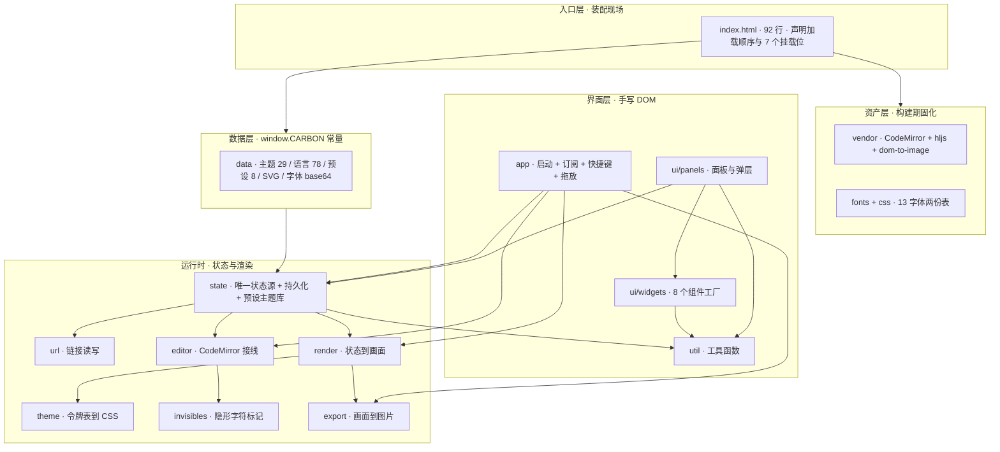
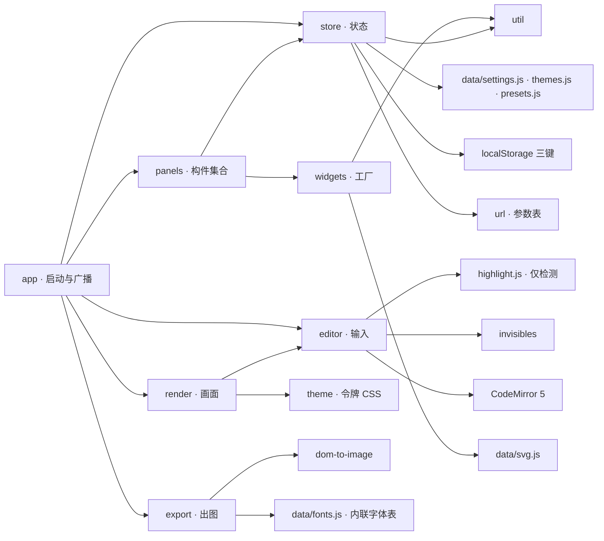
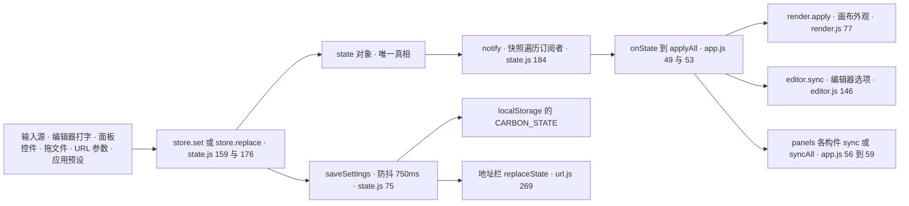
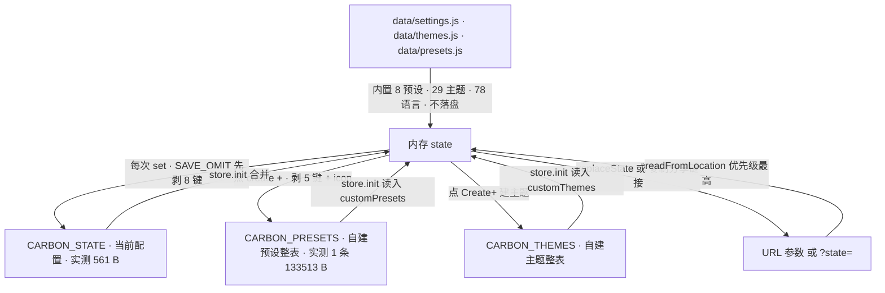
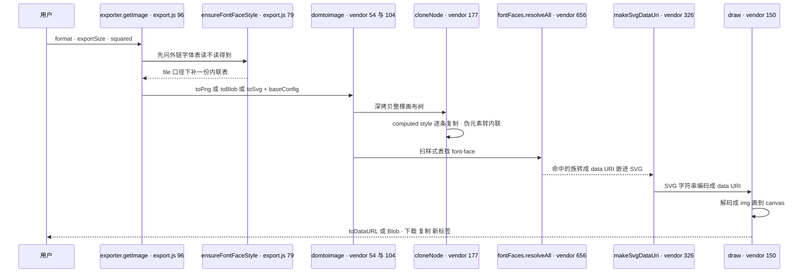
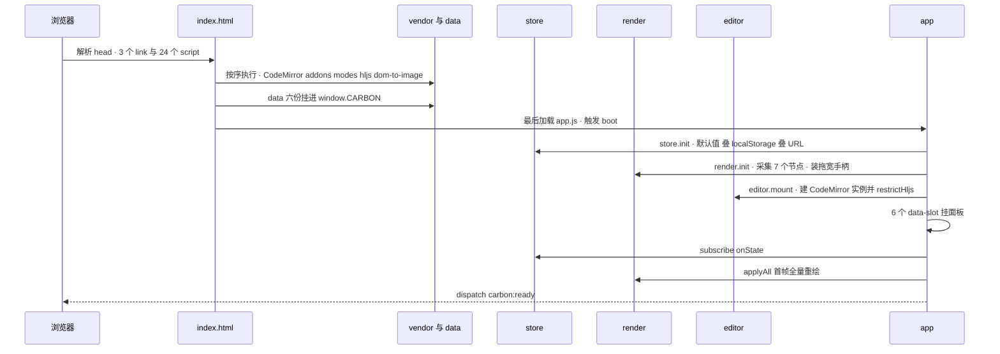
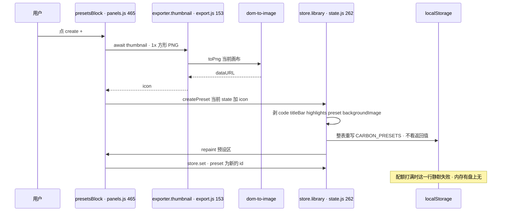
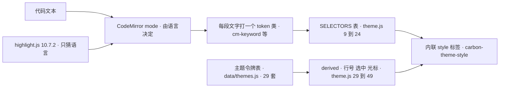
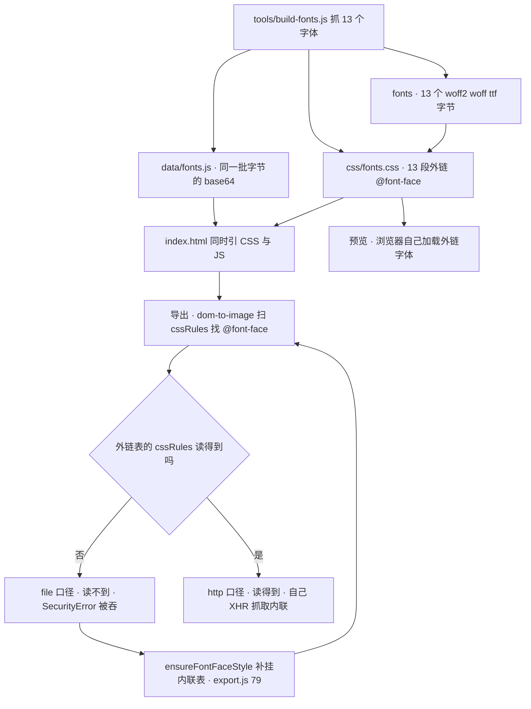

# carbon.now.sh 离线复刻 · 项目全景

> 读者设定：你从没碰过这个仓库，要在最短时间里知道**它是什么、为什么这样设计、代码在哪、数据怎么流、一张图是怎么从代码里长出来的**。
> 本文所有结论都带 `文件:行号`，可直接打开核对；数字后面标了它是**实测**（本文写作时跑过命令）还是**记录**（引自 `doc/运行与构建（T0Level）.md`）。运行与构建、验收判据的完整操作手册在 [doc/运行与构建（T0Level）.md](doc/运行与构建（T0Level）.md)，本文不重复命令细节。

---

## 0. 三分钟新人小结

**这是什么。** 一个能离线跑的 carbon.now.sh：左边敲代码，右边出一张带窗口圆点、阴影、水印的漂亮图片，可以下载、复制进剪贴板、或存成"预设"下次复用。

**它长什么样。** 双击仓库根的 `index.html` 就在浏览器里跑起来了。**没有 npm install，没有构建步骤，没有一行网络请求**——所有平时该从 CDN 拉的东西（CodeMirror、highlight.js、29 套主题色表、78 种语言、13 个编辑器字体）都已经下载好、拼成文件躺在仓库里。

**一个类比。** 线上版 carbon 像一家点外卖的餐厅：厨房（渲染逻辑）在自己手里，但米面油（依赖、字体、语言包）每天从供应商（CDN）进货。本工程是把供应商的货**一次性买断搬进自家仓库**，从此这家店没有外卖渠道也能开门——代价是仓库变大（1.89 MB）、进货流程要写成脚本（`tools/`），而且得留一套"真的没出过门"的检查（`tools/audit.js` + 7 个探针台）。

**读代码的正确顺序。** `index.html`（装配现场）→ `js/app.js`（启动顺序）→ `js/state.js`（唯一的真相来源）→ `js/render.js`（状态怎么变成画面）→ `js/export.js`（画面怎么变成图）。其余模块都是这五步的配角。

**最该先记住的一条架构约束。** 全部模块是 classic script，靠**加载顺序**而不是 import 图来确定依赖：`js/util.js` 一定在其它 `js/*` 之前，`js/app.js` 一定在最后。这条顺序错了不会报"模块找不到"，而是白屏或某个按钮静默失灵，所以它被 `tools/audit.js:171-185` 写成判据钉住了。

---

## 1. 项目原型

### 1.1 上游是谁

| 项 | 值 | 出处 |
| --- | --- | --- |
| 原型 | [carbon.now.sh](https://carbon.now.sh)，仓库 `carbon-app/carbon` | 页脚文案 `index.html:57-60` |
| 上游版本 | `main`，v4.9.10，MIT | `data/*` 每个生成文件的头注第 3 行 |
| 上游留存的参考源码 | `tools/upstream/`，33 个文件（实测 `ls \| wc -l`） | `tools/build-data.js:2-14` 用它作输入与逐字节比对基准 |
| 上游编辑器引擎 | CodeMirror **5.65.5** | `index.html:57-60` 页脚自述 + `vendor/README.md:24-31` |
| 上游语言检测 | highlight.js，上游依赖写 `^10.7.2` | 本工程钉 **10.7.2**（原因见 §3.3） |

### 1.2 复刻到哪一层：核心业务全留，外围全砍

用户最初的要求是"移除界面冗余内容聚焦核业务完整性"。落到代码上是一条一条的取舍：

| 面 | 线上有 | 本工程 | 为什么 |
| --- | --- | --- | --- |
| 编辑器 + 语法高亮 | ✓ | ✓ 同构 | 核业务的地基 |
| 主题 / 语言 / 字体 / 字号 / 行高 / 内边距 / 阴影 / 水印 / 窗口控件 / 行号 / 首行号 / 隐形字符 / 方形裁剪 | ✓ | ✓ 全留（25 个设置项，实测 `DEFAULT_SETTINGS` 键数 = 25） | 这些每一项都会改变最终图片，属于核业务 |
| 预设（8 内置 + 自建保存）、自建主题、选中行淡化、代码宽度拖拽 | ✓ | ✓ | 复用配置就是"把图片做稳定"的那半边 |
| PNG / SVG / 复制到剪贴板 / 新标签打开 | ✓ | ✓ | 输出面 |
| `?state=` 与逐参数分享链接 | ✓ | ✓ 读写两侧都保留（`js/url.js:57-110`） | 链接是"搬配置"的合法入口 |
| 账号、云端片段、计费、推荐、公告、Unsplash 图库、随机背景图、Tweet / Imgur 上传、PWA、embed、页脚外链、SelectionEditor | ✓ | ✗ | 用户点名移除；`js/app.js:41` 还专门给旧链接里的片段 id 留了一句提示 toast |
| prettier 美化 | ✓ | ✗ | prettier standalone 约 1 MB，且不改变图片内容 |
| 上游的字体获取方式 | 运行时从 Google Fonts 拉 | 13 个字体打进 `fonts/` + `css/fonts.css`，另存一份 base64 在 `data/fonts.js` | 零网络；两份的必要性见 §10.3 |

### 1.3 与上游"同构"到什么程度

同构不是"长得像"，而是**同样的输入要给出同样的输出**。工程里为此做过三类对照：

- **数据同构**：29 套主题 × 高亮令牌表、78 种语言、8 个内置预设的默认值，都从 `tools/upstream/` 逐字节搬到 `data/`，由 `tools/build-data.js` 生成并可 `--check` 复比（`tools/build-data.js:2-14`）。
- **行为同构**：语言自动检测钉 hljs **10.7.2**——同一默认代码 + 同一 57 语言白名单，10.7.2 判 `javascript (rel 21)`，11.9.0 判 `coffeescript (rel 18)`。换版本就是换结论，所以宁可不升级（`doc/运行与构建（T0Level）.md` ⑧.2 第 4 条）。
- **成图同构**：`file://` 与 `http://` 两个口径导出的 PNG **逐字相同**（实测 205541 / 85414 / 99631 / 31840 四档全等），SVG 只差 32 B 且差值能算平（`doc/运行与构建（T0Level）.md` ③.6）。

---

## 2. 创建目的与解决的问题

### 2.1 痛点：这类页面离开网络就废

原始诉求只有一句："复刻成一个单文件 html（复杂 js 和数据部分可单独在子目录区分存放）"。这句话背后要解决的，是**"依赖 CDN 的前端工具在离线/内网/审查环境里不可用"**。真实的困难按出现顺序是：

| # | 问题 | 表象 | 本工程的解法（章节） |
| --- | --- | --- | --- |
| 1 | 依赖要从 CDN 拿 | 断网时编辑器是空框、语言列表空 | 构建期下载并拼成 `vendor/*`，带 `来源/版本/字节/sha1` 内联标记（§4.3、§5.3） |
| 2 | `file://` 下不能 `fetch` 本地 JSON | 数据文件读不到，页面直接不启动 | 数据一律写成 `window.CARBON.X = …` 的 **classic script** 而不是 `.json`（§10.1） |
| 3 | `file://` 下外链样式表的 `cssRules` 抛 `SecurityError` | **预览字体对、导出图片却是系统字体**，不报错 | 把 13 个字体的 `@font-face` 再烘一份 data URI 到 `data/fonts.js`，导出前按需挂载（§10.3） |
| 4 | 运行时不能有任何外呼 | 一处 `url(https://…)` 就让"离线"变成谎话 | `tools/audit.js` 静态扫源码 + 探针台在无头浏览器里数请求（§11） |
| 5 | "看着对"不等于"一样对" | 复刻版和线上导出的图不同、字体切换点了没反应 | 每个缺陷都要一条**能自己变红**的判据；改完跑对应那一挡（§11.3） |

### 2.2 设计取舍：为什么是这个形状

| 决策 | 备选 | 为什么选它 |
| --- | --- | --- |
| 手写 DOM + 全局命名空间 `CARBON` | 上 React/Vue，或上打包器 | 单 `index.html` + 子目录是用户硬要求；框架意味着构建，构建意味着"打开即不可改"。零依赖也让交付体只有 43 个文件（记录：④.1） |
| classic script，按顺序加载 | ES module | `file://` 下 module 与本地 `fetch` 一起被 CORS 拦（§10.1），module 方案在双击打开这个场景里根本不成立 |
| 依赖在**构建期**解决，运行期不解决 | 运行时懒加载 + 缓存 | 运行期任何一次网络失败都会留下"这次图对不对"的疑心；构建期一次性买断，换来可静态审计的确定性 |
| 状态集中在一个 `CARBON.store`，UI 只读它 | 各面板自持状态 | 图片、面板、持久化、URL 四条链都要同一份配置；一处变更要能广播（§8.1） |
| 上游同名 localStorage 键、同名 URL 参数 | 自造 schema | 与线上同构的一部分：老链接能直接粘进来工作（`js/url.js:57-110`） |

### 2.3 具体怎么用（三句话）

1. 双击 `index.html`，在左栏改代码或从设置面板调样式。
2. 满意了点右上「导出」下载 PNG/SVG，或「复制」进剪贴板；想复用这套样式就点设置面板预设区的 `create +`。
3. 想把这个状态发给别人，点「其它」页签的「复制分享链接」——链接里只有配置和代码，没有你的背景图。

---

## 3. 项目技术栈

### 3.1 运行期（浏览器里真正跑着的东西）

| 层 | 选型 | 版本 / 规模 | 出处 |
| --- | --- | --- | --- |
| 应用代码 | 原生 JS，无框架：arrow/template/`async-await`/spread 都有，**可选链与 `??` 一个没用**（实测 `grep -c '?\.'` = 0、`??` = 0） | `js/` 11 个文件合计 **3242 行**（实测 `wc -l js/*.js js/ui/*.js`）；`css/app.css` 1558 行 | `index.html:80-90` |
| 编辑器引擎 | CodeMirror 5（classic 版） | **5.65.5**，`vendor/codemirror.min.js` 169899 B（记录：`vendor/README.md:24-31`） | `js/editor.js:84` |
| 语法着色 | CodeMirror mode + 自建令牌 CSS | `vendor/modes.js` 60 个 mode + `vendor/custom-modes.js` 5 个自定义 mode | `vendor/modes.js:6`、`js/theme.js:9-24` |
| 语言自动检测 | highlight.js | 钉 **10.7.2**，`vendor/hljs.min.js` 135556 B；语言包只带 `highlight:true` 的 57 种里需补下的 32 个 | `vendor/hljs-languages.js:5-6`、`js/editor.js:25` |
| DOM → 图片 | dom-to-image（vendored 端口） | `vendor/dom-to-image.js` 23800 B，全局 `domtoimage` | `vendor/dom-to-image.js:37`、`js/export.js:96` |
| 样式 | 手写 CSS，一个文件一套分层 | `css/app.css` 1558 行 / 27243 B（实测 `wc -l`） | `css/app.css:25-31` 等分区注释 |
| 字体 | 13 个编辑器字体，latin 子集 | `fonts/` 13 个文件 + `manifest.json`（实测条目 13），另有 `css/fonts.css` 13 段 `@font-face`（实测 `grep -c '^@font-face'`） | `css/fonts.css:2-4` |
| 持久化 | 浏览器 `localStorage`，3 个键 | `CARBON_STATE` / `CARBON_PRESETS` / `CARBON_THEMES` | `js/state.js:9-11` |

**没有的东西同样重要**：没有 `package.json`、没有 `node_modules`、没有 bundler、没有 TS、没有 CSS 预处理、没有测试框架。`tools/*.js` 用 Node 跑，但它是**开发期工具**，运行期不需要 Node（`doc/运行与构建（T0Level）.md` ①）。

### 3.2 开发期工具链

| 脚本 | 做什么 | 关键旗标 |
| --- | --- | --- |
| `tools/build-vendor.js` | 下载依赖 → 解依赖闭包 → 拓扑拼接 → `vm` 双轨校验 → 产 `vendor/README.md` | `--force` / `--offline` / `--verify-only`（`tools/build-vendor.js:2-19`） |
| `tools/build-data.js` | 从 `tools/upstream/` 重生成 `data/*.js` | `--check` 只比对不改文件（`tools/build-data.js:2-14`） |
| `tools/build-fonts.js` | 抓 13 个字体 → 生成 `css/fonts.css` + `fonts/manifest.json` + `data/fonts.js` | `--verify` / `--check` / `--force` / `--offline`（`tools/build-fonts.js:37-41`） |
| `tools/audit.js` | 静态审计：判据 + 产物清单 | `--quick` 跳过构建器复核（`tools/audit.js:2-9`） |
| `tools/probe/verify*.html` | 7 个无头探针台，见 §11.2 | 用 `?mode=` 分腿（`verify7-localstorage.html`） |

### 3.3 版本为什么钉死

hljs 用 10.7.2 而不是 11.x，是因为"Auto 检测出来的语言"就是产品行为的一部分；升级会让同一个链接打开成另一种高亮。这条有对照实验（同代码、同白名单：10.7.2 → `javascript (rel 21)`；11.9.0 → `coffeescript (rel 18)`），详见 `doc/运行与构建（T0Level）.md` ⑧.2 第 4 条。

---

## 4. 项目架构

### 4.1 五层，一层只有一个职责



读法：**箭头不是 import，而是"谁在运行时读谁"**。因为是 classic script，编译期什么都看不见，依赖靠顺序保证（§4.2）。

### 4.2 加载顺序是架构，不是细节

`index.html:65-90` 共 **24 个 `<script>` + 3 个 `<link>`**（实测 `wc -l index.html` = 92，分组行号：vendor 65-71 / data 73-78 / js 80-87 / js/ui 88-89 / app 90）。它分成两段是有原因的：

| 段 | 行号 | 内容 | 为什么必须在这个位置 |
| --- | --- | --- | --- |
| CSS | `index.html:7,8,9` | `codemirror.min.css` → `app.css` → `fonts.css` | 覆盖顺序决定同名规则的胜负 |
| vendor | 65-71 | CodeMirror 核心 → addons → modes → custom-modes → hljs 核心 → hljs 语言包 → dom-to-image | addons/modes 裸引用全局 `CodeMirror`；`hljs-languages.js:3` 自述必须在 `hljs.min.js` 之后 |
| data | 73-78 | 6 份 `window.CARBON.*` | `js/state.js` 第一行就要读 `DEFAULT_SETTINGS` |
| js | 80-87 | `util` → `url` → `state` → `theme` → `invisibles` → `editor` → `render` → `export` | `state.js:6` 取 util；`export.js` 读 `CARBON.FONT_FACES_CSS` |
| js/ui + app | 88-90 | `widgets` → `panels` → `app` | app 装配全部面板，必须最后 |

这条顺序被 `tools/audit.js:171-185` 逐条断言；`vendor/addons.js:3`、`vendor/modes.js:3`、`vendor/custom-modes.js:3`、`vendor/hljs-languages.js:3` 四个文件头部也各自写了顺序要求。**改这个顺序的典型症状不是报错，而是白屏或某个控件静默缺席。**

### 4.3 三条硬约束（动了会坏）

1. **只能 classic script、只能全局命名空间**（`file://` 下 module 与本地 `fetch` 同死），见 §10.1。
2. **字体是两份**：`css/fonts.css` 管预览、`data/fonts.js` 管成图。删后者不报错、不白屏、预览照旧，只有导出的图静默换字体（§10.3、`doc/运行与构建（T0Level）.md` ⑧.1 第 6 条）。
3. **`[hidden] { display: none !important }`**（`css/app.css:29-31`，动机注释 25-28）：本工程大量行/区块靠 `el.hidden` 切换，而 `css/app.css` 里 48 个类带作者层 `display`（记录：⑧.1 第 8 条），同为 0,1,0 特异性时作者层会盖掉 UA 的 `[hidden]`。删掉这条，"收起预设""关掉窗口控件"这类开关就变成状态位翻了、元素还在。

---

## 5. 代码地图

### 5.1 目录全景

```
carbonnowsh/
├── index.html          92 行 · 入口、7 个 data-slot、24 script + 3 link
├── README.md           本文（约 74 KB，这一行也算在内，改本文就会变）· 打包脚本会把它一起收进包
├── css/                app.css 1558 行（界面与画布全部样式）· fonts.css 13 段 @font-face
├── js/                 运行时 11 个文件 · 见 §5.2
├── data/               6 个生成文件 · window.CARBON 常量（§5.4）
├── vendor/             9 个文件 · 第三方依赖固化（§5.3）
├── fonts/              13 个字体文件 + manifest.json
├── doc/                本文引用的操作手册 + 两张基线截图
└── tools/              audit.js · build-vendor.js · build-data.js · build-fonts.js
    ├── probe/          7 个无头探针台（§11.2）
    └── upstream/       33 个上游源码参考件（build-data 的输入与基准）
```

**运行必需**的交付体（`index.html` + `css/ js/ data/ vendor/ fonts/`）= **43 文件 / 1979281 B = 1.89 MB**；打包命令收"根目录除 `tools`/`doc` 之外的一切"，所以包内实际是 **44 条条目 / 1002068 B**（本轮实测，含 `README.md`）。清点与验包的可复现命令都在 `doc/运行与构建（T0Level）.md` ④.1、④.2。

### 5.2 每个源文件：行数、职责、入口

| 文件 | 行数（实测） | 一句话职责 | 挂载 | 起点 |
| --- | ---: | --- | --- | --- |
| `js/util.js` | 243 | 纯工具：防抖、颜色解析与 HSV 互转、DOM 构造、id | `CARBON.util` `:242` | `:8` clamp |
| `js/url.js` | 292 | 状态 ↔ URL 参数 / `?state=` 的读写映射 | `CARBON.url` `:291` | `:57` readMappings |
| `js/state.js` | 292 | **唯一状态源** + localStorage + 预设/主题库 | `CARBON.store` `:291` | `:84` init |
| `js/theme.js` | 102 | 令牌表 → `.cm-*` CSS + 派生色（行号/选中/光标） | `CARBON.theme` `:101` | `:9` SELECTORS |
| `js/invisibles.js` | 64 | 空格/制表/行尾符号的标记与清理 | `CARBON.invisibles` `:63` | `:28` refresh |
| `js/editor.js` | 228 | CodeMirror 实例、语言解析与自动检测、选区淡化 | `CARBON.editor` `:227` | `:79` mount |
| `js/render.js` | 169 | 把 state 写进画布 DOM（尺寸/背景/控件/水印/阴影） | `CARBON.render` `:168` | `:77` apply |
| `js/export.js` | 168 | 画面 → PNG/SVG/blob/剪贴板/缩略图 | `CARBON.exporter` `:167` | `:96` getImage |
| `js/ui/widgets.js` | 431 | 8 个组件工厂（按钮/开关/滑条/浮层/取色器…） | `CARBON.ui` `:430` | `:29` popout |
| `js/ui/panels.js` | 1080 | 工具栏与设置面板的所有构件 | `CARBON.panels` `:1070` | `:12` dropdown |
| `js/app.js` | 173 | 启动装配、订阅广播、快捷键、拖放导入 | `CARBON.app` `:170` | `:15` boot |

`panels.js` 一个文件占运行时 JS 行数的 1/3——它是"界面构件目录"而不是逻辑层，这种偏心是本项目的有意选择：所有面板的 DOM 拼装放一起，改一个控件只找一个文件。

### 5.3 资产层：vendor/ 与 fonts/

| 文件 | 是什么 | 规模 | 出处怎么标 |
| --- | --- | ---: | --- |
| `vendor/codemirror.min.js` | CodeMirror 5.65.5 核心 | 169899 B | `vendor/README.md:24-31`（含 sha1） |
| `vendor/addons.js` | 4 个 addon 拼接（含 Carbon 需要的 `autoCloseBrackets`） | 16691 B | 内联标记 `:20,24,28,32` |
| `vendor/modes.js` | 60 个语言 mode 拼接 | 395357 B | 内联标记首 `:9` 末 `:245`；头注 `:6` 记"种子 58，闭包后 60" |
| `vendor/custom-modes.js` | 5 个上游自定义 mode（apache / nim / riscv / solidity / elixir） | 51252 B | 内联标记 `:9,151,786,1468,2055` |
| `vendor/hljs.min.js` | highlight.js 10.7.2 核心（内置 39 语言） | 135556 B | `vendor/README.md:18,151` |
| `vendor/hljs-languages.js` | 32 个补充语言（57 个 `highlight:true` 里剔除核心内置 25） | 196921 B | 头注 `:5-6`，标记首 `:14` 末 `:726` |
| `vendor/dom-to-image.js` | 上游端口 + 1030 B 全局兜底桥 | 23800 B | 桥在 `:780-800`，赋值 `:794` |
| `vendor/codemirror.min.css` | CM5 基础样式 | 6037 B | — |
| `vendor/README.md` | 来源/版本/字节/sha 表，由构建数据生成，别手改 | 20339 B | `vendor/README.md:1` |
| `fonts/*` + `fonts/manifest.json` | 13 个字体二进制 + 一张来源表（字段 `id,slug,file,format,bytes,sha1,url,note`） | 284.0 KB | `fonts/manifest.json` |

每个 vendor 文件顶部带 `/*!-- 来源 URL / 版本 / 字节 / sha1 --*/`，可以 grep 复核（`doc/运行与构建（T0Level）.md` ⑧.1 第 5 条）。

### 5.4 数据层：六份常量（全部实测计数）

| 文件 | 挂什么 | 实测形状 | 生成者 |
| --- | --- | --- | --- |
| `data/settings.js` | `DEFAULT_SETTINGS`(25 键) `:8`、`DEFAULT_WIDTHS` `:35` = 320-1280、`COLORS`(11 键) `:35-46`、`EXPORT_SIZES`(1x/2x/4x) `:49`、`HIGHLIGHT_KEYS`(12) `:50`、`DEFAULT_BG_COLOR` `:51`、`BG_PRESETS`(15) `:52`、`FONTS`(13) `:53`、`FONT_FALLBACKS`(13) `:107`、`DEFAULT_CODE`(11 行) `:122` | 对象 + 数组 | `tools/build-data.js` |
| `data/themes.js` | `CARBON.THEMES` `:9` | 29 套，4 套 `light`；每套 `highlights` 有 13 个通用键，`tag` 出现在 28/29 套 | 同上 |
| `data/languages.js` | `CARBON.LANGUAGES` `:10` | 78 条，其中 `highlight:true` 57 条、`modeAvailable:false` 1 条（头注 5-6 行说明口径） | 同上 |
| `data/presets.js` | `CARBON.DEFAULT_PRESETS` `:10` | 8 个，`icon` 全为 `null`（实测 `every(p => p.icon === null)` = true） | 同上 |
| `data/svg.js` | `CARBON.SVG` `:9` | 4 组：`controls` 4（none/sharp/bw/boxy）、`windowThemeIcons` 4、`watermark` 3、`icons` 8 | 同上 |
| `data/fonts.js` | `CARBON.FONT_FACES_CSS` `:10` | 一个字符串，382887 字符、13 段 `@font-face`、13 个族名（实测） | `tools/build-fonts.js` |

**注意头注里的一处失真**：`data/presets.js:6-7` 说内置预设的 `icon` 由 `js/ui/presets.js` 用 backgroundColor + 主题补画——**仓库里没有 `js/ui/presets.js`**（实测 `find js -name '*.js'` 11 个文件里没有它），真正处理 icon 退化的是 `js/ui/panels.js:489-503`。见 §12。

---

## 6. 组件架构

### 6.1 契约：每个模块只暴露一个命名空间

| 模块 | 对外契约（全仓唯一入口） | 消费方 |
| --- | --- | --- |
| `util` | `CARBON.util`（`js/util.js:242`） | 9 个模块的首行 `const util = CARBON.util` |
| `url` | `CARBON.url`、`CARBON.serializeState`、`CARBON.deserializeState`（`js/url.js:203,208,291`） | `state.js:79,100,118`、`app.js:40`、`panels.js:806,940` |
| `state` | `CARBON.store`（含 `store.library` 子库）（`js/state.js:291,290`） | 除 `util` 外全部 |
| `theme` | `CARBON.theme.apply()`（`js/theme.js:101,85`） | 只有 `render.js:79` |
| `invisibles` | `CARBON.invisibles.refresh/clear`（`js/invisibles.js:63`） | 只有 `editor.js:105,139,167,168` |
| `editor` | `CARBON.editor.mount/sync` + `get cm()`（`js/editor.js:227,79,146,75`） | `app.js:21`、`render.js:141` |
| `render` | `CARBON.render.init/apply`（`js/render.js:168,71,77`） | `app.js:20,54` |
| `export` | `CARBON.exporter.getImage/exportImage/copyImage/thumbnail/supportsClipboard`（`js/export.js:167,96,120,143,153,91`） | `app.js:151,161,163`、`panels.js:566,927,931,1040` |
| `widgets` | `CARBON.ui.*` 8 个工厂（`js/ui/widgets.js:430`） | `panels.js` 全部构件 |
| `panels` | `CARBON.panels.*` 7 个构件工厂 + `toast`/`copyText`（`js/ui/panels.js:1070-1079`） | 只有 `app.js` |
| `app` | `CARBON.app.ready`（`js/app.js:170,8`） | 无（终点） |

**反向依赖是有的，而且是刻意的**：`panels.js` 往 `CARBON.ui` 上挂了 `dropdown`(`:159`)、`presetsPaint`(`:576`)、`uploadedFonts`(`:860,886`) 等字段，让别的构件能复用面板内部的东西。代价是这几个字段里有三个至今没人读（§12）。

### 6.2 组件关系



`index.html:15,25,26,29,30,31,34` 这 **7 个 `data-slot`** 是 HTML 与 JS 之间唯一的接缝：`logo`、`theme-dropdown`、`language-dropdown`、`background-select`、`settings`、`copy-menu`、`export-menu`。`app.js:24-31` 按名字往里 `appendChild`，改名即空位（`tools/audit.js:388-401` 双向核对槽名）。

### 6.3 widgets 提供的 8 个工厂（界面乐高）

| 工厂 | 定义 | 关键实现 |
| --- | --- | --- |
| `toast` | `js/ui/widgets.js:10` | 写进 `#toast-host`（`index.html:63`） |
| `popout` | `:29` | 开合只翻 `wrap.hidden`（`:50,56`）；**不算坐标**，定位靠 CSS `position:absolute`（`css/app.css:341-342`）；`closeOthers`(`:25`) 保证互斥；document `mousedown`(`:68`) 与 Escape(`:76`) 兜关闭 |
| `button` | `:82` | `o.href` 决定建 `<a>` 还是 `<button type=button>`（`:90`） |
| `slider` | `:106` | 三段结构（底槽 + 标签 + `input[type=range]`），进度用 `translate3d`(`:123`)；`sync`(`:119`) 带 `activeElement` 守卫(`:121`) 免得打字时被回写；onChange 交的是**带单位字符串**(`:130`) |
| `toggle` | `:140` | 真 `<input type=checkbox>` + `<span>` 塞 `SVG.icons.checkmark`(`:152-153`) |
| `inputRow` | `:166` | 与 slider 同守卫；**全仓无调用点**（§12） |
| `listSetting` | `:188` | 用 class 而非 hidden 展开(`:229`)；`paint`(`:203`) 每次清空重画；`items` 可以是函数(`:201`) 以便动态取字体/语言表 |
| `colorPicker` | `:238` | 内部唯一真值是 `hsva`(`:297`)；外部色 → `util.parseColor` → `util.rgbToHsv` → `paint`(`:343`)；`silent`(`:298`) 让外部写值不回抛 onChange；拖动是自己实现的 `drag`(`:388`)（mousedown/touchstart + document 移动，不用 setPointerCapture） |

`panels.js` 就是拿这 8 块拼出来的：主题下拉、语言下拉、背景选择、设置面板（3 页签 + 预设区）、复制菜单、导出菜单（§7.10）。

---

## 7. 每个组件的功能与内部核心逻辑

每一节都是同一个模板：**它管什么 → 对外 API → 内部关键实现（带行号）→ 看代码容易误解的地方**。行号是当前文件的真实行号。

### 7.1 `js/util.js` · 工具层

管什么：与业务无关的最小工具集，243 行。因为所有模块都靠 `const util = CARBON.util` 拿它（9 个文件首行），它必须排在 `js/*` 最前。

| API | 位置 | 内部要点 |
| --- | --- | --- |
| `clamp` | `:8` | 三段式 min/max |
| `debounce` | `:10-32` | `leading` 只在 `timer === null` 时立刻触发(`:18-20`)；`trailing` 默认开、只有显式 `false` 才关(`:14`)；每次调用都重置计时并记下最后一次的 args(`:21-25`)；`cancel` 只清 timer 不清 lastArgs(`:27-30`) |
| `escapeHtml` / `unescapeHtml` | `:35` / `:41-48` | escape 只处理 `< > /` 三类；unescape 顺序是 `&#x2F;` → 十进制 → 十六进制 → 命名表(`:41-47`)，命名表只有 amp/lt/gt/quot/apos/nbsp 六项(`:40`)。**两者不互逆**：原文里字面的 `&lt;` 会被反向解成 `<`（注释 `:34` 自己写了这是"手写等价子集"） |
| `hashBy` | `:51-58` | 非数组返回 `{}`；条目缺 key 或值为 null/undefined 就跳过(`:55`)；同 id 后写覆盖前写 |
| `generateId` | `:60` | `Math.random().toString(36).slice(2)` —— **长度不固定**，所以预设 id 有 10 位也有 11 位，整条预设字节数会漂 1-2 B |
| `fileToDataURL/Text/JSON` | `:62,69,76` | 只挂 `onload`，没挂 `onerror`：读失败时 Promise 永不 settle |
| `parseColor` | `:87-122` | 支持 3/6 位 hex(`:94-108`)、`rgb()/rgba()` 用 `[,/\s]+` 分隔并吃 `%` 通道(`:109-119`)、名字色递归查 `NAMED_COLORS`(`:120-121`)；解析失败返回 `null` |
| `rgbToHsv` / `hsvToRgb` | `:149,167` | `d === 0` 时不算色相；`hsvToRgb` 把 h 取模归一、s/v clamp 到 0-1、六段查表(`:167-188`)；**返回对象不含 `a`** |
| `colorToRgbaString` / `colorToHex` | `:129` / `:131-135` | 前者逐通道 clamp + alpha round 到 4 位；后者只取 rgb 补零、**静默丢 alpha** |
| `el` | `:191-209` | `svg` 前缀走 `createElementNS` 并剥掉 `svg:`(`:192-193`)；属性值为 `null/false` 整条丢弃(`:197`)；`class/style 对象/html/text/on*/dataset` 特判(`:198-204`)，其余 `true → ''` |
| `slot` / `byId` / `on` | `:219,220,222` | `on` 返回解绑闭包；这三个 + `matchesShortcut`(`:228`) + `isMac`(`:240`) 目前都没有调用点（§12） |

看错的地方：`clampByte`(`:124`)、`clamp01`(`:125`)、`round4`(`:137`) 声明在 `parseColor`(`:114-117`) 之后——`const` 不提升，靠"调用发生在模块求值之后"才没炸。改这个文件时不要把调用点提到模块顶层。

### 7.2 `js/url.js` · 链接层

管什么：状态 ↔ URL 的双向映射，两张表 + 一个 `?state=` 编解码器。它是"分享链接能跨版本用"的全部实现。

核心逻辑：

- **两张表方向相反**（`js/url.js:57-85` 读表、`:87-110` 写表，语义在 `:112-117` 的 `split`）：读表条目形如 `pv:paddingVertical`（前=参数名，后=状态字段），写表条目形如 `paddingVertical:pv`。同一个 `split` 服务两侧，只是表里对调（注释 `:133-135`）。实测读表 **27** 条、写表 **22** 条，差的那 5 个字段 `selectedLines / copy / readonly / id / highlights` 是**能读进来、不会写出去**的（内部态与已移除功能的遗留参数）。
- **类型钩子** `types`(`:10-51`)：`bool` 把 `'false'` 判成 `false`(`:11-15`)；`int` NaN → undefined(`:16-19`)；`intArray` 必须同时过 `!isNaN` 和"去空白非空"两关(`:20-26`)，只判 isNaN 会把空串收成 `0`；`encode` 超过 `URL_LIMIT = 4e3`(`:8`) 时**截原值前 2000 字符**再编码(`:42-52`)，截的不是编码后长度。
- **读写不对称**：`mapRead`(`:119-131`) 丢弃 `undefined` 与 `''`，`mapWrite`(`:136-166`) 只丢 `undefined/null`——所以 `false` 会真的写出 `'?ds=false'`(`:141-147`)。`width` 两侧都没有 type，写出去是 `'680'`，读回来还是字符串，靠 `state.js:128-132` 的 sanitize 才变回数字。
- **手工解析 query**(`:170-194`)：不用 `URLSearchParams`，为了与上游 `qs` 行为一致——key 单独 decode、value 先把 `+` 换空格再 decode(`:179-190`)，**同名参数保留第一个**(`:191`)。整套是"写两次、读两次"的对称设计（注释 `:168-169`）。
- **入口** `readFromLocation`(`:245-260`)：`?state=` 优先(`:247-253`)，失败退回逐参数；路径末段长度 ≥19 且不含 `.` 才当云端片段 id(`:257-258`)。`buildShareUrl`(`:263-267`) 只产普通参数形式；`tryReplaceState`(`:269-278`) 用 `history.replaceState` 把当前配置写进地址栏，抛错（比如浏览器限制）就返回 `false` 存进 `store.urlWritable`(`:39`)。
- **`?state=` 的编码**(`:203-211`)：`JSON.stringify` → `encodeURIComponent` → `btoa`（先按 UTF-8 展开，`:214-226`，因为 `btoa` 不吃 >0xFF 的字符）→ 再 `encodeURIComponent`。解回来是逆序。

看错的地方：`CARBON.serializeState`(`:203`) 定义了但**全仓没人调用**——本工程能"读"老式的 `?state=` 链接，却从不生成它（§12）。另外 `:257` 的 `decodeURIComponent` 没包 try，畸形百分号会抛 `URIError`。

### 7.3 `js/state.js` · 唯一状态源

管什么：一份 `state` 对象、localStorage 三键、预设库与主题库。所有别的模块**只读它或调 `set/replace`**，不自己存东西。

- **合并顺序**（`:84-118`）：`base = DEFAULT_SETTINGS + 11 个运行时键`(`:85-97`) → 叠 `sanitize(localStorage)` → 叠 `sanitize(?state/参数)`(`:102`)。也就是 **URL 覆盖 localStorage 覆盖默认值**；`sanitize` 不作用于 base，所以默认值本身信任 `data/settings.js`。
- **兜底链**(`:105-115`)：`language` 走 `unescapeHtml`；`fontFamily` 不在 `CARBON.FONTS` 白名单就打回默认；`fontUrl` 只认 `data:` 开头；`backgroundImage` 非字符串置 null；`code` 缺失用 `DEFAULT_CODE`。
- **sanitize**(`:122-145`)：`width` 取整后 clamp 到 `DEFAULT_WIDTHS` 320-1280(`:128-132`，非有限数则整键丢弃)；`firstLineNumber` `parseInt` 且 ≥0(`:133-137`)；`PX_KEYS` 那 5 个键(`:26-32`)命中"纯数字串"才补 `px`(`:138-144`，`'133%'`、`'16px'` 原样)。这最后一条是防"手改分享链接"把 `calc(40 + 16px)` 这种非法值喂进 CSS。
- **写入是防抖的**(`:75-80`)：`saveSettings = debounce(fn, 750, {leading:true, trailing:true})`，先按 `SAVE_OMIT`(`:14-23`，8 个键：`code / backgroundImage / backgroundImageSelection / themes / highlights / fontUrl / selectedLines / name`) 剥离，再 `writeJson`，顺带把 `tryReplaceState` 的结果记进 `urlWritable`。**代码与背景图不进持久化**——这是"刷新后代码没了但样式还在"的原因（代码走 URL 或手动保存）。
- **`writeJson` 的降级**(`:55-73`)：`setItem` 抛错（配额）时，只有 `SETTINGS_KEY` 会剥掉 `backgroundImage` 再试一次(`:60-70`)；`CARBON_PRESETS`/`CARBON_THEMES` 直接 `return false`，而调用点不看返回值 → 内存有、盘上没有（实测见 `doc/运行与构建（T0Level）.md` ③.7）。
- **`store.set`**(`:159-174`)：逐键 `===` 比较，无变化直接 return(`:161-166`)；有变化且改的是 `DEFAULT_SETTINGS` 里的键、且本次 partial 不含 `preset`/`code`，就把 `state.preset` 置 null(`:168-171`) —— 这就是"调一下字号，预设选中态自己取消"的实现。**`replace` 不走这段**(`:176-182`)，所以应用预设不会自己取消预设。
- **订阅**(`:152-157,184-192`)：`subscribe` 返回解绑函数；`notify` 用 `_subs.slice()` 快照遍历，每个订阅者独立 try/catch + `console.error`(`:185-191`) —— 一个面板画挂不会连累别人。
- **两个库的索引重建**(`:218-228`)：主题 `customThemes.concat(builtinThemes)` 后 `hashBy` 建 `themeById`(`:219-220`)，预设 `customPresets.concat(DEFAULT_PRESETS)`(`:224`) —— **自建排前面**，内置的 8 个永不落盘。重建只在 create/remove 四个调用点发生(`:245,253,273,280`)。
- **建预设**(`:262-275`)：`id = 'preset:' + generateId()`(`:264-265`)、打 `custom:true`、剥 `code/titleBar/highlights/preset/backgroundImage` 五个键(`:266-270`)、整表重写(`:272`)。删除(`:277-283`)同样是 `filter` 后**整表重写**，不是删一条记录。
- **`resetSettings`**(`:198-205`)：只 `removeItem(SETTINGS_KEY)` 再 merge 默认值 —— 不碰预设库与主题库，`code` 因为默认值里没有这个键而**保留**。

看错的地方：`:107-110` 的字体白名单判断读的是 `saved.fontUrl`，而 `fontUrl` 在 `SAVE_OMIT` 里(`:20`)，所以上传字体后刷新必被打回默认字体（条件恒真）。要保留得先把 `fontUrl` 存进别的通道。

### 7.4 `js/theme.js` · 令牌表到 CSS

管什么：把"29 套主题的高亮令牌"变成 CodeMirror 能用的 CSS，并补齐离线缺的那部分。

- 上游是两套东西叠起来：一份 `highlights` 令牌表 + 一套 CM5 官方 theme CSS（从 cdnjs 拉）。本工程离线，所以 **SELECTORS 表**(`:9-24`，14 条)自己把令牌映射到 `.cm-*` 选择器，`:63-67` 循环生成 `.CodeMirror__container <sel>{color: … !important}`，第三元素是回退（`variable2`/`variable3` 缺值就退回 `variable`，`:64`）。
- **`derived`**(`:29-49`) 补的是 CM5 theme CSS 才会给的三类派生色：行号与 gutter 色 = `comment || text`(`:33,42`)、gutter 底 = 主题 `background`(`:44`)、选中底 = text 的 25% alpha(`:33,46`，由 `withAlpha`(`:52-56`) 经 `util.parseColor` 算，解析失败返回 null，规则在 `:78` 被 `filter(Boolean)` 丢掉)、光标按 `themeId` 精确匹配 `dracula`/`vscode` 否则 1px text(`:35-38`)。
- **`apply`**(`:85-98`)：取 `store.library.effectiveHighlights()`(`:86`，= 主题表被手改色覆盖后的浅合并，`state.js:231-234`)，拼成整串后与 `current`(`:83`) 相等就直接 return(`:89`)，否则建/复用 `<style id="carbon-theme-style">` 写 `textContent`(`:91-96`)。这是全链路里唯一的"脏检查"，代价是缓存没有失效入口。

看错的地方：`:69-76` 那两条 `.cm-s-solarized.cm-s-light` / `.cm-s-dark` 能命中，是因为 CM5 把 theme 串按空格拆成多个 `cm-s-*` 类，而 `data/themes.js` 里这两个主题的 id **自带空格**（实测 id 为 `"solarized dark"`、`"solarized light"`）。自建主题 id 是 `theme:<随机>`(`state.js:238`)，恒走默认光标分支。

### 7.5 `js/invisibles.js` · 隐形字符

管什么：`hiddenCharacters` 打开时，把每个空格、制表、行尾画成一个符号。

- `makeSymbol`(`:12-19`) 造 `<span class="cm-invisible cm-space|cm-tab|cm-newline" title>` 并打 `data-carbon-invisible`(`:7,15`)；样式在 `css/app.css:1495,1500`（灰 0.6，tab 0.8）。
- `refresh`(`:28-61`)：先 `clear`(`:30`)，未启用直接 return(`:32`)，整段包在 `editor.operation`(`:33`) 里；逐行逐字符(`:34-36`)，只对 `' '` 和 `'\t'`(`:39`) 用 `markText({line,ch},{line,ch+1},{replacedWith, clearOnEnter:true})`(`:46`)；**行尾的 `¬` 用 `setBookmark(pos,{widget,insertLeft:true})`**(`:52-56`)，空行不打(`:50`)；标记对象存在一个 `WeakMap` 账本里(`:10`)，`clear`(`:21-26`) 先置空账本再逐个 `m.clear()`。
- 为什么行尾不能用 `markText`：CM5 内部对零宽 range 有 `if (0 < f || 0 == f && !1 !== d.clearWhenEmpty) return d` 这类短路，零宽 `markText({line,ch},{line,ch})` 会被直接丢弃（实测 `getAllMarks()` 读数 0）；`setBookmark` 恰好注入 `clearWhenEmpty: false` 并把 `widget` 映射成 `replacedWith`，才画得出来。这条实验记录在 `doc/运行与构建（T0Level）.md` ⑧.2 第 7 条。

看错的地方：`clearOnEnter: true` 意味着**在标记里打字就会毁掉标记**，所以 `editor.js:105` 每次 change 都全篇重扫（O(行×字符)）——长代码 + 打开关是个可感代价，上游同样如此（⑧.3）。另外这些符号是真 DOM，会一并进导出图。

### 7.6 `js/editor.js` · CodeMirror 接线

管什么：编辑器实例、语言解析与自动检测、选中行淡化。

- `mount`(`:79-142`)：`new CodeMirror(host, {…})`(`:84`)，配置来自 `store.state`(`:82`)，加上硬编码项 `scrollbarStyle: null`、`viewportMargin: Infinity`、`lineWrapping`、`smartIndent`、`extraKeys` 的 Shift-Tab、`autoCloseBrackets`、`indentUnit/tabSize = 2`(`:91-100`)。`viewportMargin: Infinity` 让 CM 渲染**全部行**——这是导出图完整的前提，也是长文件变慢的前提。
- **`restrictHljs`**(`:58-72`)：按 `CARBON.LANGUAGES` 里 `highlight:true` 建白名单(`:61`)，其余 `hljs.unregisterLanguage`(`:66`)。这是为了让"Auto 检测"的结果与线上 57 语言白名单同构（记录：实测注册 71 → 57，退订 14，统计存进 `editor.detection`(`:81`)）。
- **两条高亮路各管一半**：hljs **只负责猜语言**(`:25` `highlightAuto`)，猜出来交给 `resolveMode`(`:34-41`) → `searchLanguage`(`:18`，用 `:14-16` 三张 short/mode/mime 反查表) → 取 `mime || mode`；猜不到退 `'plaintext'`(`:37`)。**着色**由 CM5 mode 打 token → `.cm-*` → theme.js 生成 CSS。
- `runDetect`(`:45-53`)：debounce 300（leading+trailing）、读当下 state(`:46`)、非 auto 立刻 return(`:47`)、结果与 `lastResolvedMode` 相同不写(`:49`)、只 `setOption('mode')`(`:52`)——不会重设 value，所以光标不跳。
- **事件**(`:103-137`)：`change` 里依次 applyDim →（开了隐形字符时）`invisibles.refresh`(`:105`) → `origin === 'setValue'` 不回写(`:106`) → `store.set({code})`(`:108`) → auto 才 `runDetect`(`:109`)；`viewportChange`/`refresh`/`update` 三个都指回 applyDim(`:112-116`)；`gutterClick`(`:117-137`) 只认 `CodeMirror-linenumbers`(`:118`)，Shift 按 `prevGutterLine` 做区间增删(`:122-130`)，写入升序的 `selectedLines`(`:136`)。
- `sync`(`:146-190`)：先比 `getOption` 再设(`:148-150`)；`code` 不等才 `setValue`(`:155`)；`:167-168` 切隐形字符；只有命中 LAYOUT 白名单(`:170-188`)才 `cm.refresh()`(`:189`)。
- **选中行淡化**(`:204-225`)：不建 marker、不加 class，直接往 `view.text.style.opacity` / `view.gutter.style.opacity` 写 `'1'`/`'0.5'`(`:222-223`)，判定用 `view.line.lineNo()`(`:220`) 即**文档行号**——上游用 `display.view` 的下标 `i`，滚动后会错位（⑧.2 第 6 条）。`dimApplied`(`:203,207-215`) 让"从没淡化过"的情况跳过复位。

看错的地方：`:97` 那个 `showInvisibles` 是**死键**（CM5 核心与 addons 都没 `defineOption`，grep 命中 0）；`applyDim` 写的是内联样式，会被 view 重建冲掉，所以必须有 `:112-116` 那三个事件重挂。

### 7.7 `js/render.js` · 状态到画面

管什么：把 state 里影响外观的每一项写进画布 DOM。`init`(`:71-75`) 采集 7 个节点(`:10-20`)并装拖宽手柄(`:146-166`)；`apply(s, keys)`(`:77-142`) 一次性重绘。

| 状态项 | 落到哪 | 行号 | 备注 |
| --- | --- | --- | --- |
| `paddingVertical/Horizontal` | `style.padding` 直传字符串 | `:85` | 默认 `56px`(`data/settings.js:9-10`)，带单位是 state.js sanitize 保证的 |
| `widthAdjustment` = true | `minWidth 90px / maxWidth 1024px`，`width` 清空 | `:86-89` | 内容撑开 |
| `widthAdjustment` = false | `Math.round(width) + 'px'` | `:93` | 值已被 clamp 到 320-1280(`state.js:130`) |
| `fontSize` / `lineHeight` | 直传 | `:126-127` | 默认 `14px` / `133%` |
| `fontFamily` / `fontUrl` | 有 `fontUrl` 用它，否则 `FONT_FALLBACKS` 族栈 | `:121-123` | 预览吃 `css/fonts.css` 那份外链表 |
| 背景色/背景图/透明 | 三层绝对层 white/alpha/bg | `:99-104`，样式 `css/app.css:1343-1372` | `backgroundMode` 切 `is-image` |
| 窗口控件 | `SVG.controls[windowTheme] \|\| .none` 塞进 `<span class="controls-svg">` | `:31,34` | 仅当 `dataset.theme` 变化才重建(`:33-47`) |
| 标题条 | `<input>`，`oninput → store.set({titleBar})`，聚焦时不回写 | `:36-43`，`:24` | 位移 bw=`36/16`，其余 `34/14`(`:50-51`) 与 `css/app.css:1435-1448` 对齐 |
| 水印 | `SVG.watermark.light/dark` 按 `theme.light` 选 | `:63`，判据 `:80-81` | 位置 `calc(padding + 16px)`(`:66-67`) |
| 阴影 | 内联 `0 offsetY blur rgba(0,0,0,.55)` | `:130-132` | box-shadow 不参与布局，留白由 `.container` padding 提供(`css/app.css:1338-1341`) |
| 行号/首行号/隐形字符/选区 | 透传给 `editor.sync` | `:141` | render 自己不碰这些 |

**"预览 DOM 就是导出根"**：`#export-container`（`index.html:41`）既是 `render` 的采集项(`:12`)也是 `export.js:10-12` 的导出节点，尺寸取自活布局 `offsetWidth/offsetHeight`(`export.js:26-27`)。所见即所得不是口号，是同一个节点树。

看错的地方：`apply(s, keys)` 收了 `keys` 但自己不分支(`:77`)，只在 `:141` 透传给 `editor.sync` —— 所以首帧的"全量 keys"(`app.js:34`) 与后续增量在重绘范围上没有区别。圆点/标题颜色取决于 `windowTheme`，水印明暗取决于主题的 `light` 位——两套判据不同源。

### 7.8 `js/export.js` · 画面到图片

管什么：调用 dom-to-image，把画布节点变成 PNG/SVG/blob/剪贴板/缩略图。

- `getImage(opts)`(`:96-118`)：第一行 `ensureFontFaceStyle()`(`:97`)；`format` 默认 png(`:100`)；`squared` 取参否则用 `state.squaredImage`(`:101`)；倍率取 `o.exportSize` 否则查 `EXPORT_SIZES_HASH[s.exportSize] || 2x`(`:102-105`)；svg 路是 `toSvg → postProcessSvg → 剥掉 dataURI 前缀 → Blob`(`:109-115`)，blob 路 `toBlob`(`:116`)，默认 `toPng`(`:117`)。
- **倍率不是 DPI**：`baseConfig`(`:24-40`) 给克隆体加 `transform: scale(N)` + `transformOrigin: top left`(`:30-31`)，同时把 width/height 乘同倍(`:26-27`)。方形裁剪也**不是重排**：只是把 height 换成 `offsetWidth`(`:27`) 并把背景强制纯色(`:32`)，超出的内容靠视口裁掉。
- `filter`(`:14-22`) 排除 `.eliminateOnRender` 与光标层(`:18-19`)——导出图里永远没有闪烁光标。
- **字体挂载开关**：`linkedFontFacesReadable()`(`:62-77`) 遍历 `document.styleSheets`，能读到某张**外链**表里的 `FONT_FACE_RULE` 就返回 true；`ensureFontFaceStyle()`(`:79-88`) 只在读不到时（`file://`）把 `CARBON.FONT_FACES_CSS` 塞进 `<style id="carbon-font-faces">`。为什么：dom-to-image 的 `getCssRules`(`vendor/dom-to-image.js:688-698`) 读外链表抛 `SecurityError`，而它只 `console.log` 后继续(`:692-694`)——不报错，静默少嵌字体。http 口径下外链表读得到，所以不挂内联那份，避免同族嵌两次。
- 三条出口：下载 `exportImage`(`:120-141`，`:131-137` 建 `<a download>` → click → remove，30 s 后 `revokeObjectURL`(`:138`)；新标签打开是同一段但 `o.open` 时不写 `download`(`:131`)，`target=_blank` 只为 Firefox 加(`:132-133`)；剪贴板 `copyImage`(`:143-150`)，能力探测在 `supportsClipboard`(`:91-93`)。`thumbnail()`(`:153-155`) 出 1x 方形 PNG dataURL，唯一消费者是"保存为预设"(`panels.js:566 → 570`)。

看错的地方：`dataUrlToBlob`(`:157-164`) 定义了但全仓无调用点（§12）。

### 7.9 `js/ui/widgets.js` · 组件工厂

管什么：8 个可复用小件（详表见 §6.3）。三个要点值得单独记：

1. **浮层不算坐标**：`popout`(`:29-81`) 的开合就是翻 `wrap.hidden`(`:50,56`)，位置完全交给 CSS（`.popout` 在 `css/app.css:341`，`position:absolute` 是它的第 342 行；包含块由最近的 `position:relative` 容器提供：设置 `:583`、导出 `:1107`、复制 `:1237`）。这让"弹层跟着按钮"这件事零 JS，代价是**容器没有 relative 就会飘到别的祖先下**——`panels.js:380` 的 `.bg-select-container` 就没有自己的 CSS 规则，弹层落到 `.toolbar`（`css/app.css:115`，它的 `position:relative` 在 `:120`）。
2. **`activeElement` 守卫到处都在**：`slider.sync`(`:119-121`)、`inputRow.sync`(`:179`)、`colorPicker` 五个字段(`:354-358`)、`panels.js:836` 的首行号输入框。目的都是"用户正在打字时不要把他的输入回写成格式化后的值"。这是手写受控组件最容易漏的一条。
3. **取色器只认 HSV**：内部唯一真值是 `hsva`(`:297`)，`silent`(`:298`) 决定外部赋值不回抛 onChange(`:334,421`)；hex/r/g/b/a 字段用 `change` 而非 `input` 提交(`:305`)，避免边打字边解析。

### 7.10 `js/ui/panels.js` · 界面构件集合

管什么：工具栏六个挂载位 + 设置面板 + 两个菜单 + toast/复制。1080 行，是全项目的"界面目录"。

| 构件 | 定义 | 关键点 |
| --- | --- | --- |
| 主题下拉 | `dropdown` `:12`，挂载点 `themeSlot` `:164`，列表重画 `paintThemeList` `:202` | onChange 写 `{theme, highlights:null}`(`:171`) —— 换主题把手改色清掉 |
| 自建主题面板 | `themeCreatePanel` `:214` | `HIGHLIGHT_KEYS` 12 行色位(`:280`)；`selectKey`(`:299`) 复用同一个 picker 实例否则重建(`:302-316`)；background/text 禁 alpha(`:306`)；`a >= 1` 存 hex 否则存 rgba(`:308-309`)；名字输入框实时决定按钮 disabled(`:261-263`)；靠 `carbon:themes-changed` 事件重画列表(`:210,254`) |
| 语言下拉 | `languageDropdown` `:356` | 用 short/mode/mime 三张反查表(`:357-365`)；onChange 写 `item.mime \|\| item.mode`(`:371`) |
| 背景选择 | `backgroundSelect` `:379` | 两个 tab 用 `colorHost/imageHost.hidden` 切(`:443-444`)；预览方块用内联 `url(...) center/cover`(`:448`)；取色器与色板写 `backgroundColor`(`:397`)、`backgroundMode`/`backgroundImage`(`:411,418,431,435`) |
| 预设区 | `presetsBlock` `:465`（挂在面板顶部 `:590`） | 缩略图：`preset.icon` 以 `data:` 开头就铺成 CSS 背景(`:490-497`)，否则退化成"主题底色 + mini-dots"(`:498-502`)——内置 8 个的 icon 恒为 null（实测）；`apply`(`:542`) 先浅拷贝整个 state 存 `previous`，undo 时 `store.replace({…previous, preset:null})`(`:548-554`)；折叠按钮翻 `show` 并换 arrows 图标(`:556-560`)；`create +`(`:562`) 的异步链是 `await exporter.thumbnail()`(`:566`，失败只 toast `:567-569`) → `library.createPreset({...state, icon})`(`:570`) → `store.set({preset:id})` → repaint |
| 设置面板 | `settingsPanel` `:583` | 页签恰 3 个：`['窗口','编辑器','其它']`(`:599`)；`select(name)`(`:617`) **只在换页时搬 DOM**(`:621-625`)，不重建，免得输入框掉焦点；`syncAll`(`:813`) 把每一项与 state 对齐 |
| 其它页签 | `:758-811` | 导入 `.json` → 剥 `code` → `store.replace(rest)` + 切页(`:765-770`)；导出 → `configForExport`(`:776-785`，函数体 `:847-851` 只取 `DEFAULT_SETTINGS` 的 25 个键)；`squaredImage`(`:791`)；`resetSettings`(`:800`)；复制分享链接 = `copyText(url.buildShareUrl(state))`(`:806`) |
| 字体选择（含上传） | `fontSelect` `:854` | 第一项是 `Upload +`(`:858`) → 触发隐藏的 `<input type=file>`(`:873,870`)；`fileToDataURL` → `new FontFace(name, 'url(dataURL)')` → `face.load()` → `document.fonts.add` → `store.set({fontFamily, fontUrl})`(`:877-893`) |
| 复制菜单 / 导出菜单 | `:904` / `:969` | 复制走 `copyText`(`:946`)；导出菜单里 `name` 写文件名前缀(`:1053`)、`exportSize`(`:1004`)，按钮点击进 `runExport` |
| 剪贴板文本兜底 | `copyText` `:946` | 先 `navigator.clipboard.writeText`，catch 后落 `textarea + select() + execCommand('copy')`(`:952-957`)，再失败就 `console.log(text)`(`:963`) |

看错的地方：`applyPreset` 走 `store.replace`（`state.js:285-288`）而不是 `set`，因此绕过了 `:168-171` 的"自动取消预设"；`ui.presetsPaint`(`:576`) 赋了值但没人调用，所以某些改 state 的路径不会刷新预设选中态（§12）。

### 7.11 `js/app.js` · 装配与广播

管什么：启动顺序、订阅后的重绘扇出、快捷键、拖放、URL 参数收尾。

- `boot`(`:15-47`) 的顺序**就是**架构：注入 logo(`:16-17`) → `store.init()`(`:19`，必须最先，`editor.js:82` 与 render 都读 `store.state`) → `render.init()`(`:20`) → `editor.mount(#editor-host)`(`:21`) → 6 个工具栏槽位 `appendChild`(`:24-31`) → `store.subscribe(onState)`(`:33`) → 手工来一次全量 `applyAll`(`:34`) 作首帧 → 装拖放(`:36`)、快捷键(`:37`) → 处理 URL 参数(`:40-43`) → 派发 `carbon:ready`(`:46`)。
- `onState` → `applyAll`(`:49-60`)：`render.apply` → `ui.backgroundPaint()`(`:55`) → `settingsPanel.syncAll`(`:56`) → `exportMenu.sync`(`:57`) → `themeSlot.sync`/`languageSlot.sync`(`:58-59`)。**这是唯一的重绘扇出点**，加新面板要在这里挂上，否则改了设置画面不动。
- 快捷键(`:115-141`)：一律要求 Ctrl 或 Cmd；`⇧E` 快速导出(`:122`)、`⇧S` 导 SVG(`:126`)、`⇧C` 复制图片(`:130`)、`⇧\` 重置设置(`:134`)、`/`（**不带 shift**）开设置面板(`:137-139`)。
- 拖放(`:64-113`)：`#canvas-area` 上用 `depth` 计数管 dragenter/leave(`:67-81`) 控制 `#drop-overlay.hidden`；`drop` 取 `files[0]`(`:86`) → `ingest`(`:95`)：`image/*` 写 `backgroundImage/backgroundImageSelection/backgroundMode` 并把 `preset` 置 null(`:99-104`)，否则 `fileToText` 写 `code` + `language:'auto'`(`:109`)；窗口级 dragover/drop 只 preventDefault(`:91-92`) 防止浏览器自己导航走。
- URL 参数(`:40-43`)：旧链接里的云端片段 id 只 toast 提示(`:41`)；`?copy` 延时 400 ms 走复制(`:42`)；字体不在白名单时的兜底由 `state.init` 做过，这里再对齐一次(`:43`)。

看错的地方：`carbon:ready`(`:46`) 与 `CARBON.app`(`:170`) 在仓库里没有消费者——它们留给外部脚本/探针台用（§12）。

---

## 8. 数据流图

### 8.1 主干：一处改，四方动



要点三条：`set` 逐键 `===` 比较、无变化直接 return(`state.js:161-166`)；`notify` 每个订阅者独立 try/catch(`:185-191`)，一个面板画挂不连累别人；持久化写盘是**防抖 750 ms**（leading+trailing，`:75-80`），所以打字过程中地址栏和 localStorage 不是每键都动。

### 8.2 三份存储的分工（谁写谁读）



三条容易记错的口径（实测都写在 `doc/运行与构建（T0Level）.md` ③.7 / ⑦.4）：内置 8 个预设**不占盘**（列表是 `customPresets.concat(DEFAULT_PRESETS)` 现拼，`state.js:224`）；"当前应用了哪个预设"是 `CARBON_STATE.preset` 这个字段，不在预设数组里；一条预设 99.5% 是缩略图 dataURL（`iconBytes` 132866 / 整条 133513）。

### 8.3 出图那条链（数据 → 字节）



---

## 9. 工作流程

### 9.1 冷启动（双击 `index.html` 之后）



首帧必须"手工来一次全量 `applyAll`"(`app.js:34`)，因为 `store.init` 不 notify —— 它只把状态准备好。

### 9.2 用户改一个设置（以换主题为例）

1. 主题下拉 onChange → `store.set({theme: 'dracula', highlights: null})`（`panels.js:171`）。
2. `set` 比较、记录 changed keys，因为改的是 `DEFAULT_SETTINGS` 里的键且没带 `preset` → **顺手把 `state.preset` 置 null**（`state.js:168-171`），预设选中态自己取消。
3. `saveSettings` 排进 750 ms 防抖 → 剥 8 个键 → 写 `CARBON_STATE` → `tryReplaceState` 更新地址栏（`state.js:75-80`）。
4. `notify` → `app.onState` → `applyAll`（`app.js:49-60`）。
5. `render.apply`(`:77`) 第一件事是 `theme.apply()`(`:79`) → 生成令牌 CSS 写进 `<style id="carbon-theme-style">`(`theme.js:85-98`) → 再 `editor.sync`(`:141`)。
6. `editor.sync`(`editor.js:146`) 逐项比 `getOption` 后才设；主题不在 LAYOUT 白名单里，所以**不 `refresh()`**，只换样式表——这就是"切主题不闪、光标不跳"的实现原因。

### 9.3 存一个预设（唯一会写盘的两个按钮之一）



失败模式就藏在倒数第二步：`writeJson` 返回 `false` 而调用点不检查（`state.js:272`），于是界面里那条预设存在、刷新就没了。这是已记录的行为边界，不是 bug（`doc/运行与构建（T0Level）.md` ⑧.3 末条）。

### 9.4 导出一张 PNG

`app.js:151` 或 `panels.js:1040` → `exporter.exportImage`(`export.js:120`) → `getImage`(`:96`) → `domtoimage.toPng(node, baseConfig)`(`:117`) → 拿到 dataURL → 建 `<a download=前缀.png>` → click → remove(`:131-138`)。文件名前缀可在导出菜单里改（`name` 键，`panels.js:1053`）。

---

## 10. 工作原理

### 10.1 为什么一切都必须是 classic script

`file://` 打开的页面里，Chromium 把本地文件当作**不透明源**：

| 想做的事 | 结果 | 本工程怎么绕 |
| --- | --- | --- |
| `<script type=module>` 引本地模块 | 被 CORS 拦 | 全部 classic script + 一个全局命名空间 |
| `fetch('./data/x.json')` | `TypeError: Failed to fetch`（实测；加 `--allow-file-access-from-files` 就 200） | 数据写成 `window.CARBON.X = …` 的 `.js`（`data/` 六个文件） |
| 读外链样式表的 `cssRules` | `SecurityError`（`vendor/dom-to-image.js:691-695` 把它 catch 掉只 `console.log`） | 导出前额外挂一份内联 `@font-face` 表（§10.3） |
| 读 `localStorage` | **可以**，但同一台机器上所有 `file://` 目录共用一个桶（实测） | 键名与上游一致 + 文档写明这条边界（`doc/…` ⑨） |

结论：**离线交付的形态决定了技术形态**，不是风格偏好。

### 10.2 颜色与高亮是两级系统

上游 carbon 不用 CodeMirror 的 theme CSS，而是"令牌表 + 覆盖样式"。本工程同构：



- **语言决定 token**：CM5 mode 词法分析产出 `.cm-keyword` / `.cm-string` 这类类名；
- **主题决定颜色**：`theme.js` 把 29 套 `highlights` 表（实测每套 13 个通用键，`tag` 在 28/29 套里出现）翻译成 `.CodeMirror__container .cm-xxx{color:… !important}`；
- **hljs 不参与着色**，只在 `language:'auto'` 时猜语言（`editor.js:25`），且猜之前先按 57 语言白名单退订多余语言(`:58-72`)，保证与线上同结论。
- 手改某个令牌色 = 往 `state.highlights` 里塞覆盖项，`effectiveHighlights()`(`state.js:231-234`) 做浅合并；换主题会把它清空(`panels.js:171`)。

### 10.3 字体为什么必须有两份

这是整个工程最反直觉的一处，也是"预览对、导出错"这种缺陷的根源：



- 只给外链表：`file://` 下 dom-to-image 扫到 **0 段** `@font-face`，导出的图静默用系统回退字体，而**预览是对的**，页面不报任何错。
- 只给内联表：交付体膨胀（base64 比原始字节大约 33%），而且 http 口径下会与 dom-to-image 自己抓的那份**重复嵌入**。
- 所以两份并存 + 一个开关：`linkedFontFacesReadable()`(`export.js:62-77`) 探测，读得到就不挂。实测两口径导出的 PNG **逐字节相同**，SVG 只差 32 B 且差值可算平（记录：`doc/运行与构建（T0Level）.md` ③.6）。

### 10.4 尺寸、倍率、方形裁剪是怎么落地的

| 概念 | 实现 | 常见误解 |
| --- | --- | --- |
| 图片宽 | `widthAdjustment` 真 → 内容撑开，CSS 卡 `min 90 / max 1024`(`render.js:86-89`)；假 → `round(width)px`(`:93`) | 以为 320-1280 的 clamp 也管自动宽度；那条 clamp 只作用于 `width` 这个数值(`state.js:130`) |
| 图片高 | 纯内容撑开：`.container` 没有固定高度(`css/app.css:1338`)，编辑器自身 `height:auto`(`:1386-1387`)，导出时读 `offsetHeight`(`export.js:27`) | 高度不是任何地方的"配置项" |
| 导出倍率 | 克隆体 `transform: scale(N)` + width/height 各乘 N(`export.js:26-27,30`) | 以为是设备像素比或 DPI；其实与 canvas 分辨率无关，拖宽手柄那条才乘 `devicePixelRatio`(`render.js:158`) |
| 方形裁剪 | height 换成 `offsetWidth` + 背景强制纯色(`export.js:27,32`) | 以为是重排；实为视口裁切 |
| 拖宽手柄 | `installWidthDrag`(`render.js:146-166`) 写 `state.width` 并关掉 `widthAdjustment` | — |

### 10.5 导出图里为什么没有光标、没有滚动条

`export.js:14-22` 的 `filter` 在 dom-to-image 克隆时跳过两类节点：带 `.eliminateOnRender` 类的元素与编辑器光标层(`:18-19`)。`viewportMargin: Infinity`(`editor.js:92`) 让 CodeMirror 渲染**全部行**，所以长文件导出不会被虚拟滚动截断——代价是大文件的编辑与导出都更吃内存。

### 10.6 "零网络"是靠什么保证的

不是靠"我没写 fetch"，而是两层可机器检的证据：静态侧 `tools/audit.js` 扫源码里的 URL/CDN 痕迹（含 `@font-face` 形状、外链引用清单），运行侧探针台在无头浏览器里数 `performance.getEntriesByType('resource')` 并断言 `foreignOrigin = 0`。因为 `file://` 下这个列表恒为 0，判据本身**不可证伪**，所以配套跑了一个 `http://` 口径的对照腿证明探针看得见（记录：`doc/运行与构建（T0Level）.md` ③.6、⑧.1）。

---

## 11. 判据与验证体系

### 11.1 静态审计（秒级，不需要浏览器）

`node tools/audit.js` → 22 条判据 + 10 条"探针已覆盖" + 6 条显式"未验证"（实测输出：`[已核 22]` / `[探针已覆盖 10]` / `[未验证 6]` / 末行 `[OK] 静态判据全部通过`，exit 0）。它管的事包括：依赖加载顺序(`tools/audit.js:171-185`)、`data-slot` 双向对齐(`:388-401`)、每个 `popout` 都被 `appendChild`(`:403`)、字体两份一致性、成图字体链路、零网络的反向自测。

### 11.2 七个探针台（无头浏览器，各自验一面）

| 探针台 | 文件 | 验的面 |
| --- | --- | --- |
| A | `tools/probe/verify.html` | 布局几何 / 导出字节 / 零网络 三取证 |
| B | `tools/probe/verify2.html` | 50 项交互冒烟（含 `[hidden]` 基座规则那批） |
| C | `tools/probe/verify3-font.html` | 预览侧 13 个族是否各有自己的 face |
| D | `tools/probe/verify4-exportfont.html` | 成图是否真嵌进字体（墨迹宽度法） |
| E | `tools/probe/verify5-facecss.html` | 外链表 `cssRules` 的 `SecurityError` 根因 |
| F | `tools/probe/verify6-presetstore.html` | 预设经真 UI 落盘到哪、配额打满时是否静默 |
| G | `tools/probe/verify7-localstorage.html` | localStorage 桶 / 配额 / 文件读写能力面 |

命令与逐腿读数都写在 `doc/运行与构建（T0Level）.md` ③.2–③.9，本文不重复。

### 11.3 这个体系有一条贯穿的纪律

判据必须**能自己变红**。三次现成的反例（都记录在 `doc/…` ③.4/③.5/⑧）：

- 用"导出图片节字节变了没"判字体是否生效 → 假绿，因为画布几何先按预览字体烘进尺寸，回退字体也每族哈希不同。换成量**光栅化后的墨迹宽度**才第一次能证伪。
- 用"状态位翻了没"判开关是否生效 → 假绿，元素还在画。改成读**计算后的 `display`**。
- 用 `document.fonts.check()` 判"有没有这个 face" → 它会撒谎。改成对照"未装族 / 已装族 / 内联嵌入族"三臂的实测宽度。

---

## 12. 零引用点与手册失真

本次全仓 grep 实测（`js/` + `index.html`，排除 `tools/upstream/`）：以下成员**只有定义处，没有消费者**。它们大多是照搬上游留下的口子，不是 bug，但改代码时不要误以为"有人在用"。

| 位置 | 成员 | 状态 |
| --- | --- | --- |
| `js/util.js:35` | `util.escapeHtml` | 只有 `unescapeHtml` 在 `state.js:105` 被用；escape 侧零调用 |
| `js/util.js:127` | `util.stringifyColor` | 零调用（颜色输出走 `colorToRgbaString`/`colorToHex`） |
| `js/util.js:219` | `util.slot` | 零调用；实际取槽位用 `document.querySelector` 写在 `app.js:24-31` |
| `js/util.js:222` | `util.on` | 零调用 |
| `js/util.js:228` | `util.matchesShortcut` | 零调用；`app.js:115-141` 手写 if 链 |
| `js/util.js:240` | `util.isMac` | 零调用 |
| `js/url.js:203` | `CARBON.serializeState` | 零调用（能读 `?state=`，不生成） |
| `js/state.js:39,79,118` | `store.urlWritable` | 写两处、**读零处** |
| `js/state.js:258` | `library.customThemeCount` | 零调用 |
| `js/editor.js:192,196` | `editor.getCode` / `editor.focus` | 零调用 |
| `js/invisibles.js:7` | `MARK_ATTR` 常量 | 内部打标用；CSS 与外部都不按它选择（样式选 `.cm-invisible`，`css/app.css:1495,1500`） |
| `js/export.js:157` | `exporter.dataUrlToBlob` | 零调用 |
| `js/ui/widgets.js:166` | `ui.inputRow` | 零调用（`slider`/`toggle` 覆盖了需求） |
| `js/ui/widgets.js:34` | CSS 变量 `--pointer-left` | 赋值后无人读；指针位置由内联 left/right 与 `css/app.css:361-362` 决定 |
| `js/ui/panels.js:159` | `ui.dropdown` | 赋值后无人读 |
| `js/ui/panels.js:576` | `ui.presetsPaint` | 赋值后无人调用 |
| `js/ui/widgets.js:124` | `opts.dimmedOn` 分支 | 没有任何调用方传这个字段 |
| `js/app.js:46` | 事件 `carbon:ready` | 仓库内无监听者（留给外部） |
| `js/app.js:170` | `CARBON.app` | 无读取者 |
| `data/settings.js:51` | `CARBON.DEFAULT_BG_COLOR` | **值是 `undefined`**（实测该行就是 `= undefined`），而 `panels.js:450`、`render.js:106` 的 `\|\| CARBON.DEFAULT_BG_COLOR` 兜底等于把 `undefined` 赋给 `style.background`，被 CSSOM 拒收、保留上一次值 |

两处**文档/注释与代码不符**（按记忆里的规矩：以代码为准，不去改旧文档，只在这里登记）：

1. `data/presets.js:6-7` 的注释说内置预设的 `icon` 由 `js/ui/presets.js` 补画 —— 仓库里没有这个文件（实测 `find js -name '*.js'` = 11 个，不含它）；真正做退化绘制的是 `js/ui/panels.js:489-503`。
2. `js/editor.js:97` 传了 `showInvisibles` 这个选项 —— CM5 核心与本工程 addon 都没有 `defineOption('showInvisibles')`（grep 命中 0），它是个无效键；隐形字符的实际开关是 `hiddenCharacters` → `invisibles.refresh/clear`(`editor.js:105,167,168`)。

---

## 13. FAQ

**Q1：为什么不能只留一个 `index.html`，把 JS 全塞进去？**
用户原始要求是"复杂 js 和数据部分可单独在子目录区分存放"。技术上也必须分：`data/fonts.js` 一个文件就 383612 字符（实测），`vendor/modes.js` 395357 B。单文件会让"改一个面板"变成在 1.8 MB 里找行。

**Q2：预设和"当前配置"是同一份东西吗？**
不是。当前配置在 `CARBON_STATE`（含 `preset` 字段指向应用了哪个预设），预设库在 `CARBON_PRESETS`（只有自建的）。撤销预设只写前者，后者一个字节不动（实测见 `doc/…` ⑦.4 第 2 条）。

**Q3：为什么刷新后我写的代码没了、样式还在？**
`SAVE_OMIT`(`state.js:14-23`) 里明确不含 `code`——代码不进 localStorage，只在 URL 或内存里。要留代码就用分享链接，或者自己复制文本。

**Q4：为什么字体切换在预览里好了，导出的图还是系统字体？**
只给外链表时，dom-to-image 在 `file://` 下读不到它的 `cssRules`（被 `vendor/dom-to-image.js:691-695` 静默 catch）。这就是 `data/fonts.js` + `ensureFontFaceStyle()` 存在的全部理由（§10.3）。如果你看到这个现象复发，先查 `document.getElementById('carbon-font-faces')` 在不在。

**Q5：上传一个本机字体文件，它能进导出图吗？**
预览能进，成图**未验证**。`fontUrl` 走 `new FontFace()` 运行时注册（`panels.js:883-886`），它不在任何样式表里，dom-to-image 的 `cssRules` 扫描拿不到。这条挂在 `doc/…` ⑧.4 的未验证清单里。

**Q6：把工程目录拷给别人，用户数据会跟着走吗？**
不会。数据在浏览器 profile 的 `Local Storage\leveldb` 里，不在工程目录（实测见 `doc/…` ③.9 G 腿）。要搬只能导 JSON 或发分享链接。

**Q7：同机开两份这个目录，设置会互相影响吗？**
会。所有 `file://` 页面共用一个桶（实测 ③.9 B/C 腿），两份目录互相看得到、互相盖。要隔离就换浏览器 profile，或者用 `http://` 部署（协议不同即不同桶）。

**Q8：想加一个语言 / 主题 / 字体，动哪里？**
三个都有构建期入口：语言看 `data/languages.js` + `vendor/modes.js`/`hljs-languages.js`（`tools/build-vendor.js`、`tools/build-data.js`），主题看 `data/themes.js` + `theme.js` 的 SELECTORS 表，字体看 `doc/运行与构建（T0Level）.md` ⑥.3（那条给了完整加法清单与判据）。

**Q9：为什么 `panels.js` 一个文件 1080 行还不拆？**
它是"界面目录"而不是逻辑层：所有面板构件在同一处可查，改一个控件只找一个文件。逻辑都在 `store`/`render`/`export` 里，面板只做接线。代价是它同时往 `CARBON.ui` 上挂了几个字段（§6.1），其中三个没人读（§12）。

**Q10：这东西怎么改才不会坏？**
按面跑判据：改静态接线跑 `node tools/audit.js`，改布局/导出跑探针台 A，改交互跑 B，动字体跑 C+D，动持久化跑 F+G。命令与读数都在 `doc/运行与构建（T0Level）.md` ③。**不要**改完只跑 audit 就报"通过"——它看不见运行时的事。

---

## 14. 附录

### 14.1 最短上手（三行）

```powershell
PS> cd <仓库根目录>            # 然后双击 index.html，浏览器里就用起来了
PS> node tools/audit.js         # 秒级静态判据，exit 0 才算绿
PS> node -e "console.log(process.version)"   # 跑工具链需要 Node，本文实测 v24.21.0
```

完整的启动、重算产物、打包、验收操作手册：**[doc/运行与构建（T0Level）.md](doc/运行与构建（T0Level）.md)**。那份文档是操作面（每条命令都在本机跑过、输出原样贴着、未验证项有汇总表），本文是理解面（是什么、为什么、代码在哪）。两边冲突时以代码为准，且以**本文**为入口。

### 14.2 文档地图

| 文档 | 管什么 |
| --- | --- |
| `README.md`（本文） | 全景：原型、目的、栈、架构、代码地图、组件、数据流、流程、原理 |
| `doc/运行与构建（T0Level）.md` | 操作：启动 / 重算产物 / 判据与探针读数 / 打包分发 / 改文案图标 / 用户数据（⑨） / 偏离与边界清单 |
| `doc/截图-1-默认.png`、`doc/截图-2-状态参数.png` | 观感基线 |
| `vendor/README.md` | 每个第三方依赖的来源、版本、字节、sha1 |
| `fonts/manifest.json` | 13 个字体的来源与 sha1 |

### 14.3 本文的验证台账

写过的事实分三类，本文里都做了标注：

| 类别 | 怎么核 | 本文里的规模 |
| --- | --- | --- |
| 行号 | `grep -n` / `sed -n` 逐条对到当前文件，例如 11 个 `CARBON.*` 挂载点、`url` 两张表、`render` 的宽度分支、`data/settings.js:51` 的 `undefined` | §5、§7 全部 |
| 数字 | 实测命令：`wc -l`（源码行数）、`node -e` 载入 `data/*.js` 计数（25 / 29 / 78 / 8 / 13 / 11 / 15 / 3 / 12 / 27 / 22 / 382887 等）、`node tools/audit.js`（22 / 10 / 6） | §3、§5.4、§11.1 |
| 引用记录 | 标了"记录"的数字来自 `doc/运行与构建（T0Level）.md` 对应小节，那节里有原始命令与读数（如两口径 PNG 205541/85414/99631/31840、预设 133513 B、配额 39×128 KB） | 各节括注 |

**明确没做的事**：本文的 9 张 mermaid 图**没有过真解析器**（离线工程 + 本机没有 mermaid 运行时，CDN 校验通路被权限拦）。它们由一份静态自查脚本核过：节点/子图括号配平、标签内不出现尖括号与裸竖线、箭头语法统一、`subgraph` 与 `end` 配对、`sequenceDiagram` 的 participant 均在消息里出现。自查结果见 §14.4。渲染观感需要你在浏览器里看一眼——如果某张图报语法错，那是文档缺陷，不是代码缺陷。

### 14.4 结构自查读数

`README.md` 自身由一份临时静态自查脚本核过（不依赖 `tools/audit.js`，只读文本）。本次运行输出：**代码栅栏 22 个（偶数，配对）**、**标题无重复**、**mermaid 9 块**（`flowchart LR` 3 + `flowchart TD` 3 + `sequenceDiagram` 3）、每块内 `subgraph` 与 `end` 数量相等（只有 §4.1 那张用 subgraph，5 对 5）、边标签全部带引号、`sequenceDiagram` 的 participant 全部先声明、标签里没有裸尖括号、方括号/圆括号/引号逐块配平。**结论：`OK: no static problems found`。**（脚本还报总行数与标题数，但那两个量会随本文增删变，就不写进正文了。）

### 14.5 一句话总结

这个工程的全部风险都来自同一件事：**它要在没有网络、没有服务器、没有构建器的环境里，做出一张与线上逐字节相同的图**。所有看起来奇怪的设计——数据是 `.js` 不是 `.json`、字体存两份、依赖在构建期买断、判据要能自己变红、导出前多问一句"外链样式表读得到吗"——都是这句话的直接后果。
