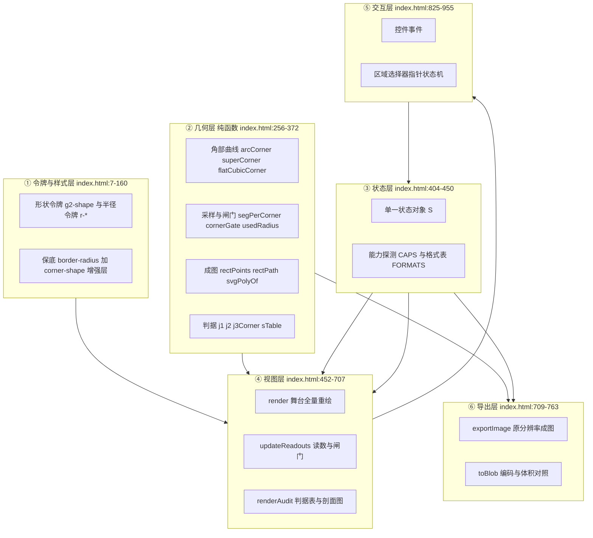
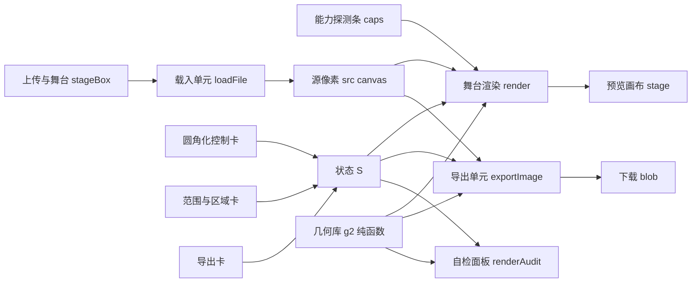
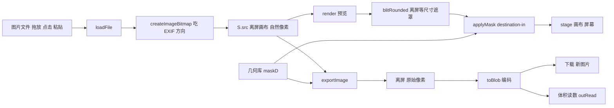
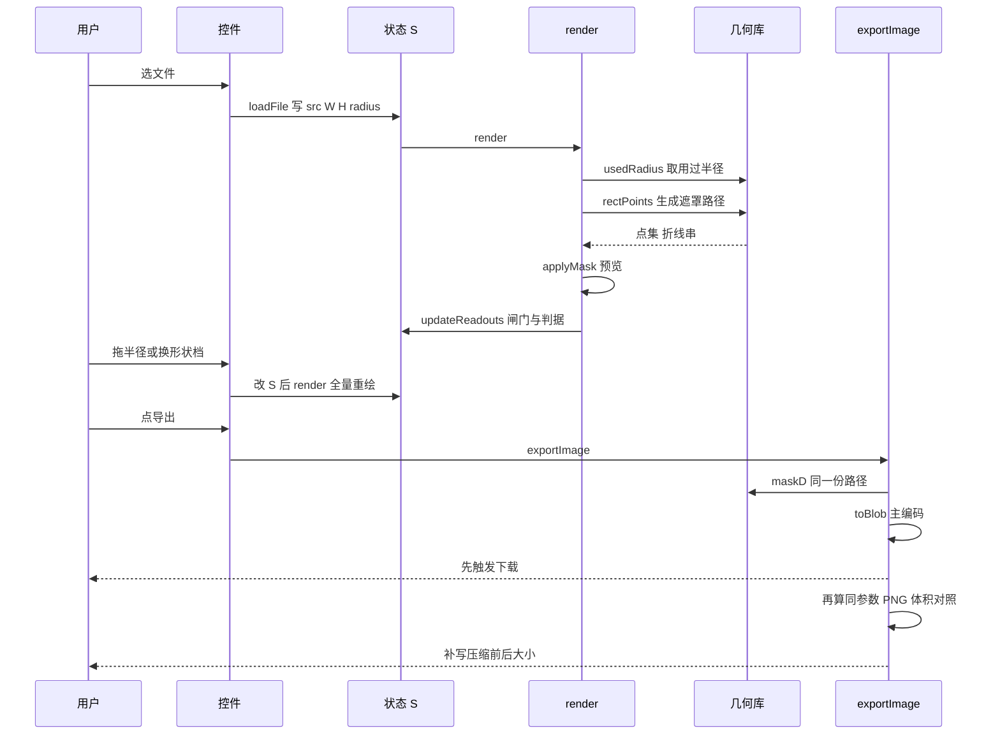
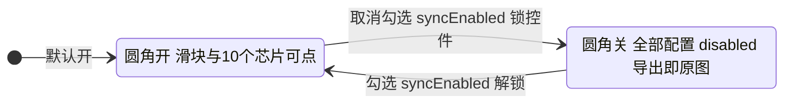
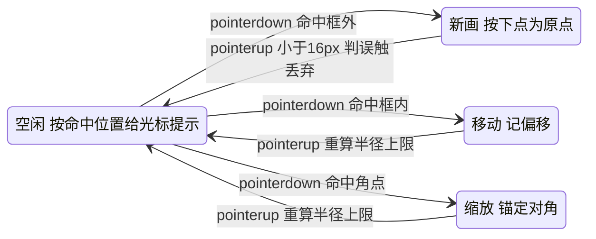
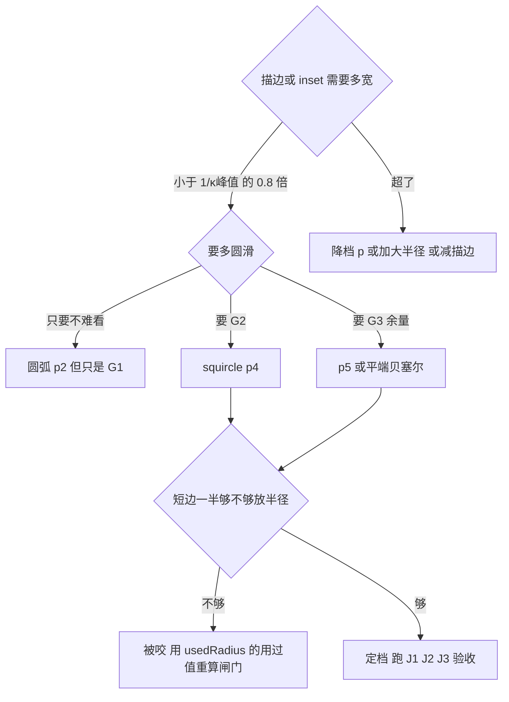

# G2 图片圆角化 · 项目全景说明

单文件网页工具：把一张图片的外框或**用户选定的区域**做成 **G2 曲率连续圆角**（squircle / 超椭圆 / 平端贝塞尔），按原始像素导出，可选高效压缩。零依赖、零构建、零联网，双击 `index.html` 即用。

| 项 | 值 |
| --- | --- |
| 交付物 | `index.html` 一个文件，959 行（含 CSS 与内联模块脚本） |
| 运行方式 | 浏览器直接打开 `file://`，或拖进任意静态站点 |
| 数据去向 | 全部在内存与本地下载里完成，无网络请求、无 localStorage |
| 适用浏览器 | Chromium 系（`corner-shape` 与 Canvas 遮罩均已实测）；不支持 `corner-shape` 的引擎会自动退回圆弧 |

---

## 0. 给新人的三分钟版本

**这个工具在解决的那件小事**：你有一张图，想让它不是"方角"而是"圆角"。听起来三行代码的事——`border-radius` 嘛。但网页上的 `border-radius` 只能画**圆弧**，而圆弧在"直边接到圆弧"的那条缝上，弯曲程度是**突然从 0 跳到 1/r** 的。人眼对这种突变极其敏感，会觉得"这个角有点硬"。

> **新人小结（生活类比）**：想象你推着购物车转弯。圆弧角就像"走直线 → 突然开始转方向盘一圈 → 突然回正走直线"，回正那一瞬你的手会抖一下；G2 角则是方向盘**从 0 度开始渐进加上去**，进弯和出弯都不抖。曲率 κ 就是"方向盘拧了多少度"，G2 说的是**κ 的变化率连续**。

**本项目做的三件事**：
1. 用**超椭圆**（`p = 2^v`，p=4 即 squircle）或**平端三次贝塞尔**生成角部曲线，从数学上让接缝处 κ→0，也就是真的 G2；
2. 把这套几何**同时用在两个地方**——导出的图片像素（Canvas 遮罩）和页面自己的界面卡片（CSS `corner-shape`），保证"你看到的角"和"你导出的角"同族；
3. 内置**判据面板**，当场用圆弧做对照组量给你看：圆弧 `J1=1.0000`（只有 G1），squircle `J1≈256`（G2 且够 G3）。

**术语速查**：

| 术语 | 一句话 |
| --- | --- |
| κ（曲率） | 曲线弯得多急；圆的 κ = 1/半径 |
| G1 / G2 / G3 | 切线连续 / 曲率连续 / 曲率变化率连续 |
| p | 超椭圆指数。p=2 是圆，p 越大越"方中带圆" |
| v | CSS `corner-shape: superellipse(v)` 的参数，**p = 2^v**，不是 p=v |
| r / 用过半径 | 声明的半径 / 被短边按比例 f 压过之后真正生效的半径 |
| ε（容差） | 用折线逼近曲线时允许的最大偏离，本项目渲染取 0.05px |
| J1/J2/J3 | 三条验收判据：是否 G2 / 是否够 G3 / 折线够不够贴 |

---

## 1. 创建目的与解决的问题

### 1.1 痛点：调大半径 ≠ 变顺滑

最常见的来回是这样的——

> 设计："这个角再顺一点。"
> 前端：把 `border-radius: 12px` 改成 `24px`。
> 设计："……还是硬。"

因为圆弧的接缝跳变 `Δκ = 1/r` 只能被**稀释**、不能被**消除**：r 从 8 到 48，Δκ 从 0.125000 降到 0.020833【档】，但比值判据 `J1` 永远是 `1.00×`【算】。**它始终只是 G1。** 要跨到 G2，必须换曲线族（`p>2` 的超椭圆，或两端曲率为 0 的平端贝塞尔）。

### 1.2 为什么需要一个"工具"而不是一段 CSS

| 场景 | 只用 CSS `border-radius` 会怎样 | 本工具的做法 |
| --- | --- | --- |
| 头像/卡片在网页里显示 | 只是 G1；且 `corner-shape` 需要非零半径、依赖引擎支持 | 页面自身走 CSS 三层策略（保底层 + `@supports` 增强层），图片本身走像素遮罩 |
| 导出成 PNG/WebP 给别的端用（App、小程序、PPT、公众号） | CSS 根本带不出去，角形在成图里是死的 | 直接把 alpha 通道挖成超椭圆角，成图自带透明角 |
| 一张大图里只想给某个色块做圆角 | 无法局部处理 | 区域选择器：框即导出范围 |
| 要控制体积（图床/包体） | 与圆角无关 | 导出挡给格式 + 质量，并给压缩前后实测体积 |

### 1.3 明确不做什么（避免误用）

- 不做批量、不做服务端、不做裁剪之外的任何图像处理（调色/缩放/水印都不在范围内）；
- 不做 `clip-path` 兜底层：本项目的圆角落在**像素**上，`clip-path` 会连元素自身 `box-shadow` 一起裁掉、且坐标是绝对值要跟着尺寸重算，在这里没有收益只有代价；
- 不在页面里"演示" G2 的观感差异来充当验收——观感不算证据，判据面板的数字才算。

---

## 2. 项目技术栈

| 层 | 选型 | 版本/依据 | 为什么是它 |
| --- | --- | --- | --- |
| 结构 | 单文件 HTML5 | 内联 `<style>` + `<script type="module">` | 需求点名"单文件"；内联模块脚本在 `file://` 下无 CORS 问题 |
| 样式 | 原生 CSS + 自定义属性 | `@supports (corner-shape: squircle)` 三层策略；`prefers-color-scheme` 明暗自适应 | 不引框架；角形与半径两套令牌集中管理 |
| 逻辑 | 原生 ES2020+ JS，无框架、无打包 | 状态是一个模块级对象 `S`，视图靠 `render()` 全量重绘 | 页面状态极简（一张图 + 十来个参数），引入框架只会增加"看不见的那层" |
| 图形 | Canvas 2D + `Path2D` + `createImageBitmap` | 遮罩用 `globalCompositeOperation='destination-in'` | 只有像素遮罩能让导出的成图真的带 G2 角；`ctx.clip()` 边缘不抗锯齿，不用 |
| 编码 | `canvas.toBlob(mime, quality)` | PNG / WebP / JPEG / AVIF（后两者按本机可编码性探测） | 浏览器原生编码器，零依赖 |
| 几何 | 自研纯函数模块（内联） | κ 用**解析导数**，θ 网格取 `i^4` | 差分在接缝处会把 J1 量成 1.27 而不是 256（步长 h 远大于该点的局部特征尺度） |
| 构建 | 无 | — | 交付即运行；改完刷新浏览器就算构建完成 |

**本机能力探测实测值**（页面顶栏那排彩色芯片就是它，UA 一变必须重测）：

| 能力 | 值 | 含义 |
| --- | --- | --- |
| `cornerShape: squircle` | true | 页面自身卡片可走真 `corner-shape` |
| `superellipseAny` | true | 可传任意 `superellipse(v)` |
| `borderShape` | false | 草案属性，代码里不依赖 |
| `clipShape` | false | `shape(rect(...))` 不可用，也不打算用 |
| `ctxRoundRect` | true | 存在，但它画的是圆弧（G1），本项目不用 |
| UA | Chrome/150.0.7871.114 | 所有数字的出处锚点 |

---

## 3. 项目架构

### 3.1 分层



**读法**：几何层是**纯函数**（不碰 DOM、不读状态），所以同一份代码既能服务渲染、又能服务导出、还能服务自检面板——三者算出来必须一致，这本身就是一条交叉校验。交互层只写状态，视图层只读状态，导出层同时读状态和调几何层。

### 3.2 三条不变量（改代码前先对齐）

| # | 不变量 | 破坏后会怎样 |
| --- | --- | --- |
| 1 | 预览与导出走**同一个** `applyMask()` 与同一份 `maskD()` 路径 | 预览好看、成图不对（或反之），肉眼看不出来 |
| 2 | 一切几何量都先过 `usedRadius()`，禁止拿声明半径算曲率 | 100×40 上写 24/30/60px 其实全是 20px，判据全体失真 |
| 3 | 判据面板必须先跑**圆弧对照组** | 测量代码写错时，其它行的数字毫无意义 |

---

## 4. 代码地图

`index.html` 单文件，按行段分块如下（行号取本仓库当前版本）：

| 行段 | 区块 | 关键符号 | 职责 |
| --- | --- | --- | --- |
| 1-6 | 文档头 | `meta charset/viewport` | `lang="zh-CN"`、UTF-8、禁缩放策略 |
| 7-32 | 令牌层 | `:root`、`@media (prefers-color-scheme:light)` | 形状档、半径档、色板、字体栈 |
| 33-59 | 基础排印与顶栏 | `body`、`header`、`.cap` | 能力芯片条 |
| 60-90 | 布局与舞台 | `main`、`.card`、`.stage-box`、`canvas#stage`、`.drop` | 两列 Grid；**舞台容器不裁剪**（见 §9.6） |
| 91-121 | 控件样式 | `input[type=range]`、`:disabled` | 滑块与禁用态 |
| 122-146 | 分段器与芯片 | `.seg`、`.chip`、`.btn` | `aria-pressed` 驱动选中态 |
| 147-159 | 读数与自检表 | `.readout`、`table.audit`、`svg.spark` | 表格紧凑化（7 列、10.5px、末列不 padding） |
| 163-166 | 顶栏 | `#caps` | 探测结果注入点 |
| 169-184 | 舞台卡 | `#stageBox #stage #drop #file #meta #pick` | 上传/预览/棋盘底 |
| 187-203 | 圆角化卡 | `#enabled #radius #rPresets #shapes #gate` | 开关、半径、预设、形状档、闸门 |
| 205-217 | 范围卡 | `#modeFull #modeRegion #selRead #selClear` | 整图/区域切换 |
| 219-241 | 导出卡 | `#compress #compBox #fmtSeg #quality #bgRow #outRead #export #result` | 压缩、格式、质量、底色、体积读数、结果条 |
| 243-248 | 自检卡 | `#auditTable #auditVerdict #spark` | 判据表、结论、κ 剖面图 |
| 256-372 | **几何层** | 见 §6.7 | 曲线、采样、闸门、判据、成图 |
| 374-391 | 能力探测 | `detectG2()`、`CAPS` | 现测，不引用别人的数字 |
| 392-402 | 形状档表 | `SHAPES`、`RENDER_EPS=0.05` | 5 档定义 |
| 404-450 | 状态与常量 | `S`、`els`、`encodable`、`FORMATS`、`activeBox()` | 单一状态源 |
| 452-483 | 遮罩与绘制 | `maskD()`、`applyMask()`、`cornerCurve()`、`blitRounded()` | 像素级圆角 |
| 484-575 | 舞台渲染 | `render()`、`usedR()`、`drawChecker()`、`handleRects()`、`drawSelUI()` | 预览与选区 UI |
| 576-708 | 读数与判据 | `updateReadouts()`、`exportSig()`、`renderAudit()`、`drawSpark()` | 闸门、体积、表格、剖面 |
| 709-764 | 导出 | `exportImage()`、`showResult()`、`toBlob()`、`saveBlob()` | 成图、编码、下载 |
| 765-824 | 载入与同步 | `loadFile()`、`fetchImage()`、`syncEnabled()`、`syncRangeLimits()` | 解码、控件上限与锁定 |
| 825-955 | 事件绑定 | 上传/开关/滑块/芯片/模式/压缩/指针 | 交互层 |
| 957-959 | 收尾 | — | `window.resize` 重绘、初始 `updateReadouts()` |

---

## 5. 组件架构

八个组件，三个 UI 容器 + 四个功能单元 + 一个纯函数库：



| 组件 | 类型 | 输入 | 输出 | 依赖 |
| --- | --- | --- | --- | --- |
| 能力探测条 | 一次性展示 | `CSS.supports` | 顶栏芯片 | — |
| 上传与舞台 | 视图 + 事件 | 文件/拖放/粘贴 | `#stage` 画布、`#meta` | 载入单元、几何库 |
| 圆角化控制卡 | 表单 | 用户点击 | 写 `S`、锁控件 | `syncEnabled` |
| 范围与区域卡 | 表单 + 指针状态机 | 指针事件 | 写 `S.mode/S.sel` | 几何库（手柄尺寸换算） |
| 导出卡 | 表单 + 动作 | 格式/质量/底色 | 下载文件、体积读数 | 编码器探测、几何库 |
| 自检面板 | 只读视图 | `S` + 几何库 | 判据表、剖面 SVG | 几何库 |
| 导出单元 | 动作 | `S` + 源像素 | Blob | 几何库 |
| 几何库 | 纯函数 | 参数 | 数字/路径串 | 无 |

**组件间通信**：没有事件总线、没有 store 订阅。所有组件读写同一个模块级 `S`，任何写操作后调用一次 `render()`，`render()` 末尾调 `updateReadouts()`——**单向、全量、幂等**。代价是每次交互都重绘预览，收益是不存在"状态和视图不同步"这类 bug。

---

## 6. 组件功能与内部核心逻辑

### 6.1 能力探测条（`index.html:374-391`）

- **功能**：把 `corner-shape` / `superellipse(v)` / `border-shape` / `clip-path: shape()` / `ctx.roundRect` 五件事的**本机真值**打在顶栏。
- **核心逻辑**：`detectG2()` 用 `CSS.supports(prop, value)` 逐项问，包 `try/catch` 防旧引擎抛异常；结果 `Object.entries` 渲染成 `.cap.on/.off`（绿/红）。
- **为什么留这一条**：`superellipse(-0.2)` 的 `supports` 返回 true **只代表语法合法**（p=2^−0.2≈0.87 是内凹角），不代表好看——所以面板里对负 v 不提供入口。

### 6.2 上传与舞台（`index.html:169-184`、`765-802`、`484-523`）

- **功能**：接收文件（点击/拖放/粘贴），解码成**自然像素**的离屏 canvas，再按比例铺到预览画布上。
- **核心逻辑**：
  1. `loadFile()` → `URL.createObjectURL` → `fetchImage()` 拿 `Image` → `createImageBitmap(img, {imageOrientation:'from-image'})` 吃 EXIF 方向；不支持该选项就 `catch` 退回裸 `Image`；
  2. 画进 `S.src`（`cv.width = bmp.width`，自然尺寸，**不是** CSS 尺寸），随后 `frame.close()` 释放；
  3. `render()` 先算适配：`cssScale = min(availW/W, availH/H, 4)`，再按 `dpr = max(1, floor(devicePixelRatio))` 设**先尺寸后 transform**：`ctx.setTransform(stageK,0,0,stageK,0,0)`，其中 `stageK = stage.width / S.W`（device px / 图像 px）。此后**所有绘制坐标都用图像像素**，选区坐标与命中测试天然一致，不必来回换算；
  4. 常量尺寸的东西（线宽、手柄、字号）一律除以 `stageK`（`drawSelUI` 里的 `k = 1/stageK`），保证在任意缩放/任意 DPR 下视觉恒定。
- **坑位备忘**：舞台容器 `.stage-box` 明确 `overflow:visible`（`index.html:72-75`）——祖先若带圆弧再叠 `overflow:hidden`，会把后代外鼓的超椭圆角**削平**。预览的透明角靠画布自身的 `conic-gradient` 棋盘底（`index.html:76-83`）露出，不是靠 CSS 裁剪。

### 6.3 圆角化控制卡（`index.html:187-203`、`804-823`）

- **功能**：开关 + 半径 + 5 个百分比预设 + 5 个形状档 + 闸门读数。
- **核心逻辑**：
  - `syncRangeLimits()`：半径上限 = `floor(min(框宽,框高)/2)`（`activeBox()` 决定"框"是整图还是选区）；预设芯片按**短边百分比**给（4/8/12/25/50%，50% 正好等于上限），文案同时给 px 值；
  - `syncEnabled()`：`S.enabled` 或 `S.src` 任一为假 → 滑块 + 5 预设 + 5 形状档全部 `disabled`（原生 `disabled` 按钮不派发 click，实测 10/10 锁住且程序化 `.click()` 也进不去处理函数）；
  - 闸门读数用 `gateOfCurve(cornerCurve(shape, R), 2)`，`R` 取 `usedR().used`（**用过半径**，不是声明值）。
- **形状档设计**：`SHAPES` 每项带 `v`（喂给 CSS `corner-shape: superellipse(v)`）与 `p = 2^v`（喂给 Canvas 几何），两者同源，所以"页面角形"和"成图角形"永远同族。

### 6.4 范围与区域选择器（`index.html:205-217`、`896-955`）

- **功能**：整图 / 区域两种模式；区域模式下在图上画框，**框即导出范围**。
- **核心逻辑**：
  - 选区存在 `S.sel = {x,y,w,h}`，单位是**图像像素**，因此与预览缩放、DPR、窗口大小完全解耦；
  - 指针状态机三态：命中角点手柄 → `resize`（锚定对角）；命中框内 → `move`（带边界夹取）；命中框外 → `new`（重新画）。手柄命中半径 = `(HS/2 + 4)/stageK`，即"9 CSS px 的手柄 + 4px 容差"换算回图像像素；
  - `endDrag()` 里小于 16 图像 px 的新框视为误触丢弃；随后 `syncRangeLimits()` 把半径上限重算并夹取；
  - 右键 = 清除选区（`contextmenu` 里 `preventDefault`，避免弹出 frameless 式深色系统菜单那类干扰）；
  - 预览里选区外的压暗**不用** `clip-path`，而是 `ctx.clip(Path2D, 'evenodd')` 画一个环形遮罩（`index.html:513-519`）——`clip(path)` 不与当前路径抵消，所以外框和内框必须写在**同一条** path 里。
- **实测**：拖 (120,90)→(1050,690) 得 `930×600 @ (120,90)`；框内拖 (600,400)→(560,380) 得 `@ (80,70)` 且尺寸不变；导出尺寸 = 选区尺寸，四角 α=0，裁剪偏移用色点证伪过（非网格点=黄、网格交点=黑）。

### 6.5 导出卡（`index.html:219-241`、`709-764`）

- **功能**：压缩开关（默认不勾）→ 格式 + 质量 +（无 alpha 时的）底色；输出读数；下载。
- **核心逻辑**：
  1. `encodable` 探测：拿一张 8×8 画布 `toDataURL(mime)` 看回读前缀，**不可编码的格式在分段器里 `disabled`**（本机 AVIF 即为灰）。理由：`toBlob` 遇到不认识的 mime 会**静默退回 PNG**，那样体积对比就是假的；
  2. `exportImage()` 以**原始像素**建离屏画布 → `drawImage(src, b.x, b.y, b.w, b.h, 0, 0, ow, oh)` → `applyMask(ctx, ow, oh, ur.used, shape)`；
  3. 无 alpha 格式（JPEG）先铺 `S.bg` 再把带透明角的成图合成上去，角外即纯色底（实测角点取到 `(255,0,254)` ≈ 设定的 `#ff00ff`）；
  4. **先 `saveBlob()` 再算体积对照**：同参数 PNG 只是参考信息，不该拖住已经落盘的下载（实测下载时刻 30850ms < 对照完成 31005ms）；
  5. `exportSig()` = 格式@质量 + 输出尺寸 + 形状@用过半径 + 底色。输出读数只在签名与当前设置完全一致时才显示体积数字，否则退回"导出后给出"——**不拿旧数字冒充当前设置**。
- **体积文案**：`压缩前 同参数 PNG 1.55 MB（源文件 1.56 MB） → 压缩后 17.5 KB，省 98.9%`；若压缩后反而更大，`saveNote()` 改口为"反而大 X%"，不会出现"省下 -313.2%"这种撒谎表述。

### 6.6 自检面板（`index.html:243-248`、`653-707`）

- **功能**：把当前档的曲率连续性当场量出来，并给出**圆弧对照组**。
- **核心逻辑**：
  - `renderAudit()` 组两行（对照 + 当前档），每行 `J1 = j1(c)`、`期望 = (sA/sB)^(p−2)`、`斜率 = j2(c)`、`描边上限 = 1/κ峰值`、`判定`；
  - 平端贝塞尔**不是**超椭圆族，解析期望列显式给 `—`（给它算 `(0.25/0.0156)^3.19` 会误导）；
  - `drawSpark()` 画 κ–s 的 log-log 剖面：圆弧是一条水平线（κ 恒 = 1/r），G2 档是一条斜率 p−2 的上升直线——**形状差异被画成斜率差异**；
  - 节流：`auditKey = 形状|用过半径|开关`，拖拽选区时不每帧重算（一次 `j1+j2` 要跑 6000 点网格）。
- **表格适配**：卡片内宽 370px 时表宽 370px、`scrollWidth == 370`、判定列右边缘落在内沿内，`overflow:false`（p=5、J1 四位数这种最坏数据下量得）。

### 6.7 几何库（`index.html:256-372`，纯函数）

| 符号 | 行 | 干什么 | 内部关键 |
| --- | --- | --- | --- |
| `kappa(c,t)` | 259 | 解析曲率 `|x'y''−y'x''| / (x'²+y'²)^1.5` | 用曲线自带的 `d1/d2`，**不用差分** |
| `arcCorner/superCorner/flatCubicCorner` | 264/270/280 | 三种角部补丁，局部坐标占 `[0,r]×[0,r]`，起点在竖直边接缝 | 分数次幂一律 `Math.pow(Math.max(0,·),e)` 钳位，否则 θ 微越界 → NaN → 整表作废 |
| `peakKappa` | 286 | 峰值曲率（在中缝，均匀网格够用） | 供 `1/κ峰值` 与折线容差律 |
| `segPerCorner` | 297 | 每角折线段数 | `s_max = √(8ε/κ峰值)` ⇒ **段数 ∝ √尺寸** |
| `usedRadius` | 298 | CSS 的 f 缩放 | `f = min(1, w/2r, h/2r)`，返回 `used/bitten/kSeam` |
| `cornerGate` | 302 | 档位闸门 | `ok = 1/κ峰值 ≥ 1.2w`，1.2 是给噪声留余量 |
| `rectPath` | 306 | 整块圆角矩形的 SVG 串（平端 C 段） | 两个控制点重合在盒角 ⇒ 两端 κ=0 ⇒ 无采样即 G2 |
| `rectPoints` | 311 | 超椭圆整块点集 | 一份左上角模板 + 三次镜像；**右上/左下要反序遍历**才保持顺时针，顺序错 → 路径自交 → `fill` 面积只剩约一半 |
| `sTable` | 332 | 弧长 s 与 κ 的对照表 | θ 网格取 `i^4` 且**从 i=1 起**：均匀网格在近接缝没分辨率，还会让两个取样点重合把 J1 假报成 1.0000 |
| `j1/j2/j3Corner` | 342/346/352 | 三条判据 | J3 必须"逐参照点取**最近**线段再取 max"，反过来量的是最远线段（0.088px 会报成 28.9px） |
| `gateOfCurve` | 369 | 从曲线对象直接取闸门 | 平端贝塞尔没有整数 p，走这条 |

---

## 7. 数据流图



三条要点：
1. **源像素只有一份**（`S.src`，自然尺寸）。预览和导出都是从它 `drawImage` 出来再套同一个 `applyMask()`——预览是"缩小版同一路径"，不是另一套近似算法；
2. 预览遮罩在**离屏画布按设备像素**做好再贴回（`blitRounded`），因为 `ctx.clip()` 的边缘不抗锯齿，而 `destination-in` 填充是抗锯齿的；
3. 自检面板的数据**不来自**画布，而是直接调几何库——如果面板与成图不一致，就说明有第二条实现路径偷偷长出来了。

---

## 8. 工作流程

### 8.1 一次典型导出（时序）



### 8.2 圆角开关的状态机



### 8.3 区域选择器的指针状态机



### 8.4 选档决策（先过闸门，再谈手感）



---

## 9. 工作原理

### 9.1 为什么圆弧永远只是 G1

圆弧接缝处 κ 从 0 跳到 `1/r`。调大 r 只稀释跳变：r=8→0.125000、24→0.041667、48→0.020833【档】。比值判据 `J1 = κ(0.25px)/κ(0.0156px)` 对圆弧恒为 `1.0000`【算】——**它测的是"κ 随弧长有没有变化"，与 r 无关**，所以调半径骗不过这条判据。

### 9.2 超椭圆怎么把接缝抹平

角部曲线 `P(t) = [r − r·cos^m(t), r − r·sin^m(t)]`，`m = 2/p`。接缝（t=0）处 κ 的渐近律是 `κ ∝ s^(p−2)`：p=2 时是常数（圆弧），p>2 时 κ→0 ⇒ **G2**；且 log-log 斜率恰为 `p−2` ⇒ p≥3.2 时斜率≥1.2，够到 **G3**。实测（用过半径 100px）：

| 档 | p | J1 | 解析期望 | 斜率 | 判定 |
| --- | --- | --- | --- | --- | --- |
| 圆弧 | 2.00 | 1.0000 | 1.0000 | 0.0000 | G1 |
| 柔和 | 2.64 | 5.91 | 5.89 | 0.639 | G2 |
| squircle | 4.00 | 256.0 | 256.8 | 2.000 | G2+够G3 |
| 深曲率 | 5.00 | 4514.7 | 4115.7 | 3.000 | G2+够G3 |
| 平端贝塞尔 | ≈5.19 | 16.19 | — | 1.037 | G2（止于 G2） |

> **新人小结**：p 就像方向盘回正的"提前量"。p=2（圆）是到点了猛打一把；p 越大，越接近"提前很久慢慢打"，进弯那一下就越没有顿挫。但 p 太大又会让角"太方"，而且**描边余量**变小——天下没有白得的顺滑。

### 9.3 平端贝塞尔是另一条路

`B(u) = (r·u³, r·(1−u)³)`，两个控制点重合在盒角 ⇒ 两端 κ=0 ⇒ 天生 G2，几何上等价 p≈5.19。代价：它的斜率只有 1.037，**止于 G2 上不了 G3**，所以"解析期望"那一列对它不成立，面板显式给 `—`。好处：它是**解析 C 段**，`rectPath()` 一行生成，零采样误差。

### 9.4 折线容差律：段数从哪来

用折线逼近时，最大允许弦长 `s_max = √(8ε/κ峰值)`。因为 `κ峰值 ∝ 1/r` 而弧长 `∝ r`，**段数 ∝ √r**。本项目 ε=0.05px（对齐阈值），实测每角段数：r=100→45、r=200→63、r=300→77、r=400→89（45×√2=63.6、45×√3=77.9、45×2=90，逐点对上√律）。别"看着差不多"手填：尺寸涨 16 倍，段数只需约 4 倍。

### 9.5 闸门：1/κ峰值 是这一档的描边上限

| 档 | p | 1/κ峰值 @ r=100 | @ r=200 |
| --- | --- | --- | --- |
| 圆弧 | 2 | 100.000 | 200.000 |
| 柔和 | 3 | 56.123 | 112.246 |
| squircle | 4 | 39.640 | 79.280 |
| 深曲率 | 5 | 30.779 | 61.557 |

超过这个内偏移，等距线会自交（描边起节、focus ring 打结）。**p 越大越顺滑，也越不容得下描边**——这就是 §8.4 那张决策图存在的原因。

### 9.6 为什么不用 clip-path / roundRect

| 方案 | 结局 |
| --- | --- |
| `ctx.roundRect()` | 画的是圆弧，永远 G1，只是便利方法 |
| `ctx.clip(path)` | 边缘不抗锯齿，成图会有毛边 |
| `clip-path: path(...)` | 会连元素自身 `box-shadow` 一起裁；坐标是绝对值，尺寸变了要重算；且不吃 `border` |
| **`destination-in` 填充遮罩** | 抗锯齿、可复用同一份路径、直接烘进 alpha 通道 → **本项目采用** |

同理，祖先链上不能出现"圆弧 + `overflow:hidden`"压在 G2 元素外面：祖先按圆弧裁，会把外鼓的超椭圆角**削平**。所以舞台容器 `overflow:visible`，透明角靠画布棋盘底露出。

### 9.7 页面自身也走 G2（三层策略）

```css
.card { border-radius: var(--radius-card); }              /* ① 保底，永远写 */
@supports (corner-shape: squircle) { .card { corner-shape: var(--g2-shape); } }  /* ② 增强 */
```
`--g2-shape` 由形状档芯片驱动（`superellipse(v)`），所以**切档时页面卡片的角也跟着变**——这是"所见即所导"的直观证明，也顺带演示了 `border`/`box-shadow`/`backdrop-filter` 会自动跟随 `corner-shape`（而 `clip-path` 不会）。

---

## 10. FAQ

**Q1：我把半径调到 200px，为什么角看着还是硬？**
因为你可能还在圆弧档。机制：圆弧接缝 `Δκ=1/r` 只能稀释不能消除。数字：r 从 24 到 200，Δκ 从 0.041667 降到 0.005，但 `J1` 恒为 `1.0000`。自查：看自检面板"当前档"那行是不是 `G1`——是就换 squircle 或更高档，别继续堆半径。

**Q2：`corner-shape: superellipse(2)` 里的 2 是 p 吗？**
不是，**p = 2^v**。`superellipse(2)` ⇒ p=4（squircle）；`round` ⇒ v=1 ⇒ p=2；`superellipse(3)` ⇒ p=8。自查：芯片上同时标了 `p=` 和 `v=`，两个数都在，对不上就是文档骗你。

**Q3：为什么"半径 0–400px"，我想设 500 不行？**
因为半径超过短边一半会被 CSS 的 f 缩放吃掉：`f = min(1, 边长/两侧半径和)`。机制：100×40 的框上写 24/30/60px，实际全用 20px。数字：面板会显示"声明 X → 用过 Y"，`bitten` 时给 f 值。自查：想看被咬的样子，切到区域模式拖一个扁框，半径读数会当场报"半径被短边咬"。

**Q4：导出图打开是白底，我以为角是透明的？**
你选了 JPEG。机制：JPEG 不存 alpha，圆角外必须填色，页面用"圆角外底色"控件（默认白）。数字：实测设成品红后角点取到 `(255,0,254)`。自查：输出读数那行写着 `带透明` 还是 `底色 #xxxxxx`。

**Q5：勾选压缩后为什么显示"压缩后 导出后给出"？**
因为那组数字必须实测。机制：`exportSig()` 把格式@质量、输出尺寸、形状@用过半径、底色做成签名，只有与当前设置完全一致的那**一次导出**的结果才会显示。自查：导出一次，读数立刻变成"压缩前 1.55 MB → 压缩后 17.5 KB，省 98.9%"；再动一下半径，它又退回"导出后给出"——这是设计，不是 bug。

**Q6：为什么 AVIF 那个按钮是灰的？**
本机 `canvas.toBlob('image/avif')` 不可编码。机制：`encodable` 用 8×8 画布 `toDataURL` 探前缀；不可用就禁用，而不是让你点完拿到一个**静默退回的 PNG**。自查：顶栏没有这项，但输出读数会写实际格式；灰按钮的 `title` 写了原因。

**Q7：压缩一定更小吗？**
不一定。机制：合成图/平涂/带锐利网格线的图，JPEG 反而比 PNG 大。数字：本机实测一张 1200×800 合成图，JPEG q82 = 125.5 KB，同参数 PNG = 30.4 KB，**反而大 313.2%**；而一张 3000×2000 渐变图 WebP = 40.9 KB vs PNG 5.70 MB，省 99.3%。自查：结果条会直说"反而大 X%"，不会出现"省下 -313%"。

**Q8：区域选择器导出的为什么不是"整图但只有那块圆角"？**
这是产品定义：**框即导出范围**（裁出 + 圆角 + 另存新图）。要"整图尺寸不变、只局部圆角"的话，得改成把选区合成回整图再导出——那是另一种产物形态，当前版本没做。自查：输出读数那行 `输出 930×600 px` 等于选区尺寸，就说明走的是"范围即导出"。

**Q9：预览看着有圆角，导出的却是方的（或反之），怎么定位？**
理论上不可能，因为两者共用 `applyMask()` + `maskD()`。真出现了就是**第二条实现路径**偷偷长出来了。自查顺序：① 看"启用圆角"是否勾选（关掉时配置全锁、导出即原图）；② 看输出读数的用过半径是否为 0（半径被夹到 0 就等于没圆角）；③ 跑自检面板，若圆弧对照组不是 `J1≈1.0000 / 斜率≈0.000`，先别信任何数字，是测量代码坏了。

**Q10：为什么每次动一下滑块就整张重绘，会不会卡？**
机制：状态极简，全量重绘换取"不可能不同步"。数字：预览是**缩放后的设备像素**遮罩填充，1200×800 预览耗时 1–7ms；只有导出才碰原始像素，6MP 的 WebP 编码 409ms、PNG 对照 155–186ms。自查：结果条末尾就印着"预览耗时 / 编码"两个毫秒数。大图想更跟手，可以先把半径档切到"关"调构图，再开回来。

**Q11：判据面板的 J1 为什么和文档里的数字不完全一样？**
因为它随**用过半径**漂移。机制：`sTable` 的 θ 网格取 `i^4`，近接缝取样密度是绝对弧长尺度，r 越大同一窗口的相对分辨率越低。数字：p=4 在 r=24 报 254.14、r=100 报 256.00、r=200 报 261.5（解析 256.82）；p=5 在 r=24 报 3963、r=100 报 4514.7（解析 4115.7）。判定档位（G1/G2/够G3）不受影响。自查：面板把"解析期望"并排印出来了，偏差一眼可见。

---

## 11. 附录 · 验证台账与数字出处

证据分级：**【算】**几何库纯函数算出；**【渲】**浏览器里对真实成图/画布量得；**【档】**g2-corner-integration skill 文档值。

### 11.1 已核（方法）

| 结论 | 方法 | 关键读数 |
| --- | --- | --- |
| 五档角形各自正确 | 【渲】导出 PNG → `createImageBitmap` → 逐行找 α≥128 边界 + 45° 交点 + 四角总面积 | 45° 交点 29/23/16/13/13 对预测 29.29/23.10/15.91/12.94/12.50；中段偏差 ≤0.87px；面积误差 ≤±0.002% |
| 圆角确实作用在原图像素上 | 【渲】保留区像素与源图 A/B 对照 | 亮度比 1.005–1.006（等于原图），角外 α=0 |
| 关掉开关 = 原图 | 【渲】不透明像素计数 | 960000/960000 全不透明 |
| 判据代码可信 | 【算】圆弧对照组 | `J1=1.0000 / 斜率 -0.0000` |
| 闸门表可复现 | 【算】`cornerGate(p,R,2)` @ R=100 | p2 100.000 / p3 56.123 / p4 39.640 / p5 30.779，与【档】r=24 值按 √ 比例一致 |
| 段数服从 √尺寸律 | 【算】`segPerCorner` @ ε=0.05 | 45@100、63@200、77@300、89@400 |
| 区域选择器坐标正确 | 【渲】合成 pointer 事件 + 色点定位 | 拖框得 `930×600 @ (120,90)`；移动后 `@ (80,70)` 尺寸不变；导出 930×600 四角 α=0 |
| f 缩放警告可达且真实 | 【渲】拖拽中途读数 | "声明 60px 实际只用 40.0px（f=0.6667）"，`hint warn` 类生效 |
| 压缩格式与体积 | 【渲】`toBlob` 产物类型 + 尺寸 | WebP q50/82/95 = 24252/28342/35288（单调）；1600×1000 省 98.9%；3000×2000 省 99.3%；JPEG 角点 `(255,0,254)` |
| 不可编码格式不冒充 | 【渲】分段器状态 | AVIF `disabled=true`，本机 `encodable` 为假 |
| 下载不被对照拖住 | 【渲】时间戳 | 下载 30850ms < PNG 对照完成 31005ms |
| 关开关即锁配置 | 【渲】`disabled` 遍历 + 程序化 click | 10/10 芯片 + 滑块全锁，`clickWhileOff:false` |
| 自检表不溢出 | 【渲】`scrollWidth` vs 卡片内宽 | 370 = 370，判定列右边缘在内沿内，`overflow:false` |
| 上传三条入口 | 【渲】change / DragEvent / ClipboardEvent | meta 依次变 `test-1200x800.png`、`dropped.png`、`pasted.png` |
| 无脚本错误 | 【渲】console + error/unhandledrejection 钩子 | 0 报错（唯一一条 warn 是探针的 getImageData 提示） |
| 结构完整 | 静态：`node --check`、CSS 括号配平、HTML 块标签配平、34 个 `els` id 与标记逐一对账 | 全通过 |

### 11.2 未验证（原因）

| 未做 | 原因 |
| --- | --- |
| 区域模式的**截图** | 截图要求浏览器面板可见，会话中两次被切走；该模式改用像素读证（压暗比 0.496、被挖角 0.453、保留区 1.006） |
| Safari / Firefox 表现 | 本机无该环境；`corner-shape` 支持度不同，页面会自动退回圆弧（保底层始终写 `border-radius`） |
| AVIF 实际导出 | 本机编码器不支持，按钮已置灰 |
| 真实 OS 级拖放与系统剪贴板 | 已用合成 `DragEvent` / `ClipboardEvent` 覆盖处理函数；OS 投递那一跳属浏览器职责 |
| 大图（>12MP）交互手感 | 未压测；已知导出侧 6MP 为 409ms + 155ms |
| `corner-shape` 参与 CSS 动画的中间态 | 本工具不做角形动画（动画首帧是圆弧端点，仍是 G1） |

### 11.3 数字口径提醒

本文所有毫秒、字节、百分比都是**本机单台机器**（Windows 10.0.26300 / Chrome 150.0.7871.114 / dpr=1）的一次实测，不是承诺值。UA 或机器变了，顶栏那排能力芯片和结果条里的毫秒数就是新的出处——**别引用本文的数字，引用你屏幕上那一行**。
