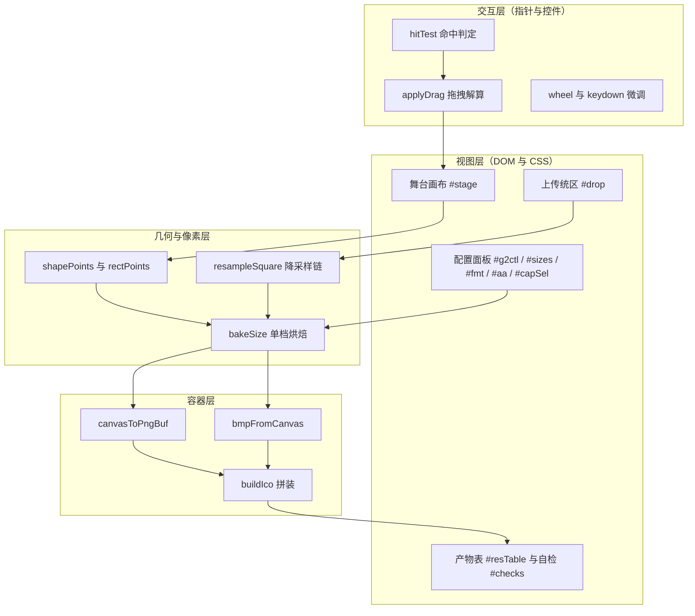
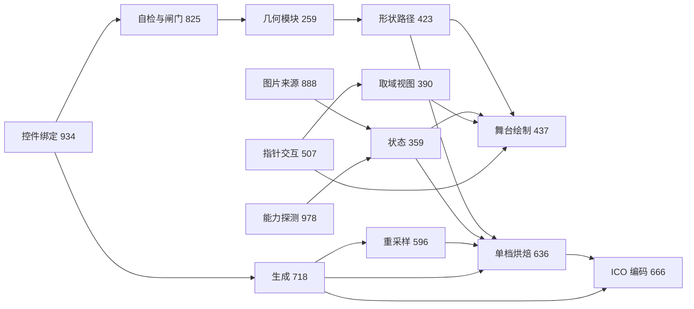
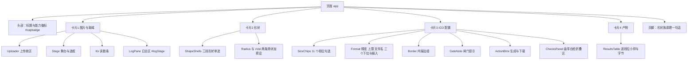
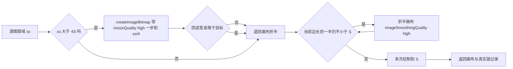
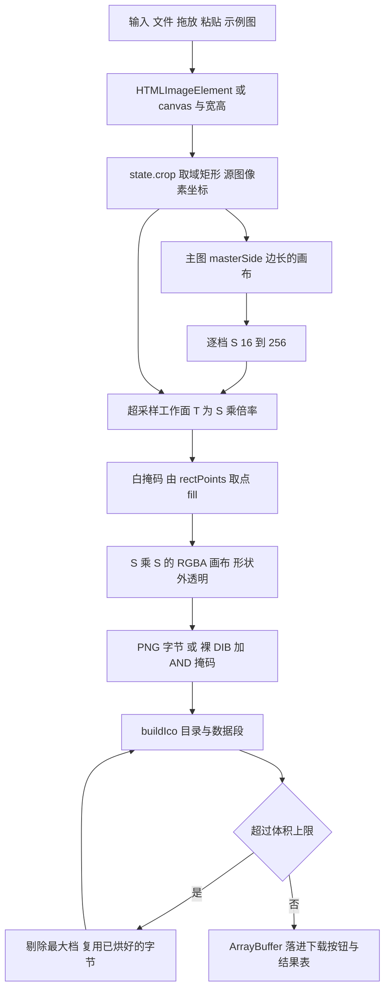
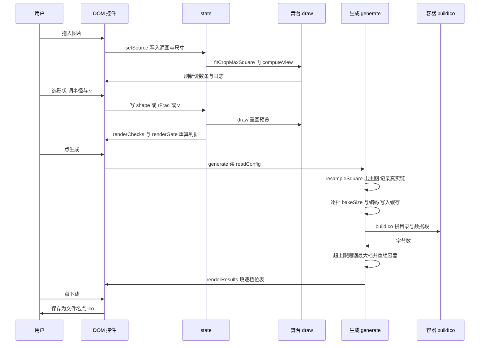
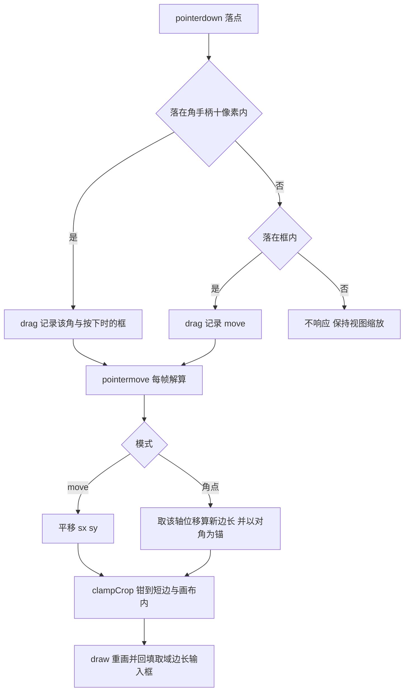

# 图片转 ICO · 项目全景

单文件浏览器工具：把任意位图裁成**正方形 / 圆形 / G2 圆角矩形**的图标，按最优降采样链压缩，打包成多尺寸 `.ico`。全程本地运行，零依赖、零网络。

| 项 | 值 | 口径/出处 |
| --- | --- | --- |
| 交付物 | `图片转ico.html` | 仓库内唯一源文件，`wc -l` = 1008 行，49512 B（48.4 KiB） |
| 运行时 | 浏览器（本机实测 Chrome/150.0.7871.114） | 页内能力探测徽标 `#capbadge` |
| 外链引用 | 0 | `grep -c 'https\?://'` = 0；无 `<script src>`、无 `@import`、无 `<link href="http...">` |
| 文档内行号 | 全部 `图片转ico.html:N` | 本轮 `grep -n` 逐条复核，改过代码要重核 |
| 数值 | 【渲】= 本机浏览器实渲染；【算】= 本轮 JS/Node 实算；【规】= 取自规范或既往报告、本轮未复算 | 见 §10 验证台账 |

**这份文档的读法**：只想跑起来看 §0；想知道为什么这么做看 §1 与 §9；要改代码按 §4 找位置、按 §5/§6 看清职责边界、改完照 §10 的判据自测；怕改坏东西看 §11。

---

## 0. 新人小结与最短可跑路径

**新人小结（一句话版）**：这个工具做的事和"把一张照片裁成圆头像再导出成 Windows 图标"完全一样，只是它多给你两个旋钮——**裁成什么形状**（方的、圆的、还是那种苹果图标式的"看着方其实角是连续过渡的"形状）和**导出成哪几档尺寸**（16 到 256）。它不需要装任何东西：双击 HTML 文件就能用。

**最短可跑路径（三步，每步都有预期）**

| # | 动作 | 预期看到什么 |
| --- | --- | --- |
| 1 | 双击 `图片转ico.html`（或拖进浏览器） | 页面右上有一枚能力徽标，形如 `本机：corner-shape ✓ · superellipse ✓ · bitmap(high) ✓ · Chrome/150.0.7871.114` |
| 2 | 点 `用示例图试一下`（或拖入/`Ctrl+V` 一张图） | 左栏出现图片与一个带四个角手柄的正方形选框；选框外变暗，选框内四个角也被压暗——被压暗的地方就是"要被切掉的部分" |
| 3 | 点 `生成 ICO` → `下载 .ico` | 日志区打印取域尺寸、降采样链、输出字节数；右栏出现逐档位表（16²/32²/48²/256²…）与每档真实字节数，`.ico` 落进浏览器下载目录 |

**三条自检（想确认"这台机器上算得对"再跑）**

1. 展开 `曲率自检`：第一行必须是 `p=2（圆弧 round，G1 对照）` 且 `J1=1.0000 / 斜率=0.0000 / 判定=G1`。这一行不对，说明判据代码本身坏了，其余行全部作废（`renderChecks()`，图片转ico.html:826）。
2. 形状切到 `正方形` 再看 `R / 描边px` 列与切到 `圆形` 对比：小样图的四角应当从"直角"变成"被压暗的弧"。
3. 把 `体积上限` 设成 `32 KB`、勾满 11 档、编码选 `BMP`：日志应逐行打印"超限 ⇒ 剔除最大档"，直到落进上限，产物档位随之减少。

---

## 1. 创建目的与解决的问题

### 1.1 痛点（为什么会有这个文件）

| 现象 | 机制成因 | 本项目的对策 |
| --- | --- | --- |
| 网上图标转换器把圆角图标导成"看得出圆弧接缝"的角 | 默认形状是**圆弧**（`corner-shape: round`，内部指数 p=2），直边与弧的接缝处曲率从 0 跳到 1/r ⇒ 只有 **G1** 连续；把半径调大只会稀释跳变，不会变成 G2 | 换形状族：超椭圆 `p = 2^v`（v=2 即 squircle，p=4），接缝曲率趋 0 ⇒ G2，并且**烘进像素**而不是只在 CSS 里显示 |
| 预览看到的是圆弧，下载到的文件却是另一种角 | 预览用 CSS `border-radius`（永远圆弧），导出用另一套采样几何 ⇒ 两套真值 | 预览与导出调用**同一个** `shapePoints()`→`rectPoints()`（图片转ico.html:424、:296），逐点同源 |
| 大图导出的图标糊或带摩尔纹 | 浏览器一次 `drawImage` 缩 20 倍时降采样核不够宽 | 分步折半降采样 + `createImageBitmap(resizeQuality:'high')` 前置大步（`resampleSquare()`，图片转ico.html:603），日志把真实链打出来 |
| 生成的 `.ico` 大得离谱（几 MB） | 256 档走裸 BMP 是 262 KB 起步，且没人管体积上限 | PNG-in-ICO（Vista+ 全支持）+ `BMP/混合` 兼容挡 + **体积上限自动降档**（`generate()`，图片转ico.html:742） |
| 想加一圈描边，小尺寸上描边把角挤变形 | 内侧可用宽度受曲率闸门约束：`w ≤ 1/κ峰值 = c(p)·R`，超了等距线自交 | 半径与描边都按**边长百分比**定义 ⇒ 闸门成为尺度不变量，一次判定覆盖 16…256 全档，并在 UI 里实时打印 `1/κ峰值`（`renderGate()`，图片转ico.html:863） |
| 裁切只能整图 | 只给了"缩略图"没给取景 | 正方形选框 + 平移/角点缩放/滚轮/方向键微调/精确边长输入（图片转ico.html:507 起） |

### 1.2 它解决到哪为止（边界）

- **不做**：动图、多形状同文件（一个 `.ico` 只有一种形状，逐档尺寸不同）、颜色量化/调色板图标（一律 32bpp RGBA）、把 `.ico` 反解成图。
- **不管**：Windows 资源管理器/任务栏对成品的实际渲染效果（需在真机双击验收，见 §10 未验证项）。
- **不假设**：`corner-shape` 是否被支持。支持与否只影响页面自己的装饰角（CSS 里 9 处 `@supports (corner-shape: squircle)` 增强层），**不影响导出**——导出走 canvas 像素烘焙，与 CSS 能力无关。

---

## 2. 项目技术栈

### 2.1 栈清单

| 层 | 选型 | 为什么是它（代价） |
| --- | --- | --- |
| 交付形态 | 单个 `.html`，内联 `<style>`（图片转ico.html:7–111）+ 内联 `<script type="module">`（:258–1006） | 目标是"拷过去就能用"；代价是没有构建、没有模块化边界，靠文件内 15 个 `/* ==== 区块 ==== */` 标记维持分层 |
| 视图 | 原生 DOM + CSS 自定义属性主题（明暗自适应） | 无需框架；代价是状态要手写同步，因此选中态一律交给 CSS `:has(input:checked)`，JS 不再维护第二份 `sel` 类（§5.5） |
| 图形 | Canvas 2D（`Path2D`、`globalCompositeOperation='destination-in'`、`createImageBitmap` 带 `resizeQuality`） | 唯一能同时做到"离线 + 像素级可控 + 有高质量重采样"的浏览器 API |
| 几何 | 自研超椭圆模块（零依赖，解析导数算曲率） | 差分算曲率在近接缝会失效（步长比局部特征尺度大得多）⇒ 一律用闭式一阶/二阶导 |
| 容器编码 | 手写 ICO 头 + 手写 32bpp BMP DIB + `toDataURL('image/png')` 取 PNG 字节 | 只有手写才敢保证 AND 掩码语义与行序正确；PNG 走 dataURL 而非 `toBlob`（实测同样字节、快约 1000×，见 §6.8） |
| 图形格式 | PNG-in-ICO（推荐）/ BMP+AND 掩码（老系统）/ 混合 | 256 档 BMP 裸数据 262 KB，PNG 通常 <10 KB |
| 文档内校标 | Mermaid 流程图/时序图（共 7 张：§3.1 分层、§4.2 依赖、§5.1 组件树、§6.6 重采样、§7.1 主数据流、§8.1 时序、§8.2 选框判定） | 图内节点标签一律不带竖线、边标签必须带箭头头，规则见 §2.2 |

### 2.2 三栈语法硬规则（改这个文件前必须知道的最低线）

| 栈 | 硬规则 | 违反后果 |
| --- | --- | --- |
| CSS | 保底 `border-radius` **必须**与 `corner-shape` 同时存在；`corner-shape` 在 `border-radius:0` 时失效 | 角形静默变回直角 |
| CSS | 环形遮罩（框内形外压暗）必须靠 `Path2D` 两条子路径 + `evenodd`，不能靠 `ctx.clip(path,'evenodd')` 与当前路径抵消 | 遮罩正反颠倒（本项目踩过，见 §6.4） |
| Canvas | `ctx.clip()` 的边缘**不抗锯齿** | 形状边缘出锯齿；正解是画一张白掩码再 `destination-in` |
| Canvas | 先设 `canvas.width/height`，再 `setTransform(dpr…)`；顺序反了整幅缩放错位 | 图糊或只画四分之一 |
| 数值 | 半径/描边一律以**边长比例**入形（`rFrac`、`wFrac`），px 只在显示层换算 | 小尺寸档被 `f` 缩放咬掉，闸门判据随之失真 |
| ICO | `width/height` 字节里 256 写成 **0**；BMP 条目是**裸 DIB**（无 `BITMAPFILEHEADER`）；`biHeight = 2h` | 资源管理器读不到档位，或把 BMP 存成 `.bmp` 打不开 |

---

## 3. 项目架构

### 3.1 分层

**新人小结**：把它想成一间拍照棚。视图层是背景布和灯箱（只负责让你看见），交互层是助理（听懂你的手往哪儿挪），几何与像素层是相机和暗房（决定哪一块进画面、切成什么形状、把 1200 万像素缩成 256），容器层是装订台（把 16 到 256 这几本册子钉成一个 `.ico`）。四层之间只靠"源图 + 取域矩形 + 形状参数"这三样东西对话，谁都不越层去改别人的数据。

### 3.2 三条不变量（架构约束，不是风格偏好）

| # | 不变量 | 强制点 | 破了会怎样 |
| --- | --- | --- | --- |
| I1 | **预览与导出共用一份几何函数**，形状只由 `(边长, rFrac, p, ε)` 决定 | `shapePoints()` 图片转ico.html:424 同时被 `draw()`(:439) 与 `bakeSize()`(:637) 调用 | 你在页面上看到的角和下载到的文件不是同一个角 |
| I2 | **状态单一来源**：取域、形状、配置全在 `state`（:373）与 DOM 控件上，读配置只经 `readConfig()`（:719） | 勾选态交给 CSS `:has(input:checked)`；JS 不维护第二份 class | 两份状态漂移，按钮按当前 DOM 算、日志按旧 class 写 |
| I3 | **像素与字节只在生成期产生**，交互期只画预览、绝不落盘 | `generate()` 是唯一的重活入口（:742） | 每挪一下选框就重编码，页面卡死 |

---

## 4. 代码地图

### 4.1 文件内区块（15 个标记，按物理行序）

| 行区间 | 区块标记 | 干什么 | 关键符号（行号） |
| --- | --- | --- | --- |
| 1–6 | `<head>` 元信息 | UTF-8、标题、无外链 | — |
| 7–111 | `<style>` | 主题令牌、明暗自适应、9 处 `@supports` 增强层、`.shell:has(input:checked)` 选中态 | `--g2-shape`:15 |
| 113–256 | `<body>` | 4 张 `.card` 骨架 + 页脚原理段 | `#stage`、`#sizes`、`#checks`、`#resTable` |
| 259–358 | 几何模块 | 曲率、超椭圆、段数、闸门、折线点集、J1/J2/J3 判据 | `superCorner`:270、`rectPoints`:296、`g2report`:351 |
| 359–389 | 状态 | `state`、`SIZE_ALL`、显示格式化 | `state`:373、`SIZE_ALL`:361、`shapeSpec`:381 |
| 390–422 | 取域/视图几何 | 选框钳位、居中最大方形、精确边长、视图缩放与 dpr | `clampCrop`:391、`computeView`:407 |
| 423–436 | 形状路径 | 预览与导出共用的取点与 `Path2D` 装配 | `shapePoints`:424、`pathFromPoints`:429 |
| 437–506 | 舞台绘制 | 底图→压暗→形内亮画→环形压暗→描边与手柄 | `draw`:439（环形遮罩 :466–467） |
| 507–595 | 指针交互 | 命中、拖拽、滚轮、方向键、越界钳位 | `hitTest`:516、`applyDrag`:554、监听 :527/:540/:549/:577/:586 |
| 596–635 | 重采样 | bitmap(high) 前置 + 折半链 + 末次 high | `resampleSquare`:603（`resizeQuality`:609） |
| 636–665 | 单档烘焙 | 超采样工作面、内描边、掩码、缩档 | `bakeSize`:637（`destination-in`:657） |
| 666–717 | ICO 编码 | PNG 取字节、裸 DIB 构造、容器拼装 | `canvasToPngBuf`:669、`bmpFromCanvas`:676、`buildIco`:700 |
| 718–824 | 生成 | 配置读取、主图、逐档缓存、超限降档、结果表 | `readConfig`:719、`generate`:742（缓存 :760、降档 :768） |
| 825–887 | 自检与闸门 | 本机实算判据表、描边宽度闸门提示 | `renderChecks`:826、`renderGate`:863 |
| 888–933 | 图片来源 | 上传、拖放、粘贴、示例图 | `setSource`:889、`loadFile`:898、`paste`:917 |
| 934–977 | 控件绑定 | 档位勾选、形状档、滑块、上限、按钮、resize | `checkedSizes`:936、`setSizeSet`:937、`$sizes` 监听 :938 |
| 978–1005 | 能力探测 | 探 corner-shape/superellipse/bitmap(high)，并暴露 `window.__g2ico` | 探测 :983–:989、徽标 :994 |

### 4.2 依赖方向

读法：**箭头只从"知道对方"指向"被对方调用"**，没有回头边。几何模块不认识 DOM，所以自检表（§6.11）可以直接在 Node 里跑同一份函数——本项目验证时正是靠这一点把判据数值逐个复核的。

---

## 5. 组件架构

### 5.1 组件树

### 5.2 组件清单与职责边界

| 组件 | DOM 锚点 | 内部函数（行号） | 唯一职责 | 明确不负责 |
| --- | --- | --- | --- | --- |
| CapBadge | `#capbadge` | `detect()` :979 | 探本机 `corner-shape`/`superellipse`/`bitmap(high)` 并显示 | 不参与导出决策（导出走 canvas，与 CSS 能力无关） |
| Uploader | `#drop` `#picker` `#btnSample` | `setSource` :889、`loadFile` :898、paste :917 | 把任意来源变成 `state.src + srcW/srcH`，并默认取居中最大方形 | 不做解码校验以外的图像处理 |
| Stage | `#stage` `#cropSize` `#btnFit` `#btnReset` | `computeView` :407、`draw` :439、`hitTest` :516、`applyDrag` :554 | 视图缩放 + 选框交互 + 形状预览（所见即所得的那一层） | 不产生任何字节 |
| Kv | `#kSrc` `#kCrop` `#kZoom` `#kShape` | `draw` 尾部 :494–:502 | 用文字复述当前几何，供肉眼核对 | 不是判据，只是读数 |
| LogPane | `#logStage` | `stageLog` :387、`logLines` :388 | 打印降采样链、档位剔除记录、输出体积等**真实执行痕迹** | 不写预测值 |
| ShapeShells / Radius / vVal | `input[name=shape]` `#rPct` `#vVal` `.g2presets` | `shapeSpec` :381、`curP` :380 | 决定 `(rFrac, p)`；`v` 与 `p` 的换算只在这里 | 不知道尺寸档 |
| SizeChips | `#sizes`（11 个 `label[data-size]`） | `sizeInput` :935、`checkedSizes` :936、`setSizeSet` :937 | 档位集合（唯一来源是 `input.checked`） | 不管编码与体积 |
| Format/Aa/Cap/Fname/Border | `#fmt` `#aa` `#capSel` `#capCustom` `#fname` `#bOn` `#bW` `#bC` | `readConfig` :719 | 把控件值收敛成一份配置对象 | 不校验业务合理性（合理性在 GateNote 与 generate） |
| GateNote | `#gateNote` | `renderGate` :863、`gateSafe` :885 | 用 `cornerGate` 判"这圈描边在形状上放不放得下" | 不阻止生成，只给结论与建议值 |
| ChecksPanel | `#checksBox` `#checks` | `renderChecks` :826 | 在**本机**重跑 J1/J2/J3 与圆弧对照组 | 不做视觉验收 |
| ActionBtns | `#btnGen` `#btnIco` | `generate` :742、`download` :818 | 编排：主图 → 逐档烘焙 → 编码 → 容器 → 超限降档 | 不缓存跨次生成（每次生成重建缓存） |
| ResultsTable | `#resCard` `#kIco` `#resTable` | `renderResults` :787 | 逐档小样、编码、字节、R/描边 px，并可单档存 PNG | 不显示未生成的档 |

### 5.3 组件间通信方式（只有一种）

全项目**没有**事件总线、没有响应式框架：控件 `change/input` 事件 → 写 `state` 或留在 DOM → 调 `draw()` / `renderChecks()` / `renderGate()` 之一重算派生显示；只有 `#btnGen` 触发 `generate()` 走完整链。这条约束换来的好处是：任何一屏状态都能靠"读 `state` + 读 DOM 控件"两个动作完整复现，本项目所有取证脚本就是这么做的。

### 5.4 派生显示与真实值的分工

| 显示 | 来源 | 会不会撒谎 |
| --- | --- | --- |
| `#kCrop`、`#kZoom`、`#kShape` | `state.crop` / `state.view` / `shapeSpec()` | 直接由几何算出，是读数 |
| `#gateNote` | `cornerGate(p, rFrac·256, w)` | 与尺度无关，一次判定覆盖全档 |
| `#checks` | `g2report()` + `segPerCorner()` + `j3Corner()` | 含**对照组**：p=2 不给 `G1/1.0000` 就显式宣布其余行不可信 |
| `#resTable` 字节列 | 实际 `ArrayBuffer.byteLength` | 不会撒谎，编码后实测值 |

### 5.5 选中态的做法（以及为什么不用自造 ARIA）

档位芯片与三挡形状的"高亮"由 `.shell:has(input:checked)` 驱动（`<style>` 内），JS 只在 `readConfig` 时读 `input.checked`。早期版本另存了一份 `.sel` class 和一个自造属性 `aria-on`，两处状态会在批量勾选时漂移，且 `aria-on` 不是合法 ARIA 名 —— 已删除。**规则**：能由 `:has()` 表达的视觉态，不再往 JS 状态里抄一遍。

---

## 6. 组件功能与内部核心逻辑

### 6.1 几何模块（图片转ico.html:259–358）

**内部核心逻辑，逐处为什么**

1. `kappa(c, t)`（:260）用曲线的**闭式一阶/二阶导**算 `κ = |x′y″ − y′x″| / (x′²+y′²)^1.5`。不用差分的理由很硬：近接缝处（s≈0.0156 px 对应 θ≈4e-7）任何可用步长都比局部特征尺度大，差分能把 J1 量成 1.27 而真值是 254【规】（这组差分对照来自既往闭卷报告，本轮只复算了解析口径的判据，没有重跑差分那一路）。
2. `superCorner(r, p)`（:270）给出局部坐标补丁 `P(t) = (r − r·cos^m t, r − r·sin^m t)`，`m = 2/p`。所有分数次幂的底数都过 `max(0, ·)` 钳位——θ 稍越界就 `NaN`，一整张表会跟着作废。
3. `segPerCorner(c, eps)`（:291）按折线容差律 `s_max = √(8ε/κ峰值)` 定段数（`maxChord` :290）。所以**段数 ∝ √边长**：n=5、ε=0.5 时实测 32→512 边长跨 16 倍，段数只从 7 涨到 26【算】。
4. `cornerGate(p, r, w)`（:292）返回 `safeInner = 1/κ峰值` 并以 `safeInner ≥ 1.2·w` 为通过线。`κ峰值 ∝ 1/r` ⇒ `safeInner/r` 只依赖 `p` ⇒ **同一形状档在 16 与 256 上的判定相同**（实测 p=4：`c(4)=0.3964`，即描边上限是半径的 39.6%）。
5. `rectPoints(w, h, r, p, eps)`（:296）只生成**左上角模板**，其余三角靠镜像，且有的角要反序遍历才保持顺时针。顺序错了路径自交，`fill` 出来的面积只剩一半——这是本项目里最容易写错的一处，所以镜像逻辑全部封在这一个函数里，外面只给 `shapePoints()` 的四个参数。
6. J1/J2/J3（:325/:329/:335）是判据不是装饰：J1=`κ(s=0.25)/κ(s=0.0156)`，≥2 才算 G2；J2 是 log-log 斜率 ≈ p−2；J3 是折线最大偏离，方向必须"逐参照点取**最近**线段再取最大"（反过来量到的是最远线段：同一形状 12 段真值 0.088 px【算】，错量法会报成 28.9 px【规】）。
7. `sTable`（:315）的 θ 网格用 `i⁴` 分布且**从 i=1 起**：均匀网格在近接缝没有分辨率，还会让两个取样点落同一处、把 J1 假报成 1.0000。

**实测锚点**（本机浏览器跑同一份代码【算】）

| p | κ峰值(r=24) | 1/κ峰值 | J1 | J2 斜率 | 判定 |
| --- | --- | --- | --- | --- | --- |
| 2（圆弧） | 0.041667 | 24.000 | 1.0000 | 0.0000 | G1 |
| 3 | 0.074242 | 13.470 | 16.0299 | 1.0003 | G2 |
| 4（squircle） | 0.105112 | 9.513657 | 254.1365 | 2.0000 | G2+够G3 |
| 5 | 0.135375 | 7.386866 | 3963.326 | 3.0000 | G2+够G3 |

### 6.2 状态与配置（:359–389、:719）

`state`（:373）只装**几何事实**：源图对象与宽高、视图 `view`、hover、drag、`crop{sX,sY,size}`、`shape/rFrac/v`。`SIZE_ALL`（:361）是 11 个档位的唯一列表。`shapeSpec()`（:381）把三挡形状收敛成 `{kind, rFrac, p}`：正方形 → `rFrac=0`；圆形 → `rFrac=0.5, p=2`；G2 → `rFrac` 取滑块、`p=2^v`（`curP` :380）。
`readConfig()`（:719）把其余控件收敛成一份配置对象，其中 `#aa` 的值形如 `0.05|2`，一次拆出**几何容差 ε**与**超采样倍率**；`#capSel` 选 `自定义…` 时按 KB×1024 解析，否则直接取内置字节数。文件名的清洗只删 Windows 非法字符 `\/:*?"<>|`。

### 6.3 取域与视图（:390–422）

- `clampCrop(c)`（:391）：先把边长钳到 `[1, min(srcW,srcH)]`（方形约束下这是硬上限），再钳 `sx/sy` 使框不出画。**顺序不能反**，否则先钳坐标再改边长会把框推出界。
- `fitCropMaxSquare()`（:398）默认居中最大方形；`setCropSize(px)`（:402）按当前**中心**改边长，保证精确输入时框不跳。
- `computeView()`（:407）：`cssW = max(240, 容器宽)`，`cssH` 夹在 260…540（宽度的 0.62），`k = min(cssW/srcW, cssH/srcH)` 做 contain；先设 `canvas.width/height`（乘 dpr）再设 CSS 尺寸。窗口 `resize` 只重算视图（:976），不动取域。

### 6.4 舞台绘制 `draw()`（:439–506）

一层层叠，顺序即 z 序：

| 步 | 行 | 做什么 | 为什么 |
| --- | --- | --- | --- |
| 1 | :441–:444 | `setTransform(dpr…)` → `clearRect` → `imageSmoothingQuality='high'` | 先换变换再清屏，否则清的是缩放后的错区域 |
| 2 | :447–:449 | 铺底色、画整图（contain 适配） | 给出图片全貌 |
| 3 | :450–:451 | 在整图范围压暗 `rgba(0,0,0,.52)` | 选框外 = 不要的像素 |
| 4 | :456–:461 | 以**方框**为裁剪区，把取域内容原样亮画回来 | 这一步还没切形，先把"会被用到的那块"点亮 |
| 5 | :462–:470 | `ring = new Path2D(); ring.rect(框); ring.addPath(形状); ctx.clip(ring,'evenodd'); fillRect` 再压暗 | 只压暗"框内但形外"，于是四角比框外更暗，一眼看出被切掉的部分 |
| 6 | :472–:488 | 形状轮廓描线（:475）+ 方框白线 + 两条对角虚线 + 四个角手柄（hover 时实心） | 手柄画在最后，保证命中点可见 |
| 7 | :489–:492 | hover 手柄高亮（在 `restore()` 之后画，用绝对坐标） | 早期写在 translate 里面，位置偏了一个框原点 |
| 8 | :494–:502 | 刷新读数条，并把取域边长回填进 `#cropSize`（**聚焦时不回填**，:499） | 否则用户打字会被自己的输入打断 |

**这一步踩过一个真实缺陷**：第 5 步原来写成 `ctx.beginPath(); ctx.rect(); ctx.clip(shapePath,'evenodd')`。`ctx.clip(path, rule)` 只吃传进去的那条 Path2D，**不会**与当前路径做 evenodd 抵消，结果遮罩正反颠倒——形内被压暗、四角保持亮，看起来像"形状完全不对"。修法是把矩形与形状装进同一条 `Path2D`（`ring.addPath`，:466）。

预览的几何容差取 `ε = max(0.004, 框显示边长 × 0.0012)`（:453），即按显示尺寸相对取值；导出用绝对 ε（配置项）。两者都是**同一个函数的同一个参数族**，实测 5 组 `(r%, v)` 下预览与导出的对角线命中位逐组相差 ≤1 px（§7.3）。

### 6.5 指针交互（:507–595）

- `toStage/toSource`（:508/:512）在 CSS 像素与源图像素之间换算，`state.view.k` 是唯一的尺度因子。
- `hitTest`（:516）先判四个角手柄（±10 px），再判框内 `move`，其余返回 `null`。**手柄优先**，否则贴在角上会同时命中框内，拖不动缩放。
- `pointerdown`（:540）记录 `drag{h, x0, y0, c0}`（起点源图坐标 + 按下时的完整框），`setPointerCapture` 包了 `try/catch`——合成或非激活指针会抛 `InvalidStateError`，不该让拖拽整体失效。
- `applyDrag`（:554）：`move` 平移；角点拖拽先按拖动方向算新边长 `size = clamp(o.size ± dx, 4, min(srcW,srcH))`，再以**对角为锚**反推 `sx/sy`。正方形只有一个自由度，所以 `dx/dy` 只取各自符号对应的那一个分量，框始终是方。所有分支最后都过 `clampCrop`，因此把框拽出画布外会被钳在 `sx=0` 或 `sx=srcW−size`（实测：1200² 图、300 框 → 钳到 0 与 900）。
- `wheel`（:577）以框中心为锚乘 1.06/0.94；`keydown`（:586）方向键微调 1 px、`Shift` 10 px，且当焦点在 `INPUT/SELECT/TEXTAREA` 时**直接返回**，不抢数字输入的左右键。

### 6.6 重采样 `resampleSquare()`（:603–635）

**新人小结**：把 4000 万像素一次缩到 256，就像把一整块橡皮直接压成一颗豆——边缘会挤成脏色。先压一半、再压一半、最后到目标，每一刀都很轻，脏色就没有累积的空间。

要点：① `createImageBitmap` 那一步失败或宽高不符预期就**静默退回**画布折半，并把已建位图 `close()` 释放（`closeIfBitmap` :602）；② 每一步都记进 `note.chain`，日志里打的是**实际走过的链**，例如 5000² 源图实测 `1250(bitmap high) → 625 → 312`，而不是想象中的 5000→256 一步；③ 取域小于目标档位时不做折半，直接 high 单次放大并在日志里给出放大倍数警告。

### 6.7 单档烘焙 `bakeSize()`（:637–665）

1. 取该档源：`S === masterSide` 直接复用主图，否则再走一次折半（主图是最大档，小档永远只降不升）。
2. 工作面 `T = min(4096, S × 超采样)`；几何容差按最终像素定义，所以工作空间放宽成 `tol = ε × 超采样`——这样"在 T 上取点"与"在 S 上取点"的**每角段数相同**（段数 ∝ √尺寸/√ε，两因子正好抵消）。
3. 画内容 → 若开描边则 `stroke(lineWidth = 2 × w)` 沿**中线**画（:649 起）。
4. 另建一张白掩码 `fill(shapePath)`（:653–:656），把内容切 `destination-in`（:657）。于是：形状外透明、形状边缘抗锯齿（`fill` 抗锯齿，`clip` 不抗锯齿）、描边的外半被掩码裁掉 ⇒ 等效**内描边**，而且内缘是引擎算出的法向等距线，不需要手写"外角减边框宽"（那个公式只在 p=2 精确）。
5. 超采样后缩回 `S`（:660–:661，high）。

实测不变量：开/关描边两份成图的 `alpha>127` 轮廓**逐像素相同**（差异像素数 0）、alpha 总和同为 64336，而 256 档内描边实测深度正好 6 px【渲】。

### 6.8 ICO 编码（:666–717）

| 函数 | 行 | 核心逻辑 |
| --- | --- | --- |
| `canvasToPngBuf` | :669 | `toDataURL('image/png')` → `atob` → `Uint8Array`。注释里写清了为什么不用 `toBlob`：同图两者字节逐位相同（128² 实测 1123 B 全等），但 `toBlob` 在本机要 ~1000 ms/张，`toDataURL` 1 ms |
| `bmpFromCanvas` | :676 | 40 字节 `BITMAPINFOHEADER`：`biWidth=w`、**`biHeight=2h`**（XOR+AND 两段）、`planes=1`、`bpp=32`、`biCompression=0`、`biSizeImage = w·h·4 + 掩码长`；XOR 段**底朝上**写 BGRA（`getImageData` 拿到的就是非预乘 alpha）；AND 掩码每行补到 4 字节、同样底朝上、**MSB 是最左像素**、`alpha < 128` 置 1 |
| `formatFor` | :699 | `png` / `bmp` / `mix`（≤32 走 BMP 兼容老系统，≥48 走 PNG） |
| `buildIco` | :700 | `ICONDIR{reserved=0, type=1, count}` + 每档 16 字节 `ICONDIRENTRY`（宽高字节里 256 写 0、`colorCount=0`、`reserved=0`、`planes=1`、`bpp=32`、`bytesInRes`、`imageOffset`），数据段顺序紧跟、偏移逐条累加 |

### 6.9 生成编排 `generate()`（:742–786）

1. 校验：没图 / 没勾档位 → 只写日志，不动像素。
2. `masterSide = max(1, min(最大档, round(min(取域边长, 4096))))`，一次 `resampleSquare` 出主图；日志打印取域、主图、真实降采样链、放大倍数提示。
3. 逐档 `produce()`（:730）= 烘焙 + 按 `formatFor` 编码；结果进 `Map` 缓存（:760）。
4. `buildIco` 后比体积上限：超限就 `sizes.pop()` 剔掉最大档并**只重组容器**（已烘焙的档复用，不重画），直到达标或只剩一档（循环体 :763–:771）。实测 8 KB 上限 + 11 档：从 115.9 KB 起逐行打印剔除记录，最终 5486 B、保留 4 档【渲】。
5. `renderResults()`（:787）把每档小样（`toDataURL`，34 px 显示 + `image-rendering: pixelated`）、编码、真实字节、`R / 描边px` 换算值列成表；单档下载按钮给 PNG（BMP 条目是裸 DIB，不适合单独存文件，按钮 `title` 里写明了这点）。
6. `finally` 恢复按钮可用态——异常只可能来自解码或编码，`catch` 把 `e.stack` 原样打进日志而不是吞掉。

### 6.10 图片来源（:888–933）

`setSource(el, w, h, name)`（:889）是唯一入口，参数 `el` 只要是 `CanvasImageSource` 即可（`` 或 `<canvas>` 都走同一条链，这也是"示例图"能当测试夹具的原因）。三条来源：文件选择与拖放都汇到 `loadFile()`（:898，`URL.createObjectURL` → `Image` → `onload` 里 `setSource` 并从文件名清洗出 `#fname`，`onerror` 给"换一张"的提示）；`document` 级 `paste`（:917）从 `clipboardData.items` 里挑第一个 `image/*`。三条路径都不上传数据。

### 6.11 自检与闸门（:825–887）

`renderChecks()`（:826）在**本机重跑**判据：列出 `p ≤ 当前 p` 的各挡 `g2report`，把当前挡加粗，并强制跑一行圆弧对照——`J1≈1.0000 且斜率≈0.0000` 不成立就把整表标红（"判据异常，其余行不可信"）。再报当前档的每角段数与 J3 偏离是否 ≤ ε。`正方形` 档下整块判据不适用，直接给提示而不是假装通过。

`renderGate()`（:863）用 `cornerGate(p, round(rFrac·256), w)` 判描边，不通过时给可执行建议（"降到 ≤ ⌊safeInner/1.2⌋ px，或把半径拉大 / v 降到 1"）。实测：p=4、R=102 时 `safeInner=40.433`，w=60 判不过并建议 ≤33 px；w=6 判过【算】。

### 6.12 能力探测（:978–1005）

探三项并显示成徽标：`corner-shape: squircle`、`corner-shape: superellipse(2.322)`、以及 `createImageBitmap` 是否真支持 `resizeWidth/resizeHeight/resizeQuality`——第三项不是查 `CSS.supports`，而是**真的裁一张 8×8 并要求回读 2×2**（:988–:989），查不到就把降采样链退回画布折半。规则写死在注释里：**UA 一变就重测，不引用别人的数字**。同一段还把内部函数挂到 `window.__g2ico`，供控制台/自动化取证直接调用（§10 的所有读数都由此取得）。

---

## 7. 数据流图

### 7.1 主数据流（一次"生成 ICO"）

**新人小结**：数据像一条流水线上的木头：先是"整块原木"（源图），第一次锯的是"用哪一段"（取域），第二次锯的是"锯成什么截面形状"（掩码），最后才是"装进哪个箱子"（ICO 容器）。关键在于**每一站只交接一件东西**，所以下游坏了不用回头怀疑上游——本项目排查时就是靠这一点：先单独调 `bakeSize()` 看像素对不对，再单独调 `bmpFromCanvas()` 看字节对不对。

### 7.2 字节流与容器布局

`.ico` 的物理排布（`buildIco()` :700 直接按这个顺序写）：

| 偏移 | 长度 | 内容 | 备注 |
| --- | --- | --- | --- |
| 0 | 6 B | `ICONDIR` | `reserved=0`、`type=1`、`count=档位 n` |
| 6 | 16n B | `ICONDIRENTRY[n]` | 宽高字节 ≥256 写 0；`planes=1`、`bpp=32`、`bytesInRes`、`imageOffset` |
| 6+16n | Σ 字节 | 各档图像数据 | 顺序紧跟；PNG 条目是**整份 PNG 文件**；BMP 条目是**裸 DIB** |

一条实测的目录（4 档 PNG、容器总长 11367 B【渲】）：`off(16)=70, len=410` → `off=480, len=814` → `off=1294, len=1212` → `off=2506, len=8861`，且 `2506+8861 = 11367 = 文件长` —— 即"偏移连续 + 尾部齐平"两条不变量。

同一档 256 的字节量随**内容与取域**差别很大，下面是各轮次各自的实测值（每行是一次独立跑批，不能跨行相减）【渲】：

| 轮次 | 容器总长 | 256 档条目 / 备注 |
| --- | --- | --- |
| 4 档、1200² 彩色条纹源、取域铺满、PNG | 11367 B | 8861 B |
| 11 档全开、示例图源、R=20%、PNG | 97420 B | 52132 B |
| 2 档（16+256）、5000² 彩色条纹源、PNG | 8833 B | 该轮未单列 256 条目 |
| 2 档（16+256）、同一 5000² 源、全 BMP | 271542 B | 裸 DIB 恒为 `40 + 256·256·4 + 32·256 = 270376 B`，与总长逐字节对得上（`270376 + 16 档 1128 + 目录 38 = 271542`）——同配置比 PNG 大 30.7 倍 |
| 11 档全开、全 BMP、上限 64 KB | 430.4 KB 起 | 撞上限后自动剔到 8 档 63.1 KB 才停 |
| 11 档全开、混合（≤32 用 BMP，≥48 用 PNG） | 46.6 KB | 目录里逐档编码不同 |

### 7.3 预览数据流（与导出共享的只有几何）

`draw()` 的取点调用 `shapePoints(框显示边长, rFrac, p, 相对ε)`，`bakeSize()` 调 `shapePoints(S, rFrac, p, ε)`——**同一个函数、同一族参数**，差别只在尺度与容差。实测五组配置的对角线首命中位（240 档、1:1 预览【渲】）：

| 配置 | 预览 | 导出 | 解析预测 |
| --- | --- | --- | --- |
| R=20% p=4 | 8 | 8 | 7.64 |
| R=20% p=2 圆弧 | 15 | 14 | 14.06 |
| R=20% p=8 | 5 | 4 | 3.98 |
| R=40% p=4 | 16 | 15 | 15.27 |
| R=40% p=2 圆弧 | 29 | 28 | 28.12 |

差 ≤1 px 来自预览的 AA 与阈值口径（预览按亮度 ≥200、导出按 alpha ≥128），不是几何差异。

---

## 8. 工作流程

### 8.1 端到端时序

### 8.2 选框交互的判定顺序

注意 `F` 那一支：框外按下**不响应**，所以滚轮和空白处点击不会误拖；`L` 里"聚焦时不回填"是防止用户正在 `#cropSize` 里打字被自己的重画打断。

### 8.3 生成期工作流的两条硬约束

| 约束 | 落点 | 破了会怎样 |
| --- | --- | --- |
| 主图只生成一次，小档从主图再降 | `generate()` 函数体内 :751–:753、`bakeSize()` 函数体内 :638 | 每个小档都从原图重采样 → 时间随档位线性爆掉，且各档之间不一致 |
| 超限只**重组容器**不重画 | `cache = new Map()` :760、`sizes.pop()` :768 | 超限循环会把 11 档重烘重编码 N 遍。**拆开量**才认得清谁贵：只烘 11 档 = 8 ms，加 `toBlob` 编码 = 11181 ms，加缓存 + `toDataURL` 后同一轮 8 KB 上限 = 195 ms【渲】⇒ 大头一直是 PNG 编码，重复烘焙是倍数放大器，两处都得改 |

---

## 9. 工作原理

### 9.1 为什么"圆角"默认只是 G1

**新人小结**：直边接圆弧，像开车走直线突然把方向盘一下打到底——方向没断（G1），但"打盘的快慢"从 0 跳到某个值（曲率不连续 = 接缝看得见的根源）。G2 是让你**慢慢把方向盘转进去**，接缝处曲率从 0 平滑升起。

| 形状 | 内部指数 p | 直边接缝处曲率跳变 | 连续性 |
| --- | --- | --- | --- |
| 圆弧 `round` | 2 | `Δκ = 1/r`【算】：r=8→0.125000、12→0.083333、16→0.062500、24→0.041667、32→0.031250、48→0.020833 | G1 |
| 超椭圆 | `p = 2^v`【规】，v>2 | κ 在接缝处趋 0 | G2（斜率≈p−2 时够 G3） |
| 平端三次贝塞尔 | 几何等价 p≈5.19【规】 | 两端 κ→0 | 止于 G2（斜率 1.072【规】） |

**关键判据（比值不是绝对值）**：`J1 = κ(s=0.25) ÷ κ(s=0.0156)`，≥2 才算 G2。圆弧恒为 1.0000，p=4 实测 254.1365【算】。用绝对曲率会被"把半径调大"骗过去——r 从 8 到 48，Δκ 小了 6 倍，但 J1 一直是 1.0000，仍然是 G1。

### 9.2 v 与 p 的映射，以及为什么不追大 p

`corner-shape` 里 **p = 2^v**【规】：`round`=`superellipse(1)`=p2、`squircle`=`superellipse(2)`=p4、`superellipse(3)`=p8；**v<0 会得到 p<1，那是内凹方向，不是"更方"**（要更方走 v∈(1,2)）。

大 p 的代价写在闸门里。r=24 时本轮实算【算】：

| p | 2（圆弧） | 3 | 4（squircle） | 5 | 8 |
| --- | --- | --- | --- | --- | --- |
| `1/κ峰值` | 24.000 | 13.470 | 9.514 | 7.387 | 4.446 |
| `c(p)=1/κ峰值÷r` | 1.0000 | 0.5612 | 0.3964 | 0.3078 | 0.1853 |
| 判据可容纳的最大 `w`（= `1/κ峰值`÷1.2） | 20.00 | 11.22 | 7.93 | 6.16 | 3.71 |

也就是说**描边上限只由 `w/R ≤ c(p)` 决定**：p=8 时半径的 18.53% 就是天花板。按本项目 `safeInner ≥ 1.2w` 这条判据，p=8、r=24、w=3 **仍判过**（4.446 ≥ 3.6），但它是这张表里离上限最近的一档——再想把 w 或半径往极端调，或者在小档上被别的环节相对放大，就会翻。**形状档不是越"顺滑"越好，是"描边放得下且留有余量"为止**。

### 9.3 尺度不变性：为什么半径和描边都用比例

图标要同时出 16 与 256。若按 px 定半径，CSS 的 `f` 缩放会把过大的半径压小，而 `getComputedStyle` 读不回这个值（本项目因此一律自己算）。这个"读过值"长什么样，本轮实算【算】：100×40 的盒子上写 `24/25/30/40/60 px`，`f` 依次是 `0.8333/0.8/0.6667/0.5/0.3333`，**用过半径全都是 20.00**——五个声明值对应同一个真实角，改半径自然"没反应"。本项目取域恒为正方形且 `rFrac ≤ 0.5`，结构上就落不进这个坑。

更关键的是闸门：`safeInner = 1/κ峰值 = c(p)·R`，两边同除以边长 ⇒ `w/R ≤ c(p)` 与档位无关。于是**一次 `cornerGate` 判定覆盖全档**，UI 里那句"各尺寸档同结论"不是修辞。

顺带一条同源结论：`rectPoints` 的每角段数在"工作面 T 上以 `ε×超采样` 取点"与"最终档 S 上以 `ε` 取点"两种算法下**相等**（段数 ∝ √尺寸 ÷ √容差，两个 √ 抵消）。

### 9.4 从矢量形状到像素：三步

| 步 | 做法 | 不做会怎样 |
| --- | --- | --- |
| 1 超采样 | 在 `T = S × 倍率` 的工作面上画 | 16 档配 R=25% 时角部补丁只有 4×4 px，直接画会明显起棱 |
| 2 掩码 | 把形状 `fill` 成白图，再用 `destination-in` 与内容相与 | `ctx.clip()` 边缘不抗锯齿 ⇒ 锯齿角；而且掩码顺手把描边的外半裁掉，得到干净的内描边 |
| 3 缩档 | `T → S` 用 `imageSmoothingQuality:'high'` | 白掩码与内容分辨率不一致 ⇒ 边缘发虚或错位 |

实测效果：256 档形状面积 `64336` 对解析值 `64341`（−0.01%）；16 档 `251.1` 对 `251.3`【渲】。

### 9.5 降采样为什么"分步"最好

浏览器一次 `drawImage` 缩小 20 倍时，重采样核半径受源像素布局限，高频会折叠成脏色（摩尔纹）。折半链把每一步的比例固定在 2，核半径始终够用；`createImageBitmap(..., resizeQuality:'high')` 再把最狠的一刀交给引擎的 mipmap 路径。链是**按源尺寸自动决定**的，并原样打进日志——这条设计让"我用了最优算法"变成可核对的一句话而不是形容词。

### 9.6 ICO 里 alpha 的两套表达

| 编码 | 半透明怎么表达 | 兼容性 | 代价 |
| --- | --- | --- | --- |
| PNG-in-ICO | 真 8 bit alpha | Vista+ | 老如 XP 不认 |
| BMP 32bpp + AND 掩码 | XOR 段自带 8 bit alpha，**再叠**一个掩码位（`alpha<128` 记 1=透明） | 最广 | 掩码只有 1 bit，"这一像素画不画"是硬的；细边缘的柔和透明靠 XOR 段的 alpha |

`formatFor`（:699）的 `mix` 就是按这张表把 ≤32 交给 BMP、≥48 交给 PNG。

### 9.7 描边的内缘为什么不能写成"外角减边框宽"

只有 p=2（圆弧）时内边界才恰好是"半径减 w 的同心圆弧"。p>2 时真正的内边界是**法向等距线**，与"R−w 的同族曲线"不同形，偏差约 `0.23·w`（p=5）【规】——这个系数本轮没有独立复算，只作为"为什么不手算内半径"的理由引用。本项目因此沿**中线**画 `lineWidth = 2w` 再靠掩码裁掉外半，把等距线的计算交给光栅化器。实测 256 档描边深度 6 px、开/关描边的轮廓差异像素数 0【渲】，正是这个做法的直接证据。

### 9.8 形状为什么"后置"

选框只管取哪一块方形区域，形状在烘焙时才把方形切成形（§6.7 第 4 步）。这样三件事同时成立：① 选框是纯正方形，几何只有一个自由度，拖拽不会出非方形；② 圆形和 G2 只是 `(rFrac, p)` 的两个特例（`rFrac=0` 是正方形、`0.5+p=2` 是圆、`0.5+p=4` 是 squircle），不需要三套代码；③ 预览与导出天然同源（I1）。

---

## 10. 验证台账

### 10.1 已核（方法）

| # | 结论 | 方法 | 代表读数 |
| --- | --- | --- | --- |
| V1 | 几何/判据模块与既定数值台逐位吻合 | 页内 `window.__g2ico` 跑 22+30 项断言，期望值取自闭卷报告 | κ峰值/1κ/J1/J2/J3/段数/面积比 全通过；`clip-path` 字符串长度 515（96×96、r=24、p=5、ε=0.5）复现 |
| V2 | G2 形状确实烘进了像素 | 解出 256 档 PNG 条目，读 alpha 沿对角线找首命中位 | 实测 10，p=4 解析 10.18，**圆弧解析 18.75**；四角对称 [10,10,10,10] |
| V3 | 形状面积正确 | 逐像素 alpha 求和 vs Γ 函数解析面积 | 64336 / 64341（−0.01%）；16 档 251.1 / 251.3 |
| V4 | 预览与导出同源 | 1:1 预览下扫五组 `(r%, v)` | 逐组差 ≤1 px（§7.3 表） |
| V5 | 三挡形状都工作 | 分别烘焙正方形 / 圆形 / squircle（256 档、纯色源，逐像素 alpha 求和） | 正方形 65536（铺满）；圆形 51447 对 π·128²=51472（−0.05%）；R=50% p=4 的 squircle 60746 对解析 60754 |
| V6 | BMP 编码器逐字节正确 | 64² 穷举 4096 像素比通道序/行序/掩码位 | 不符数 0 / 0；头部 `biSize=40`、`biHeight=128=2h`、`bpp=32` |
| V7 | ICO 容器合法 | 自解析目录 + 逐条目 `createImageBitmap` + Chrome 整文件解码 | 偏移连续、尾部齐平、每条 PNG 签名齐、条目尺寸=声明尺寸、整文件解出 256×256 |
| V8 | 描边是干净内描边 | 开/关描边逐像素比轮廓与 alpha 和 | 轮廓差异像素 0；alpha 同为 64336；深度实测 6 px |
| V9 | 体积上限自动降档 | 8 KB 上限 + 11 档；64 KB 上限 + 全 BMP | 逐行打印剔除记录，5486 B/4 档 与 63.1 KB/8 档 |
| V10 | 大图压缩链真实发生 | 5000² 源图，读日志 `note.chain` | `1250(bitmap high) → 625 → 312`，末档 256 |
| V11 | 输入四路都可用 | 真 PNG 字节走 drop、`paste` 事件、示例图、文件对象 | 640×300 图自动取居中最大方形（300²@x170）；非正方形取域被钳住 |
| V12 | 交互与钳位 | 合成 `PointerEvent` 平移/角点/滚轮/方向键/越界 | 位移与 `1/k` 换算一致；越界钳到 0 与 900；Shift 微调 −10 |
| V13 | 判据自校验有效 | 强制跑圆弧对照组 | p=2 给 `G1 / 1.0000 / 0.0000`，否则面板显式判"其余行不可信" |
| V14 | 性能 | 分段计时（只烘 / 烘+PNG 编码 / 完整生成） | `toDataURL` 取字节 1 ms vs `toBlob` ~1000 ms/张（128² 字节全等 1123 B）；只烘 11 档 8 ms；改完两处后 11 档完整生成 238 ms、8 KB 上限那轮 195 ms |
| V15 | 静态审核 | `node --check` 抽出脚本 + 判 id 引用配平 | SYNTAX OK；42 个 id 全有定义，无悬空引用 |

### 10.2 未验证（原因）

| # | 未验证项 | 原因 | 你要怎么补 |
| --- | --- | --- | --- |
| N1 | 页面 CSS 布局的真实观感（列宽、卡片间距、明暗自适应） | 内嵌浏览器面板当时 viewport 0×0、`visibilityState=hidden`，截图直接返回 `NATIVE_BROWSER_VIEWPORT_UNAVAILABLE`；数值取证不受影响，但排版没有目测 | 你在真机打开一次，重点看窄窗（<1040 px）单列时舞台高度是否够 |
| N2 | 系统文件选择对话框 | 原生对话框不可自动化，只能验证到 `loadFile()` 收到 `File` 之后 | 手点一次 `选择图片` |
| N3 | 下载落点与文件名（含中文/空格） | 浏览器下载目录在页外，页内只能确认 `Blob` 与 `a.download` 已生成 | 看一眼下载目录，Windows 非法字符清洗规则见 §6.2 |
| N4 | Windows 资源管理器/任务栏/浏览器标签对成品 `.ico` 的实际渲染 | 需要真机右键属性与实机装载，页内只能证明容器被 Chrome 解码 | 把 `.ico` 挂到 exe 或快捷方式上看 16/32 两档 |
| N5 | Firefox / Safari 行为 | 本机只有 Chrome 150；`corner-shape`、`createImageBitmap resizeQuality` 在别家可能为假 | 徽标会显示 `✗`，此时降采样自动退回画布折半；页面装饰角退回圆弧 |
| N6 | `corner-shape` 参与动画的中间态 | 本项目不让角形参与动画 | 若要加，注意首帧是圆弧端点（G1） |
| N7 | 4096 以上源图与 256 以上档位 | ICO 上限 256，主图上限 4096 是代码常量 | 需要更大交付尺寸就不能用 ICO 容器 |

**这张表的两条口径**：① 只写实际跑过的读数，没跑完的绝不为凑齐而填数；② 每条 V# 都能被复跑——复跑方式就是页内 `window.__g2ico`（§6.12），它把几何、烘焙、编码三段都单独暴露，所以 V2 与 V6 这类结论不必依赖 UI 也能验。V14 的 1000 倍差距是先撞出 V9 那轮 11.2 s 读数、再分段计时才定位到的；N1 与这批性能读数无关，它只是当时截图不可用。

---

## 11. 改动影响面与回退

### 11.1 "改了会波及产物"的清单（交付面收窄）

| 改动点 | 波及 | 必查判据 |
| --- | --- | --- |
| `superCorner`（:270）与 `rectPoints`（:296） | 预览形状、导出形状、段数、闸门、自检表全部 | V1 + V2 + V4 |
| `shapeSpec`（:381） | 三挡形状的语义 | V5 |
| `bakeSize`（:637） | 所有档位的像素（含 AA 与描边） | V2 + V3 + V8 |
| `resampleSquare`（:603） | 大图清晰度与耗时 | V10 + V14 |
| `bmpFromCanvas`（:676） | BMP/混合两种编码 | V6 |
| `buildIco`（:700） | 容器合法性，改一个字段就全盘废 | V7 |
| `SIZE_ALL`（:361） | 档位芯片、体积降档序列、结果表 | V7 + V9 |
| `<style>` 里的 `--g2-shape` / `@supports` 块 | **只影响页面自己的装饰角**，不影响导出 | 目测（受 N1 限制） |

### 11.2 回退

| 目标 | 动作 | 影响 |
| --- | --- | --- |
| 退回"普通圆角图标" | 形状选 `正方形` 或把 v 拉到 `1`（round=p2） | 一键回到 G1，管线其余不变 |
| 退回小尺寸兼容形态 | 编码选 `BMP` 或 `混合` | 体积变大，老系统可读 |
| 退回未加体积约束 | `体积上限` 选 `不限` | 档位不再被自动剔除 |
| 代码级回退 | 形状族只由 `(rFrac, p)` 两个参数决定，把 `shapeSpec()` 的 G2 分支改成 `p=2` 即整站退回圆弧 | 改一处，V2/V3/V4 会立刻报警——判据就是为这个回退准备的 |

### 11.3 加新档位/新形状的正确姿势

1. 新档位：只改 `SIZE_ALL`（:361），芯片、生成循环、降档序列、结果表都自动跟随；但 **>256 不允许**（ICO 容器规则，见 §2.2 的"宽高字节里 256 写成 0"与 §7.2 的目录表）。
2. 新形状：只改 `shapeSpec()`（:381）返回一组 `(rFrac, p)`，几何与像素层不动。
3. 新编码（如给 BMP 加文件头单独存 `.bmp`）：改 `formatFor` + `produce()`，并给 V6 补一条穷举判据。

---

## 12. 常见误判 FAQ

| # | 问题 | 机制 | 数字 | 自查动作 |
| --- | --- | --- | --- | --- |
| 1 | "我把半径调到 48 px，角就 G2 了吧" | 圆弧接缝 Δκ=1/r，只是被稀释 | 【算】r=8→0.125000、r=48→0.020833；【算】J1 恒 1.0000 | 看 `#checks` 的 J1 列，不是看半径 |
| 2 | "预览看着圆，文件应该也圆" | 若预览走 CSS `border-radius` 而导出走采样几何，两套真值 | 本项目实测五组 ≤1 px 一致 | 1:1 预览下量对角线命中位（V4） |
| 3 | "导出边缘有锯齿，是段数不够" | `ctx.clip()` 不抗锯齿，与段数无关 | 段数够仍锯齿 | 确认走的是白掩码 + `destination-in`（:657） |
| 4 | "J3 报 28.9 px，折线崩了" | 量法反了：逐**线段**找最近参照点 vs 逐参照点取最远线段 | 同一形状 12 段真值 0.088 px【算】；错量法的 28.9 px 出自既往报告【规】 | 用 `j3Corner()`（:335），别自己写循环 |
| 5 | "加了描边角上起节" | 内侧等距线自交，超闸门 | p=4/R=102 时上限 40.433【算】，w=60 判不过 | 看 `#gateNote` 建议值（V8 的反例） |
| 6 | "改半径没反应" | CSS 的 `f` 缩放把过大半径压小且读不回 | 【算】100×40 上写 24/25/30/40/60 px，用过半径全是 20.00 | 本项目取域恒为方，`rFrac ≤ 0.5` ⇒ 结构上不会发生 |
| 7 | "生成的 ico 怎么 270 KB" | 256 档裸 BMP | `40+262144+8192=270376 B`；同图 PNG 条目实测 8861 B | 编码切 `PNG` 或设体积上限（V9） |
| 8 | "toBlob 慢是有 bug" | 本环境 `toBlob('image/png')` ~1000 ms/张 | `toDataURL` 1 ms，两者字节全等 1123 B | 看 §6.8 的注释，别退回 `toBlob` |
| 9 | "示例图能过，真图未必" | 示例图是 `canvas` 直插，绕开了解码 | 真 PNG 字节走 drop/粘贴 已实测 640×300 | 补 N2/N3 的真机一轮 |
| 10 | "面板数字对，图就对了" | 判据只保证几何与容器，不保证观感 | V1–V14 全绿但 N1/N4 仍空 | 观感必须真机看，文档已列进未验证 |

