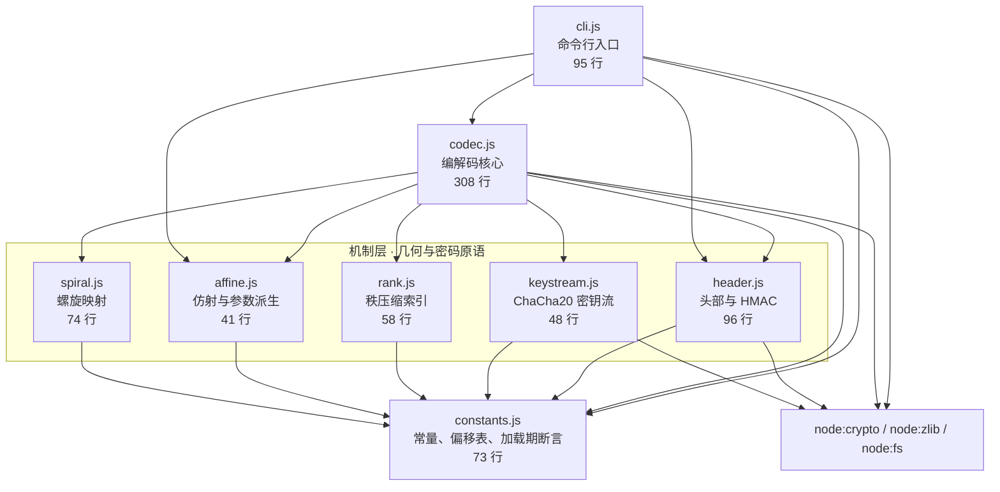
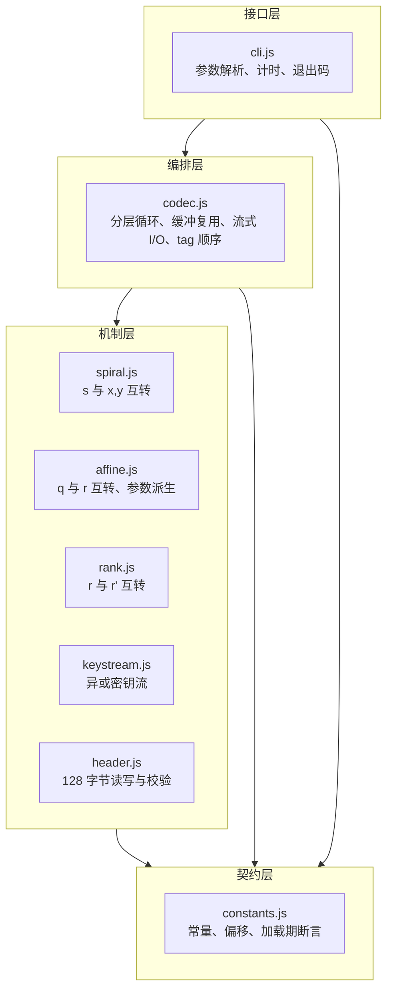
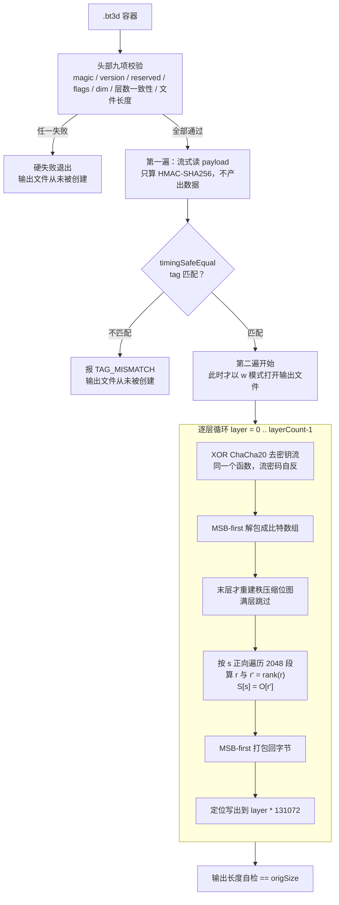
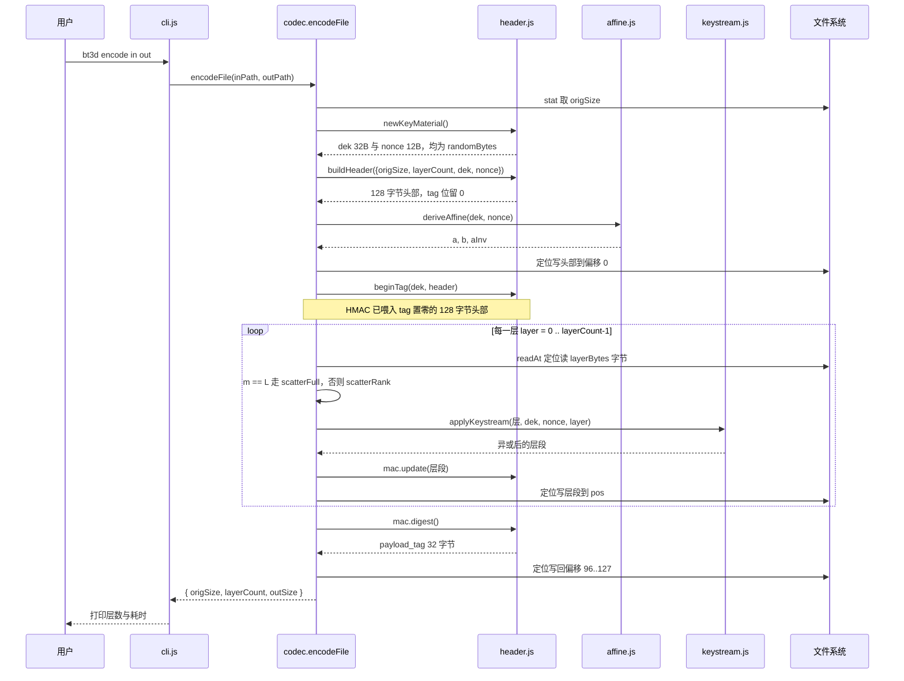
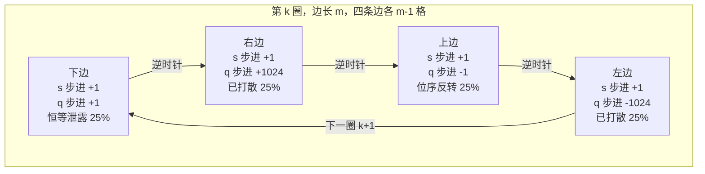
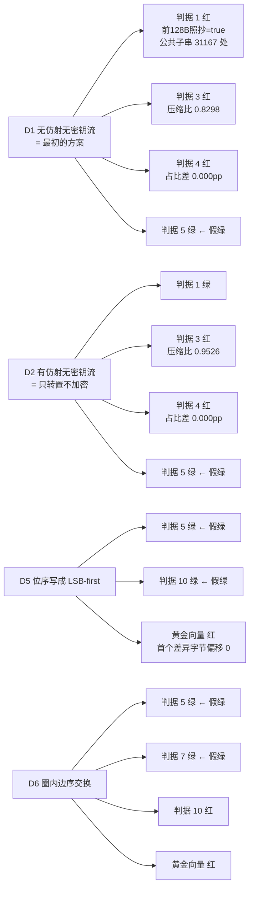

# BT3D · Node 实现

把任意文件重编码成一个自定义容器 `.bt3d`：文件被切成 128 KiB 的层，每层的比特按**逆时针螺旋**填进 1024×1024 的平面格子，格子序号再经**密钥相关的仿射变换**打散、经**秩压缩**紧凑化，最后整层与 **ChaCha20 密钥流**异或落盘。总大小 = 原文件 + **恰好 128 字节**。

| 项 | 值 |
| --- | --- |
| 格式版本 | BT3D v1 |
| 规范文档 | [`../格式规格.md`](../格式规格.md)（**规范性**，本文与之冲突时以它为准） |
| 实现语言 | JavaScript（ESM），Node ≥ 20 |
| 第三方依赖 | **0 个**（只用 `node:crypto`、`node:zlib`、`node:fs`） |
| 源码规模 | `src/` 772 行 + `test/` 788 行 = 1560 行 |
| 验收状态 | 判据 **15 / 15 通过**，黄金向量 6 / 6 匹配 |
| 机密性 | **0 bit**（DEK 明文存于头部，见第 1.4 节）—— 这是混淆容器，不是加密容器 |

> **本文是自包含的全景文档**：不读规范文档也能理解并改动这个工程。因此第 2 章（头部逐位）与第 10 章（工作原理）会与规范文档有意重复；改格式时必须两处同步。

---

## 目录

- [第 0 章 最短可跑路径](#第-0-章-最短可跑路径)
- [第 1 章 创建目的与解决的问题](#第-1-章-创建目的与解决的问题)
- [第 2 章 前 128 Byte 逐位分析](#第-2-章-前-128-byte-逐位分析)
- [第 3 章 项目技术栈](#第-3-章-项目技术栈)
- [第 4 章 项目架构](#第-4-章-项目架构)
- [第 5 章 代码地图](#第-5-章-代码地图)
- [第 6 章 组件架构](#第-6-章-组件架构)
- [第 7 章 各组件功能与内部核心逻辑](#第-7-章-各组件功能与内部核心逻辑)
- [第 8 章 数据流图](#第-8-章-数据流图)
- [第 9 章 工作流程](#第-9-章-工作流程)
- [第 10 章 工作原理](#第-10-章-工作原理)
- [第 11 章 验收判据与实测台账](#第-11-章-验收判据与实测台账)
- [第 12 章 交付面：改了什么会波及产物](#第-12-章-交付面改了什么会波及产物)
- [附录 FAQ](#附录-faq)

---

## 第 0 章 最短可跑路径

读者设定：**从没碰过这个工程的人**。每一步都给命令和预期输出，照着抄就能跑通。

### 0.1 前置要求

| 项 | 要求 | 本机实测值 |
| --- | --- | --- |
| Node.js | ≥ 20（需 `zlib.zstdCompressSync`，判据 3 用） | v24.21.0 |
| npm install | **不需要** | 零第三方依赖 |
| 磁盘 | 判据 5 的 E5 用例需临时构造 37 MiB + 1 B 数据 | 95.9 GiB 可用内存 |
| 操作系统 | 无特殊要求 | win32 10.0.26300 x64 |

检查命令与预期：

```bash
node --version
# 预期：v20.x 或更高。本机实测 v24.21.0
```

### 0.2 三步跑通

```bash
cd node

# 第 1 步：编码（输出名可以省略）
node src/cli.js encode 任意文件              # → 任意文件.bt3d
node src/cli.js encode 任意文件 输出.bt3d     # 显式指定，效果相同
# 预期：编码完成: N 字节 → N+128 字节，K 层
#              输出 任意文件.bt3d（输出名缺省 = 源文件名 + .bt3d），T ms

# 第 2 步：还原（两个参数都必填）
node src/cli.js decode 输出.bt3d 还原文件
# 预期：解码完成: N 字节，K 层，写出 N 字节，T ms

# 第 3 步：逐字节比对
cmp 任意文件 还原文件 && echo 一致
# 预期：一致
```

缺省输出名的规则是**追加**而不是替换后缀：`archive.tar.gz → archive.tar.gz.bt3d`。理由见第 7.8 节。

本机实测（输入为 `node.exe` 的前 5 MiB，5,242,880 字节）：

```
编码完成: 5242880 字节 → 5243008 字节，40 层，218 ms
解码完成: 5242880 字节，40 层，写出 5242880 字节，262 ms
cmp: 完全一致
还原文件 sha256 = 620105e5d1b35ea1bb89bb243c61a7a15995ee6d193e9306f96e9f74851b62d5（与原文件逐字符相同）
```

### 0.3 跑验收判据

```bash
node test/criteria.js               # 15 条判据，约 5 秒
# 预期末行：通过 15 / 15  全部判据通过   退出码 0

node test/criteria.js --prove-red   # 额外注入 4 个缺陷，证明判据会自己红
node test/vectors.js --check        # 黄金向量回归守卫
# 预期：黄金向量对拍通过：6 组全部匹配   退出码 0
```

### 0.4 查看容器内部

```bash
node src/cli.js inspect 输出.bt3d
```

本机实测输出（5 MiB 容器）：

```
  文件大小            5243008 字节
  origSize        5242880 字节
  layerCount      40（满层 40，无末层）
  几何              1024 × 1024，每层 131072 字节
  flags           0x1c
  dek             793ec1dbc13a9fdb5d1d4f7f2855989e70fd0d944566565f9e9ab4b6b9ad8963
  file_nonce      a8164864486a54dac9824474
  仿射 a            1016413 (0xf825d)
  仿射 b            589069 (0x8fd0d)
  a_inv mod 2^20  1008117  校验 a*a_inv mod 2^20 = 1
  payload_tag     eff1bff8a8df03bd88666bbad4cead437705dea83d2b6ded73a2eb62e2cb2af8
  体积开销            128 字节（规范值 128）
```

**注意 `dek` 是明文打印出来的** —— 这不是疏忽，而是本格式的设计（第 1.4 节）。任何人拿到容器都能这样还原它。

### 0.5 最短路径断链自查

| 步骤 | 失败时的现象 | 原因 |
| --- | --- | --- |
| `node --version` 报 command not found | 无输出 | Node 未装或不在 PATH。本机 Node 在 `C:\Program Files\nodejs\` |
| `criteria.js` 报 `zstdCompressSync is not a function` | 判据 3 抛异常 | Node < 22.15，`node:zlib` 尚无 zstd |
| `encode` 报 `EMFILE` / `ENOSPC` | 编码中断 | 句柄或磁盘不足 |
| `decode` 报 `TAG_MISMATCH` | 退出码 1，**不创建输出文件** | 容器被改动过，或用别的实现写的（黄金向量对不上） |

---

## 第 1 章 创建目的与解决的问题

### 1.1 痛点：一段真实的设计对话

这个格式起源于一个很自然的想法。最初的提案是：

> 「将任意一个文件在二进制层面映射到一个三维空间中获取一个新的自定义格式的文件。核心是将原文件对应的所有二进制的 0/1 首先在一个 1024×1024 的矩阵平面中从 0 开始逆时针循环填充，一层完成之后再开始在 Z 轴向上堆叠。」

出发点是**比特流混淆**：让文件不能被工具直接认出来，同时能完整还原。

沿着这个思路把几何算清楚之后，出现了一个当时没预料到的结果：

> 「螺旋的每一圈由四条边组成，各占 `m−1` 格。存储扫描 `q = y·n + x` 在 x 方向是连续的，于是下边的 `s` 步进 +1、`q` 步进也是 **+1** —— 恒等映射。最外圈的下边覆盖 `s = 0..1022`，紧接着右边第一格 `s = 1023 → q = 1023`。所以 payload 的前 1024 比特 = 原文件的前 1024 比特，**即容器去掉头部后的前 128 字节，与原文件前 128 字节逐字节相同**。」

这不是参数没调好，而是**一般性结论**：只要存储扫描在 x 方向连续，螺旋的两条水平边（占全部比特的 **正好 50%**）就必然落在 `|Δq| = 1` 的位置上 —— 与起点选哪个角、顺时针还是逆时针、y 朝上还是朝下、从哪一圈开始，全都无关。

这个结论后来被实测证实了。第 11 章的缺陷注入变体 **D1**（纯螺旋 + 纯光栅，无仿射无密钥流，即最初的方案）跑出：

```
判据1 红（前128B照抄=true，≥8B公共子串 31167 处）
判据5 往返一致
```

**「往返一致」是关键**：最初的方案能完美还原，任何往返测试都是绿的，但它把原文件的前 128 字节原样抄在容器开头。`file` 命令一眼就能认出那是个什么文件。

### 1.2 它怎么解决的

三层叠加，每层解决一个不同的问题：

| 层 | 机制 | 解决的问题 | 章节 |
| --- | --- | --- | --- |
| 几何转置 | 逆时针螺旋填进 1024×1024 | 提供三维解释与可视化模型；把线性流变成二维面 | 第 10.2 节 |
| 仿射散射 | `r = (a·q + b) mod 2²⁰`，`a`/`b` 由密钥派生 | **修掉 50% 恒等邻接泄露** | 第 10.3 节 |
| 秩压缩 | `r' = rank(r)` | 让末层不必补满 128 KiB，总体积精确 = 原文件 + 128 | 第 10.4 节 |
| 密钥流 | ChaCha20 异或 | **唯一提供真混淆的一层**：消除压缩率指纹、位占比指纹、公共子串 | 第 10.5 节 |

> **新人小结**：把原文件想成一副按顺序排好的扑克牌。
> - **螺旋**是把牌按螺旋形摆到桌面上 —— 牌还是那些牌，顺序也没变，只是换了个摆法；
> - **仿射散射**是真的洗牌，让相邻的牌飞到桌子两端；
> - **秩压缩**是「桌子太大而牌不够时，把牌往左边推紧，别留空位」；
> - **密钥流**是把每张牌的花色用一张随机透明胶片盖住 —— 这一步之后，即使有人知道你怎么洗的牌，也看不出原来是什么。
>
> 只做前两步，牌面还是原来那些牌面；只有最后一步真正让外人看不出来。

### 1.3 具体怎么用

见第 0 章。三条命令：`encode` / `decode` / `inspect`。

作为库使用时：

```js
import { encodeBuffer, decodeBuffer } from './src/codec.js';

const container = encodeBuffer(originalBuffer);   // 自动随机生成 dek 与 nonce
const restored  = decodeBuffer(container);
restored.equals(originalBuffer);                   // true
```

流式大文件用 `encodeFile` / `decodeFile`，常驻内存与文件大小无关（实测 256 MiB 输入只增 1.8 MiB RSS，见第 11.5 节）。

### 1.4 必须说清楚的能力边界

**本格式在密码学意义下的机密性强度为 0 bit。**

数据密钥 `dek` 明文存放在头部偏移 64..95。任何持有容器文件的人都能读出这 32 字节并完整还原原文 —— `node src/cli.js inspect` 就是干这个的。

它提供的是**混淆（obfuscation）**，不是**加密（encryption）**。区别在于：加密的安全性依赖密钥保密；本格式的密钥与密文同处一个文件，因此安全性依赖的是「攻击者没拿到这个文件」，而一旦拿到，格式不再提供任何保护。

这是**有意的设计选择**，不是实现偷懒。设计阶段评估过三个挡位：

| 挡位 | DEK 存放 | 机密性 | 「可恢复」的条件 |
| --- | --- | --- | --- |
| A · 纯几何 | 无 DEK | 0 bit | 无条件 |
| **B · 明文 DEK（本实现）** | 头部偏移 64..95 | **0 bit** | **无条件** |
| C · 口令包裹 DEK | 头部，被口令派生的 KEK 加密 | 依赖口令强度 | 需记得口令 |

选 B 而非 C：「可恢复」**无条件成立**，不存在忘口令导致数据永久丢失。
选 B 而非 A：DEK 每文件随机，因此仿射参数与密钥流也每文件随机，两个容器之间无法互相对拍，且修掉了 A 挡下的三个指纹泄露。

选 B 的代价：仿射散射与秩压缩在本挡位下**不提供安全性**（攻击者有 DEK 就能全部还原），它们只是让格式看起来像个三维体素容器，并为将来升级到 C 挡预留了承重结构。这一点在第 10.3 节会再强调一次。

**提供的保护 / 不提供的保护**：

| 威胁 | 防住？ | 机制或原因 |
| --- | --- | --- |
| `file` 等魔数嗅探 | ✅ | payload 是 ChaCha20 输出，无可识别结构 |
| hex 编辑器肉眼判读 | ✅ | 同上 |
| 自动内容分类 / 索引器 | ✅ | 同上 |
| 压缩率指纹 | ✅ | 判据 3 实测 0.000148 → 1.000031 |
| 位占比指纹 | ✅ | 判据 4 实测 36.605% → 49.975% |
| 原文公共子串 | ✅ | 判据 1 实测 ≥8 B 公共子串 **0 处**（D1 变体为 31,167 处） |
| 意外损坏（截断、位翻转） | ✅ | `payload_tag`，判据 9 实测五种损坏全部报错 |
| 同内容文件产生相同容器 | ✅ | DEK 与 nonce 每文件随机，判据 8 实测 |
| **持有容器者读取原文** | ❌ | DEK 明文在头部 |
| **蓄意伪造 / 篡改** | ❌ | HMAC 密钥就是 DEK，攻击者可对任意改动重算合法 tag |
| 元数据泄露 | ❌ | `origSize` 明文，精确文件大小可见 |

---

## 第 2 章 前 128 Byte 逐位分析

容器 = **128 字节头部** + **payload**。头部逐字节全覆盖、无空洞，加总核对：

```
4 + 1 + 1 + 2 + 8 + 8 + 4 + 4 + 12 + 20 + 32 + 32 = 128  ✓
```

### 2.1 逐字节偏移表

| 偏移 | 长度 | 字段 | 类型 | 规范值 / 范围 | 说明 |
| --- | --- | --- | --- | --- | --- |
| 0 | 1 | `magic[0]` | u8 | `0x42` `'B'` | 魔数 |
| 1 | 1 | `magic[1]` | u8 | `0x54` `'T'` | |
| 2 | 1 | `magic[2]` | u8 | `0x33` `'3'` | |
| 3 | 1 | `magic[3]` | u8 | `0x44` `'D'` | |
| 4 | 1 | `version` | u8 | `1` | v1 |
| 5 | 1 | `flags` | u8 | `0x1C` | 逐位见 §2.2 |
| 6 | 1 | `reserved0` | u8 | `0` | 必须为 0 |
| 7 | 1 | `reserved1` | u8 | `0` | 必须为 0 |
| 8..15 | 8 | `origSize` | u64 LE | 原文件字节数 | **往返闭环的唯一保证**，见 §2.3 |
| 16..23 | 8 | `layerCount` | u64 LE | `ceil(origSize/131072)` | 冗余；解码方必须交叉校验 |
| 24..27 | 4 | `dimX` | u32 LE | `1024` = `00 04 00 00` | |
| 28..31 | 4 | `dimY` | u32 LE | `1024` = `00 04 00 00` | |
| 32..43 | 12 | `file_nonce` | 12 × u8 | 每文件随机 | ChaCha20 nonce |
| 44..63 | 20 | `reserved2` | 20 × u8 | **全 0** | 解码方必须校验；预留给 v3 的 KDF 参数 |
| 64..95 | 32 | `dek` | 32 × u8 | 每文件随机 | **明文**数据密钥 |
| 96..127 | 32 | `payload_tag` | 32 × u8 | HMAC-SHA256 | 见 §2.4 |

代码里的偏移常量集中在 [`src/constants.js:40-54`](src/constants.js#L40)，命名规则是 `OFF_<字段>` / `LEN_<字段>`，全仓禁止出现裸数字偏移。

### 2.2 `flags` 字节（偏移 5）逐位展开

| 位 | 权重 | 常量名 | 规范值 | 含义 |
| --- | --- | --- | --- | --- |
| bit0 | 1 | `F_SPIRAL_CW` | `0` | 螺旋方向：0 = 逆时针（规范），1 = 顺时针 |
| bit1 | 2 | `F_BIT_LSB_FIRST` | `0` | 位序：0 = MSB-first（规范），1 = LSB-first |
| bit2 | 4 | `F_KEYSTREAM_ON` | **`1`** | 密钥流开关。v1 **禁止**为 0 |
| bit3 | 8 | `F_AFFINE_ON` | **`1`** | 仿射散射开关 |
| bit4 | 16 | `F_RANK_COMPACT` | **`1`** | 秩压缩开关 |
| bit5 | 32 | `F_COMPRESSED` | `0` | v1 保留，**必须为 0**；v2 用于每层压缩 |
| bit6 | 64 | `F_RESERVED6` | `0` | 必须为 0 |
| bit7 | 128 | `F_RESERVED7` | `0` | 必须为 0 |

规范 profile：`bit2 + bit3 + bit4 = 4 + 8 + 16 = 28 = 0x1C = 0b0001_1100`

```
bit:    7   6   5   4   3   2   1   0
值:     0   0   0   1   1   1   0   0
        │   │   │   │   │   │   │   └─ bit0 F_SPIRAL_CW    = 0  逆时针（规范）
        │   │   │   │   │   │   └───── bit1 F_BIT_LSB_FIRST = 0  MSB-first（规范）
        │   │   │   │   │   └───────── bit2 F_KEYSTREAM_ON  = 1  密钥流开
        │   │   │   │   └───────────── bit3 F_AFFINE_ON     = 1  仿射散射开
        │   │   │   └───────────────── bit4 F_RANK_COMPACT  = 1  秩压缩开
        │   │   └───────────────────── bit5 F_COMPRESSED    = 0  v1 保留，必须为 0
        │   └───────────────────────── bit6 F_RESERVED6     = 0  必须为 0
        └───────────────────────────── bit7 F_RESERVED7     = 0  必须为 0
```

解码校验：

```js
if (flags & FLAGS_MUST_BE_ZERO)                    → BAD_PROFILE   // 有未支持的位置 1
if ((flags & FLAGS_NORMATIVE) !== FLAGS_NORMATIVE) → BAD_PROFILE   // 必需位没置 1
```

**两个掩码是从各个标志位常量算出来的，不写死字面量**（[`src/constants.js:25-37`](src/constants.js#L25)），并且模块加载时断言：

```js
if ((FLAGS_NORMATIVE | FLAGS_MUST_BE_ZERO) !== 0xff) throw new Error('flags 的两个掩码未覆盖全部 8 位');
if ((FLAGS_NORMATIVE & FLAGS_MUST_BE_ZERO) !== 0)    throw new Error('flags 的两个掩码互相重叠');
```

实测加载结果：`FLAGS_NORMATIVE=0x1c  FLAGS_MUST_BE_ZERO=0xe3  并集=0xff  交集=0x0` ✓

> **为什么这么绕**：规范文档初稿把必零位掩码手写成了 `0xC3`。`0xC3 = 0b1100_0011`，而 bit0|bit1|bit5|bit6|bit7 实际是 `0b1110_0011 = 0xE3` —— **少算了 bit5**。后果是 `COMPRESSED` 位被置 1 的畸形容器会通过校验，解码方按未压缩解析一段压缩数据，输出全是垃圾，而且没有任何测试会变红。
>
> 手写位掩码的错误不会自己暴露，所以改成「从常量算 + 加载期断言并集为 0xFF」。这个缺陷在规范文档 §4.2 与 §10.1 各存在一处，后者在规范性解码算法里，会被直接抄进任何实现。

### 2.3 三个字段的语义细节

**`origSize`（偏移 8..15）—— 往返闭环的唯一保证**

末层几乎必然填不满，其填充比特在数学上是歧义的：解码方无法从 payload 本身判断哪些比特是数据、哪些是补齐。`origSize` 精确消除这个歧义。它同时决定 `layerCount`、每层的 `m`（秩压缩的模）、以及解码输出的截断位置。

**`file_nonce`（偏移 32..43）—— 每文件必须重新随机生成**

ChaCha20 在「同一密钥 + 同一 nonce」下重用会构成 two-time pad：两个容器的 payload 异或即得两份明文的异或，可直接 crib-drag 破解。本格式每文件的 DEK 也是随机的（双重保护），但仍必须每文件重新生成 nonce —— 否则一旦某个实现错误复用了 DEK，就没有第二道防线。判据 8 实测：随机密钥两次编码，payload / nonce / dek 全部不同。

**`reserved2`（偏移 44..63）—— 必须校验全零**

留白不是「随便填」。解码方逐字节校验（[`src/header.js:63-65`](src/header.js#L63)），任一非零报 `BAD_RESERVED`。这 20 字节是 v3 升级（口令包裹 DEK）时放 KDF 参数的位置，提前锁死可以让 v1 解码方在遇到 v3 容器时硬失败而不是误解析。

### 2.4 `payload_tag` 的计算

```
1. 取头部 128 字节的副本，把偏移 96..127 这 32 字节全部置 0
2. data = 置零后的头部(128 B) ‖ payload(origSize B)
3. payload_tag = HMAC-SHA256(key = dek, data)
4. 把结果写入头部偏移 96..127
```

实现见 [`src/header.js:41`](src/header.js#L41)（`tagFromHeader`）与 [`src/header.js:49`](src/header.js#L49)（`verifyTag`，用 `timingSafeEqual` 常量时间比较）。

**它是完整性校验，不是认证** —— HMAC 密钥就是明文 DEK，攻击者可对任意修改后的 payload 重算出合法 tag。它的作用是检测**意外损坏**（截断、位翻转、传输错误、拿错工具），不是防**蓄意伪造**。

**为什么不用 CRC**：口令/tag 不匹配时，CRC32 有 2⁻³² 概率碰巧通过，然后你会拿到一堆垃圾字节却以为还原成功了。HMAC-SHA256 截断到 256 位没有这个问题。判据 9 实测五种损坏（payload 首字节、payload 末字节、头部 origSize、头部 flags、头部 reserved2）全部硬失败。

### 2.5 真实容器头部逐字段拆解

下面是黄金向量 **GV-4**（输入 = 8 字节 `00 01 02 03 04 05 06 07`，固定 DEK 与 nonce）的实际头部，用脚本按偏移切开：

```
GV-4 头部 hex 总长度 = 256 字符 = 128 字节

偏移   0..3   ( 4 B) magic              42543344 = "BT3D"
偏移   4..4   ( 1 B) version            01 = 1
偏移   5..5   ( 1 B) flags              1c = 0x1c = 0b00011100
偏移   6..7   ( 2 B) reserved0/1        0000
偏移   8..15  ( 8 B) origSize u64LE     0800000000000000 = 8
偏移  16..23  ( 8 B) layerCount u64LE   0100000000000000 = 1
偏移  24..27  ( 4 B) dimX u32LE         00040000 = 1024
偏移  28..31  ( 4 B) dimY u32LE         00040000 = 1024
偏移  32..43  (12 B) file_nonce         425433442d6e6f6e63652d31 = "BT3D-nonce-1"
偏移  44..63  (20 B) reserved2          0000000000000000000000000000000000000000 全零=true
偏移  64..95  (32 B) dek                425433442d76312d66697865642d64656b2d676f6c64… = "BT3D-v1-fixed-dek-golden-vector!"
偏移  96..127 (32 B) payload_tag        2f73e82080d3c2e5d2e2b1620fae035bf843c7e33141…

覆盖字节数 = 128 （应 128）
```

三个值得注意的细节：

1. **`00040000` 读作 1024** —— 小端序。写成大端会是 `00000400`，读出来是 1024 的字节反转 262144。这是约定 C1，两份实现字节序不一致时**所有**多字节字段都会读错。
2. **`origSize` 的 8 字节里 7 个是 0** —— u64 是为了支持到 256 GiB（32 位块计数器的上限），小文件下高位字节全零是正常的，不是浪费。
3. **`dek` 和 `file_nonce` 在黄金向量里是可见 ASCII** —— 这是刻意的：固定密钥材料才能让 payload 完全可复现，从而成为跨栈对拍的靶子。真实编码走 `newKeyMaterial()`，两者都是 `crypto.randomBytes` 的输出。

### 2.6 头部的一致性校验清单

解码方在读 payload 之前必须全部通过（[`src/header.js:55`](src/header.js#L55) `parseHeader`）：

| 检查 | 失败错误码 |
| --- | --- |
| 文件长度 ≥ 128 | `TOO_SHORT`（实际由 `readAt` 抛 `EOF`） |
| `magic == "BT3D"` | `BAD_MAGIC` |
| `version == 1` | `BAD_VERSION` |
| 偏移 6..7 与 44..63 全零 | `BAD_RESERVED` |
| `flags` 两个掩码 | `BAD_PROFILE` |
| `dimX == dimY == 1024` | `BAD_GEOMETRY` |
| `layerCount == ceil(origSize/131072)` | `HEADER_INCONSISTENT` |
| 文件长度 `== origSize + 128` | `BAD_LENGTH` |
| `payload_tag` 常量时间比对 | `TAG_MISMATCH` |

**总原则：遇到任何不符合规范的情况都必须硬失败，禁止尽力而为的部分还原** —— 部分还原会让用户以为拿到了完整数据。

---

## 第 3 章 项目技术栈

### 3.1 选型与理由

| 层 | 选择 | 为什么 | 代价 |
| --- | --- | --- | --- |
| 语言 | JavaScript（ESM） | 用户指定；Node ≥ 20 内置全部所需能力 | 位运算只有 32 位有符号，`a·x` 达 2⁶⁰ 时必须切 BigInt |
| 模块制 | ESM（`"type": "module"`） | Node 24 原生支持，`import` 静态可分析 | 顶层 `await` 只在 ESM 下可用（`criteria.js` 依赖它） |
| 加密 | `node:crypto`（OpenSSL 3.5.8） | ChaCha20 / HMAC-SHA256 / HKDF-SHA256 / randomBytes / timingSafeEqual 全部内置 | ChaCha20 的 IV 是 16 字节（计数器 4 + nonce 12），与 RFC 8439 的参数形式不同，需要自己拼 |
| 压缩 | `node:zlib` 的 `zstdCompressSync` | 判据 3 需要一个真压缩器来量熵 | Node < 22.15 没有这个 API |
| 文件 I/O | `node:fs/promises` 的 `FileHandle` | `fh.read(buf, off, len, position)` 支持定位读，解码两遍不需要 seek | 需要自己写 `readAt` 处理短读 |
| 第三方依赖 | **无** | 零 `npm install`，容器与测试脚本可直接拷走跑 | 无 zstd 压缩挡（v1 本就不做压缩） |

### 3.2 用到的 Node API 清单

| API | 用在哪 | 作用 |
| --- | --- | --- |
| `crypto.randomBytes` | `header.js:13` | 生成每文件随机的 dek（32 B）与 file_nonce（12 B） |
| `crypto.hkdfSync` | `affine.js:29` | 从 (dek, nonce) 派生仿射参数 a、b |
| `crypto.createCipheriv('chacha20', …)` | `keystream.js:32`、`keystream.js:40` | 密钥流。流密码，`update()` 的返回值就是输入异或密钥流 |
| `crypto.createHmac('sha256', …)` | `header.js:35`、`codec.js` | `payload_tag` |
| `crypto.timingSafeEqual` | `header.js:49`、`codec.js` | tag 常量时间比较 |
| `zlib.zstdCompressSync` | `test/criteria.js:46` | 判据 3 的熵代理 |
| `Buffer.readBigUInt64LE` / `writeBigUInt64LE` | `header.js` | 头部的 u64 小端字段 |
| `Math.clz32` | 未使用（秩压缩不需要 select） | — |
| `BigInt` | `affine.js:16`、`test/criteria.js` | Hensel 提升的中间积达 2⁶⁰，超出 float64 精确整数范围 2⁵³ |

### 3.3 语言特性上的三个硬约束

这三条是 JS 特有的坑，换语言时会变形但不会消失：

1. **`>>` 是有符号右移**。`i >> 20` 对 `i ≥ 2³¹` 会得到错误结果。本实现的全局比特序号 `i` 上界是 2⁴¹（256 GiB），但**代码里从不构造全局 `i`** —— 层号与层内序号分开算，层内序号 `s < 2²⁰`、`q`、`r` 全部安全落在 int32 内。这是刻意的设计约束，不是巧合。
2. **float64 的精确整数上界是 2⁵³**。`a·q < 2⁴⁰` 安全；`x·(2 − a·x)` 达 2⁶⁰ **不安全**，所以 [`affine.js:16`](src/affine.js#L16) 的 Hensel 提升全程用 `BigInt`。
3. **`1 << 31` 是负数**。位图操作里 `1 << (r & 31)` 在 `r & 31 === 31` 时得到 `-2147483648`，写进 `Uint32Array` 时经 `ToUint32` 转回 `0x80000000` —— 结果正确，但依赖这个隐式转换。[`rank.js:52`](src/rank.js#L52) 的掩码 `((1 << b) - 1)` 同理，`b = 31` 时得 `-2147483649`，`& ` 运算经 `ToInt32` 得 `0x7FFFFFFF`，正是低 31 位掩码。

> **新人小结**：JS 的数字只有一种（float64），但位运算会临时把它当成 32 位有符号整数。这就像一把尺子平时能量到 1 公里，但你一用它做「与或非」，它就自动缩短到只能量 2 米 —— 超过就绕回负数。所以要么保证参与位运算的数小于 2³¹，要么改用 `BigInt` 这把不会缩短的尺子。

---

## 第 4 章 项目架构

### 4.1 目录结构

```
比特3维化/
├── 格式规格.md              ← 规范性文档（跨栈唯一权威）
├── node/
│   ├── README.md            ← 本文
│   ├── package.json         ← 零依赖，"type": "module"
│   ├── src/
│   │   ├── constants.js     ← 契约层：常量、头部偏移、加载期断言
│   │   ├── spiral.js        ← 机制层：螺旋闭式 + 2048 段等差表
│   │   ├── affine.js        ← 机制层：仿射变换 + HKDF 派生 + 模逆
│   │   ├── rank.js          ← 机制层：秩压缩索引（位图 + 字级前缀和）
│   │   ├── keystream.js     ← 机制层：ChaCha20 绑定
│   │   ├── header.js        ← 机制层：头部构造、解析、HMAC
│   │   ├── codec.js         ← 编排层：分层循环、散射/聚集、流式 I/O
│   │   └── cli.js           ← 接口层：encode / decode / inspect
│   └── test/
│       ├── criteria.js      ← 判据 1~15 + prove-red
│       ├── reference.js     ← 慢路径参照实现 + 几何审计
│       ├── defects.js       ← 缺陷注入（D5 / D6）
│       ├── vectors.js       ← 黄金向量生成与对拍
│       └── golden-vectors.json  ← 6 组向量（生成物，纳入版本控制）
└── sdk/
    ├── bt3d-encode.js       ← 自包含单文件编码器（CommonJS，零依赖）
    ├── bt3d-decode.js       ← 自包含单文件解码器（同上）
    ├── interop-check.js     ← 与 node/src/ 的逐字节对拍检查（6 个用例）
    └── README.md            ← 引入方式、API 表、边界
```

`sdk/` 里的两个文件各自内联了一份完整格式实现，与 `node/src/` 是**重复实现**而不是同一份代码 —— 目的是让任何项目拷走一个文件就能用。重复的漂移风险由 `sdk/interop-check.js` 守住。

### 4.2 依赖图



三条结构性约束，都是从这张图上直接读出来的：

1. **机制层互不依赖**（`spiral` / `affine` / `rank` / `keystream` / `header` 之间没有边）。它们只依赖 `constants.js`。因此任何一个都可以单独替换或单独测试。
2. **`codec.js` 是唯一的汇聚点**，也是唯一知道「层循环」这个概念的地方。机制层不知道层的存在。
3. **依赖无环**。`constants.js` 是唯一的汇（sink），不 import 任何本地模块。

### 4.3 分层原则

| 层 | 职责 | 不该做的事 |
| --- | --- | --- |
| 接口层 `cli.js` | 参数解析、进度与错误呈现、退出码 | 不含任何格式逻辑 |
| 编排层 `codec.js` | 分层循环、缓冲复用、I/O、tag 计算顺序 | 不含几何公式，不直接调 `node:crypto`（除 HMAC 的流式用法） |
| 机制层 5 个模块 | 各自的纯函数式变换 | 不做 I/O，不知道层循环，不持有跨调用状态（`RankIndex` 是唯一有状态的类，且由编排层持有） |
| 契约层 `constants.js` | 常量、偏移、错误类型、加载期断言 | 不含算法 |

**为什么把 `constants.js` 单独立一层**：格式里所有「魔法数字」（1024、2²⁰、128、2048、偏移 64、掩码 0xE3）都必须只有一个出处。它们散落在各模块里时，改一处漏一处是必然的；集中之后，`grep` 一次就能审完。加载期断言（掩码并集必须是 0xFF）也放在这里，因为它检查的是契约自身的自洽性。

---

## 第 5 章 代码地图

行号均为 2026-10-17 实测 `grep -n` 结果，改代码后需重新核对。

### 5.1 `src/constants.js`（73 行）—— 契约层

| 行 | 符号 | 说明 |
| --- | --- | --- |
| 3-10 | `N` `L` `LAYER_BYTES` `RING_COUNT` `SEG_PER_LAYER` `HEADER_SIZE` `CHACHA_BLOCK` `BLOCKS_PER_LAYER` | 几何与尺寸常量。`L = 2²⁰`，`LAYER_BYTES = 131072` |
| 12-13 | `MAGIC` `VERSION` | `'BT3D'` / `1` |
| 16-23 | `F_SPIRAL_CW` … `F_RESERVED7` | 八个 flags 位常量 |
| 25 | `FLAGS_NORMATIVE` | 由三个「必须为 1」的位常量算出 = `0x1C` |
| 29-30 | `FLAGS_MUST_BE_ZERO` | 由五个「必须为 0」的位常量算出 = `0xE3` |
| 32-37 | 加载期断言 | 两掩码并集必须 `0xFF`、交集必须 `0x0`，否则模块加载即抛错 |
| 40-54 | `OFF_*` / `LEN_*` | 头部 12 个字段的偏移与长度 |
| 56-57 | `HKDF_INFO_A` `HKDF_INFO_B` | `'BT3D-v1-scan-a'` / `'BT3D-v1-scan-b'`，域分隔用 |
| 59-65 | `Bt3dError` | 带 `code` 字段的错误类型，CLI 靠它决定退出码 |
| 67, 70 | `layerBytes` `layerCountOf` | 层长与层数推导 |
| 73 | `modL` | 负数安全取模 `((v % L) + L) % L` |

### 5.2 `src/spiral.js`（74 行）—— 螺旋

| 行 | 符号 | 说明 |
| --- | --- | --- |
| 11 | `ringBase(k)` | 第 k 圈基址 `4k(n−k)` |
| 14 | `spiralForwardSlow(s)` | **慢路径**：sqrt 闭式 + 两轮整数校正，返回 `[x, y]` |
| 31 | `spiralInverse(x, y)` | 逆映射，四分支判边 |
| 45-48 | `SEG_S` `SEG_Q` `SEG_QSTEP` `SEG_LEN` | **快路径**：2048 段的四个并列 `Int32Array`（共 32 KiB） |
| 50-72 | 段表构建块 | 模块加载时执行一次；末尾断言段数 = 2048 |
| 74 | `SEG_TOTAL_LEN` | 段长之和，判据 6 断言它 = `L` |

### 5.3 `src/affine.js`（41 行）—— 仿射与派生

| 行 | 符号 | 说明 |
| --- | --- | --- |
| 8 | `affineForward(q, a, b)` | `(a*q + b) % L`。`a*q < 2⁴⁰`，float64 精确 |
| 11 | `affineInverse(r, aInv, b)` | 逆变换。随机访问路径用，流式解码不用 |
| 16 | `modInverse20(a)` | Hensel 提升 5 轮，**全程 BigInt** |
| 29 | `deriveAffine(dek, nonce)` | HKDF 两次 → `a ∈ [2¹⁹, 2²⁰)` 奇数、`b`、`aInv` |

### 5.4 `src/rank.js`（58 行）—— 秩压缩

| 行 | 符号 | 说明 |
| --- | --- | --- |
| 10 | `WORDS` | `L / 32 = 32768` |
| 14 | `popcount32(v)` | SWAR，入参先 `>>> 0` |
| 22 | `RankIndex` | 位图 128 KiB + 前缀和 128 KiB，可跨层复用 |
| 30 / 36 / 40 / 52 | `clear` / `set` / `build` / `rank` | 四个方法。**没有 `select`** —— 解码按 `s` 顺序正向遍历，只需 `rank` |

### 5.5 `src/keystream.js`（48 行）—— ChaCha20 绑定

| 行 | 符号 | 说明 |
| --- | --- | --- |
| 11 | `MAX_LAYER` | `2³² / 2048 = 2097152`，对应 256 GiB payload 上限 |
| 13 | `counterBaseOf(layer)` | `layer * 2048`，超限抛 `COUNTER_OVERFLOW` |
| 23 | `buildIv(layer, nonce)` | **IV = 计数器 u32 LE(4 B) ‖ nonce(12 B)**，判据 14 对 RFC 8439 验证过 |
| 32 | `applyKeystream` | 加解密同一个函数（流密码自反） |
| 40 | `chacha20Raw` | 显式计数器版，仅供判据 14 |

### 5.6 `src/header.js`（96 行）—— 头部

| 行 | 符号 | 说明 |
| --- | --- | --- |
| 13 | `newKeyMaterial()` | `randomBytes(32)` + `randomBytes(12)` |
| 18 | `buildHeader({…})` | 写 128 字节，tag 位留 0 |
| 35 | `beginTag(dek, header)` | 返回已喂入「tag 置零头部」的 HMAC 对象，供流式续喂 |
| 41 | `tagFromHeader` | 一次性版（内存态解码用） |
| 49 | `verifyTag` | `timingSafeEqual` 比对 |
| 55 | `parseHeader(buf, fileSize)` | 九项校验，见第 2.6 节 |

### 5.7 `src/codec.js`（308 行）—— 编排核心

| 行 | 符号 | 说明 |
| --- | --- | --- |
| 18, 20 | `getBit` `setBit` | **MSB-first**（约定 C2）。全仓唯一的位存取入口 |
| 28, 29 | `segR0` `segRStep` | 由段的 `q` 起点/步进推出 `r` 起点/步进 |
| 34 | `scatterFull` | 满层散射：2048 段等差递推，`r' = r` |
| 50 | `scatterRank` | 末层散射：两遍，第一遍建位图第二遍写 `rank(r)` |
| 79 | `gatherFull` | 满层聚集 |
| 94 | `gatherRank` | 末层聚集（重建位图后用 `rank`） |
| 126 | `Scratch` | 复用缓冲容器：层缓冲 128 KiB + `RankIndex` 256 KiB |
| 133 | `makeParams` | 把 (dek, nonce) 变成 `{dek, nonce, a, b, aInv}` |
| 141 | `encodeLayer` | 单层编码：散射 → 打包 → 异或 |
| 157 | `decodeLayer` | 单层解码：异或 → 解包 → 聚集 |
| 171 | `encodeBuffer` | 内存态编码，黄金向量与判据都走这条 |
| 192 | `decodeBuffer` | 内存态解码 |
| 217 | `readAt` | 处理短读的定位读 |
| 226 | `encodeFile` | 流式编码：边写边喂 HMAC，最后定位写回 tag |
| 259 | `decodeFile` | 流式解码：**两遍**，第二遍才创建输出文件 |

### 5.8 `src/cli.js`（95 行）

| 行 | 符号 | 说明 |
| --- | --- | --- |
| 11 | `USAGE` | 三个子命令的用法文本，含缺省输出名示例 |
| 24 | `defaultOutPath(inPath)` | `inPath + '.bt3d'`（追加，不剥原后缀） |
| 28 | `assertDistinct(inPath, outPath)` | 同名输入/输出 → `SAME_PATH`，拒绝就地覆盖 |
| 35 | `inspect(inPath)` | 打印头部全字段 + 派生的 a/b/aInv + 模逆自校验 |
| 66 | 参数解构 | `[, , cmd, a1, a2] = process.argv` |
| 69 / 77 / 83 | `encode` / `decode` / `inspect` 分派 | `encode` 只要求 `a1`，`out = a2 ?? defaultOutPath(a1)` |
| 89-95 | 错误处理 | `Bt3dError` → 打印 `[code] message` + 退出码 1；其他异常继续抛 |

### 5.9 `test/`（788 行）

| 文件 | 行 | 关键符号与行号 |
| --- | --- | --- |
| `criteria.js` | 508 | `readSlice:37`、`zstdRatio:46`、`record:77`、`run:82`、`commonSubstrings:97`、`adjacencyStats:113`；判据 1~15 分别在 `146 / 158 / 167 / 184 / 202 / 221 / 231 / 243 / 259 / 280 / 305 / 320 / 344 / 373 / 389` |
| `reference.js` | 85 | `buildRankSlow:14`、`scatterSlow:25`、`gatherSlow:37`、`auditGeometry:49`、`auditAffineBijection:66`、`firstCells:78` |
| `defects.js` | 81 | `setBitLsb:19`、`scatterWith:42`、`gatherWith:57`、`scatterD5:73`、`gatherD5:74`、`scatterD6:77`、`gatherD6:78`、`scatterOk:81`；`D6_S` 段表在文件前部构建 |
| `vectors.js` | 114 | `generate:41`；`--check` 分支做逐字段对拍 |

---

## 第 6 章 组件架构

### 6.1 四层结构



### 6.2 机制层五个组件各自负责的变换

这五个组件对应格式里的五次可逆变换，串起来就是完整的映射链：

| 组件 | 变换 | 定义域 → 值域 | 逆运算 |
| --- | --- | --- | --- |
| `codec.js` | 分层 | 全局比特 `i` → `(layer, s)` | `(layer, s)` → `i` |
| `spiral.js` | 螺旋 | 层内序号 `s` → 格子 `(x, y)` | `(x, y)` → `s` |
| `affine.js` | 光栅 + 仿射 | `(x, y)` → 散射序号 `r` | `r` → `(x, y)` |
| `rank.js` | 秩压缩 | `r` → 存储序号 `r'` | 不需要（解码按 `s` 正向遍历） |
| `keystream.js` | 异或 | 打包字节 → 打包字节 | 自身即逆（流密码自反） |
| `header.js` | 元数据 | — | — |

**五个变换都是双射**，这是「可完整恢复」的数学基础。判据 6（螺旋覆盖）、判据 11（仿射双射）、判据 12（秩压缩满层退化）分别守住前三个的双射性；`rank` 的双射性由「`R` 中元素互异」+「秩的定义」直接保证，并由 `RankIndex.count === m` 这条运行时断言兜底。

### 6.3 三个关键设计决策

**决策一：快慢两条路径并存，慢路径永不进生产**

`spiral.js` 同时提供 sqrt 闭式（慢）和 2048 段等差表（快）。生产代码只走快路径；慢路径只被 `test/reference.js` 使用，作为判据 10 的独立真值。

- 快路径的价值：一整层的映射只需 2048 次段初始化 + 纯加法递推，**没有 sqrt、没有除法、不需要 4 MB 置换表**。
- 慢路径的价值：它与快路径**没有共享代码**（一个用 `Math.sqrt`，一个用预先构建的段表），所以快路径的段起点或公差算错时，判据 10 会红。这是「独立真值」的含义 —— 用同一套代码验同一套代码等于没验。

**决策二：解码不需要秩的反函数**

秩压缩的定义域是 `R`（该层被填充的 `m` 个散射序号），`rank` 把 `R` 映到 `[0, m)`。直觉上解码需要反函数 `select`（给 `r'` 求 `r`），那要二分查找 + 位扫描。

但解码可以**按 `s` 顺序遍历**：`s → (x,y) → q → r → r' = rank(r)`，然后读 `O[r']` 写回 `S[s]`。这条路径只需要正向的 `rank`，与编码侧共用同一个函数。

因此 `RankIndex` 没有 `select` 方法。规范文档 §7.5 初稿写了 `select` 的算法，实现时发现不需要，已同步修订 —— **文档跟着代码改，不留滞后条款**。

**决策三：解码走两遍输入**

`decodeFile` 第一遍只流式读 payload 算 HMAC，第二遍才解码写出。这会让输入文件被读两次。

换来的性质是：**tag 校验失败时输出文件从未被创建**。这不只是「干净」——`fs.open(path, 'w')` 会立刻截断已存在的文件，如果在校验前打开，一次失败的解码就会清空用户原有的同名文件。这个缺陷在实现完成后跑错误路径测试时被发现并修掉，回归验证见第 11.7 节。

替代方案（解码到临时文件再改名、或先写出再校验后删除）都更复杂且有各自的失败模式。两遍读的代价是可接受的：实测解码吞吐 14.4–19.0 MiB/s，比编码慢约 20%，其中一部分就来自这一遍。

---

## 第 7 章 各组件功能与内部核心逻辑

> **引用约定**：本章代码块里的注释是从源码原样摘录的，其中的 `§x.y` **一律指 [`../格式规格.md`](../格式规格.md) 的章节**，不是本文的章节号。例如 `spiral.js` 注释里的 `§5.5` 指规格的「螺旋正向闭式」，而本文的 §5.5 是 `keystream.js` 的代码地图 —— 两者无关。本文正文里的 `§x.y` 则指本文自身，指向规格时会显式写「规格 §x.y」或「规范文档 §x.y」。

### 7.1 `constants.js` —— 契约层

**功能**：格式的每一个魔法数字只有一个出处；并在模块加载时自证契约自洽。

**核心逻辑**（[`src/constants.js:25-37`](src/constants.js#L25)）：

```js
export const FLAGS_NORMATIVE = F_KEYSTREAM_ON | F_AFFINE_ON | F_RANK_COMPACT; // 0x1C
export const FLAGS_MUST_BE_ZERO =
  F_SPIRAL_CW | F_BIT_LSB_FIRST | F_COMPRESSED | F_RESERVED6 | F_RESERVED7;

if ((FLAGS_NORMATIVE | FLAGS_MUST_BE_ZERO) !== 0xff) {
  throw new Error('flags 的两个掩码未覆盖全部 8 位');
}
if ((FLAGS_NORMATIVE & FLAGS_MUST_BE_ZERO) !== 0) {
  throw new Error('flags 的两个掩码互相重叠');
}
```

**为什么这么写**：规范文档初稿把必零掩码手写成 `0xC3`，而 bit0|bit1|bit5|bit6|bit7 实际是 `0xE3` —— 少算了 bit5（`F_COMPRESSED`）。手写位掩码的漏位不会让任何测试变红，只会让畸形输入静默通过。改成「从位常量算 + 断言并集为 0xFF、交集为 0x0」之后，漏位在**模块加载时**就抛错，不可能进入运行期。

**实测**：加载后 `FLAGS_NORMATIVE=0x1c  FLAGS_MUST_BE_ZERO=0xe3  并集=0xff  交集=0x0` ✓；判据 9 的 `flags` 置 bit5 用例报 `BAD_PROFILE` ✓

**另一个易忽略的点**：`modL(v) = ((v % L) + L) % L`。仿射的公差可以是负数（上边 `−a`、左边 `−1024a`），而 JS 的 `%` 对负数返回负值。少写一次 `+ L` 会让 `r` 变成负数，进而 `setBit` 写到 `buf[负数 >>> 3]` —— 一个巨大的正索引，静默写越界（`Uint8Array` 越界写被忽略），数据凭空消失而往返测试可能仍然通过。

### 7.2 `spiral.js` —— 螺旋映射

**功能**：`s ↔ (x, y)` 双向 O(1) 映射，外加一张 2048 段的等差表供快路径使用。

**慢路径核心逻辑**（[`src/spiral.js:14-28`](src/spiral.js#L14)）：

```js
export function spiralForwardSlow(s) {
  let k = Math.floor((N - Math.sqrt(N * N - s)) / 2);
  // 整数校正必须保留：吸收跨平台浮点舍入差异（§5.5）
  while (4 * (k + 1) * (N - k - 1) <= s) k++;
  while (k > 0 && ringBase(k) > s) k--;

  const m = N - 2 * k;
  const e = m - 1;
  const t = s - ringBase(k);

  if (t < e) return [k + t, k];                        // 下边
  if (t < 2 * e) return [k + m - 1, k + (t - e)];      // 右边
  if (t < 3 * e) return [k + m - 1 - (t - 2 * e), k + m - 1]; // 上边
  return [k, k + m - 1 - (t - 3 * e)];                 // 左边
}
```

**逐处为什么**：

| 代码 | 为什么 |
| --- | --- |
| `Math.floor((N - Math.sqrt(N*N - s)) / 2)` | 解 `4k(n−k) ≤ s` 的小根。由 `k² − nk + s/4 ≥ 0` 得来 |
| 两个 `while` 校正 | `sqrt` 在别的平台/别的 libm 上可能差一个 ulp，`floor` 就会偏一圈。校正各至多执行一次，成本可忽略，但换掉了「本地能跑、换平台就错」这一整类风险 |
| `e = m - 1` | 每条边的格子数是 `m−1` 而非 `m` —— 四个角各归属一条边，不重复计。`m = 2` 时 `e = 1`，四边各 1 格，正好覆盖 2×2 实心块 |
| 判边顺序 下→右→上→左 | 逆时针（从 +Z 俯视、x 右 y 上）。换成顺时针会让前 4 比特落到 `(0,0)(0,1)(0,2)(0,3)`，判据 7 会红 |

**逆映射**（[`src/spiral.js:31-41`](src/spiral.js#L31)）用 `k = min(x, y, N−1−x, N−1−y)` 一步定圈，然后四分支判边。四个角的归属是这条逻辑最容易错的地方，判据 6 对全部 1,048,576 个格子做了 `spiralInverse(spiralForwardSlow(s)) === s` 的逐一核对，实测全部一致。

**快路径的段表**：模块加载时构建一次，四个并列 `Int32Array(2048)`（共 32 KiB）。每圈产出四段：

| 边 | `q` 起点 | `q` 步进 |
| --- | --- | --- |
| 下边 | `k*N + k` | `+1` |
| 右边 | `k*N + (k+m−1)` | `+N` |
| 上边 | `(k+m−1)*N + (k+m−1)` | `−1` |
| 左边 | `(k+m−1)*N + k` | `−N` |

构建块末尾断言段数 = 2048，并导出 `SEG_TOTAL_LEN`（段长之和）供判据 6 断言 = `L`。实测 `SEG_TOTAL_LEN = 1048576` ✓

> **新人小结**：慢路径像「每次都从市中心重新数门牌号」，快路径像「预先记好每段路的起点和步长」。螺旋的每一条边都是等差数列，所以一整层 100 万个格子只需要 2048 个「起点 + 步长 + 长度」就能描述完，走的时候只做加法。这就是为什么本实现处理一层不需要 `sqrt`。

### 7.3 `affine.js` —— 仿射散射与参数派生

**功能**：`q ↔ r` 的双射散射；从 (dek, nonce) 派生 `a`、`b`、`a_inv`。

**模逆**（[`src/affine.js:16-25`](src/affine.js#L16)）：

```js
export function modInverse20(a) {
  const A = BigInt(a);
  const M = BigInt(L);
  let x = 1n;
  for (let i = 0; i < 5; i++) {
    x = (x * (2n - A * x)) % M;
    if (x < 0n) x += M;
  }
  return Number(x);
}
```

**为什么是 5 轮**：Hensel 提升每轮把精度**翻倍**（若 `x ≡ a⁻¹ mod 2ᵏ`，则 `x' = x(2−ax) ≡ a⁻¹ mod 2²ᵏ`）。轨迹 `1 → 2 → 4 → 8 → 16 → 32`，5 轮达到 mod 2³²，覆盖 mod 2²⁰。

规范文档初稿写「19 次」，与同句「精度翻倍」自相矛盾。而判据初稿又写「4 轮必然不足」——**实测推翻了它**：遍历 `[1, 2²⁰)` 内全部 524,288 个奇数 `a`，4 轮不足的有 262,144 个，**正好 50%**；5 轮不足的 **0 个**。派生出的 `a = 846561` 恰好落在「4 轮就够」的那一半里，于是判据 13 首次运行就假失败。

修法是**别把断言钉在派生结果上**，改钉在固定见证 `a = 3` 上：4 轮得 `983041 ≠ 1`，5 轮得 `1`。最小的三个「4 轮不够」的奇数是 3、7、11。

**为什么全程 BigInt**：`x·(2 − A·x)` 的量级达 2⁶⁰，超出 float64 精确整数上界 2⁵³。用 `Number` 不会报错，只会静默丢掉低位，产出一个「看起来合理」的错误逆元。

**参数派生**（[`src/affine.js:29-41`](src/affine.js#L29)）：

```js
const t = Number(rawA % BigInt(1 << 19));   // t ∈ [0, 2^19)
const a = ((1 << 19) + t) | 1;              // a ∈ [2^19, 2^20)，恒奇
const b = Number(rawB % BigInt(L));         // b ∈ [0, 2^20)
```

**为什么 `a` 要收窄到 `[2¹⁹, 2²⁰)`**：若直接 `a = rawA | 1` 取满 `[1, 2²⁰)`，则 `a < 2¹⁰` 的概率是 `2¹⁰/2²⁰ = 1/1024`。此时下边的散射步进 `a` 很小，邻接几乎没被打散 —— 千分之一的文件会静默地弱于其余文件。「大多数时候对、偶尔不对」是最难查的一类缺陷，所以用**结构性收窄**而不是靠概率排除。

`a` 必须是奇数：奇数 ⇒ 与 `2²⁰` 互素 ⇒ `r = (a·q + b) mod 2²⁰` 是双射。偶数会让两个 `q` 撞到同一个 `r`，静默丢数据。判据 11 实测去重后 `r` 计数 = 1,048,576 ✓

### 7.4 `rank.js` —— 秩压缩索引

**功能**：把「`m` 个散落在 `[0, 2²⁰)` 里的位置」紧凑映射到 `[0, m)`。

**核心逻辑**（[`src/rank.js:40-57`](src/rank.js#L40)）：

```js
build() {
  let acc = 0;
  for (let j = 0; j < WORDS; j++) {
    this.prefix[j] = acc;
    acc += popcount32(this.bitmap[j]);
  }
  this.prefix[WORDS] = acc;
  this.count = acc;
  this.built = true;
}

// r -> r'（编码侧与解码侧共用；解码按 s 顺序遍历，因此不需要反函数 select）
rank(r) {
  const j = r >>> 5;
  const b = r & 31;
  const mask = b === 0 ? 0 : ((1 << b) - 1);
  return this.prefix[j] + popcount32(this.bitmap[j] & mask);
}
```

**数据结构**：位图 `Uint32Array(32768)` = 128 KiB，字级前缀和 `Uint32Array(32769)` = 128 KiB。`rank(r)` = 前面所有整字的置位数 + 本字内低于 `r` 的置位数，O(1)。

**三处细节**：

1. `mask = b === 0 ? 0 : ((1 << b) - 1)` —— `b = 0` 时必须显式给 0。虽然 `(1 << 0) - 1` 也等于 0，但这个三元表达式把意图写明；而 `b = 31` 时 `(1 << 31) - 1` 在 JS 里是 `-2147483649`，经 `ToInt32` 变成 `0x7FFFFFFF`，**恰好**是低 31 位掩码。这个正确性依赖 JS 的隐式转换，属于「测过所以对，但读起来会一惊」的代码。
2. `popcount32` 先做 `v = v >>> 0`。SWAR 的每一步都用无符号右移，若入参是负 int32 而不先转无符号，第一步 `v - ((v >>> 1) & 0x55555555)` 就会溢出成负数。
3. `prefix` 多分配一项存总数。`build()` 之后 `count` 必须等于 `m` —— 这是**免费的双射自检**：不等就说明位图置位次数与 `m` 不符，`codec.js` 直接抛 `RANK_COUNT`。

**满层退化**：`m = L` 时 `R` 是全集，位图全 1，`prefix[j] = 32j`，于是 `rank(r) = r`。判据 12 对全部 1,048,576 个 `r` 断言 `rank(r) === r`，实测不符个数 = **0** ✓。因为退化是恒等，`codec.js` 用一个 `m === L` 分支直接跳过整个位图，两条路径必须产出相同结果。

### 7.5 `keystream.js` —— ChaCha20 绑定

**功能**：把 RFC 8439 的「12 字节 nonce + 32 位计数器」翻译成 OpenSSL 要求的 16 字节 IV。

**核心逻辑**（[`src/keystream.js:23-38`](src/keystream.js#L23)）：

```js
export function buildIv(layer, nonce) {
  const iv = Buffer.allocUnsafe(16);
  iv.writeUInt32LE(counterBaseOf(layer), 0);
  nonce.copy(iv, 4);
  return iv;
}

export function applyKeystream(buf, dek, nonce, layer) {
  const cipher = createCipheriv('chacha20', dek, buildIv(layer, nonce));
  const out = cipher.update(buf);
  cipher.final(); // 流密码，返回空；调用它是为了触发 OpenSSL 的状态校验
  return out;
}
```

**IV 布局是实测确定的，不是猜的**。判据 14 用 RFC 8439 §2.4.2 的测试向量跑了三种拼法：

| 拼法 | 结果 |
| --- | --- |
| **计数器 u32 LE 在前 ‖ nonce** | ✅ 密文 `6e2e359a2568f98041ba0728dd0d6981…` 与 RFC 期望逐字节相同 |
| 计数器 u32 BE 在前 ‖ nonce | ❌ 得到 `4b78b2698cbb5b45b4eb85c6bcf5a1c7…` |
| nonce 在前 ‖ 计数器 | ❌ 得到 `39eed7438088ed0a2430af6d5ed2c515…` |

**计数器基址 = `layer × 2048`**（`131072 / 64 = 2048` 块/层）。这样各层密钥流互不重叠、任意层可独立解密、上限 `2³²/2048 = 2,097,152` 层 = **256 GiB** payload。`counterBaseOf` 在超限时抛 `COUNTER_OVERFLOW` 而不是静默回绕。

**加解密是同一个函数**：流密码的 `update()` 返回的就是输入异或密钥流，自反。

### 7.6 `header.js` —— 头部与完整性

**功能**：128 字节头部的构造、九项校验、HMAC 计算与常量时间比对。

**校验顺序有讲究**（[`src/header.js:55`](src/header.js#L55)）：先查便宜且不依赖其他字段的（magic → version → reserved → flags → dim），再查需要算术的（`layerCount == ceil(origSize/131072)`），最后查需要文件大小的（`fileSize == origSize + 128`）。这样错误信息尽可能指向真正的根因，而不是被上游字段污染。

**`beginTag` 的设计**：返回一个已经喂入「tag 置零的头部」的 HMAC 对象，让流式编码可以边写 payload 边喂，最后一次性 `digest()` 并定位写回偏移 96..127。这样编码 256 GiB 也不需要把 payload 整体留在内存里。

### 7.7 `codec.js` —— 编排核心

**功能**：分层循环、四条散射/聚集路径、缓冲复用、流式 I/O。

**位存取是全仓唯一的入口**（[`src/codec.js:18-25`](src/codec.js#L18)）：

```js
export const getBit = (buf, i) => (buf[i >>> 3] >>> (7 - (i & 7))) & 1;

export function setBit(buf, i, v) {
  const j = i >>> 3;
  const m = 1 << (7 - (i & 7));
  if (v) buf[j] |= m;
  else buf[j] &= ~m;
}
```

`(7 - (i & 7))` 就是约定 C2（MSB-first）。写成 `(i & 7)` 就是 LSB-first —— **而那样往返测试依然全绿**，因为编解码同源。缺陷注入 D5 实测证明了这点：位序写反的实现自洽往返一致，只有黄金向量能抓到（首个差异字节偏移 0）。

**满层散射**（[`src/codec.js:34-47`](src/codec.js#L34)）：

```js
function scatterFull(src, dst, a, b) {
  for (let i = 0; i < SEG_PER_LAYER; i++) {
    let s = SEG_S[i];
    let r = segR0(i, a, b);
    const step = segRStep(i, a);
    const len = SEG_LEN[i];
    for (let j = 0; j < len; j++) {
      setBit(dst, r, getBit(src, s));
      s++;
      r += step;
      if (r >= L) r -= L;
    }
  }
}
```

内层循环只有两次自增、一次比较、一次位读、一次位写 —— **没有乘法、没有取模、没有 sqrt**。`r += step; if (r >= L) r -= L;` 之所以一次减法就够，是因为 `step ∈ [0, L)` 且 `r ∈ [0, L)`，故 `r + step < 2L`。

**末层散射的两遍结构**（[`src/codec.js:50-75`](src/codec.js#L50)）：第一遍只置位图，`build()` 后断言 `count === m`，第二遍才真正写比特。两遍走**完全相同的段遍历**（`pass` 变量只切换循环体内的那一行），因此第二遍算出的 `r` 序列与第一遍逐个相同 —— 这是秩压缩正确性的前提。

段遍历的终止条件是 `SEG_S[i] < m`。它成立的前提是 `SEG_S` 单调递增，而这可以从 `s0(k+1) − s0(k) = 4(1023 − 2k) = 4e_k`（正好是第 k 圈四段的总长）推出。

**`Scratch` 的复用**：层缓冲 128 KiB + `RankIndex` 256 KiB，构造一次，跨层复用。这是「常驻内存与文件大小无关」的实现基础（实测见第 11.5 节）。

**`decodeFile` 的输出文件延迟创建**（[`src/codec.js:259`](src/codec.js#L259)）：

```js
let outFh = null;
try {
  // …读头部、九项校验、第一遍流式算 HMAC、timingSafeEqual 比对…
  if (!timingSafeEqual(h.tag, mac.digest())) {
    throw new Bt3dError('TAG_MISMATCH', '…');
  }
  // 第二遍：校验已通过，此时才创建输出文件
  outFh = await fs.open(outPath, 'w');
  …
} finally {
  await inFh.close();
  if (outFh) await outFh.close();
}
```

`'w'` 模式会立刻截断已存在的目标文件。若在校验前打开，一次失败的解码就会**清空用户原有的同名文件**。这是本轮实测抓到的唯一用户可感缺陷，回归验证见第 11.7 节。

### 7.8 `cli.js` —— 接口层

**功能**：三个子命令 + 计时 + 错误分类退出码。

**错误处理只认 `Bt3dError`**：

```js
} catch (e) {
  if (e instanceof Bt3dError) {
    console.error(`错误 [${e.code}]: ${e.message}`);
    process.exit(1);
  }
  throw e;   // 非格式错误（I/O、内存、bug）继续抛，保留堆栈
}
```

把「容器不合法」和「程序有 bug」区分开：前者退出码 1 + 一行人类可读的错误码，后者保留完整堆栈。**不要**用 `catch (e) { console.error(e.message) }` 一把抓 —— 那会把实现 bug 伪装成格式错误。

`inspect` 额外打印 `a * a_inv mod 2^20` 的自校验结果，让「这个容器的派生参数是否自洽」不需要跑测试就能看见。

**`encode` 的第二个参数可省（`cli.js:69-71`）**

痛点：最常见的用法就是"把这个文件混淆一下"，输出名根本没有信息量 —— 调用方每次都手打一遍 `源文件名.bt3d`，打错了还会写出一个想不到的文件。

设计：`out = a2 ?? defaultOutPath(a1)`，缺省规则是**追加** `.bt3d` 而不是替换后缀。三条理由：

| 候选规则 | `archive.tar.gz` 的结果 | 问题 |
| --- | --- | --- |
| 替换最后一个后缀 | `archive.tar.bt3d` | 丢掉 `gz` 这一层信息，且当目录里已有 `archive.tar` 时会覆盖它 |
| 只留主名 | `archive.bt3d` | 丢两层信息，撞名概率更高 |
| **追加（采用）** | `archive.tar.gz.bt3d` | 名字里保留了完整来源信息；缺省名永远不等于输入名，所以不可能就地覆盖源文件 |

配套的两条：
- `decode` 的两个参数**保持必填**。容器里没有名字字段（128 字节只放 `origSize / layerCount / dimX / dimY / nonce / dek / tag`），任何缺省名都只能靠猜，而猜错就是覆盖别人的文件。
- 输入与输出解析到同一路径时抛 `SAME_PATH`（`cli.js:28`），不做原地覆盖。编码是边读边写，同名只会毁掉源文件。比较口径是 `path.resolve()` 后转小写再去掉结尾的点 —— Windows 认为 `a`、`A`、`a.` 是同一个文件。

缺省名会覆盖**同名的旧容器**：目录里已有 `a.bt3d` 时，再跑一次 `encode a` 就把它换掉了。这是"重新生成产物"的常规预期，但它确实是一次写入 —— 想留旧版本就显式给第二个参数。

实测（`node src/cli.js encode a.jpg`，源文件 720 字节）：

```
编码完成: 720 字节 → 848 字节，1 层
        输出 a.jpg.bt3d（输出名缺省 = 源文件名 + .bt3d），6 ms
```

---

## 第 8 章 数据流图

### 8.1 编码数据流


### 8.2 每一步的数据形态

| 阶段 | 数据形态 | 长度 | 驻留位置 |
| --- | --- | --- | --- |
| 原文件切片 | 字节 | `layerBytes` ≤ 131072 | 输入读缓冲（复用） |
| 填充序比特 `S` | 字节（MSB-first 打包） | 同上 | **就是输入切片本身，不额外分配** |
| 散射后 `O` | 字节（MSB-first 打包） | `ceil(m/8)` = `layerBytes` | `Scratch.layer`（复用 128 KiB） |
| 秩压缩位图 | 位 | 2²⁰ 位 | `RankIndex.bitmap`（复用 128 KiB，仅末层用） |
| 异或后层段 | 字节 | `layerBytes` | `cipher.update()` 每次新建（瞬时） |
| payload | 字节流 | `origSize` | 直接写盘，不整体驻留 |

**`S` 那行是 0 额外分配**，这不是省略而是一条必须核对的性质：`S` 的打包约定（MSB-first、`s = i mod L`）与输入文件切片的打包约定完全相同，且 `m` 恒为 8 的倍数（层按整字节切分），所以输入切片**就是** `S`。若将来支持非整字节长度的输入，这一行就不再是 0。

### 8.3 解码数据流



**解码不做「逆仿射」也不做「逆秩压缩」**。它按填充序 `s` 正向遍历，用**正向**的 `affineForward` 与 `rank` 算出该比特在存储里的位置，然后读出来写回 `S[s]`。因此 `affineInverse` 与秩的 `select` 都不在解码路径上 —— `affineInverse` 只服务于随机访问（v1 未实现，判据 11 单独覆盖它），`select` 则完全不需要，`RankIndex` 里没有这个方法。

### 8.4 数据流的三个不变量

| 不变量 | 含义 | 谁守 |
| --- | --- | --- |
| 每一层独立 | 第 `layer` 层只依赖 `dek`、`nonce`、`layer`、`(a,b)`，不依赖任何其他层 | 计数器基址 `layer × 2048`；判据 5 的 E4/E5 跨层用例 |
| 常驻内存恒定 | 与 `origSize` 无关 | `Scratch` 复用；第 11.5 节实测 |
| 五步全双射 | 每步都可逆，故整体可逆 | 判据 6（螺旋）、判据 11（仿射）、判据 12（秩压缩）；密钥流自反 |

---

## 第 9 章 工作流程

### 9.1 编码时序



**tag 必须最后写**：它覆盖「tag 置零的头部 + 完整 payload」，所以在 payload 全部产出之前无法计算。流式实现用「先写占位 0、最后定位写回」解决，代价是一次 32 字节的随机写。

### 9.2 解码的两遍结构


### 9.3 错误处理路径

| 触发 | 错误码 | 退出码 | 输出文件 | 实测命令 |
| --- | --- | --- | --- | --- |
| 文件不足 128 B | `EOF` | 1 | 未创建 | `head -c 100 容器 > t.bt3d` |
| 文件被截断 | `BAD_LENGTH` | 1 | 未创建 | `head -c 1000 容器 > t.bt3d` |
| payload 翻转一位 | `TAG_MISMATCH` | 1 | 未创建 | 改偏移 200 的一个比特 |
| `flags` 置 bit5 | `BAD_PROFILE` | 1 | 未创建 | `flags` 从 `0x1C` 改成 `0x3C` |
| 拿 PE 文件当容器 | `BAD_MAGIC` | 1 | 未创建 | 直接 decode 一个 `.exe` |

五种全部：退出码 1、**不创建输出文件**、打印 `错误 [CODE]: 消息` 一行。

### 9.4 库调用流程

```js
import { encodeBuffer, decodeBuffer, Scratch } from './src/codec.js';

const scratch = new Scratch();          // 可选：跨多次调用复用 384 KiB 缓冲
const c1 = encodeBuffer(buf1, { scratch });
const c2 = encodeBuffer(buf2, { scratch });
const back = decodeBuffer(c1, { scratch });
```

不传 `scratch` 时每次调用自建一个，功能相同但多 384 KiB 分配。批量处理建议复用一个。

---

## 第 10 章 工作原理

### 10.1 五步映射链


五步全是双射，所以整体可逆。前四步是**位置**变换，最后一步是**值**变换 —— 这个区分是理解本格式安全性的关键（第 10.5 节）。

### 10.2 螺旋：几何与覆盖完备性

**定义**：第 `k` 圈（`k = 0` 最外，`k = 511` 最内）是边界框 `[k, 1023−k]²` 的周界，边长 `m = 1024 − 2k`。起点是**左下角 `(k, k)`**，按**下边 → 右边 → 上边 → 左边**逆时针行进。



**「逆时针」为什么需要精确定义**：顺/逆时针依赖观察方向与坐标系手性。本格式的约定 C3 是「从 +Z 向 −Z 俯视、x 右 y 上时的逆时针」。自洽性核对：在该坐标系里逆时针 = 极角递增；左下角 `(k,k)` 相对圈中心极角约 225°，递增依次经过 270°（下边中点）、315°（右下角）、0°（右边中点），所以从左下角出发**先沿下边向右**，再沿右边向上 ✓。屏幕坐标 y 向下会让同一段代码输出顺时针 —— 这就是约定 C3 必须写进文档的原因。

**覆盖完备性**（规范文档 §5.4 有完整证明）：

```
Σ_{k=0}^{511} (4m − 4) = Σ (4092 − 8k) = 512 × 4092 − 8 × 130816
                       = 2095104 − 1046528 = 1048576 = 1024²  ✓
```

各类边各占**正好 25%**：`Σ_{k=0}^{511}(m−1) = Σ(1023−2k) = 523776 − 261632 = 262144 = L/4` ✓

判据 6 实测：逐 `s` 走闭式 1,048,576 次，落点去重 1,048,576，无越界无重复，`spiralInverse` 全部一致。

> **新人小结**：想象绕操场跑圈。第一圈沿最外道跑，跑完进第二道，一直跑到最里面只剩 2×2 的一小块。每一圈有四条直道，四条直道加起来正好是这一圈的全部格子，不重不漏。1024 是偶数，所以最内圈是 2×2 而不是 1×1 —— 这个「偶数边长退化」是螺旋实现最容易写错的地方，判据 6 会抓到。

### 10.3 仿射散射：为什么必须有它

**成因**：存储扫描 `q = y·1024 + x` 在 x 方向连续，而螺旋的两条**水平边**（下边、上边）也是沿 x 连续行走。于是这两条边上 `s` 步进 +1、`q` 步进也是 ±1 —— **位置几乎没被打散**。

这是**一般性结论，不是参数没调好**：只要存储扫描在 x 方向连续，两条水平边（合计 50% 的比特）就必然落在 `|Δq| = 1` 上，与起点选哪个角、顺/逆时针、y 朝上还是朝下、从哪一圈开始全都无关。

**最外圈的具体后果**：下边覆盖 `s = 0..1022 → q = 0..1022`，紧接着右边第一格 `s = 1023 → q = 1023`。所以 `s = 0..1023` 全部恒等映射 —— **payload 的前 128 字节 = 原文件的前 128 字节**。

这个预测被缺陷注入 D1 实测证实：

```
D1 纯螺旋+纯光栅，无仿射无keystream（最初的方案）
  判据1 红（前128B照抄=true，≥8B公共子串 31167 处）
  判据5 往返一致
```

**修法**：`r = (a·q + b) mod 2²⁰`，`a` 奇数且 `∈ [2¹⁹, 2²⁰)`。代入四条边的 `q` 步进：

| 边 | `q` 步进 | `r` 步进 | 数值 |
| --- | --- | --- | --- |
| 下边 / 上边 | ±1 | ±a | `a ≥ 524289` |
| 右边 / 左边 | ±1024 | ±1024a mod 2²⁰ | `= ±1024·(a mod 1024)`，∈ {1024, 3072, …, 1047552} |

四类边的 `|Δr|` 全部 ≥ 1024。判据 2 实测：满层 1,048,575 个相邻对中 `|Δ| = 1` 占比 **0.0000%**（阈值 1%），中位数 **202015**（阈值 256）。

**额外的红利**：仿射是线性变换，等差数列映到等差数列，所以 §7.2 的 2048 段快路径**在仿射之后依然成立**，段内仍然只需加法递推。若换成非线性打散（比如每格独立算一个伪随机位置），就必须为每层生成 100 万个位置，或者预存一张 4 MB 的置换表。

**必须诚实说明的一点**：在第 1.4 节选定的挡位下（DEK 明文在头部），**仿射散射不提供任何安全性** —— 攻击者读出 DEK 就能派生出 `a`、`b` 并完全还原。它的作用是（a）让判据 2 成立，即几何本身确实是打散的；（b）为将来升级到口令包裹 DEK 预留承重结构（那时攻击者拿不到 `a`、`b`，几何就成了他必须猜的第二道关卡）。

### 10.4 秩压缩：为什么体积能精确 +128

**问题**：仿射 `r` 是 `[0, 2²⁰)` 上的满射。末层只有 `m < L` 个有效比特，它们会被散射到整个 `[0, 2²⁰)` 区间里 —— 要取回就必须写满整层 131,072 字节。**一个 1 字节的文件会膨胀成 128 KiB。**

**解法**：`r' = rank(r) = |{ r'' ∈ R : r'' < r }|`，其中 `R` 是该层被填充的 `m` 个散射序号构成的集合。这是 `R → [0, m)` 的双射。

**满层退化**：`m = L` 时 `R` 是全集，`rank(r) = r`。所以满层可以完全跳过位图，一个 `m === L` 分支即可，**不需要为末层写第二条几何代码路径**。判据 12 实测：满层 `rank(r) ≠ r` 的个数 = 0。

**为什么不能只保留仿射、或只保留秩压缩**：

- 只有仿射没有秩压缩 ⇒ 末层补满 128 KiB，小文件体积爆炸。
- 只有秩压缩没有仿射（按光栅 `q` 排序）⇒ 下边的格子既有连续的 `s` 又有连续的 `q`，其秩也连续 ⇒ **50% 恒等泄露原样回归**。

**这里有一处对设计初稿的更正**：初稿的方案是「末层不做仿射散射，直接按填充序 `s` 紧凑存储」。它有两个缺陷，已废弃：（1）末层 `r' = s` 意味着**完全没有几何置换**，而小于 128 KiB 的文件占绝大多数，三维映射名存实亡；（2）满层与末层走两条不同的几何代码路径，这种「最后一块特殊处理」是互通 bug 的高发区。秩压缩对满层退化为恒等，因此**全层共用一条路径**。

> **新人小结**：假设 100 个人抽签决定站位，签号是 1 到 1,048,576。如果只有 8 个人来，他们抽到的签号可能分散在整个区间，但要「按签号顺序紧凑记录」就必须准备 1,048,576 个格子。秩压缩就是「先看看这 8 个人的签号排第几名，然后只记名次 1 到 8」—— 信息一样，占用变成 8 格。人满的时候，名次就等于签号，所以不用做任何额外处理。

### 10.5 密钥流：唯一的承重墙

前三步全是**位置**变换。位置变换不改变比特的多重集 —— 原文有多少个 1，容器里就有多少个 1。因此纯几何方案留下三个指纹：

| 指纹 | 纯几何方案（D1 实测） | 本实现（实测） |
| --- | --- | --- |
| ≥8 B 公共子串 | 31,167 处，前 128 B 照抄 | **0 处** |
| zstd -19 压缩比 | 0.8298（原文 0.3625） | **1.000031** |
| 1 比特占比 | 36.605%（与原文完全相同） | **49.975%**（原文 36.605%） |

ChaCha20 异或把**值**也打散，三个指纹同时消失。这是本格式「不可直接识别」这个性质的**唯一来源**。

一个反直觉的实测数据：**D2（有仿射、无密钥流）的压缩比是 0.9526**，比原文的 0.3625 高得多 —— 因为散射破坏了 LZ77 的匹配窗口。但它仍然低于 0.98 的阈值，判据 3 依然能区分「转置」与「真混淆」。这条判据因此成为**唯一能客观区分这两者的数**：若某个实现漏掉了 ChaCha20，判据 1、5、6、7 可能全绿，只有判据 3 和判据 4 会红。

**末层填充会泄露密钥流**：末层最后一个字节可能只有部分比特是数据，其余为 0 填充，异或后等于裸露的密钥流比特，且位置可由头部明文的 `origSize` 算出。用 ChaCha20 这类密码学安全 CSPRNG 时无害（泄露部分输出不帮助恢复密钥或其他位置）；但**禁止**换成 LCG / xorshift / xoshiro 这类小状态 PRNG —— 攻击者可从泄露段反推内部状态，进而恢复整个密钥流。

实际上本格式里 `m` 恒为 8 的倍数（层按整字节切分），所以不存在字节内的填充位；泄露只发生在「末层长度不足 131,072 字节、预留的密钥流块未被使用」这个更弱的意义上。约束仍然保留，因为它是格式级的，不该依赖某个实现的分层方式。

### 10.6 三维解释如何导出

容器里**没有**任何三维数组。`(x, y, z)` 是可从比特序号即时算出的**视图**：

```
z = layer = 全局比特序号 / 2^20
(x, y) = spiralForwardSlow(全局比特序号 mod 2^20)
```

两者都是 O(1)（`spiralForwardSlow` 含一次 `sqrt`）。因此可视化时可以按需生成任意一层的 1024×1024 位图，不需要先解码整个文件。

存储布局按**填充顺序**落盘，坐标是解释层元数据。这个选择让 payload 的比特流与原文件的比特流在「未经仿射/秩压缩/密钥流」的假想基线下逐位相同 —— 也就是说，三维模型不占一个字节的存储，也不带来任何体积代价。

---

## 第 11 章 验收判据与实测台账

本章与规范文档 §16 引用**同一次运行**：`node test/criteria.js`，2026-10-17，结果 **15 / 15 通过**，判据总耗时 **4625 ms**。

> 耗时为单次运行值，run-to-run 波动可达 ±20%（同一份代码另两次运行总耗时为 4813 ms 与 5072 ms）。**结论只看 PASS/FAIL 与证据里的数值，不看耗时。**

### 11.1 判据总表

| # | 名称 | 类别 | 断言 | 适用范围 |
| --- | --- | --- | --- | --- |
| 1 | 恒等泄露 | 混淆有效性 | payload 与原文件之间不存在任何 ≥ 8 字节的公共子串 | 全部 payload |
| 2 | 邻接保留 | 混淆有效性 | 环形 \|Δ\|=1 占比 ≤ 1%，且中位数 ≥ 256 | **仅满层**（§11.2） |
| 3 | 熵代理 | 混淆有效性 | `zstd -19` 压缩后 / 压缩前 ≥ 0.98 | 全部 payload |
| 4 | 位占比指纹 | 混淆有效性 | 前置：原文占比偏离 50% ≥ 5 pp；断言：payload 落在 50% ± 1 pp | 原文件 ≥ 4 KiB |
| 5 | 往返 | 正确性 | 五个边界文件还原后逐字节相同且长度相同 | 全部 |
| 6 | 几何覆盖 | 正确性 | 落点去重总数 = `L`，坐标不越界，`spiralInverse` 全部一致 | 全部 |
| 7 | 手性 | 正确性 | 前 4 比特落点 = `(0,0) (1,0) (2,0) (3,0)` | 全部 |
| 8 | 随机性 | 正确性 | 同文件两次编码 payload 不同；同密钥材料两次编码容器相同 | 全部 |
| 9 | 完整性 | 正确性 | 五种损坏全部硬失败且不输出数据 | 全部 |
| 10 | 快慢路径等价 | 实现自证 | 2048 段等差快路径与逐比特 sqrt 慢路径产出逐字节相同 | 全部 |
| 11 | 仿射双射 + 逆变换 | 实现自证 | `r` 去重计数 = `L`；`affineInverse∘affineForward = id` | 满层 |
| 12 | 秩压缩退化 | 实现自证 | 满层时 `rank(r) === r` 对全部 `r` 成立 | 满层 |
| 13 | 派生确定性 + 模逆 | 实现自证 | 两次派生一致；`a·a_inv ≡ 1 (mod 2²⁰)`；轮数见证 + 5000 抽样 | 全部 |
| 14 | ChaCha20 绑定 | 实现自证 | 对 RFC 8439 §2.4.2 测试向量逐字节匹配 | 全部 |
| 15 | 头部逐字段对齐 | 实现自证 | 12 个字段的偏移与取值全部匹配 §2.1 的表 | 全部 |

编号沿革：1~11 是设计阶段确定的原始 11 条，**编号冻结**；12、13 在规格定稿时新增；14、15 在 Node 实现落地时新增。只追加、不重排。

### 11.2 逐条实测结果

| # | 耗时 | 实测证据（原样摘自输出） |
| --- | --- | --- |
| 1 | 350 ms | 输入 = node.exe 前 1 MiB（开头 `MZ`）；payload 前 128 B 与原文前 128 B 相同 = **false**；≥8 B 公共子串命中 **0 处** |
| 2 | 12 ms | 满层 1,048,575 个相邻对：环形 \|Δ\|=1 占比 **0.0000%**，中位数 **202015** |
| 3 | 102 ms | 1 MiB 高重复文本：原文压缩比 **0.000148** → payload **1.000031** |
| 4 | 78 ms | node.exe：原文 36.605%（偏离 13.395 pp，前置成立）→ payload **49.975%**（偏离 0.025 pp）；稀疏样本：原文 4.999%（偏离 45.001 pp）→ payload **49.993%**（偏离 0.007 pp） |
| 5 | 3908 ms | E1 0 B→128 B/0 层；E2 1 B→129 B/1 层；E3 131072 B→131200 B/**1 层**；E4 131073 B→131201 B/2 层；E5 38797313 B→38797441 B/297 层（3874 ms）。容器长度全部 = 输入 + 128，还原全部逐字节一致 |
| 6 | 38 ms | 逐 `s` 走 sqrt 闭式 1,048,576 次：落点去重 **1048576**，无越界无重复，`spiralInverse` 全部一致；2048 段长度之和 = **1048576** |
| 7 | 0 ms | 实测 `(0,0) (1,0) (2,0) (3,0)` = 期望；光栅序号 `q = 0,1,2,3` |
| 8 | 11 ms | 随机密钥两次：payload/nonce/dek 全部不同 = true；固定密钥材料两次：容器逐字节相同 = true |
| 9 | 2 ms | payload 首字节 bit0 → `TAG_MISMATCH`；payload 末字节 bit7 → `TAG_MISMATCH`；头部 origSize bit0 → `BAD_LENGTH`；flags bit2 → `BAD_PROFILE`；reserved2 首字节 → `BAD_RESERVED` |
| 10 | 47 ms | 满层 131072 B 逐字节相同 = **true**；末层 `m = 8000` 逐字节相同 = **true** |
| 11 | 57 ms | `a = 846561`（奇数 true，∈[2¹⁹,2²⁰) true）；去重后 `r` 计数 = **1048576**；`affineInverse∘affineForward` 抽样 **20007** 个 `q`（含 0/1/2/L−2/L−1 边界），失败 **0** |
| 12 | 9 ms | 满层位图计数 = 1048576；`rank(r) ≠ r` 的个数 = **0**；前缀和末项 `W[32768]` = 1048576 |
| 13 | 12 ms | 两次派生一致 = true；`a·aInv mod 2²⁰ = 1`；见证 `a=3`：4 轮得 **983041**（≠1）、5 轮得 **1**；`modInverse20` 抽样 5000 个随机奇数，失败 **0** |
| 14 | 0 ms | IV = 计数器 u32 LE ‖ nonce 12 B；密文前 16 B = `6e2e359a2568f98041ba0728dd0d6981`，与 RFC 期望一致 |
| 15 | 0 ms | 12 个字段偏移全部匹配，头部长度 128 B |

**判据 2 为什么只适用于满层**：末层的 `m` 可能很小（E2/E4 的 `m = 8`）。任何 `[0, m)` 上的置换，其 `|Δ| = 1` 的概率约为 `2/m`；`m = 8` 时约 25%，必然超过 1% 阈值。这不是实现缺陷，而是**该判据在小 `m` 下不具备区分力**。因此满层断言、末层只报告不设阈值。对末层真正有区分力的是判据 1（公共子串），它在任意大小下都成立。

**判据 5 的 E5 取值踩过坑**：设计阶段原本写「37 MiB，非整层倍数」。实算 `37 × 1024 × 1024 / 131072 = 296` **恰好整除** —— 因为 1 MiB = 8 × 128 KiB，任何整数 MiB 都是 128 KiB 的整数倍。照原计划跑，这个用例会全绿，但**根本没走到末层代码路径**。规范写法：凡要触发末层的用例，大小必须写成 `k × 131072 + r`（`0 < r < 131072`），禁止用「N MiB」。E5 因此改为 38,797,313 B。

### 11.3 缺陷注入自证（`--prove-red`）

**判据必须能自己红。** 四个注入变体用同一套判据函数评估：



实测原样输出：

```
变体                                          判据1  判据3  判据4  判据5
D1 纯螺旋+纯光栅，无仿射无keystream（最初的方案）红      红      红      往返一致
D2 有仿射散射，无 keystream（只转置不加密）绿      红      红      往返一致
OK 规范实现（仿射+秩压缩+keystream）绿      绿      绿      往返一致

--- D5 / D6：往返绿但对拍红 ---
D6 圈内边序交换：
  与慢路径参照逐字节相同 = false（判据 10 应为红 → 判据 10 红 ✓）
  D6 自洽往返一致 = true（判据 5 仍绿 ⇒ 往返测试抓不到）
  对照 scatterOk 与慢路径相同 = true
D5 位序 LSB-first：
  与规范输出逐字节相同 = false（黄金向量应为红 → 黄金向量红 ✓）
  D5 自洽往返一致 = true（判据 5 仍绿 ⇒ 往返测试抓不到）
  首个差异字节偏移 = 0
```

**四个注入缺陷的判据 5 全部是绿的。** 这就是「只跑往返测试」不能验收混淆容器的直接证据。

`scatterOk 与慢路径相同 = true` 那一行是**对照组**：它证明 D6 的红来自注入的缺陷，而不是慢路径参照实现本身有问题。没有对照组的注入实验说明不了任何事。

D6 的设计也踩过坑：最初想注入「段起点差一」（`SEG_S[i] + 1`），但最后一段的 `s` 会走到 `L`，造成越界读写 —— 那是**崩溃**，不是「静默错」。改成「圈内边序交换」（右边与上边的 `s` 区间对调）后，映射仍是双射、编解码仍自洽、往返仍绿，但几何与规格不符。这才能证明判据 10 抓的是「静默错」而不是「崩溃」。

### 11.4 黄金向量

`node test/vectors.js` 生成，落盘 `test/golden-vectors.json`；`--check` 做回归对拍（实测输出：`黄金向量对拍通过：6 组全部匹配`）。

固定密钥材料：

```
dek        = 425433442d76312d66697865642d64656b2d676f6c64656e2d766563746f7221  ("BT3D-v1-fixed-dek-golden-vector!")
file_nonce = 425433442d6e6f6e63652d31                                           ("BT3D-nonce-1")
派生 a = 846561 (0xCEAE1)   b = 70669 (0x1140D)   aInv = 907553
```

| 向量 | 输入 | 容器长度 | 层数 | payload 前 64 B（hex） | payload SHA-256（前 32） |
| --- | --- | --- | --- | --- | --- |
| GV-1 | 空 | **128** | 0 | （无 payload） | `e3b0c44298fc1c149afbf4c8996fb924` |
| GV-2 | `0x00` | **129** | 1 | `24` | `09fc96082d34c2dfc1295d92073b5ea1` |
| GV-3 | `0xFF` | **129** | 1 | `db` | `b7d25296e7bc6a6bf66da09b1c5ed273` |
| GV-4 | `00 01 … 07` | **136** | 1 | `a6b2909dc9b45680` | `64c31954668825b535c0d52ddde8924a` |
| GV-5 | `0xA5` × 131072 | **131200** | 1 | `267927aa3572741474302dd795c180797d472e8d1e7c090ed37dbeac61c48bd7…` | `0b0d83f6ab6875a117faac8395872539` |
| GV-6 | `0x00`×131072 + `0xFF` | **131201** | 2 | `243ab8ddc9f45a9852f7e2ea4743891ea0994e0d3a41fe711a1d566e4df8780a…` | `59763d3864789efd559731bac23a17e6` |

容器长度全部 = 输入 + 128。GV-1 的 payload SHA-256 是空串的标准值，可作「无 payload」对照。

**跨栈用法**：另一语言的实现只要对同一组固定 `dek`/`nonce`/输入产出同一组字节，即视为符合规格。第一步先比 `a`/`b`/`aInv` 三个数 —— 它们不同就说明 HKDF 的 `info` 字符串、`a` 的范围映射、或 Hensel 轮数有偏差，不必再比 payload。

### 11.5 吞吐与常驻内存

**吞吐口径 A：CLI 独立进程**（每次冷启动，含文件 I/O，输入为随机字节，各跑一次）

| 尺寸 | 编码 | 编码吞吐 | 解码 | 解码吞吐 |
| --- | --- | --- | --- | --- |
| 1 MiB | 55 ms | 18.2 MiB/s | 69 ms | 14.5 MiB/s |
| 16 MiB | 844 ms | 19.0 MiB/s | 1102 ms | 14.5 MiB/s |
| 64 MiB | 3485 ms | 18.4 MiB/s | 4438 ms | 14.4 MiB/s |

**吞吐口径 B：单进程内连续跑**（JIT 已热，每次取样前强制 `global.gc()` 两次，含文件 I/O）

| 尺寸 | 编码吞吐 | 解码吞吐 |
| --- | --- | --- |
| 16 MiB | 21.0 MiB/s | 19.7 MiB/s |
| 64 MiB | 18.8 MiB/s | 18.1 MiB/s |
| 256 MiB | 20.8 MiB/s | 19.0 MiB/s |

口径 A 的解码比口径 B 慢 20–25%，归因于冷进程的 JIT 未热。**引用吞吐数字必须带口径**，否则两组数看起来互相矛盾。

解码慢于编码是设计使然：解码含两遍输入读取（§9.2），不是实现缺陷。

**常驻内存**（`node --expose-gc`，取样前 `global.gc()` 两次）

| 输入尺寸 | 基线 RSS | 编码后 | 增量 | 解码后 | 增量 |
| --- | --- | --- | --- | --- | --- |
| 16 MiB | 39.6 MiB | 44.7 MiB | **+5.0 MiB** | 44.6 MiB | +5.0 MiB |
| 64 MiB | 44.7 MiB | 45.2 MiB | **+0.5 MiB** | 45.4 MiB | +0.7 MiB |
| 256 MiB | 45.4 MiB | 47.2 MiB | **+1.8 MiB** | 47.2 MiB | +1.8 MiB |

三个尺寸的流式往返 SHA-256 全部一致。**RSS 增量与输入尺寸无关**（256 MiB 输入只增 1.8 MiB），证实第 8.4 节的常驻内存不变量。

> **必须区分两个数字**：§7.7 的 `Scratch` 按缓冲逐项加总是 **384 KiB**（层缓冲 128 KiB + 位图 128 KiB + 前缀和 128 KiB），加上流式输入读缓冲 128 KiB 与密钥流的瞬时输出缓冲 128 KiB，合计约 **640 KiB** —— 与规格 §14.2 的口径一致。而实测 RSS 增量是 **0.5–5.0 MiB**。差值来自 V8 分配器开销与 GC 粒度 —— RSS 不是「我的缓冲之和」的精确度量。三个数字都真，口径不同，不能混用。
>
> 首次测量曾得到「编码 64 MiB 后 RSS 增 22.4 MiB」，那是**测量方法错误**：加了 `--expose-gc` 却没调 `global.gc()`，量到的是未回收的瞬时垃圾（每层 `cipher.update()` 新建一个 128 KiB 缓冲，512 层共 64 MiB 垃圾）。加了强制 GC 后降到 0.5 MiB。

### 11.6 体积核对

| 输入 | 容器 | 差值 |
| --- | --- | --- |
| 0 B | 128 B | +128 ✓ |
| 1 B | 129 B | +128 ✓ |
| 131,072 B | 131,200 B | +128 ✓ |
| 131,073 B | 131,201 B | +128 ✓ |
| 38,797,313 B | 38,797,441 B | +128 ✓ |
| 5,242,880 B（CLI 端到端） | 5,243,008 B | +128 ✓ |

### 11.7 错误路径与不破坏既有文件的回归

见 §9.3 的五种场景表。**关键的额外回归**：

```
预先创建 29 字节的 preexisting.bin
用损坏容器解码到同一路径 → 退出码 1
解码前 sha256 = 6aee6d68c70637d4dd8fc0e26317a4720e273a427d48b6734c2e27ee6a920376
解码后 sha256 = 6aee6d68c70637d4dd8fc0e26317a4720e273a427d48b6734c2e27ee6a920376
大小仍 29 B  →  ✅ 原文件未被破坏
```

这一项原本不在判据清单里，是跑完错误路径测试后补进来的。

### 11.8 本轮实测抓到并修掉的缺陷

| # | 类别 | 缺陷 | 修法 | 验证 |
| --- | --- | --- | --- | --- |
| 1 | **实现** | `decodeFile` 在任何校验之前就以 `'w'` 打开输出文件，**会截断已存在的同名文件** | 把输出文件的打开推迟到 `payload_tag` 校验通过之后 | §11.7 的 29 B 预存文件 sha256 前后一致 |
| 2 | 实现 | `inspect` 对整层倍数文件显示「末层 0 字节」 | 余数为 0 时显示「无末层」 | 5 MiB → `40（满层 40，无末层）`；200,000 B → `2（满层 1，末层 68928 字节）` |
| 3 | 实现 | `header.js` 的错误消息把必零掩码写成字面量 `0xE3`，会与算出的常量漂移 | 改成插值 `FLAGS_MUST_BE_ZERO.toString(16).toUpperCase()` | — |
| 4 | **判据** | 判据 4 用中文 UTF-8 文本作输入，占比 50.670%，**无区分力** | 换 node.exe（36.605%）+ 稀疏样本（4.999%），并把判据改成「先断言前置条件，不成立则报不适用」 | §11.9 的候选测量表 |
| 5 | **判据** | 判据 13 断言「4 轮 Hensel 必然不足」，实测 **50%** 的 `a` 四轮即收敛 ⇒ 掷硬币式假失败 | 改用固定见证 `a = 3` + 对生产函数抽样 5000 | 穷举：524,288 个奇数中 4 轮不足 262,144 个（50.00%），5 轮不足 **0** 个 |
| 6 | **判据** | 判据 5 的 E5 用「37 MiB」当非整层倍数用例，实际恰好整除 ⇒ 用例全绿但没走末层路径 | 改 38,797,313 B，并写入规范写法规则 | §11.2 |
| 7 | 测量 | 内存测量加了 `--expose-gc` 却没调 `global.gc()`，量到未回收垃圾，报出 22.4 MiB | 每次取样前强制 GC 两次 | §11.5 |
| 8 | 规格 | `flags` 必零掩码写成 `0xC3`，漏掉 bit5 | 改 `0xE3`，两处（规格 §4.2 与 §10.1 规范性解码算法） | 判据 9 的 `BAD_PROFILE` 用例 |
| 9 | 规格 | Hensel 轮数写「19 次」，与同句「精度翻倍」矛盾 | 改 5 次 | §11.8 第 5 行的穷举 |
| 10 | 规格 | 比特序号上界写 `2⁴³` | 改 `2⁴¹`（256 GiB = 2³⁸ 字节 × 8） | — |

缺陷 1 是唯一的**真实用户可感缺陷**。缺陷 4、5、6 都是「判据自身假绿或假红」，比实现缺陷更难发现 —— 因为它们让测试给出错误的结论，而不是给出失败的结论。

### 11.9 位占比候选输入的实测

判据 4 需要原文占比远离 50% 才有区分力。七个候选：

| 候选 | 1 占比 | 偏离 50% | 可用性 |
| --- | --- | --- | --- |
| 中文 UTF-8 重复文本 | 50.670% | 0.6695 pp | ❌ 无区分力（**最初误用的就是它**） |
| 随机字节 | 50.001% | 0.0010 pp | ❌ |
| ASCII 英文重复文本 | 46.111% | 3.8888 pp | ⚠️ 低于 5 pp 前置阈值 |
| ASCII 大写 + 数字 + 空格 | 41.216% | 8.7837 pp | ✅ |
| **node.exe 前 1 MiB** | **36.605%** | **13.394 pp** | ✅ 已采用 |
| **稀疏样本（90% 零 + 10% 递增）** | **4.999%** | **45.007 pp** | ✅ 已采用 |
| 全零 | 0.000% | 50 pp | ✅ 但过于退化 |

「中文 UTF-8 接近 50%」不直观：三字节序列如 `0xE6 0xA0 0xBC` 的 1 个数分别是 5/2/5，平均正好在 50% 附近。

### 11.10 未验证项

| 项 | 原因 |
| --- | --- |
| Go / Rust 实现 | 本轮范围外。本机 `find /c /d -maxdepth 3` 全扫未找到 `go.exe` / `rustc.exe` / `cargo.exe`，也无 rustup |
| 压缩挡（`flags` bit5） | v1 未实现，规范要求该位必须为 0 |
| 口令包裹 DEK（v3） | 未实现 |
| payload > 256 GiB | 未实测。仅有 `MAX_LAYER` 静态守卫，未构造超大文件 |
| 大端机器 | 本机 x64 小端。头部整数用了 `writeUInt32LE` / `writeBigUInt64LE` 显式指定，但未在大端机器上实测 |
| 并发 / 多线程 | 未实现也未测，当前是单线程顺序处理 |
| 秩压缩在 `m` 接近 `L` 时的性能 | 只测了 `m = 8`、`8000`、`68928`、`L`。未测 `m = L − 8` 这类最坏情况 |
| 判据 1 在 > 1 MiB 输入上的全文滑窗 | 受 `Set` 内存限制，判据 1 只在 1 MiB 输入上跑过全文扫描；更大输入由判据 3/4 间接覆盖 |
| 随机访问单比特（`affineInverse` 的实际使用路径） | v1 未实现该 API，`affineInverse` 仅由判据 11 覆盖其数学正确性 |
| **本文 9 张 mermaid 图未过真解析器** | 真解析器通路（`%TEMP%` 起 http 服务 + 浏览器打开 + 页内 `import` jsDelivr 的 mermaid@11）本轮被 auto 模式权限闸门拦住（起本地服务 + 驱动浏览器不在授权范围内）。**已退到静态清单**：块级配平（subgraph/loop/end）、逐行引号奇偶、`(){}[]` 配平、箭头 token 摘除后的残留尖括号、引号内竖线、竖线成对、sequence 消息行缺箭头、边标签竖线与箭头 2:1 —— 9 块全过。该清单**只保证结构配平，不保证解析器级语法**。清单本身做了自证：注入 6 个已知错误（subgraph 未闭合、引号内竖线、残留 `<T>`、方括号不配平、sequence 缺箭头、边标签竖线不成对）**全部被抓到**，3 个正例**零误报**，故非恒真。**交付时请在 Markdown 预览里目测这 9 张图。** |

---

## 第 12 章 交付面：改了什么会波及产物

这一章回答「我改了 X，需要重跑什么、要不要升 `version`」。

### 12.1 改动波及表

| 改动 | 波及产物 | 必须重跑 | 升 `version`？ |
| --- | --- | --- | --- |
| `constants.js` 的任何偏移常量 | **所有已存在的容器都读不了** | 判据 15 + 黄金向量 | **是** |
| `flags` 位定义 | 同上 | 判据 15 + 黄金向量 | **是** |
| 螺旋起点 / 方向 / 边序 | payload 全部改变 | 判据 6、7、10 + 黄金向量 | **是** |
| 仿射的 `a` 范围映射或 HKDF `info` 字符串 | payload 全部改变 | 判据 11、13 + 黄金向量（先比 a/b/aInv 三个数） | **是** |
| Hensel 轮数 | `aInv` 可能改变 | 判据 13 | **是**（若 `aInv` 变了） |
| ChaCha20 的 IV 拼装 | payload 全部改变 | 判据 14 + 黄金向量 | **是** |
| 位序（MSB/LSB-first） | payload 全部改变 | **只有黄金向量能抓到**（判据 5 与 10 都绿） | **是** |
| 秩压缩算法 | 末层 payload 改变 | 判据 5 的 E2/E4/E5 + 判据 12 + 黄金向量 GV-2/GV-3/GV-6 | **是** |
| `scatterFull` / `gatherFull` 的段递推 | 满层 payload 改变 | 判据 10 + 黄金向量 GV-5 | **是** |
| `decodeFile` 的 I/O 顺序 | 不影响容器字节 | §11.7 的 clobber 回归 | 否 |
| `cli.js` 的输出文案 | 不影响容器字节 | 无 | 否 |
| `cli.js` 的缺省输出名规则 | 不影响容器字节 | `sdk/interop-check.js` 的 C3 / C5 | 否 |
| `sdk/*.js` 内联的格式实现 | **影响**（它就是又一份实现） | `node sdk/interop-check.js`（C1~C6） | 是（若容器字节变了） |
| 新增判据 | 无 | 追加编号，不重排 | 否 |

### 12.2 三条硬规矩

1. **改任何影响 payload 字节的东西，必须重新生成黄金向量**（`node test/vectors.js`），并在提交信息里说明为什么字节变了。黄金向量的价值就在于它会红 —— 如果每次改动都顺手重新生成而不追问「为什么变了」，它就退化成了一个记录器而不是守卫。
2. **改偏移或掩码，必须先看加载期断言有没有炸**。`constants.js` 在 import 时就会检查掩码并集/交集，这比任何测试都早。
3. **文档与代码冲突时以代码为准，并同时改文档**。本轮已经这样处理过一次：规范 §7.5 初稿写了解码侧的 `select` 算法，实现时发现解码按 `s` 正向遍历根本不需要它，于是删掉 `select` 并回头修订了 §7.5。留一份滞后的规格比没有规格更危险。

### 12.3 交付物清单

| 文件 | 行 | 性质 |
| --- | --- | --- |
| `../格式规格.md` | 1329 | 规范性文档，跨栈唯一权威 |
| `README.md` | 1720 | 全景文档，自包含，含 9 张 mermaid 图与 12 条 FAQ |
| `package.json` | 21 | 零依赖；脚本 `test` / `prove-red` / `vectors` / `sdk-check` |
| `src/*.js` × 8 | 793 | 生产代码 |
| `test/criteria.js` | 508 | 判据 1~15 + prove-red |
| `test/reference.js` | 85 | 慢路径参照 + 几何审计 |
| `test/defects.js` | 81 | 缺陷注入 D5 / D6 |
| `test/vectors.js` | 114 | 黄金向量生成与对拍 |
| `test/golden-vectors.json` | — | 6 组向量，生成物但纳入版本控制 |
| `../sdk/bt3d-encode.js` | 425 | 自包含单文件编码器（CommonJS，零依赖） |
| `../sdk/bt3d-decode.js` | 461 | 自包含单文件解码器 |
| `../sdk/interop-check.js` | 265 | SDK ↔ 参考实现的对拍检查（C1~C6） |
| `../sdk/README.md` | 200 | SDK 引入方式、API 表、错误码、边界 |
| `../参数与场景技术参考.md` | 2967 | 参数含义 + 代码格式底线 + 12 个场景（分析文档，不改规范） |
| `../几何散射与纯ChaCha20对比.md` | 666 | 拆掉几何机器后的逐项实测对比（分析文档，不改规范） |

### 12.4 第 12.2 节硬规矩的补充

4. **改任何影响容器字节的东西，除了重生成黄金向量，还要跑 `node sdk/interop-check.js`**。黄金向量证明"实现和自己一致"，对拍检查证明"sdk/ 里那份重复实现和 node/src/ 那份是同一个格式"。前者红不代表后者绿 —— 两边同时改错时黄金向量会被重新生成而永不报警。

---

## 附录 FAQ

### Q1 为什么不直接压缩就好，非要搞三维？

**问题**：目标是「让文件不能被直接认出」，压缩也能改变字节面貌。

**机制**：压缩改变的是**编码方式**，但它有两个致命问题：（1）压缩后的文件仍有可识别特征（zstd 魔数 `28 B5 2F FD`、gzip 的 `1F 8B`），除非再套一层容器；（2）压缩是可逆的**且逆过程不需要密钥**，任何工具都能解开。

**数字**：本格式的 zstd 压缩比实测 **1.000031**（判据 3），即 payload 完全不可压 —— 这恰恰是「已经没有任何可识别结构」的量化表达。

**自查**：`node test/criteria.js` 看判据 3。若某个改动的 payload 能被压缩，说明还残留结构。

### Q2 容器能防住别人看我的文件吗？

**不能。** 见第 1.4 节。DEK 明文在头部偏移 64..95，`node src/cli.js inspect` 就能把它打印出来。

**机制**：本格式提供的是混淆，不是加密。安全性依赖「攻击者没拿到文件」，而一旦拿到，格式不再提供任何保护。

**数字**：机密性强度 **0 bit**。

**自查**：跑一次 `inspect`，看 `dek` 那行。如果能看见，就说明任何人都能还原。需要真机密性请走规范 §12.5 的 v3 升级路径（口令包裹 DEK）。

### Q3 为什么头部是 128 字节，不是更紧凑的 varint？

**问题**：`origSize` 用 varint 编码，小文件只需 1-3 字节，头部能压到 40 字节左右。

**机制**：设计初稿确实用 varint。改成固定 128 字节是因为「头部正好 128 B」这个性质本身有价值：（1）payload 起始偏移恒定，无需先解析 varint 才知道从哪读起；（2）128 = 一个 ChaCha20 块的两倍，对齐友好；（3）`reserved2` 的 20 字节为 v3 的 KDF 参数预留了空间而不必改布局。

**数字**：1 MiB 文件的膨胀率是 `128 / 1048576 = 0.0122%`；100 B 文件是 128%。小文件场景确实吃亏。

**自查**：`inspect` 的「体积开销」行，规范值恒为 128。

### Q4 为什么是 1024×1024，不是别的尺寸？

**机制**：`1024² = 2²⁰` 比特 = 131,072 字节 = **正好 128 KiB**。2 的幂让「全局比特序号 ↔ (层号, 层内序号)」变成纯位运算（`i >> 20` 与 `i & 0xFFFFF`），不需要除法。同时 128 KiB 恰好是 2048 个 ChaCha20 块，计数器基址 `layer × 2048` 也是整数。

**数字**：换成 1000×1000 = 10⁶ 比特 = 125,000 字节，层长不是 2 的幂，分层要除法，计数器基址 `layer × 1562.5` 不是整数 —— 三处都会变复杂。

**自查**：`constants.js:3-10` 的常量全部由 `N = 1024` 推出，改一个 `N` 就能验证这个性质有多依赖 2 的幂。

### Q5 为什么解码要读两遍输入？

见 §6.3 决策三与 §9.2。一句话：为了让 tag 校验失败时**输出文件从未被创建**。

**数字**：解码吞吐 14.4–19.0 MiB/s，比编码的 18.2–21.0 MiB/s 慢约 20%，其中一部分来自这一遍。

**自查**：§11.7 的 clobber 回归 —— 29 B 预存文件在失败解码后 sha256 不变。

### Q6 为什么末层不直接补满 128 KiB？

**问题**：补满最简单，秩压缩这套位图 + 前缀和完全不用写。

**机制**：补满会让容器长度向上取整到 128 KiB 的倍数。**一个 1 字节的文件会变成 128 KiB + 128 B**，膨胀 13 万倍。

**数字**：秩压缩后，1 字节文件的容器是 **129 字节**（黄金向量 GV-2 实测）。

**自查**：`node test/vectors.js` 看 GV-2 的 `containerLen`。

### Q7 螺旋填充和行优先填充，可视化上哪个更好？

**机制**：绝大多数文件格式的结构是**线性分段**的（头、索引表、数据块、尾目录）。行优先填充下这些呈现为清晰的水平条带，肉眼可读边界。螺旋会把它们卷成同心环 —— 头部结构挤在最外圈、尾部挤在最内圈。

**数字**：无（这是定性判断，本轮未做可视化实测）。

**自查**：本格式选螺旋不是为了可视化最优，而是因为它同时满足「二维打散」与「分段等差」（§7.2），后者是性能的关键。若目标是看懂文件结构，行优先更合适。

### Q8 我能只解码其中一层吗？

**能，但 v1 没实现这个 API。**

**机制**：每层的密钥流计数器基址是 `layer × 2048`，与其他层无关；几何参数 `(a, b)` 也是全局的。所以任意层都能独立解密。末层需要先重建秩压缩位图，那是 O(m) 的层内操作，不涉及其他层。

**数字**：`MAX_LAYER = 2,097,152`，对应 256 GiB payload。

**自查**：`keystream.js:13` 的 `counterBaseOf(layer)` 不依赖任何前序层的状态。

### Q9 判据 5（往返）都通过了，为什么还不够？

**这是本项目最重要的一条经验。**

**机制**：往返测试是**自洽性**测试，不是**正确性**测试。编解码同源出错时，两边一起错，还原依然完美。

**数字**：§11.3 实测四个注入缺陷（D1 缺密钥流、D2 只转置、D5 位序反、D6 边序交换），**判据 5 全部是绿的**。D1 还把原文件的前 128 字节原样抄在容器开头，31,167 处 ≥8 B 公共子串。

**自查**：`node test/criteria.js --prove-red`。看 D1 那一行的「判据5 往返一致」。

### Q10 换成 Go / Rust 实现要注意什么？

按踩坑概率排序：

1. **位序 MSB-first**（约定 C2）。写反了往返照样绿，只有黄金向量能抓（D5 实测）。
2. **ChaCha20 的 IV 拼装**。RFC 8439 是「12 B nonce + 32 位计数器」，各语言绑定不同。Node/OpenSSL 是 16 字节 IV = 计数器 u32 LE ‖ nonce。先跑判据 14 那种 RFC 向量测试再接进格式。
3. **Hensel 提升的中间积达 2⁶⁰**。u64 可容纳（需 wrapping 乘法），但 32 位类型会溢出。轮数是 **5**，不是 4（50% 的 `a` 四轮就够，会让你误以为 4 轮也对）。
4. **`a` 必须先归一到 20 位再乘**。`a·q` 在 `a < 2²⁰` 时是 2⁴⁰，安全；未归一的 64 位 `a` 乘 `q` 是 2⁸⁴，u64 也会溢出。
5. **负数取模**。公差可以是负数（上边 `−a`、左边 `−1024a`）。Go 的 `%` 与 Rust 的 `%` 对负数都保留被除数符号，必须先加模再取模。
6. **光栅方向是 y 升序（底行优先）**，与图像光栅相反。照抄图像代码会上下翻转。
7. **`layerCount = ceil(origSize / 131072)`，整层倍数时不能多出一层**。判据 5 的 E3 专门守这个。

**第一步永远是先比 `a` / `b` / `aInv` 三个数**（黄金向量 §11.4），它们对了再比 payload。

### Q11 为什么秩压缩不需要反函数？

见 §6.3 决策二与 §8.3。一句话：解码按填充序 `s` 正向遍历，用正向的 `rank(r)` 就能定位，不需要「给 `r'` 求 `r`」。

规范文档 §7.5 初稿写了 `select` 的算法，实现时发现用不上，已删掉并回头修订了规格。

### Q12 容器能流式解码到管道吗？

**编码能，解码不能。**

**机制**：解码必须**先**验证 `payload_tag`，而 tag 覆盖整个 payload，所以要读完全部输入才能开始输出（§9.2 的两遍结构）。这是「失败时绝不产出部分数据」这个性质的直接代价。

**数字**：因此解码的输入 I/O 是 2×，吞吐比编码低约 20%。

**自查**：`codec.js:259` 的 `decodeFile` 结构 —— 第一遍循环里没有任何写操作。

---

**文档结束。**

本文与 `../格式规格.md` 冲突时以规格为准；规格与实测结果冲突时以实测为准并**同时修订规格**（第 12.2 节硬规矩 3）。

行号口径：2026-10-17，`grep -n` 实测。改代码后需重新核对。
