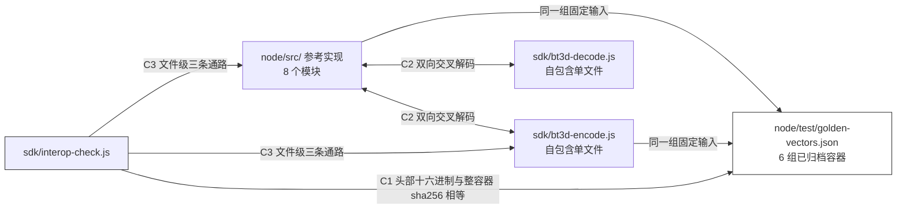

# BT3D v1 独立 SDK（单文件编码 / 单文件解码）

这个目录里的两个 `.js` 文件是**自包含**的：各自内联了一份完整的 BT3D v1 格式实现，只使用 Node 内置模块（`node:crypto`、`node:fs`、`node:path`），不引用本工程任何其他文件。把其中一个文件拷进任何 Node 项目，就能直接调用它的导出方法完成加密或解密。

| 文件 | 行 | 作用 |
| --- | --- | --- |
| `bt3d-encode.js` | 425 | 编码（混淆）。可当库引入，也可当 CLI 跑 |
| `bt3d-decode.js` | 461 | 解码（还原）。同上 |
| `interop-check.js` | 265 | 与 `node/src/` 参考实现的逐字节对拍检查，6 个用例 |
| `README.md` | 本文件 | 上手与边界 |

---

## 1. 为什么是两份独立实现（痛点 → 设计 → 用法）

**痛点**：`node/src/` 是按职责拆开的 8 个模块（常量、螺旋、仿射、秩压缩、密钥流、头部、编解码核心、CLI）。拆分对工程是对的，但对「我只是想在别的项目里加一个加密入口」的调用方是负担 —— 他要么装整个包，要么抄 8 个文件并维护它们之间的 import 关系。

**设计**：把「一个方向」所需的全部内部逻辑压进一个文件。编码侧需要 `scatter` 系列，解码侧需要 `gather` 系列，两侧共用的是常量、段表、位存取、仿射派生、秩压缩、ChaCha20 绑定 —— 这部分**刻意重复**了两份，因为单文件可移植性的定义就是"不依赖邻居"。

**代价（必须知道）**：重复实现会漂移。这个目录的存在理由就是 `interop-check.js` —— 它是防漂移的闸门，不是可选附件。改了 `node/src/` 里任何影响容器字节的代码，必须回来跑它；反过来改了 SDK，也一样。判据 5（往返自测）抓不到「两边各自自洽但互解不开」，只有交叉对拍抓得到。



---

## 2. 30 秒上手

### 当命令行用

```bash
node sdk/bt3d-encode.js a.jpg                 # → a.jpg.bt3d（输出名可省）
node sdk/bt3d-encode.js a.jpg out/a.enc       # 显式指定输出
node sdk/bt3d-decode.js a.jpg.bt3d a.jpg       # 输出名必填
```

### 当库引入

```js
// CommonJS
const { encodeFile, decodeFile } = require('./bt3d-encode.js');   // 解码侧同理
const { origSize, outSize, outPath } = await encodeFile('a.jpg'); // 省略输出 → a.jpg.bt3d
await decodeFile(outPath, 'restored/a.jpg');
```

```js
// ESM
import { encodeFile } from './bt3d-encode.js';
import { decodeFile } from './bt3d-decode.js';
import bt3dDecode from './bt3d-decode.js';        // 默认导出 = module.exports，也可用
```

### 内存态（已经在 Buffer 里）

```js
const container = encodeBuffer(original, { keyMaterial: { dek, nonce } }); // keyMaterial 可省
const restored  = decodeBuffer(container);
```

---

## 3. API

### `bt3d-encode.js`

| 导出 | 签名 | 说明 |
| --- | --- | --- |
| `encodeFile` | `(inPath, outPath?, opts?) → Promise<{origSize, layerCount, outSize, outPath}>` | 流式，常驻内存与文件大小无关（128 KiB 层缓冲 + 256 KiB 秩索引） |
| `encodeBuffer` | `(Buffer, opts?) → Buffer` | 内存态，返回完整容器 |
| `defaultOutPath` | `(inPath) → string` | `inPath + '.bt3d'` |
| `newKeyMaterial` | `() → { dek: Buffer(32), nonce: Buffer(12) }` | 自己生成密钥材料时用 |
| `Scratch` | `class` | 复用缓冲，批量编码时传同一个 `opts.scratch` 省分配 |
| `Bt3dError` | `class extends Error` | 带 `.code`，见第 5 节 |
| `HEADER_SIZE` / `LAYER_BYTES` / `SUFFIX` | `128` / `131072` / `'.bt3d'` | 常量 |

`opts.keyMaterial` 给了就用它，不给就随机。固定的 `keyMaterial` ⇒ 容器逐字节可复现（黄金向量就是这么生成的）。

### `bt3d-decode.js`

| 导出 | 签名 | 说明 |
| --- | --- | --- |
| `decodeFile` | `(inPath, outPath) → Promise<{origSize, layerCount, written, outPath}>` | `outPath` **必填**，见下 |
| `decodeBuffer` | `(Buffer) → Buffer` | 校验失败抛异常，绝不返回部分结果 |
| `readHeader` | `(inPath) → Promise<{fileSize, origSize, layerCount, dimX, dimY, flags, dek, nonce, tag}>` | 不解码只看头，用于「先确认能不能解、要多大空间」 |
| `parseHeader` | `(Buffer128, fileSize?) → 同上（无 fileSize）` | 纯函数版 |
| `Scratch` / `Bt3dError` / `HEADER_SIZE` / `LAYER_BYTES` / `SUFFIX` | 同编码侧 | |

**为什么解码不给缺省输出名**：容器里不保存原文件名 —— 头部 128 字节只有 `origSize / layerCount / dimX / dimY / nonce / dek / tag`，没有任何名字字段。任何"缺省名"都只能是调用方猜的，而猜错就是覆盖别人的文件。所以规则是：**编码可以推断（源文件名就在手上），解码必须显式**。

**失败不破坏既有输出**：`decodeFile` 分两遍走 —— 第一遍只算 HMAC 不产出数据，`payload_tag` 通过之后才用 `'w'` 打开输出文件。`'w'` 会立刻截断已存在的目标，如果在校验前打开，一次失败的解码就会把用户原有的同名文件清空。这条是被真实 bug 教出来的，`interop-check.js` 的 C4 用 1320 字节哨兵内容守着它。

---

## 4. 缺省输出名规则

| 输入 | 缺省输出 |
| --- | --- |
| `a.jpg` | `a.jpg.bt3d` |
| `archive.tar.gz` | `archive.tar.gz.bt3d` |
| `no_ext` | `no_ext.bt3d` |
| `dir/a.jpg` | `dir/a.jpg.bt3d`（落在源文件同目录） |

**不剥原后缀**：`archive.tar.gz → archive.bt3d` 会丢掉"这是个 tar.gz"的信息，而且当目录里已经存在一个真的 `archive` 文件时就撞名了。追加式命名保证 `X → X.bt3d` 单射，且还原时一眼能看出来源。

**同路径守卫**：`encodeFile(p, p)` 显式同路径时抛 `SAME_PATH`，不做原地覆盖 —— 编码是「边读边写同一个文件」，那样只能毁掉源文件。比较口径是 `path.resolve()` 后转小写再去掉结尾的点（Windows 认为 `a` 与 `a.` 与 `A` 是同一个文件）。

---

## 5. 错误码

`try { ... } catch (e) { if (e.code === 'TAG_MISMATCH') ... }`

| code | 出处 | 含义 |
| --- | --- | --- |
| `SAME_PATH` | 编 / 解 | 输入与输出同名，拒绝就地覆盖 |
| `NEED_OUTPUT` | 解 | `decodeFile` 没给输出名 |
| `TOO_SHORT` | 解 | 不足 128 字节 |
| `BAD_MAGIC` | 解 | 魔数不是 `BT3D`（多半不是本格式文件） |
| `BAD_VERSION` | 解 | 版本不是 1 |
| `BAD_RESERVED` | 解 | 偏移 6..7 或 44..63 保留位非零 |
| `BAD_PROFILE` | 解 | flags 含未支持位或缺必需位 |
| `BAD_GEOMETRY` | 解 | 维度不是 1024×1024 |
| `HEADER_INCONSISTENT` | 解 | `layerCount` 与 `origSize` 推的不符 |
| `BAD_LENGTH` | 解 | 文件长度 ≠ `origSize + 128` |
| `TAG_MISMATCH` | 解 | payload 被改过，或密钥材料对不上 |
| `COUNTER_OVERFLOW` | 编 / 解 | 层号超出 32 位块计数器上限（payload > 256 GiB） |
| `RANK_COUNT` | 编 / 解 | 秩压缩位图计数与末层比特数不符（内部一致性断言） |
| `EOF` | 编 / 解 | 读取提前结束 |

---

## 6. 实测台账

命令与结果原样贴在下面，都是 2026-10-18 在本机（Node v24.21.0，win32 10.0.26300 x64）实际跑出来的。

### 6.1 对拍检查

```
node sdk/interop-check.js
```

| # | 用例 | 结果 | 实测证据 |
| --- | --- | --- | --- |
| C1 | 黄金向量逐字节 | PASS | 6/6 向量的头部十六进制与整容器 sha256 全部匹配（GV-1=128B GV-2=129B GV-3=129B GV-4=136B GV-5=131200B GV-6=131201B） |
| C2 | 交叉解码 | PASS | 9 种长度（0, 1, 7, 127, 128, 129, 131072, 131073, 300000）：两侧容器逐字节相同，且双向都能解开（含 0 层、单满层、跨层进位、3 层带末层） |
| C3 | 缺省输出名 + 文件级双向 | PASS | 缺省名 `photo.jpg.bt3d`，容器 250128 B / 2 层；SDK↔SDK、参考↔SDK、SDK↔参考 三条文件级通路全部逐字节还原 |
| C4 | 篡改与不破坏既有输出 | PASS | `TAG_MISMATCH` 命中；输出文件 1320 字节哨兵内容原样保留 |
| C5 | 两个文件当 CLI 跑 | PASS | encode 缺省名生成 `cli-demo.dat.bt3d` 并被 CLI decode 还原（7000 字节）；无参数 exit=2；decode 缺输出名被拒；`SAME_PATH` 在编码/解码的库入口与 CLI 入口共 3 条路径上都被触发 |
| C6 | 隔离目录 drop-in | PASS | 目录内只有两个 SDK 文件 + `package.json`：require 具名导入、ESM 具名导入、ESM 默认导入三种引入方式都可用并逐字节还原（9001 → 9129 → 9001） |

`通过 6 / 6`

### 6.2 这套检查会自己红吗

一套永远不会失败的检查等于没有检查。往**临时副本**里注入两个缺陷（仓库里的文件未被改动）：

| 注入 | 改了什么 | 捕获情况 | 为什么这样分布 |
| --- | --- | --- | --- |
| ① 位序改成 LSB-first | `bt3d-encode.js` 里两处 `7 - (i & 7)` → `i & 7` | **5/6 红**：C1（GV-4 头部不匹配）、C2（输入 1 字节时两侧容器不同）、C3（参考实现解不开 SDK 容器）、C5、C6 | 位序属于容器字节口径，凡是比较字节的用例都必须红。C4 只走 HMAC 路径，天然对位序不敏感 —— 这不是漏检，是分工 |
| ② 缺省名改成剥后缀 | `return inPath + SUFFIX` → 先 `replace(/\.[^.]+$/,'')` | **2/6 红**：C3（`a.tar.gz` 断言）、C5（缺省名文件没生成） | 命名是 CLI/API 行为，不进容器字节，所以字节级用例正确地保持绿色 |

注入 ① 特别值得看一眼：如果只测「SDK 自己编码再自己解码」，两个方向同时翻转位序会**完全自洽**、往返全绿 —— 但它已经解不开任何真实容器了。这正是 C1（拿已归档的哈希当外部靶子）和 C2（拿另一份实现当外部裁判）存在的理由。

---

## 7. 边界与不该用它做的事

| 事项 | 现状 |
| --- | --- |
| **机密性** | **0 bit**。按设计决策，DEK 明文放在容器头部 64..95，任何人都能解开任何人写的容器。本格式的目标是「比特流面貌不可识别 + 可无损还原」，不是「防看」。要真保密必须把 DEK 换成分发密钥并改头部口径（见 `../格式规格.md` §12）。 |
| 浏览器 / 小程序 | 不能用。依赖 `node:crypto` 与 `node:fs`。 |
| 文件大小上限 | payload ≤ 256 GiB（ChaCha20 块计数器 32 位），超出抛 `COUNTER_OVERFLOW`。 |
| 压缩率 | 不压缩。容器长度**精确** = 原长 + 128 字节。 |
| 篡改防护 | 有。HMAC-SHA256 覆盖「tag 置零的头部 ‖ payload」，用 `timingSafeEqual` 比对。 |
| 完整性 ≠ 认证密钥 | tag 用明文 DEK 做 key，只保证「和写它的是同一份字节」，不保证是谁写的。 |
| CommonJS | 两个文件是 CJS。ESM 项目通过具名导入或默认导入都能用（C6 实测）；反过来 `.mjs` 会在 CJS 项目里报 `require of ESM`，所以故意选 CJS。 |
| 只拷一个文件行不行 | 行。编码与解码互不依赖，只要项目里最终两个方向都需要用到即可。 |

---

## 8. 维护约定

1. 改 `node/src/` 中**任何影响容器字节**的地方（`constants.js` 偏移/掩码、`spiral.js` 段表、`affine.js` 派生、`rank.js`、`keystream.js`、`codec.js` 散射/聚集、`header.js` 构造/解析）之后：先 `node test/vectors.js`（黄金向量重生成，并说明为什么字节变了），再 `node sdk/interop-check.js`，最后手动同步两个 SDK 文件里对应的内联段落。
2. 只改 `cli.js` 的文案、参数解析或缺省命名规则：只需跑 `node sdk/interop-check.js` 的 C3/C5。
3. SDK 里**不允许**出现只在一个文件里存在的算法分支。两侧的常量段、段表段、位存取段必须逐项相同 —— 注释里标了"与 `bt3d-encode.js` 必须逐项相同"就是提醒这一点。
