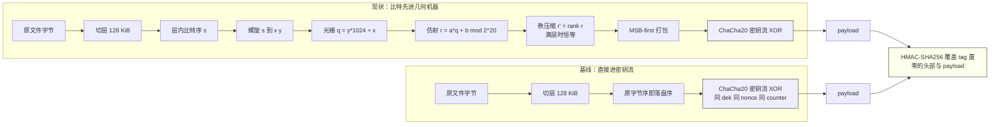

# 几何散射 vs 纯 ChaCha20 —— 保住"头部 128 字节不变"这个前提后的逐项对比

> **这份文档回答什么**：如果只保留现在的 128 字节头部，把 payload 换成"原文直接过 ChaCha20"（简称**基线**），会和现在的方案差在哪里。每个差异都配一组实测数字。
>
> **这份文档不回答什么**：格式的规范性定义（那是 [`格式规格.md`](格式规格.md)）、模块逐个实现说明（[`node/README.md`](node/README.md)）、参数含义（[`参数与场景技术参考.md`](参数与场景技术参考.md)）。
>
> **实验日期**：2026-10-18，本机 Node v24.21.0 / win32 10.0.26300 x64 / OpenSSL 3.5.8。所有数字都出自当次命令输出，未测的显式标 `未验证`。

---

## 目录

- [结论速览](#结论速览)
- [第 1 章 对照组是怎么搭起来的](#第-1-章-对照组是怎么搭起来的)
- [第 2 章 两条路径一张图](#第-2-章-两条路径一张图)
- [第 3 章 先说没有差别的地方](#第-3-章-先说没有差别的地方这部分很重要别高估散射)
- [第 4 章 差异点逐项](#第-4-章-差异点逐项)
- [第 5 章 该选哪个](#第-5-章-该选哪个四条路线与它们各自的适用面)
- [第 6 章 怎么复核这些数字](#第-6-章-怎么复核这些数字)
- [第 7 章 常见误解与追问（FAQ）](#第-7-章-常见误解与追问faq)
- [附录 A 一张表看全部实测数字](#附录-a-一张表看全部实测数字)
- [附录 B 给三类人的一句话](#附录-b-给三类人的一句话)
- [附录 C 本文与其余四份文档的关系](#附录-c-本文与其余四份文档的关系)

第 4 章的十个差异点：4.1 相邻关系、4.2 分层归因、4.3 差分形态、4.4 随机访问、4.5 吞吐、4.6 内存、4.7 出错面、4.8 威胁模型、4.9 迁移成本、4.10 方案 D。

---

## 结论速览

| 维度 | 现状（螺旋 + 仿射 + 秩压缩 + ChaCha20） | 基线（头部不变，payload = ChaCha20(原文)） | 差异量级 |
|---|---|---|---|
| 容器长度 | 原长 + 128 | 原长 + 128 | **无差** |
| "看起来像随机"（≥8B 公共子串、位占比、压缩比） | 命中 0 / 49.975% / 1.000031 | 命中 0 / 49.990% / 1.000031 | **无差**（三件套全由密钥流提供） |
| 完整性（改 1 比特能否被发现） | `TAG_MISMATCH` | `TAG_MISMATCH` | **无差**（HMAC 才是承重的，不是散射） |
| 逐位可改写性 | 还原值 `0x80 0x40 0x20 0x10 0x08 0x04 0x02 0x01` | 同一串 | **无差**，只差要动几个位置 |
| 相邻比特保持相邻的比例 | **0.0000%** | **100.0000%** | 5 个数量级 |
| 改 1 个原字节的容器差异 | 8 比特散在 8 个字节，跨度 55104 | 8 比特在 1 个字节，跨度 0 | 8× 字节数，跨度 0 → 5.5 万 |
| delta 记录大小（改 1 字节） | 24 字节 | 3 字节 | 8× |
| 取回任意 1 个原字节的读量 | 131,072 字节（整层） | **1 字节** | 131072 : 1 |
| 38 MB 流式编码 | 2002 ms | 91 ms | **21.9×** |
| 38 MB 流式解码 | 2083 ms | 98 ms | **21.4×** |
| 常驻内存 | 与文件大小无关（128 KiB 层缓冲 + 末层 256 KiB 秩索引） | 与文件大小无关（128 KiB 读缓冲） | **基本无差**（见 §4.6 的诚实说明） |
| 跨实现必须逐字节对齐的规范旋钮 | 17 项（§4.7 逐条列出） | 5 项 | 3.4× 出错面 |
| 15 条判据里为几何件而存在的 | 判据 2/6/7/10/11/12/13（7 条） | 0 条 | 基线不需要它们 |

**一句话结论**：把"看起来不可识别"这件事做到及格的，是密钥流和 HMAC，不是散射。散射买到的只有一件事 —— **把"原数据的相邻关系与物理位置"彻底打散**（0.0000% vs 100%），代价是 **21× 的编解码耗时、131072:1 的随机访问粒度、3.4× 的跨实现出错面**。所以选型问题不是"哪个更安全"，而是"位置解耦值不值这 21 倍"。

---

## 第 1 章 对照组是怎么搭起来的

### 1.1 痛点：直接比"两个不同程序"会得出假差异

最省事的对比是"拿现状的容器和 AES-CTR 的容器比一比"。这种比法会把三样东西的差异混在一起：密钥流算法、密钥材料、分层方式。任何一边换了密钥流，"相同字节率""位占比"这类指标就全变，得出的差异里有多少来自散射、多少来自换了密码原语，分不开。

### 1.2 设计：让两边共用同一条密钥流

控制变量只有一条原则：**除几何置换以外，一切同源**。

| 必须同源 | 怎么做到 |
|---|---|
| 密钥材料 | 两边都用固定 `dek = 'BT3D-v1-fixed-dek-golden-vector!'`、`nonce = 'BT3D-nonce-1'`（与黄金向量同一组） |
| 头部 | 都调 `buildHeader(...)`，`origSize / layerCount / dimX / dimY / flags / dek / nonce` 七个字段逐字节相同（实测：0..95 全等） |
| 密钥流 | 两边都用 `applyKeystream(层字节, dek, nonce, layer)`，counter 基址都是 `layer × 2048` ⇒ **同一层产生的 131072 个密钥流字节完全相同** |
| 分层 | 都按 128 KiB 切层，末层不足也按实际字节数 |
| 完整性 | 都是 HMAC-SHA256 覆盖「tag 置零的头部 ‖ payload」 |
| **唯一不同** | 进密钥流之前，比特有没有先走 `s → (x,y) → q → r → r'` 这一趟 |

这样任何一条指标的差值，都能直接归因到几何置换。

### 1.3 前置校验：先证明"我用的是真实现"

对比实验最容易犯的错，是拿自己脑补的模型算数字。所以每一步都先做一次对齐：

```
M0  置换模型 vs codec.js           随机层逐字节相同 = true；全 0 层相同 = true
M0' 手工组装的 V2 与 codec.js      true
参数  a = 846561  b = 70669        counter 基址同源 ⇒ 密钥流同源
```

`M0` 的做法：用 `SEG_S / SEG_Q / SEG_QSTEP / SEG_LEN` 四张段表把满层的 `s → r` 全排列展开成 `perm[1048576]`，然后按 `perm` 手工散射一个 128 KiB 的伪随机层，与 `encodeLayer(..., {useKeystream:false})` 的输出逐字节比对。全等之后，所有由 `perm` 导出的指标（邻接率、散射位置、跨度）才可以用。

### 1.4 基线实现（可直接粘贴运行，42 行）

```js
// baseline-chacha-only.mjs —— 头部口径不变，payload 只做密钥流
import { createHmac, timingSafeEqual } from 'node:crypto';
import { buildHeader, beginTag, parseHeader } from './node/src/header.js';
import { applyKeystream } from './node/src/keystream.js';
import { HEADER_SIZE, LAYER_BYTES, Bt3dError } from './node/src/constants.js';

const LEN_TAG = 32, OFF_TAG = 96;

export function encodeBuffer(input, { keyMaterial: km }) {
  const origSize = input.length;
  const layerCount = Math.ceil(origSize / LAYER_BYTES);
  const header = buildHeader({ origSize, layerCount, dek: km.dek, nonce: km.nonce });
  const mac = beginTag(km.dek, header);
  const segs = [];
  for (let layer = 0; layer < layerCount; layer++) {
    const off = layer * LAYER_BYTES;
    const raw = input.subarray(off, Math.min(off + LAYER_BYTES, origSize));
    const seg = applyKeystream(raw, km.dek, km.nonce, layer);   // ← 现状这里是 encodeLayer(...)
    mac.update(seg);
    segs.push(seg);
  }
  mac.digest().copy(header, OFF_TAG);
  return Buffer.concat([header, ...segs]);
}

export function decodeBuffer(container, km) {
  const header = container.subarray(0, HEADER_SIZE);
  const h = parseHeader(header, container.length);            // 头部九项校验一行都不改
  const hz = Buffer.from(header);
  hz.fill(0, OFF_TAG, OFF_TAG + LEN_TAG);
  const mac = beginTag(h.dek, hz);
  mac.update(container.subarray(HEADER_SIZE));
  if (!timingSafeEqual(h.tag, mac.digest())) throw new Bt3dError('TAG_MISMATCH', 'payload_tag 校验失败');
  const out = Buffer.alloc(h.origSize);
  for (let layer = 0; layer < h.layerCount; layer++) {
    const off = layer * LAYER_BYTES;
    const nb = Math.min(LAYER_BYTES, h.origSize - off);
    applyKeystream(container.subarray(HEADER_SIZE + off, HEADER_SIZE + off + nb), h.dek, h.nonce, layer)
      .copy(out, off);
  }
  return out;
}
```

与现状相比，被删掉的只有 `scatterFull / scatterRank / gatherFull / gatherRank / RankIndex / spiral.js 的四张段表 / affine.js 的派生`。**头部、分层、密钥流绑定、完整性、错误码一个都没动** —— 这正是"保留前 128 B 不变"的字面实现。

> **一个必须点破的语义问题**：这份基线代码仍然把 `flags` 写成 `0x1C`（`F_KEYSTREAM_ON | F_AFFINE_ON | F_RANK_COMPACT`），`dimX/dimY` 仍写 1024×1024。实验里这么做是为了让头部逐字节可比；但作为交付格式它就是**谎报** —— 声明了仿射和秩压缩在生效，实际没有。真要提供一个"纯 ChaCha20 挡位"，必须重定义规范 profile（`0x04`），并为此付出不互通的代价：现状的 `parseHeader` 会在 `(flags & FLAGS_NORMATIVE) !== FLAGS_NORMATIVE` 这一步直接把基线容器拒成 `BAD_PROFILE`（[`header.js:69`](node/src/header.js#L69)）。见 §4.9。

### 1.5 新人小结

把这两条路径想成同一条快递流水线：**打包（头部）、贴单（密钥流）、封箱上锁（HMAC）完全一样，唯一的区别是有没有先把包裹里的东西按一张怪表格重新摆一遍**。要判断"重新摆放"到底值多少，就得把其他环节钉死不变量 —— 这就是 §1.2 那张表的全部意义。

---

## 第 2 章 两条路径一张图



图中 `C1 → G1` 这一段就是全部差异的来源。§3 说明它**没有**影响的东西，§4 逐项量化它影响的东西。

---

## 第 3 章 先说没有差别的地方（这部分很重要，别高估散射）

### 3.1 体积：完全相同

| 样本 | 原长 | 现状容器 | 基线容器 |
|---|---|---|---|
| node.exe 前 1 MiB | 1,048,576 | 1,048,704 | 1,048,704 |
| 65,536 B | 65,536 | 65,664 | 65,664 |
| 38,797,313 B（297 层） | 38,797,313 | 38,797,441 | 38,797,441 |

秩压缩的存在理由本来是"让末层不必补齐到 128 KiB"，基线因为不做置换，长度天然精确 —— 两边在这一点上**殊途同归**。也就是说：**散射并不给体积带来任何额外代价**，这是它相对某些混淆方案的一个真实优势。

### 3.2 外观三件套：完全相同，而且功劳不属于散射

| 指标 | 样本 | 现状 | 基线 | 阳性对照 |
|---|---|---|---|---|
| 与原文的 ≥8 字节公共子串 | node.exe 前 1 MiB | **0 处** | **0 处** | 不加密时 1,048,569 处（首处 0） |
| payload 位占比 | 同上 | 49.975% | 49.990% | 原文 36.605% |
| payload 的 zstd 压缩比 | 1 MiB 高重复文本（`abcdefgh` × 131072） | 1.000031 | 1.000031 | 原文 0.000100 |
| 原文前 128 字节直接出现在容器里 | node.exe 前 1 MiB | false | false | — |

阳性对照那一栏说明这套指标确实有区分力：同一个指标，不加密钥流时命中上百万处，加密钥流后两边同时归零。**结论：这三项指标测不出两个方案的差别，它们测的是密钥流。** 谁要是在评审里用"我们的 payload 压不动 / 位占比 50% / 找不到明文片段"来论证散射的价值，那是把密钥流的功劳记到了几何件账上。

### 3.2b 一个容易被误读的指标：两个容器的"相同字节率"

顺手会去算"现状 payload 与基线 payload 有多少字节相同"。实测（同一 128 KiB 窗口、同一密钥流）：

| 比较对 | 相同字节率 |
|---|---|
| 基线 ↔ 现状（螺旋 + 仿射） | 0.894% |
| 基线 ↔ **随机置换**（与螺旋毫无关系的双射） | **0.929%** |
| 现状 ↔ 随机置换 | 0.681% |
| 全 1 MiB 窗口 基线 ↔ 现状 | 0.811% |
| 38 MB 全容器 基线 ↔ 现状 | 0.390% |

如果只看第一行，很容易得出"两个容器有 0.9% 的字节相同，是不是散射没打干净？"。**第二行就是回答**：换一条与螺旋毫无关系的随机双射，相同率反而更高（0.929%）。所以这个指标量的不是结构，而是"两条路径共用同一条密钥流 + 明文位占比非均匀"的巧合率。

用独立位假设估一下量级：原文位占比 `p = 0.36605`，同一位置两个比特相同的概率 `p² + (1−p)² = 0.53589`，一个字节 8 位全同 ≈ `0.53589⁸ = 0.680%` —— 与实测的 0.681%（现状↔随机置换）对得上。0.894% 略高于这个估算，是因为明文的相邻位并不独立（文件里有大量连续 0 与连续相同字节）；**这个超出量我没有做分解，所以不要把它当差异用**。可靠的结构指标是 §4.1 的邻接率，不是相同字节率。


### 3.3 完整性与可改写性：机制相同

| 情形 | 现状 | 基线 |
|---|---|---|
| 翻 1 个 payload 比特后 `decodeBuffer` | `TAG_MISMATCH` | `TAG_MISMATCH`（同一处 HMAC 判定） |
| 攻击者翻 payload 想改还原结果的第 0 字节 | 能做到，逐位可控：`0x80 0x40 0x20 0x10 0x08 0x04 0x02 0x01` | 同样能做到，**同一串值** |

差别只在"要动几个位置"：现状要动 8 个分散位置（实测跨度 110633 字节），基线只要动 1 个连续字节。而这两个方案的散射位置都是**可从公开头部重算**的 —— 实验里只拿容器里的 `dek + nonce` 就重算出 `s=0..7` 的 8 个 `r`，与实现完全一致（`与实现一致 = true`）。所以这条差异对"任何持有容器的人"约等于不存在。

### 3.4 还原正确性

两条路径在 0 B、1 B、128 KiB、128 KiB+1、250000 B、300000 B、1 MiB、38 MB 上都是逐字节还原一致（实测均为 `true`）。基线没有引入正确性问题，也没有解决任何正确性问题。

### 3.5 其余不变项

| 项 | 现状 | 基线 | 说明 |
|---|---|---|---|
| 密钥流复用风险 | 同一 `(dek, nonce)` 编码两份文件 ⇒ 两份密钥流相同 ⇒ 异或即两份明文异或 | **完全相同** | 与散射无关，是流密码的固有性质 |
| payload 上限 | 256 GiB（32 位块计数器） | **相同** | 分层与 counter 基址没变 |
| 大端机器 / 并发 | 未验证 | 未验证 | 两边同状态 |
| 机密性 | **0 bit**（`dek` 明文在头部 64..95） | **0 bit** | 这是既定设计决策，不是本实验发现的问题 |

### 3.6 新人小结

把 §3 当成"砍价前的原价清单"：体积、外观、防篡改、还原正确性、密钥风险这五样，砍掉散射**一分都不损失**。真正会变的东西全部在 §4。

---

## 第 4 章 差异点逐项

### 4.1 相邻关系：0.0000% 与 100.0000%，这是唯一被散射改写的核心统计

**痛点**：文件里的相邻字节有强语义关联 —— JPEG 的 Huffman 表、PE 的头 + 节表、数据库页的定长记录。如果混淆后"原来的邻居还是邻居"，那么攻击者不需要解密，只要观察"某段每 24 字节出现一次相同的模式"就能反推结构。

**设计**：散射把填充序 `s` 的相邻两位送到相距极远的存储位置。

**实测（满层 1,048,575 个相邻对，`perm` 模型已经与真实现逐字节对齐）**

| 方案 | `|Δ|=1` 占比 | `|Δ|` 中位数 | `|Δ|` 最小 | `|Δ|` 最大 |
|---|---|---|---|---|
| 基线（恒等置换） | **100.0000%** | 1 | 1 | 1 |
| 现状（螺旋 + 仿射） | **0.0000%** | 293,888 | 202,015 | 846,561 |
| 控制组·随机置换（n=200,000） | 0.0000% | 310,365 | — | — |
| 控制组·只螺旋不加仿射 | **50.0488%** | 1 | — | — |
| 控制组·只取现状外圈下边 1023 对 | 0.0000% | 202,015 | — | — |
| **方案 D：删掉螺旋，只留仿射**（`r = a·s + b mod 2²⁰`） | **0.0000%** | 202,015 | **202,015** | **846,561** |

**这张表最有价值的地方在控制组**：

1. 随机置换也是 0.0000% ⇒ "打散相邻关系"这件事**任何**双射都能做到，不需要螺旋。
2. 只螺旋不加仿射 = **50.0488%** ⇒ 螺旋单独只解决了**一半**，而且那 50% 是它沿网格边走的连续段（外圈下边 `s=0..1023` 时 `q = s`）。
3. 现状 0.0000% 与随机置换同量级 ⇒ **仿射才是承重的**，它的作用是把螺旋残留的那 50% 连续段拆开。
4. **方案 D 与现状的 min/max 完全相同（202,015 / 846,561）**，这把第 3 条从"归因推测"变成了"闭环证明"：那两个极值就是 `a` 本身 —— `a = 846561`，`L − a = 202015`。现状只是把这一个步长换成了四种带符号的步长（`±a`、`±1024a`；实测 `1024a mod 2²⁰ = 754688`，其补数 `293888` 正是现状的中位数）。**螺旋没有加强打散，它只是让打散变得分段。**

`min |Δ| = 202015` 这个数值得单独看一眼：现状与方案 D 里**都没有任何一对**相邻比特落在彼此 202,014 个位置以内。这是"满层 + 仿射"的一个可量化保证，基线完全给不出（它的 min 就是 1）。


### 4.2 分层归因：外观是谁给的，位置解耦是谁给的

同一份 128 KiB 原文（node.exe 开头），四条路径逐个关掉几何件，实测：

| 变体 | 原文前 128 字节逐字出现 | ≥8B 公共子串 | 位占比 | `|Δ|=1` 邻接率 |
|---|---|---|---|---|
| V0 只螺旋（`a=1,b=0`），无密钥流 | **true** | **4077 处**（首处偏移 0） | 35.737% | 50.0488% |
| V1 螺旋 + 仿射，无密钥流 | false | 0 处 | 35.737% | 0.0000% |
| V2 现状（螺旋 + 仿射 + 密钥流） | false | 0 处 | **50.019%** | 0.0000% |
| B 基线（只有密钥流） | false | 0 处 | 49.984% | 100.0000% |

三条归因线，每条都只由一个变量翻转：

- **V0 → V1（只加仿射）**：4077 处明文片段泄露 → 0，邻接 50.05% → 0。**仿射是唯一能拆掉螺旋自身泄露的件。**
- **V1 → V2（只加密钥流）**：位占比 35.737% → 50.019%，从"和原文一样"变成"和抛硬币一样"。**密钥流才是"看起来像随机"的来源。**
- **V2 → B（只去掉全部几何）**：外观三项都不变，只有邻接率 0.0000% → 100%。**几何件的净产出 = 位置解耦，没有别的。**

顺带一条反例值得记住：**全 0 的 128 KiB 层，现状容器与基线容器逐字节相同**（实测 `true`）。置换对"全同一个值"的输入没有可观察效果 —— 所以拿稀疏样本或全零样本做这种对比，会得到"两个方案没差别"的假结论。选样本时必须用有内容的明文（本实验用 node.exe 前若干字节）。

### 4.3 差分形态：改一个字节，容器里怎么变

**痛点**：真实使用里最常见的写操作是"改几个字段"，不是"重写整个文件"。改动在容器里的分布形态，直接决定增量备份、同步、纠错的成本。

**实测**（65,536 字节样本，同一密钥流，差异按字节统计）

| 原文件改动 | 现状 payload 差异 | 基线 payload 差异 |
|---|---|---|
| 翻转 1 比特（第 1000 字节的 bit3） | 1 比特落在 **1 个字节**，偏移 25,390，跨度 0 | 1 比特落在 **1 个字节**，偏移 1,000，跨度 0 |
| 翻转 1 字节（`^= 0xff`） | 8 比特落在 **8 个字节**：7022 / 14958 / 17454 / 25390 / 35822 / 43758 / 54190 / 62126，跨度 **55,104** | 8 比特落在 **1 个字节**：1000，跨度 **0** |
| 第 1000 字节处插入 1 字节 | **64,991 / 65,536 = 99.17%** 的字节变了（容器 65,664 → 65,665） | **57,514 / 65,536 = 87.76%** 的字节变了（容器同样 65,664 → 65,665） |
| delta 记录（3 字节 / 差异字节） | 改 1 比特 3 B；改 1 字节 **24 B** | 改 1 比特 3 B；改 1 字节 **3 B** |

读法：

- **单比特替换**两边一样便宜，都是 1 个 payload 字节 —— 因为流密码本来就没有雪崩，散射也只是置换，两者都是"改 N 比特 ⇒ 恰好改 N 比特"。**谁要是声称散射提供了"扩散"，那是假的。**
- **整字节替换**差 8× 的字节数、5.5 万倍的跨度。对增量传输协议（rsync 式块比对）来说，现状的一次小改会污染 8 个远离彼此的块，基线只污染 1 个。
- **插入字节**两边都"全变"，基线的 87.76% 就是"整体平移一格后逐位重算密钥流"的巧合相同率（≈1/8 概率 ×8 位）。所以**位置解耦对"插入"这种改动没有任何额外保护**，反而现状更彻底（99.17%）。

### 4.4 随机访问粒度：131072 : 1，这是散射最贵的一笔开销

**痛点**：真实场景里经常只需要"看一眼这个文件的第 N 个字节"—— 索引项、记录头、视频帧内偏移、数据库页尾的 LSN。如果为此必须读回 128 KiB 并重算整层逆散射，随机访问的代价就变了性质。

**设计上的必然**：散射是**层内**双射 —— 一个原字节被送到哪，取决于同层里其他比特占的位置（末层还要 `rank`）。所以层内任何一个比特的还原都依赖整层。基线没有这层依赖：`payload[i] ^ keystream[i]` 就是答案，而 `keystream` 由 `(dek, nonce, counter)` 定位，`counter` 可以直接从绝对偏移算出来。

**实测 A（38 MB 容器的满层内取 1 字节，目标 = 原文件第 2,633,785 字节，期望值 `0x9d`）**

| | 读多少 | 怎么定位 | 取回 | 正确 | 耗时 |
|---|---|---|---|---|---|
| 现状 | **131,072 字节**（第 20 层整层） | 层号 `= 2633785 / 131072`，读整层 → 去密钥流 → 逆散射 | `0x9d` | true | 11.54 ms |
| 基线 | **1 字节**（绝对偏移 2,633,913） | `counter = 41152`（= 层内偏移 ÷ 64），一次 pread + 块内第 57 字节异或 | `0x9d` | true | 0.34 ms |

**实测 B（部分末层，秩压缩路径，样本 20,000,000 B → 153 层，末层 77,056 B = 616,448 比特）**

| | 读多少 | 取回 | 正确 | 耗时 |
|---|---|---|---|---|
| 现状 | 77,056 字节 + 建秩 + 逆散射 | `0x5c` | true | 15.47 ms（内存态切片，未计 I/O） |
| 基线 | 1 字节 | `0x5c` | true | 亚毫秒 |

末层更贵的原因不止是逆散射，还要多跑一趟秩压缩位图（第一趟只为建位图）。实测单层散射 + 密钥流 5.5 ms/次，仅密钥流 0.1 ms/次（各 10 次）—— 比值 55×，比 38 MB 整体吞吐的 21× 更极端，因为大文件里 HMAC 与 I/O 的固定开销摊薄了置换的占比。

**什么时候这条不重要**：只做"整文件编码 / 整文件解码"的场景（备份、归档、外发附件）。**什么时候它是硬伤**：任何需要按偏移读的部分解包 —— 索引、随机播放、增量同步、日志尾部。

### 4.5 吞吐：21× 量级，来自比特级循环而非密码运算

**实测（38,797,313 字节，297 层，两侧都是流式文件 API）**

| 路径 | 现状 | 基线 | 倍率 |
|---|---|---|---|
| `encodeFile` | 2002 ms | 91 ms | **21.9×** |
| `decodeFile` | 2083 ms | 98 ms | **21.4×** |

**实测（5 MiB，内存态 `encodeBuffer`/`decodeBuffer`）**：编码 212.7 ms vs 7.6 ms；解码 232.3 ms vs 5.1 ms。

**成因**：基线每字节的工作是"一次 OpenSSL 异或"（密钥流是 native 的）；现状每**比特**的工作是 `getBit` + `setBit`，1,048,576 次/层，且带分支（`if (r >= L) r -= L`）。ChaCha20 本身两侧同价，所以倍率全部是 JS 里比特循环的成本。

两侧容器在 38 MB 上的相同字节率 = 151,479 / 38,797,441 = **0.390%**（≈1/256），这是"两条不同路径共用同一密钥流"的正常巧合率，不表示结构相似（§3.2 的指标才是判断结构的）。

### 4.6 内存：不是差异点，别看错

**实测（38 MB 流式，`--expose-gc`，每次取样前 `global.gc()` 两次）**

| 路径 | RSS 起点 | 峰值 | GC 后 |
|---|---|---|---|
| 现状 `encodeFile` | 81 | 87 | 83 MiB |
| 基线 `encodeFile` | 83 | **94** | 84 MiB |
| 现状 `decodeFile` | 84 | 86 | 84 MiB |
| 基线 `decodeFile` | 84 | **107** | 84 MiB |

**必须诚实的一句话**：这四次里基线的峰值反而更高（94 与 107 vs 87 与 86），GC 之后两侧全部回到基线水位。这个互有高低落在分配器噪声级，我没有做重复取样去分离成因，因此**不能拿它论证任何东西**。

结构上可以断言的是另一件事：两侧的常驻都**与文件大小无关**。现状是 1 个 128 KiB 层缓冲 + 末层的秩索引（位图 128 KiB + 字前缀和 128.0 KiB ≈ 256 KiB），基线是 1 个 128 KiB 读缓冲。差 256 KiB，在 38 MB 任务的噪声里量不出来 —— 所以内存不该被写进选型理由。（用内存态 `encodeBuffer` 时两侧都按文件大小线性增长：5 MiB 样本上 RSS 增量都是 +10 MiB，实测相同。）

### 4.7 出错面：17 个必须逐字节对齐的旋钮 vs 5 个

跨语言实现（规格要求 Rust/Go 也据它实现）只要有一个旋钮对不齐，产出的容器就互解不开，而**往返测试全是绿的** —— 这正是规格 §15 用黄金向量兜底的原因。

| # | 现状必须对齐的项 | 基线是否还需要 |
|---|---|---|
| 1 | 螺旋起点 `(0,0)` | 否 |
| 2 | 逆时针手性（x 向右、y 向上） | 否 |
| 3 | 圈内边序 下→右→上→左 | 否 |
| 4 | `n = 1024` 与 `dimX/dimY` 的含义 | 否（字段变装饰） |
| 5 | `s → (x,y)` 闭式 + **整数校正 while** | 否 |
| 6 | 光栅 `q = y*1024 + x` 的 y 升序约定 | 否 |
| 7 | `a, b` 由 HKDF 两条 `info` 派生 | 否 |
| 8 | `a` 强制奇数且 ∈ `[2^19, 2^20)` | 否 |
| 9 | `aInv` 的 Hensel 5 轮 + BigInt | 否 |
| 10 | MSB-first 位序（约定 C2） | 否（不碰比特序） |
| 11 | 秩压缩位图与字前缀和口径 | 否 |
| 12 | 满层 `rank(r) ≡ r` 的退化 | 否 |
| 13 | 2048 段表的段序 | 否 |
| 14 | 负步进的安全取模（实测 **1024 / 2048** 段 `qStep` 为负：上边 −1、左边 −1024） | 否 |
| 15 | `counter` 基址 = `layer × 2048` | **是** |
| 16 | IV 布局 = 计数器 u32 LE ‖ nonce 12 B | **是** |
| 17 | 头部 12 字段偏移 + flags 两个掩码 + HMAC 覆盖范围 | **是** |

基线需要的是表中标"是"的三行，拆开数就是 5 项：`counter` 基址、IV 布局、头部字段偏移、flags 两个掩码、HMAC 覆盖范围。**其余 12 项全部失去意义** —— 这才是 §5 里"5 vs 17"那组数的来源（不是三份、也不是四份的差异，是清单本身短了 12 行）。

**两个可核对的旁证**：

- 判据台账（规格 §16.2）共 15 条，其中**为几何件而存在**的是 7 条：判据 2（邻接）、6（几何覆盖）、7（手性）、10（快慢路径等价）、11（仿射双射）、12（秩压缩退化）、13（派生确定性与模逆）。基线一条都不需要，但仍要保留 1/3/4/5/8/9/14/15 这 8 条。
- 缺陷台账（规格 §16.10）里 8 条实测抓到的问题，落在几何机器上的是 3 条（#4 判据 13 的"4 轮必然不足"是掷硬币、#6 §11.2 的 Hensel 轮数写 19、#7 §14.3 比特上界写 2⁴³），另有一处 §7.5 描述了实现根本不需要的 `select`。密钥流绑定与头部偏移在同样强度的实验下**一次都没错过**。

**一条本机测不出来的差异，必须如实标注**：现状的 `k` 由 `Math.floor((N − sqrt(N²−s))/2)` 给出，规范强制要求后面跟两个整数校正 while 循环以吸收跨平台浮点舍入。实测本机 V8 在全部 1,048,576 个 `s` 上**校正触发 0 次**（最大偏移 0 圈）。也就是说：**这条差异在本机不可测**，它是为 Rust/Go 的浮点实现留的防御，不能作为"现状更稳健"的证据，只能作为"现状多一个必须逐字对齐的风险点"的证据。基线没有这类风险。

### 4.8 位置解耦到底防什么：把威胁模型摊开写

| 想要的性质 | 谁提供 | 散射提供吗 | 实测依据 |
|---|---|---|---|
| 容器不被认出是"某个原文件" | 密钥流 | **否** | §3.2：基线三项指标与现状同分 |
| payload 不可压缩 | 密钥流 | 否 | §3.2：两边都是 1.000031 |
| 隐藏"原数据的字节顺序与对齐周期" | **散射** | **是** | §4.1：100% → 0.0000%，min 202015 |
| 隐藏"某个偏移在原文件里的位置" | **散射** | **是** | §4.4：1 字节的偏移需要整层才能定位 |
| 让"改一个字节"在容器里不可局部化 | **散射** | **是** | §4.3：1 字节 vs 8 字节、跨度 0 vs 55104 |
| 机密性 | 只有密钥，而密钥明文存放 ⇒ **两边都是 0 bit** | 否 | §3.5；§4.8 末段 |
| 抗篡改 | HMAC | 否 | §3.3：两边同样 `TAG_MISMATCH` |
| 抗密钥流复用攻击 | 编码时的随机 `nonce` 纪律 | 否 | §3.5：流密码固有 |

**末段那条必须反复强调**：散射的 17 个旋钮对持有容器的人全部公开可算 —— 实验中只取头部 `dek`(64..95) 与 `nonce`(32..43) 就重算出了原文件第 0 字节 8 个比特的落点（`与实现一致 = true`）。所以**任何一行的"是"都不等于"更安全"**，它们只在"攻击者拿不到容器 / 不能自由构造明文-密文对"的前提下有意义。本格式的机密性本来就是 0 bit（既定决策），所以这些性质的实际受众是：**做结构启发式识别的工具**（杀毒、DLP、缩略图服务、内容审核），而不是拿着密钥的解密者。

### 4.9 迁移成本：换成基线要动规格的哪些地方

如果决定把纯 ChaCha20 做成一个**挡位**而不是替换整个格式，需要处理的是：

| 影响面 | 具体条款 | 代价 |
|---|---|---|
| `flags` profile | 规范必一掩码从 `0x1C` 变 `0x04`（`F_AFFINE_ON`/`F_RANK_COMPACT` 必须为 0） | 现状 `parseHeader` 会把基线容器判 `BAD_PROFILE`（[`header.js:69`](node/src/header.js#L69)）⇒ **两个挡位的容器互解不开**，必须靠 `version` 或新 profile 位区分 |
| `dimX / dimY` | 基线里无几何含义 | 要么继续写 1024×1024 当"未使用"，要么改 §4.1 语义（属冻结项，需升 version） |
| 判据 | 2/6/7/10/11/12/13 共 7 条对基线挡位不适用 | 判据清单要按挡位分叉，否则评审时会出现"绿但没测到"的假覆盖 |
| 黄金向量 | 全部 6 组要按挡位重生成 | 现有 JSON 的 `derived.a/b/aInv` 字段对基线挡位是空信息 |
| 代码 | `node/src/codec.js` 的四个散射/聚集函数要变可选 | `flags` 分支 + 新的分派路径，属于"新增状态组合"，测试面按乘法增长 |
| SDK | `sdk/` 两份单文件要各自再分叉一份 | 已经刻意重复的实现再乘 2，漂移风险翻倍 |

**这就是"要不要在格式里加挡位"的真实代价**：不是删代码（删得掉），而是**每加一个 profile 位，判据/向量/实现/文档都乘一份**。

### 4.10 顺手量出来的第四个方案 D：只要仿射，不要螺旋

§4.1 的控制组已经指向这个方案，所以把它实现出来实测了一遍。`r = (a·s + b) mod 2²⁰`，把填充序直接当光栅序用 —— 没有圈、没有 `(x,y)`、没有 sqrt、没有手性、没有四种边、没有负步进。

**双射性**（这是它能当格式用的前提，`a` 必须为奇数）

```
D 双射自检       越界 0，重复 0，覆盖 1048576 / 1048576
D 自往返（满层） 逐字节还原 = true
```

**结构指标与现状同分**

| 指标 | 现状 | 方案 D | 基线 |
|---|---|---|---|
| `|Δ|=1` 占比 | 0.0000% | **0.0000%** | 100.0000% |
| min / max `|Δ|` | 202,015 / 846,561 | **202,015 / 846,561** | 1 / 1 |
| 前 128 字节逐字出现 | false | false | false |
| ≥8B 公共子串 | 0 处 | 0 处 | 0 处 |
| 位占比 | 50.019% | 49.959% | 49.984% |

**末层仍然需要秩压缩**：`m = 616,448`（§4.4 那个末层）时，D 有 **254,044 个散射位置 ≥ m**，所以"先建位图再 `rank(r)`"这一步省不掉，落盘长度才会等于 `m/8`。省掉的是**分段**：从 2048 段退化成 1 段等差。

**耗时（公平口径：缓冲全部复用，预热后各跑 20 次，同一 128 KiB 层）**

| 单层 128 KiB | 耗时 | 相对基线 |
|---|---|---|
| 现状（2048 段 + 密钥流） | 5.07 ms | 56× |
| 方案 D（1 段仿射 + 密钥流） | **4.24 ms** | **48×** |
| 基线（仅密钥流） | 0.09 ms | 1× |

这是一条有点反直觉但很重要的读数：**段数从 2048 降到 1，只换来 1.19× 的加速**。散射的耗时几乎全部来自"逐比特 `getBit`/`setBit` 一百万次"，不是来自分段表。所以：

- 想靠"简化几何"把速度追回来 ⇒ **做不到**，只要还要打散相邻关系，就得付这 4 ms/层；
- 方案 D 的真实收益是**出错面**：规范旋钮从 17 项降到约 10 项（去掉起点、手性、圈内边序、`s→(x,y)` 闭式与整数校正、光栅 y 序、2048 段表、负步进安全取模），且快慢路径等价（判据 10）、几何覆盖（判据 6）、手性（判据 7）这三条判据的存在理由直接消失；
- 随机访问粒度**不变**（还是整层 131,072 字节），因为层内依赖还在。

> **本轮没有做的**：D 的整文件流式计时与 D 的 38 MB 吞吐。单次跑的时候我的样本文件构造写错了（`容器 168 字节`，即输入文件是空的），那组数字无效，已丢弃，不写进结论。要落地 D 的话，这一步必须补测。


---

## 第 5 章 该选哪个：四条路线与它们各自的适用面

### 5.1 四条路线

| 路线 | 内容 | 单层 128 KiB 实测 | 位置解耦（`|Δ|=1` / min） | 随机访问读量 | 规范旋钮 |
|---|---|---|---|---|---|
| **A 纯密钥流**（本文基线） | 头部不变，payload = `ChaCha20(原文)` | **0.09 ms** | 无（100% / 1） | 1 字节 | 5 |
| **B 现状** | 螺旋 + 仿射 + 秩压缩 + 密钥流 | 5.07 ms | 完全（0.0000% / 202,015） | 131,072 字节 | 17 |
| **D 只仿射**（§4.10 实测） | `r = a·s + b`，无圈无坐标无分段表 | **4.24 ms** | 与 B **同分**（0.0000% / 202,015 / 846,561） | 131,072 字节 | 约 10 |
| **C 折中：块级置换** | 层内以 64 字节块为单位做仿射块置换，块内顺序不变 | 未实测 | 部分（块间打散，块内保留） | ≤64 字节 + 块映射 | 估 12，未实测 |

读法：**A 与 B 之间没有中间点可省** —— 一旦决定要打散相邻关系，就要付那 4 ms/层的比特循环（D 只比 B 快 1.19×）。B 相对 D 多出来的 7 项旋钮换不到任何指标上的优势，只换到"容器里看不到定长记录的周期"这一条形态差异（D 是全局等差，B 是分段等差）。C 只在这里列出**设计意图**，本实验没有实现它，所以不给数字；它的意义是把随机访问粒度从 128 KiB 降到 64 B，**要不要做 C 取决于 §4.4 的 131072:1 是不是你的硬约束**。

### 5.2 决策表

| 你的实际情况 | 选 | 理由（对应实测条目） |
|---|---|---|
| 目标是"备份/外发时文件看起来不像原文件"，且要能整取整还 | **A** | §3.2 外观三件套同分；§4.5 快 21.9×；§4.7 出错面 5 vs 17 |
| 需要抵抗"从容器结构反推原文布局"的启发式识别（DLP、内容审计、缩略图服务） | **B 或 D** | §4.1：两者 `|Δ|=1` 都是 0.0000%，min 都是 202,015 |
| 上面这条要，但不想维护螺旋那套几何约定 | **D** | §4.10：旋钮 17 → 约 10，判据 6/7/10 失去存在理由，耗时只差 1.19× |
| 要支持按偏移部分解包（索引、页尾、播放位置） | **A 或 C** | §4.4 的 131072:1 在随机访问场景是硬成本；D 完全没改善这一点 |
| 要做增量同步 / 差异传输 | **A** | §4.3 改 1 字节 delta 记录 3 B vs 24 B |
| 已经实现完 B，吞吐够用（离线批处理） | **维持 B** | 换 A 的收益是速度，不是安全；换 D 的收益是可维护性，但 §4.9 的迁移成本要付一次 |
| 需要真机密性 | **都不是** | 两边都是 0 bit（§4.8 末段）；先把 DEK 换成分发密钥并升 `version` |

### 5.3 三个最常见的错判

1. **"散射提供了扩散/雪崩"** —— 假。§4.3 实测：改 1 比特，两侧都恰好改 1 比特的 payload。
2. **"没有散射就压得动 / 位占比不正常"** —— 假。§3.2 三项指标同分，阳性对照证明指标有区分力。
3. **"散射让文件更难被篡改"** —— 假。§3.3 两侧同样 `TAG_MISMATCH`，且散射位置可用公开头部重算（§4.8）。

### 5.4 新人小结

把这三条路线想成搬家的三种做法：**A 是把箱子整体刷成灰色**（看不出里面装了什么，但箱子的排列顺序照旧）；**B 是把所有东西按一张怪表格重新装箱**（连物品之间的相邻关系都没了，代价是每次只能整箱开箱）；**C 是按整箱洗牌**（箱子顺序乱了，箱内还在，开箱取一件只花几秒）。选哪个取决于你更怕"别人看出你装了什么顺序"，还是更怕"每次只能整箱搬"。

---

## 第 6 章 怎么复核这些数字

### 6.1 复现用的核心代码

指标本身只有三段，全部可以直接跑（模型对齐是前置，不能跳）：

```js
// ① 从四张段表展开满层置换 perm[s] = r，并与真实现对齐
const perm = new Int32Array(L);
for (let i = 0; i < SEG_PER_LAYER; i++) {
  let s = SEG_S[i], r = (a * SEG_Q[i] + b) % L;
  const step = modL(a * SEG_QSTEP[i]);
  for (let j = 0; j < SEG_LEN[i]; j++) { perm[s++] = r; r += step; if (r >= L) r -= L; }
}
// 背书：把 encodeLayer(src, L, 0, p, scratch, {useKeystream:false})
//       与「按 perm 手工散射 src」的结果逐字节比 —— 必须 true
//       （实测：随机层 true，全 0 层 true）

// ② 邻接率：这是唯一能区分两方案的结构指标
let one = 0;
for (let s = 0; s < L - 1; s++) if (Math.abs(perm[s + 1] - perm[s]) === 1) one++;
// 现状 0.0000% / 基线（恒等）100.0000% / 只螺旋 50.0488%

// ③ 分层归因：逐个关掉几何件
const scatter = (map, input) => { const o = Buffer.alloc(LAYER_BYTES);
  for (let s = 0; s < L; s++) if (getBit(input, s)) setBit(o, map(s), 1); return o; };
// 注意：V0 用的是 a=1,b=0 的那张 perm（此时 r = q，即"按螺旋顺序写进光栅位置"），
// 不是恒等映射。把 (s) => s 当成 V0 会得到基线。
const permOf = (aa, bb) => { const pm = new Int32Array(L);
  for (let i = 0; i < SEG_PER_LAYER; i++) {
    let s = SEG_S[i], r = (aa * SEG_Q[i] + bb) % L;
    const step = modL(aa * SEG_QSTEP[i]);
    for (let j = 0; j < SEG_LEN[i]; j++) { pm[s++] = r; r += step; if (r >= L) r -= L; }
  } return pm; };
const V0 = scatter(permOf(1, 0), src);                                // 只螺旋，无密钥流
const V1 = scatter(permOf(a, b), src);                                 // 螺旋 + 仿射，无密钥流
const V2 = applyKeystream(V1, dek, nonce, 0);                          // 现状
const B  = applyKeystream(src, dek, nonce, 0);                         // 基线
```

> ②里的 `map` 可以直接传数组（`perm`）或函数（恒等），实现时用 `typeof` 归一一处即可 —— 本实验第一版就是因为把 `Int32Array` 当函数传，跑出过 `TypeError: map is not a function`。

跑的顺序与要拿的数字：

1. 模型对齐（M0）→ 必须 true；
2. 邻接率与 min/max/中位 → §4.1 表；
3. V0/V1/V2/B 四路的「前 128 字节逐字出现 / ≥8B 公共子串 / 位占比」→ §4.2 表；
4. 差分形态（改 1 比特、改 1 字节、插 1 字节）→ §4.3 表；
5. 随机访问（满层内 1 字节 + 部分末层 1 字节）→ §4.4；
6. 38 MB 流式四条路径，带 `--expose-gc` 且每次取样前调 `global.gc()` 两次 → §4.5 / §4.6。

复现时的两个要点：

- **必须先跑模型对齐**。跳过 M0 就去看邻接率，测的可能是你脑补的置换而不是实现里的置换。
- **样本必须用有内容的数据**。本实验用 `process.execPath`（node.exe）的前若干字节作为明文样本，位占比 36.605%（1 MiB 窗口）/ 35.737%（128 KiB 窗口）；用全 0 样本会让两侧容器完全相同（§4.2 实测）。

### 6.2 本文数字的口径表

| 数字 | 样本与窗口 | 出处 |
|---|---|---|
| 100.0000% / 0.0000%（邻接） | 满层 1,048,575 个相邻对，`perm` 模型 | §4.1 表 |
| 50.0488%（只螺旋） | 同上，`a=1,b=0` | §4.1 控制组 |
| 4077 处 ≥8B 公共子串 | V0，128 KiB 层 | §4.2 表 |
| 0.894% / 0.929% / 0.681% / 0.811% / 0.390% | 相同字节率的三组对照 | §3.2b |
| 99.17% / 87.76% | 65,536 字节样本头部插 1 字节 | §4.3 表 |
| 2002 / 91 / 2083 / 98 ms | 38,797,313 字节，流式 | §4.5 表 |
| 11.54 ms / 0.34 ms | 38 MB 容器取 1 字节 | §4.4 实测 A |
| 15.47 ms | 20 MB 容器末层 77,056 B 取 1 字节 | §4.4 实测 B |
| RSS 87 / 94 / 86 / 107 MiB | 38 MB 流式 | §4.6 表 |
| 1024 / 2048 段负步进 | 段表 | §4.7 |
| sqrt 校正 0 处 | 全部 1,048,576 个 `s`，本机 V8 | §4.7 末段 |
| `0x80 … 0x01` | 全 0 层，翻转 8 个散射位后还原的第 0 字节 | §3.3 |


### 6.3 本实验没测的东西（别把它当成结论）

| 未验证项 | 为什么没测 |
|---|---|
| 路线 C（块级置换）的任何数字 | 没实现，§5.1 只给设计意图 |
| AES-256-GCM / ChaCha20-Poly1305 一档方案 | 它把机密性与完整性捆在一起，容器长度会变成 原长 + 16（tag），与本格式"128 字节头部 + 精确长度"的口径冲突；这是另一条路线，本文不比 |
| 跨平台浮点差异（Rust/Go 的 `k` 闭式） | 本机 V8 校正触发 0 次，测不出（§4.7 末段） |
| 大端机器、并发、>256 GiB | 与现状同样未验证（规格 §16.11） |
| RSS 差异的成因 | 观测到互有高低，未做重复取样，§4.6 已声明不能论证 |
| 真实 DLP/杀毒识别率 | 没有可用的对照工具，本文只用可计算的代理指标（§3.2/§4.1） |

---

## 第 7 章 常见误解与追问（FAQ）

### Q1 既然"看起来像随机"全靠密钥流，那散射不是白做了？

不是白做，但买的东西要指名。**净产出只有一条**：原数据的相邻关系与物理位置在容器里不复存在（§4.1，100% → 0.0000%，min 202,015）。外观、体积、完整性、还原正确性、密钥风险五项**一项都不变**（§3）。所以这是个纯权衡问题，权衡的价码在 §4.4（131072:1）与 §4.5（21.9×）。

### Q2 ChaCha20 只是 XOR，改一字节不会扩散，那散射是不是补上了扩散？

没有。实测（§4.3）：翻转原文件的 1 个比特，现状与基线的 payload 都**恰好只有 1 个比特**变化。散射是置换，不产生雪崩。要"改动扩散到整块"得用 CBC/CTR 之外的模式或加 MAC —— 而本格式对篡改的回答是**拒绝整个容器**（`TAG_MISMATCH`），不是扩散。

### Q3 换成 AES-256-GCM 或 ChaCha20-Poly1305 一步搞定机密 + 完整，不就不用纠结了吗？

那是另一条路线，本文没测（§6.3 已列）。只说与本格式口径冲突的两点：AEAD 的 tag 是 16 字节，容器会变成 `原长 + 16`（本格式是 `原长 + 128`，且头部还放了 dek）；AEAD 要求 nonce **严格唯一**，一旦复用即彻底失守，而本格式的 nonce 是随文件明文存放的、机密性本来就为 0 bit。**要评估这条，需要单独一轮实验，不要引用本文任何数字。**

### Q4 那基线可以直接替换现状吗？

技术上"能编不能换"：基线如果照抄现状的 `flags = 0x1C`，就是在声明仿射与秩压缩在生效而实际没生效（§1.4 的语义警告）；改成 `0x04` 又会被现状的 `parseHeader` 判 `BAD_PROFILE`（§4.9）。**两个挡位互解不开**，所以这不是"删代码"而是"改格式"，要动 §17.1 的冻结项。

### Q5 位占比 50% 就说明安全吗？

只说明"这一项指标看不出差别"。§3.2 的阳性对照证明了指标本身有区分力（不加密钥流时命中 1,048,569 处）。位占比对**置换完全不敏感** —— 这是数学性质（置换不改变 1 的总数），不是巧合，所以它永远不可能用来评价散射。同理，§3.2b 的"相同字节率"也不是结构指标，它是共用密钥流的巧合率。

### Q6 螺旋有没有被证明是必要的？

**恰恰相反，本文把它证到了"在邻接指标上无增益"**（§4.1 控制组 + §4.10 方案 D：min/max 与现状完全相同）。螺旋还剩的贡献是形态层面的：它让 `r` 序列变成分段等差（4 种步长）而不是全局等差（1 种步长）。**如果有人能构造一个专门区分这两者的探测方法，那才是螺旋的必要性证据 —— 本文没有构造出来，所以这一条写在这里而不是写成结论。**

### Q7 你说散射不提供机密性，那这个格式到底在防谁？

按实测能防的只有：**没有密钥、只能做统计与结构启发式的观察者**（§4.8 表最后一段）。它防不住任何持有容器的人 —— dek 明文在头部 64..95，17 个几何旋钮全部可从那 44 字节重算（实测：仅用头部 `dek + nonce` 重算 `s=0..7` 的散射位置，与实现一致 = true）。这是既定设计决策，本文只是把它量化。

### Q8 我该改代码还是改文档？

先按 §5.2 定位你的实际约束。如果结论是"位置解耦不值 21×"，那要做的不是删散射，而是**先决定 flags profile 怎么分挡**（§4.9），因为分挡的代价是判据/向量/文档三份都要按挡位分叉。如果结论是"要位置解耦但嫌约定太多"，方案 D 是实测过的更低风险路径，但它同样是格式变更。

---

## 附录 A 一张表看全部实测数字

| 维度 | 基线 A | 方案 D | 现状 B | 阳性对照 |
|---|---|---|---|---|
| 容器长度（1 MiB / 38 MB） | 1,048,704 / 38,797,441 | 未单独测（同 A 口径，长 `+128`） | 1,048,704 / 38,797,441 | — |
| 头部 0..95 | 与现状逐字节相同 | — | — | 96..127 因 payload 不同而不同 |
| `|Δ|=1` 邻接率（满层 1,048,575 对） | **100.0000%** | **0.0000%** | **0.0000%** | 随机置换 0.0000% |
| min / max `|Δ|` | 1 / 1 | 202,015 / 846,561 | 202,015 / 846,561 | 只螺旋：50.0488% 相邻 |
| ≥8B 公共子串（1 MiB node.exe） | 0 处 | 0 处 | 0 处 | 不加密 1,048,569 处 |
| 位占比 | 49.990%（1 MiB）/ 49.984%（128 KiB） | 49.959%（128 KiB） | 49.975%（1 MiB）/ 50.019%（128 KiB） | 原文 36.605% / 35.737% |
| zstd 压缩比（高重复文本） | 1.000031 | 未测（同机制，密钥流决定） | 1.000031 | 原文 0.000100 |
| 单层 128 KiB 编码 | 0.09 ms | 4.24 ms | 5.07 ms | — |
| 38 MB 流式编码 / 解码 | 91 / 98 ms | 未测（§4.10 那条无效读数已作废） | 2002 / 2083 ms | — |
| 取 1 个原字节的读量 | 1 字节 | 131,072 字节 | 131,072 字节 | — |
| 取 1 字节的耗时 | 0.34 ms | 未测（同层内依赖，预期同现状） | 11.54 ms（满层）/ 15.47 ms（末层 77,056 B） | — |
| 改 1 字节的 payload 差异 | 1 字节，跨度 0 | 未测（全局等差，预期同 B） | 8 字节，跨度 55,104 | 改 1 比特：两侧都是 1 字节 |
| delta 记录（改 1 字节） | 3 B | 未测 | 24 B | — |
| 逐位可改写性 | `0x80…0x01` | 未测 | `0x80…0x01` | 不重算 tag：两侧 `TAG_MISMATCH` |
| 规范旋钮 | 5 项 | 约 10 项 | 17 项 | 判据：几何件占 7/15 |

## 附录 B 给三类人的一句话

| 你是 | 一句话 |
|---|---|
| 只做备份/归档工具 | 你不需要散射，A 就够，还能拿回 21× 速度和 1 字节的随机访问 |
| 要做"抗结构识别"的混淆 | 承重的件是**仿射**，不是螺旋（§4.10）；先考虑 D，再考虑 B |
| 要评审别人的"混淆强度"论证 | 抓住两点：外观三件套是密钥流的功劳（§3.2 有阳性对照）；机密性是 0 bit（§4.8），任何把这两项记给几何件的说法都是错的 |

## 附录 C 本文与其余四份文档的关系

| 本文条目 | 权威口径在别处 |
|---|---|
| 头部 12 字段偏移、`flags` 掩码、HMAC 覆盖范围 | `格式规格.md` §4 / §10.1 |
| 螺旋闭式、2048 段、秩压缩、ChaCha20 绑定 | `格式规格.md` §5 / §7 / §8 |
| 基线与现状的**代码级**差异 | 本文 §1.4 给了完整基线实现；现状的逐函数说明在 `node/README.md` 第 5、7 章 |
| `s / k / q / r / r'` 这些符号到底什么意思 | `参数与场景技术参考.md` 第一、二部分 |
| SDK 单文件引入方式 | `sdk/README.md` |

发现本文与上述任何一份冲突时，按既有硬规矩处理：**代码事实 > 规格 > README > 本文**，发现冲突先改文档，不改代码。

