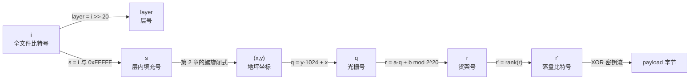
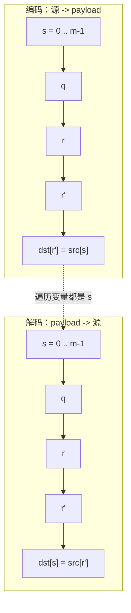
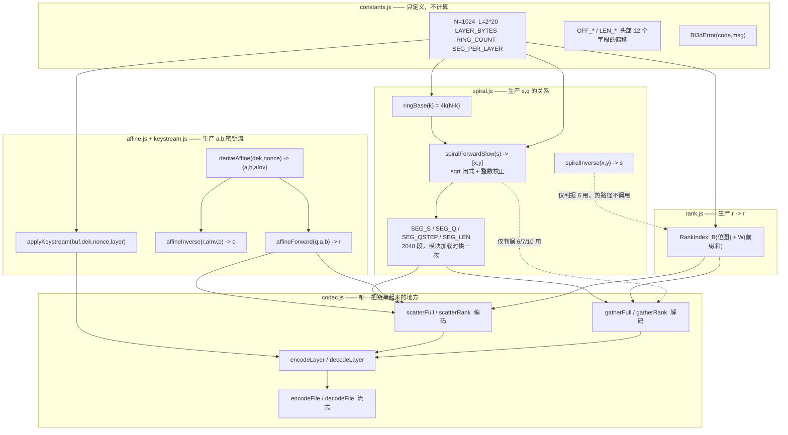
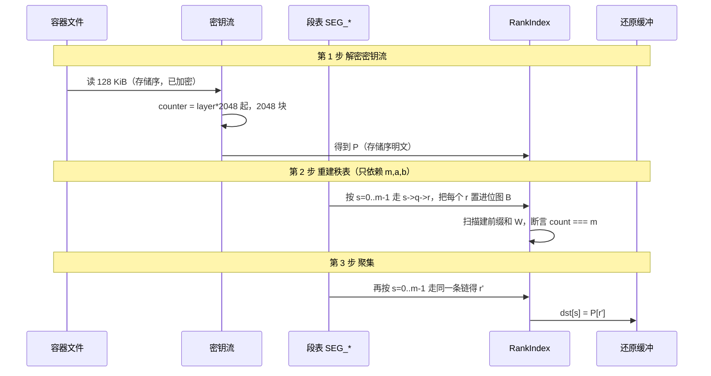
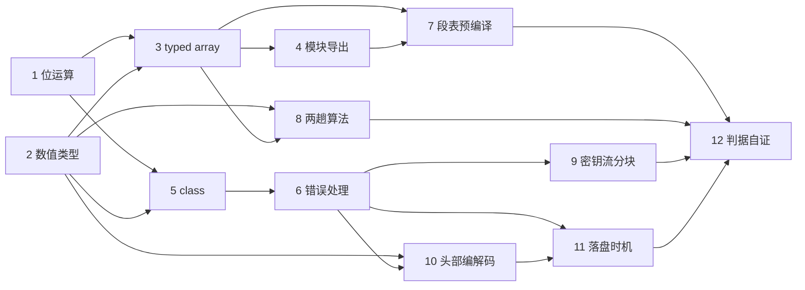
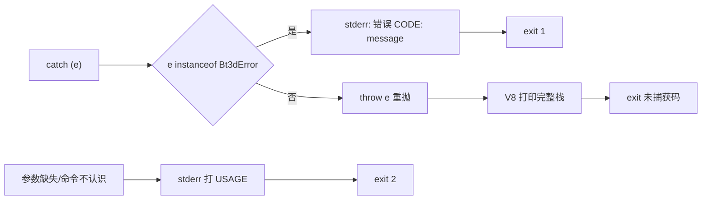
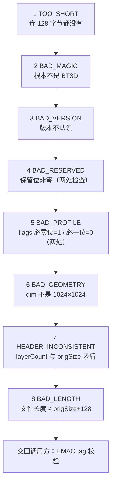

# BT3D 参数与场景技术参考

> **这份文档回答什么**：`s` `k` `t` `q` `m` `e` `n` `r` `r'` `a` `b` `aInv` 这些字母到底是什么意思，
> 它们之间是什么关系；以及这套代码为什么这样写、零基础新人怎么开始读它。
>
> **它不回答什么**：格式的规范性定义（那是 `格式规格.md` 的职责）、模块逐个的实现说明（那是 `node/README.md` 的职责）。

---

## 本批交付进度

本文按约定分批写入。下表是**全文大纲**，也是验收单。

| 部分 | 章节 | 内容 | 状态 |
|---|---|---|---|
| — | 第 0 章 | 导读、三份文档分工、贯穿全文的类比 | ✅ 本批 |
| 第一部分 | 第 1 章 | 为什么需要这么多"编号"（痛点 → 设计 → 流程） | ✅ 本批 |
| 第一部分 | 第 2 章 | 六个下标：本文最容易出事的一节 | ✅ 本批 |
| 第一部分 | 第 3 章 | 完整符号词典（6 组 34 项） | ✅ 本批 |
| 第一部分 | 第 4 章 | 量感：这些数到底多大、三个必背等式 | ✅ 本批 |
| 第一部分 | 第 5 章 | 符号之间的调用关系图 | ✅ 本批 |
| 第二部分 | 第 6 章 | 问题一：只按逆时针写，底层不还是原样依次读吗 | ✅ 本批 |
| 第二部分 | 第 7 章 | 问题二：每层原数据与混淆后数据的关系、怎么读怎么解析 | ✅ 本批 |
| 第二部分 | 第 8 章 | 问题三：V0/V1/V2 与 `s→(x,y)` 落在哪些阶段 | ✅ 本批 |
| 第二部分 | 第 9 章 | 坦白：现在哪一块在承重（含一处勘误） | ✅ 本批 |
| 第三部分 | 第 10 章 | 本工程的结构与命名约定 | ✅ 本批 |
| 第三部分 | 第 11 章 | 新人动手前必须建立的 6 条语法底线 | ✅ 本批 |
| 第四部分 | 场景 1 | 位运算：`getBit` 那行为什么长那样 | ✅ |
| 第四部分 | 场景 2 | 数值类型：`Number` 的安全边界到底安不安全 | ✅ |
| 第四部分 | 场景 3 | typed array：为什么是四张并列的表 | ✅ |
| 第四部分 | 场景 4 | 模块与导出：顶层副作用与"私有" | ✅ |
| 第四部分 | 场景 5 | class 的三种选型：`RankIndex`/`Scratch`/`Bt3dError` | ✅ |
| 第四部分 | 场景 6 | 错误处理：`code` 与三个退出码 | ✅ |
| 第四部分 | 场景 7 | 把 O(1) 闭式预编译成 2048 段 | ✅ |
| 第四部分 | 场景 8 | 两趟算法：先记账后干活 | ✅ |
| 第四部分 | 场景 9 | 密钥流分块：`counter` 基址为什么是 `layer × 2048` | ✅ |
| 第四部分 | 场景 10 | 头部编解码：偏移常量与九项校验的顺序 | ✅ |
| 第四部分 | 场景 11 | "失败不留半成品"：`fs.open` 的时机 | ✅ |
| 第四部分 | 场景 12 | 判据驱动测试：怎么证明你的测试有区分力 | ✅ |
| — | FAQ（12 条） | 压到最后 | ✅ |
| — | 附录：本文的自证方法 | 引用/锚点/mermaid 三层检查 + 检查器自证 | ✅ |

**全文已写完。** 下面这张表保留是为了说明写作过程：本文分两批落盘，
批 1 交付到场景 3 并停下确认口径，批 2 交付场景 4-12 与 FAQ。

**文中所有实测数字的复现方式**在 [第 4.4 节](#44-本文数字从哪来)。

---

## 目录

- [第 0 章 导读](#第-0-章-导读)
- [第一部分 参数词典](#第一部分-参数词典)
  - [第 1 章 为什么需要这么多"编号"](#第-1-章-为什么需要这么多编号)
  - [第 2 章 六个下标](#第-2-章-六个下标本文最容易出事的一节)
  - [第 3 章 完整符号词典](#第-3-章-完整符号词典)
  - [第 4 章 量感](#第-4-章-量感这些数到底多大)
  - [第 5 章 符号关系图](#第-5-章-符号之间的调用关系图)
- [第二部分 三个被真实问到过的问题](#第二部分-三个被真实问到过的问题)
  - [第 6 章 问题一：螺旋写入是否等于原样依次读](#第-6-章-问题一只按逆时针写底层不还是原样依次读吗)
  - [第 7 章 问题二：层内原数据与混淆数据的关系](#第-7-章-问题二每层原数据与混淆后数据到底是什么关系怎么读怎么解析)
  - [第 8 章 问题三：V0/V1/V2 与 `s→(x,y)` 的落点](#第-8-章-问题三v0v1v2-是什么sxy-落在哪些阶段)
  - [第 9 章 坦白：现在哪一块在承重](#第-9-章-坦白现在哪一块在承重)
- [第三部分 代码格式与语法底线](#第三部分-代码格式与语法底线)
  - [第 10 章 结构与命名约定](#第-10-章-本工程的结构与命名约定)
  - [第 11 章 6 条语法底线](#第-11-章-新人动手前必须建立的-6-条语法底线)
- [第四部分 12 个典型场景](#第四部分-12-个典型场景)
  - [场景 1 位运算](#场景-1--位运算getbit-那行为什么长那样)
  - [场景 2 数值类型](#场景-2--数值类型number-的边界到底安不安全)
  - [场景 3 typed array](#场景-3--typed-array为什么是四张并列的表而不是一张对象数组)
  - [场景 4 模块与导出](#场景-4--模块与导出顶层副作用与私有)
  - [场景 5 class 的三种选型](#场景-5--class-的三种选型)
  - [场景 6 错误处理与退出码](#场景-6--错误处理code-与三个退出码)
  - [场景 7 闭式预编译成段表](#场景-7--把-o1-闭式预编译成-2048-段)
  - [场景 8 两趟算法](#场景-8--两趟算法先记账后干活)
  - [场景 9 密钥流分块](#场景-9--密钥流分块counter-基址为什么是-layer--2048)
  - [场景 10 头部编解码](#场景-10--头部编解码偏移常量与九项校验的顺序)
  - [场景 11 失败不留半成品](#场景-11--失败不留半成品fsopen-的时机)
  - [场景 12 判据驱动测试](#场景-12--判据驱动测试怎么证明你的测试有区分力)
- [FAQ](#faq)
- [未覆盖项与连带改动](#未覆盖项与连带改动)
- [附录：本文的自证方法](#附录本文的自证方法)
- [待办](#待办本文发现但未动源码的项)

---

# 第 0 章 导读

## 0.1 三份文档的分工

| 文档 | 回答的问题 | 谁能改它 | 出错时以谁为准 |
|---|---|---|---|
| [`格式规格.md`](格式规格.md) | **应该**是什么。语言无关的规范性定义，Rust/Go/Node 实现都据它 | 需评审 | 它定义语义 |
| [`node/README.md`](node/README.md) | Node 这份实现**怎么做**的。逐模块、逐函数、逐判据 | 实现者 | — |
| 本文 | **这些参数是什么意思**、**代码为什么这么写**、新人怎么上手 | 任何人可补充 | — |

还有一份外围文档不属于这三份的分工：[`sdk/README.md`](sdk/README.md)，它只回答"我的项目怎么把这个格式引进来"。`sdk/` 里的两份实现是 `node/src/` 的**重复实现**（为了单文件可移植），所以当二者对容器字节的说法不一致时，`node/src/` 与 `格式规格.md` 为准，并且这属于必须立刻修的 bug —— 守卫是 `node sdk/interop-check.js`（逐字节对拍，6 个用例，2026-10-18 实测通过 6/6）。

一句话记住分工：**规格说"必须"，README 说"我这么做了"，本文说"你该先看懂这个字母"。**

当三份文档冲突时，处理规则只有一条，写死在 README 里：
**代码事实 > 规格 > README > 本文**。发现冲突先改文档，不改代码 —— 除非代码本身错了。

## 0.2 零基础读者的路径

按这个顺序读，不要跳：

```
第 0.4 节 类比  →  第 2 章 六个下标  →  第 3 章 词典（只查不背）
              →  第 10 章 命名约定  →  第 11 章 6 条底线
              →  场景 1 → 2 → 3 → …（顺序读，它们是有依赖的）
              →  这时候再去读 node/src/spiral.js，应该没有障碍了
```

第 1 章、第 4-9 章可以先跳过。**第 2 章不能跳** —— 团队里 80% 的沟通事故都来自
"我说的是 `s`，你以为我说的是 `q`"。

## 0.3 有经验读者的路径

只看三处就够动手：[第 2 章的下标对照表](#第-2-章-六个下标本文最容易出事的一节)、
[第 4.3 节三个必背等式](#43-三个必须记住的等式)、[第 9 章的承重坦白](#第-9-章-坦白现在哪一块在承重)。

## 0.4 贯穿全文的唯一类比：仓库与货架

后面 34 个符号，全部挂在同一个故事上。**请不要为不同的符号换不同的比喻**，
那是学不会的真正原因。

> 你经营一个仓库。供应商送来一条**永远连成一排的包裹传送带**，
> 包裹按到货顺序从 0 开始编号，每个包裹里装的是一比特（0 或 1）。
>
> **① 仓库有很多层楼**，每层楼正好能放 **2²⁰ = 1048576** 个包裹。
> 所以"这是全仓库第几个到货的包裹"是 `i`；"第几层楼"是 `layer`；
> "在本层里排到第几号到货"是 `s`。三者是同一个数字的三种写法。
>
> **② 摆货路线是绕圈的。** 每层的仓库地面是一个 1024×1024 的方格地坪。
> 摆货员从左下角 `(0,0)` 出发，沿最外圈**逆时针**绕，绕完一圈往里缩一圈继续绕。
> "绕到第几圈"是 `k`，"本圈这个正方形每边多少格"是 `m`，
> "在本圈里绕了几步"是 `t`，摆到的地块坐标是 `(x, y)`。
>
> **③ 但盘点员不会绕圈数。** 他站在南墙外，从南往北**一排一排**地数地块，
> 每排从西到东。他数到的那个号就是 `q`（光栅序号）。
> 这就是为什么地坪坐标 `(x,y)` 要换算成 `q = y·1024 + x`。
>
> **④ 货架号是打乱的。** 包裹不是摆在坪上不管了，最终要上货架。
> 货架号按一条只有老板知道的公式算：`r = (a × q + b) 除以 1048576 的余数`。
> `a` 和 `b` 写在合同里（就是密钥派生出来的），于是盘点员看到的规律位置，
> 在货架上完全不成规律。
>
> **⑤ 顶层没装满，空货架不留。** 最后一层楼只来了 `m` 个包裹，
> 按 `r` 打散后货架号零零散散，中间大片空架。仓库规定空架不租，
> 把用过的货架**从 0 开始重新连续编号**，这个新号是 `r'`。
> 满层时每个货架都有货，重新编号的结果就是原号 —— `r' = r`，这一步自动消失。
>
> **⑥ 出库时套上不透明袋。** 最后整层再按一套"花纹本"逐包做一次异或（XOR），
> 花纹由密钥流生成。旁人看不到袋里是什么，但只要他有同一个花纹本、
> 再对一次，就能还原。

**这个类比的边界（很重要，越界就会理解错）**：
包裹是**不可分**的类比失效单位 —— 实际处理时以"层"为整体搬动，
包裹本身没有形状；而且真实文件是**比特**，8 个才占 1 字节，
所以"货架号 `r`"是比特号，不是字节号。字节号是 `r >> 3`。

---

# 第一部分 参数词典

## 第 1 章 为什么需要这么多"编号"

### 1.1 痛点：一个比特在系统里同时拥有 6 个合法身份

假设原文件第 40000 个比特（就是第 5000 字节的第 1 位）是 `1`。
现在问你："**它存在文件的哪里？**"

这个问题在没定义清楚之前是**没有答案的**，因为下面六条路都能走：

| 你想说的是 | 那个数字 |
|---|---|
| 它在原文件里的绝对比特位 | `i = 40000` |
| 它在原文件里的字节位 | `5000` |
| 它在这一层里是第几个到货的 | `s = 40000`（第 0 层） |
| 它在 1024×1024 地坪上摆在哪格 | `(x,y) = (9,569)` |
| 盘点员一排一排数到它是第几个 | `q = 582665` |
| 上货架后它的货架号 | `r = 899574` |
| 空架抽掉后它在 payload 里的比特位 | `r' = 899574`（满层时 `r'=r`） |
| 它落在 payload 的第几字节第几位 | 第 `112446` 字节，从高位起第 `6` 位 |

**同一个比特，八个数字，全都对。** 如果沟通时不说清"我在说哪一个坐标系"，
代码评审里的争论会全部变成鸡同鸭讲。这就是这套格式必须把符号定义钉死的原因。

### 1.2 设计：把一条链定死，每个符号是链上的一个节点

解决"多身份"问题的办法不是少用几个身份，而是**规定它们只能按一条固定顺序换算**，
并且规定这个顺序的名字：



链上每一段都有**唯一的名字**和**唯一的公式**，反过来走也有唯一的名字。
这就是词典存在的意义：它不是词汇表，是**这条链的合同**。

### 1.3 流程：编码时正向走，解码时也是正向走

这里有一个新人一定会踩的认知陷阱，先说破：

> **解码不是"从 `r'` 反查它原来是哪个 `s`"。解码还是正向走 `s`。**

因为解码方**知道**全部规则（`m`、`a`、`b` 都能从头部推出），
所以它可以照着"假设我是编码器"的方式，把 `s → q → r → r'` 这条链**重走一遍**，
走到第 `s` 步时就知道"编码时第 `s` 号包裹放到了 `r'`"，于是从 payload 的 `r'` 位读出来写回 `s`。



这个决定省下了一整块代码：`r → s` 的反向查找（专业名叫 **select**，是 rank 的逆运算）
**在这条路径上永远用不到**，所以 `node/src/rank.js` 里没有 `select` 方法。
规格 §7.5 初稿描述过一个 `select`，实现按本节事实把它删了，文档随之改写。

### 新人小结

> 想象你寄快递。快递单上有四个编号：**运单号**（全网唯一）、**今天第几个取件的**（当日序号）、
> **货架号**（分拣中心内部）、**你家门的门牌号**。这四个号都对，但你打电话时只说"编号 5"，
> 客服就懵了。
>
> 这套格式里的 `i / s / q / r / r'` 就是**同一件快递的五个编号**，
> 而且它们之间有固定的换算公式。
> 读任何一段代码之前，先问一句：**"这一行的这个变量，是五个编号里的哪一个？"**
> 问这一句，能解决你 80% 的看不懂。

---

## 第 2 章 六个下标（本文最容易出事的一节）

### 2.1 六个下标的准确定义

| 名称 | 代码里的名字 | 含义 | 定义式 | 范围 | 谁产生它 |
|---|---|---|---|---|---|
| `i` | — | 全文件比特绝对下标 | `byteIndex × 8 + bitIndex` | `0 ≤ i < origSize×8` | 约定 **C5** |
| `layer` | `layer` | 层号 | `i >> 20` | `0 ≤ layer < layerCount` | 除法语义 |
| `s` | `s` | **层内填充序**（到货序号） | `i & (L−1)` = `i & 0xFFFFF` | `0 ≤ s < m` | 层切分 |
| `(x,y)` | `x`,`y` | 地坪格坐标 | 四边分段函数，见 2.2 | `0 ≤ x,y < n` | 螺旋 |
| `q` | `q` | **光栅序**（盘点员的数法） | `y·n + x` | `0 ≤ q < L` | 约定 **C4** |
| `r` | `r` | **货架序**（散射后存储序） | `(a·q + b) mod L` | `0 ≤ r < L` | 仿射 |
| `r'` | `rank(r)` | **落盘比特序**（抽掉空架） | `\|{r'' ∈ R : r'' < r}\|` | `0 ≤ r' < m` | 秩压缩 |

`m` 是**这一层实际有多少个比特**。满层 `m = L = 1048576`；末层 `m = origSize×8 − layer×L`。
`r'` 只在末层才与 `r` 不同，**满层时 `r' ≡ r`，这一事实是恒等式不是巧合**（见 4.3）。

### 2.2 `s → (x,y)` 的完整公式（唯一需要背的一段）

一圈是一个 hollow 正方形。圈号 `k`、本圈边长 `m`、单边步数 `e`：

```
n = 1024,  L = n² = 2^20,  RING_COUNT = n/2 = 512

k    = 第几圈（0 = 最外圈）          0 ≤ k < 512
m    = n − 2k                        最外圈 1024 → 最内圈 2
e    = m − 1                         最外圈 1023 → 最内圈 1
s0(k)= 4k(n − k)     ← 前 k 圈占用的格子总数（圈基址）
t    = s − s0(k)                     0 ≤ t < 4e（本圈共 4e 格）
```

`t` 落在哪一段决定在哪条边上。**边的顺序是 下 → 右 → 上 → 左**（逆时针）：

| 条件 | 边 | `(x, y)` | 直观理解 |
|---|---|---|---|
| `t < e` | 下边 | `(k + t, k)` | 沿底边往**东**走 |
| `e ≤ t < 2e` | 右边 | `(k + m − 1, k + t − e)` | 沿右边往**北**走 |
| `2e ≤ t < 3e` | 上边 | `(k + m − 1 − (t − 2e), k + m − 1)` | 沿顶边往**西**走 |
| `3e ≤ t < 4e` | 左边 | `(k, k + m − 1 − (t − 3e))` | 沿左边往**南**走 |

反向（坐标 → `s`）也在代码里，但**它不属于热路径**（第 8 章会讲为什么）：

```
k = min(x, y, n−1−x, n−1−y)          ← 该点属于哪一圈，一行取最小值搞定
```

### 2.3 `k` 是怎么从 `s` 算出来的（以及为什么要"整数校正"）

从 `s0(k) = 4k(n−k) ≤ s` 解一元二次不等式，得闭式：

```js
// node/src/spiral.js:15
let k = Math.floor((N - Math.sqrt(N * N - s)) / 2);
// node/src/spiral.js:17-18  整数校正必须保留：吸收跨平台浮点舍入差异
while (4 * (k + 1) * (N - k - 1) <= s) k++;
while (k > 0 && ringBase(k) > s) k--;
```

**新人必须理解的工程决定**：闭式算出的 `k` 可能差 1，因为 `N*N - s` 开方是浮点运算，
不同 CPU/不同库的舍入可能给 `999.9999999` 而不是 `1000`，`floor` 之后就变成 `999`。
那两个 `while` 循环用**纯整数比较**把结果钉回正确答案，且正常情况下一次都不进入循环体。
这不是"防御性编程的冗余"，是**跨实现可复现的必需品** ——
本格式要能被 Rust/Go/Node 三份实现独立跑出**逐字节相同**的容器（黄金向量就是这么对的），
浮点舍入差异会让这个目标直接失败。删掉这两行，你的实现对拍就会偶发不一致。

### 2.4 实测：10 个真实 `s` 走完这条链

下表由 `a=846561, b=70669`（固定 DEK+nonce 派生，见 4.4）**实跑**得出，不是手推示意。
`r'=r`，因为这些都是第 0 满层。

| `s` | `k` | `m` | `e` | `t` | `s0(k)` | `(x,y)` | `q` | `r` | `r>>3` | `r&7` |
|---|---|---|---|---|---|---|---|---|---|---|
| 0 | 0 | 1024 | 1023 | 0 | 0 | (0,0) | 0 | 70669 | 8833 | 5 |
| 1 | 0 | 1024 | 1023 | 1 | 0 | (1,0) | 1 | 917230 | 114653 | 6 |
| 1023 | 0 | 1024 | 1023 | 1023 | 0 | (1023,0) | 1023 | 1027372 | 128421 | 4 |
| 1024 | 0 | 1024 | 1023 | 1024 | 0 | (1023,1) | 2047 | 733484 | 91685 | 4 |
| 4095 | 1 | 1022 | 1021 | 3 | 4092 | (4,1) | 1028 | 17297 | 2162 | 1 |
| 4096 | 1 | 1022 | 1021 | 4 | 4092 | (5,1) | 1029 | 863858 | 107982 | 2 |
| 40000 | 9 | 1006 | 1005 | 3460 | 36540 | (9,569) | 582665 | 899574 | 112446 | 6 |
| 262144 | 68 | 888 | 887 | 2112 | 260032 | (617,955) | 978537 | 563286 | 70410 | 6 |
| 524288 | 149 | 726 | 725 | 2788 | 521500 | (149,261) | 267413 | 220418 | 27552 | 2 |
| 1048575 | 511 | 2 | 1 | 3 | 1048572 | (511,512) | 524799 | 125740 | 15717 | 4 |

读这张表的正确方式（三处值得停下来看）：

1. **`s=0` → `q=0`，`s=1` → `q=1`。** 最外圈下边这一段，`s` 和 `q` **恒等**。
   这正是第 6 章那个问题的根源 —— 只螺旋的话，前 1024 比特落地还是前 1024 位，即前 128 字节照抄。
2. **`s=1023` → `s=1024`，`q` 从 `1023` 跳到 `2047`。** 这就是"拐角"：
   下边走完了往右拐，地坪坐标只动了 1 格，但盘点员数法下跳了 1024。
3. **`s=1048575`（最后一个）落在 `(511,512)`。** 最内圈 `m=2`，是个 2×2 的小方块，
   中心四格是 `(511,511) (512,511) (512,512) (511,512)` —— 表里这行是第 4 个，绕完回到左边列。

### 2.5 字节与比特的换算（约定 C1/C2/C5）

符号链最终要落到"文件里的第几个字节第几位"，这一层换算也必须钉死：

| 约定 | 内容 | 代码位置 |
|---|---|---|
| **C1** | 头部所有整数**小端**（`writeUInt32LE` / `writeBigUInt64LE`） | `header.js:24-27` |
| **C2** | 字节内位序 **MSB-first**：位 0 是最高位 | `codec.js:18` |
| **C5** | `i = byteIndex × 8 + bitIndex` | `codec.js:18` 的 `i >>> 3` 与 `i & 7` |

```js
// node/src/codec.js:18  读第 i 个比特
export const getBit = (buf, i) => (buf[i >>> 3] >>> (7 - (i & 7))) & 1;
```

`7 - (i & 7)` 就是把"从 0 数第几位"翻译成"从最高位数第几位"。
**这条如果不钉死，两个实现对同一个容器会解出完全不同的文件** ——
第 8 章的缺陷 D5 就是只把这条改反，结果往返自洽、判据 5 全绿，但黄金向量当场红。

### 新人小结

> 六个下标不用背，只需要记住一句口诀：
>
> **`i` 是全国号码，`s` 是本店号码，`q` 是盘点员号码，`r` 是货架号码，`r'` 是账单号码。**
>
> 前四个都**在 0 到 104 万之间**，看起来都是数，很容易混。
> 唯一的区分办法是看它出现在哪段代码：
> 出现 `sqrt` / `ringBase` 的地方是 `s→(x,y)`；
> 出现 `a * ... + b` 的地方一定是 `q→r`；
> 出现 `rank(` 的地方一定是 `r→r'`。
>
> 以后你在代码里看到一个单字母变量，**先在心里给它补上"它属于哪条链的第几环"**，
> 再往下看。补不上就是命名有问题，去提 issue，不要猜。

---

## 第 3 章 完整符号词典

按"它属于链的哪一环"分 6 组。每项给：**含义 / 定义式 / 值或范围 / 代码出处 / 规格出处**。

### 3.1 A 组：几何常量（编译期定死，永不变）

| 符号 | 含义 | 定义式 | 值 | 代码出处 |
|---|---|---|---|---|
| `n` | 层边长（地坪是 n×n） | 头部 `dimX = dimY = 1024` | 1024 | `constants.js:3`（代码里导出名是 **`N`**） |
| `N` | 同上，代码里的名字 | — | 1024 | `constants.js:3` |
| `L` | 每层比特数 | `n²` | 1048576 = 2²⁰ | `constants.js:4` |
| `LAYER_BYTES` | 每层字节数 | `L / 8` | 131072 = 128 KiB | `constants.js:5` |
| `RING_COUNT` | 圈数 | `n / 2` | 512 | `constants.js:6` |
| `SEG_PER_LAYER` | 每层段数 | `RING_COUNT × 4` | 2048 | `constants.js:7` |
| `HEADER_SIZE` | 头部长度 | 定死 | 128 | `constants.js:8` |
| `CHACHA_BLOCK` | ChaCha20 一块输出 | 算法规定 | 64 | `constants.js:9` |
| `BLOCKS_PER_LAYER` | 每层密钥流块数 | `LAYER_BYTES / CHACHA_BLOCK` | 2048 | `constants.js:10` |
| `MAGIC` | 头部魔数 | `'BT3D'` 4 字节 ASCII | — | `constants.js:12` |
| `VERSION` | 版本 | 1 | 1 | `constants.js:13` |
| `MAX_LAYER` | 最大层数 | `⌊2³² / BLOCKS_PER_LAYER⌋` | 2097152 | `keystream.js:11` |

> **为什么 `N` 而不是 `n`**：规格用数学斜体 `n`，代码里 `n` 太容易和局部变量撞名，
> 且 JS 社区约定常量全大写。所以代码导出 `N`，文档写 `n`，
> **两者是同一个东西** —— 规格附录 A 专门列了这一条以防有人以为是两个参数。

`MAX_LAYER` 值得多说一句：ChaCha20 的块计数器是 32 位，每层用掉 2048 块，
所以层数上限 = `2³² / 2048 = 2097152` 层，乘回 128 KiB/层 = **256 GiB**。
这不是"理论上限"而是**会真的报错的闸门**：超过就在 `counterBaseOf()` 抛 `COUNTER_OVERFLOW`。

### 3.2 B 组：螺旋的内部量（全部由 `s` 推出，用完即弃）

| 符号 | 含义 | 定义式 | 范围 / 取值 | 代码出处 |
|---|---|---|---|---|
| `k` | 圈号，0 = 最外圈 | `floor((n − √(n²−s))/2)` + 整数校正 | `0 ≤ k < 512` | `spiral.js:15-18` |
| `m` | 本圈正方形边长 | `n − 2k` | 1024 → 2 | `spiral.js:20` |
| `e` | 本圈单边步数 | `m − 1` | 1023 → 1 | `spiral.js:21` |
| `s0(k)` | 圈基址：前 k 圈占用格子数 | `4k(n − k)` | 0, 4092, 16368, … | `spiral.js:11` |
| `t` | 本圈内局部偏移 | `s − s0(k)` | `0 ≤ t < 4e` | `spiral.js:22` |
| `(x,y)` | 地坪格坐标 | 2.2 的四边分段函数 | `0 ≤ x,y < n` | `spiral.js:24-27` |
| `hi` | 本圈右上界坐标 | `k + m − 1` | 1023 → 512 | `spiral.js:57` |

**注意 `m` 的严重同名歧义**，这是新人最容易读错的一处：

| 出现位置 | 这里的 `m` 是 |
|---|---|
| `codec.js` 的函数签名 `scatterRank(src, dst, m, ...)` | **本层实际比特数**（满层 = L，末层 < L） |
| `spiral.js` 的三处：`spiralForwardSlow`（`:20`）、`spiralInverse`（`:33`）、段表构建块（`:54`） | **本圈圈长**（1024 → 2） |

两者毫无关系，只是恰好都用了 `m`。规则：**看到 `m`，先看它在哪个文件的哪个函数**。
在 `spiral.js` 的任一函数内 = 圈长；在 `codec.js` 的参数位 = 层内比特总数。

注意这是**同一个名字在同一个文件里出现三份**（`:20` 与 `:33` 分属两个函数，
`e = m - 1` 这个式子在 `:21`、`:34`、`:55` 各写一遍），所以"看文件"这一招在这里只够用一半。
建议的消歧见文末"待办" —— **本批没有改源码**，因为改组件源码前要先取得同意。

### 3.3 C 组：密钥量（全部从头部 128 字节来）

| 符号 | 含义 | 大小 / 范围 | 头部位置 | 代码出处 |
|---|---|---|---|---|
| `dek` | 数据密钥（Data Encryption Key） | 32 字节 | **64..95**，明文 | `constants.js:51-52` |
| `nonce` | 一次性随机数 | 12 字节 | **32..43** | `constants.js:48` |
| `okmA` | HKDF 输出，供派生 `a` | 32 字节 | 不落盘 | `affine.js:30` |
| `okmB` | HKDF 输出，供派生 `b` | 32 字节 | 不落盘 | `affine.js:31` |
| `info` | HKDF 上下文串 | `'BT3D-v1-scan-a'` / `'BT3D-v1-scan-b'` | 不落盘 | `constants.js:56-57` |
| `a` | 仿射乘数 | **奇数**，`2¹⁹ ≤ a < 2²⁰` | 不落盘 | `affine.js:37` |
| `b` | 仿射平移 | `0 ≤ b < L` | 不落盘 | `affine.js:38` |
| `aInv` | `a` 模 2²⁰ 的逆 | `a·aInv ≡ 1 (mod L)` | 不落盘 | `affine.js:40` |
| `counter` | 密钥流块计数器 | 基址 `layer × 2048` | 不落盘 | `keystream.js:13-20` |
| `tag` | HMAC-SHA256 认证码 | 32 字节 | **96..127** | `constants.js:53-54` |

三条必须理解的取值约束：

1. **`a` 强制奇数**。偶数 `a` 与 `2²⁰` 不互质，`a·q + b` 就不是双射了，
   会有货架撞号、有货架永远空着 —— 直接破坏可逆性。强制奇数是**结构正确性的根**。
2. **`a` 强制落在 `[2¹⁹, 2²⁰)`**，不允许小 `a`。若 `a = 3`，那 `r = 3q + b`，
   相邻的 `q` 映射到相邻性尚存的 `r`，散射退化（规格 §6.4）。
   取 `a = 2¹⁹ + t`（`t` 随机）后，`a` 至少是 52 万，任何局部规律都被撕开。
3. **`a` 和 `b` 分开两次 HKDF**，用不同的 `info` 串。
   一次派生 64 字节再切两半是**错的设计** —— 那样 `b` 和 `a` 在密钥流上有相邻关系。

派生的实际代码（就 10 行，每一行都得看懂）：

```js
// node/src/affine.js:29-40
export function deriveAffine(dek, nonce) {
  const okmA = Buffer.from(hkdfSync('sha256', dek, nonce, HKDF_INFO_A, 32));
  const okmB = Buffer.from(hkdfSync('sha256', dek, nonce, HKDF_INFO_B, 32));
  const rawA = okmA.readBigUInt64LE(0);
  const t = Number(rawA % BigInt(1 << 19));   // t ∈ [0, 2^19)
  const a = ((1 << 19) + t) | 1;              // a ∈ [2^19, 2^20)，恒奇
  const b = Number(rawB % BigInt(L));         // b ∈ [0, 2^20)
  return { a, b, aInv: modInverse20(a) };
}
```

`((1 << 19) + t) | 1` 这个写法值得单独学：`| 1` 把最低位强行置 1 = **把任意整数变成奇数**。
代价是取值空间从 2¹⁹ 缩到 2¹⁸ 个奇数，仍是 26 万个候选，且 `a` 仍严格落在 `[2¹⁹, 2²⁰)` 内
（因为 `+1` 最多让它到 `2¹⁹ + (2¹⁹−1) + 1 = 2²⁰`？不会 —— `t < 2¹⁹` 时 `(2¹⁹ + t) | 1 ≤ 2²⁰ − 1`，
上界是安全的，因为 `2¹⁹ + t` 本身 `< 2²⁰`，而 `| 1` 在偶数时只加 1，
只有当它恰好等于 `2²⁰ − 2` 时才可能推到 `2²⁰ − 1`，仍在范围内）。

### 3.4 D 组：秩压缩的三个结构

| 符号 | 含义 | 定义式 | 大小 | 代码出处 |
|---|---|---|---|---|
| `R` | 落点集合 | `{ r(s) : s < m }`，本层实际用到的货架号全集 | `|R| = m` | — |
| `B` | 落点位图 | `B[r/32]` 的第 `r mod 32` 位 = 货架 `r` 有没有货 | `WORDS = 32768` 个 u32 = **128 KiB** | `rank.js:24` |
| `W` | 字级前缀和 | `W[j] = Σ_{u<j} popcount(B[u])` | `32769` 个 u32 = **128 KiB + 4 B** | `rank.js:25` |
| `WORDS` | 位图字数 | `L / 32` | 32768 | `rank.js:10` |
| `rank(r)` | 秩查询 | `W[r>>>5] + popcount(B[r>>>5] & 低 r&31 位的掩码)` | 结果 `∈ [0, m)` | `rank.js:52` |

三个结构的关系：`R` 是数学对象，`B` 和 `W` 是它的**存储形态**；
`B` 存"哪些货架有货"，`W` 存"到第 j 个字为止累计有多少货"。
两者合起来让 `rank(r)` 变成 **O(1) 一次查询**（否则每次查询要数 32768 次）。

### 3.5 E 组：段表四元组（性能设计的全部落点）

| 符号 | 含义 | 类型 | 代码出处 |
|---|---|---|---|
| `SEG_S` | 段首的**填充序** `s` | `Int32Array(2048)` | `spiral.js:45` |
| `SEG_Q` | 段首的**光栅序** `q` | `Int32Array(2048)` | `spiral.js:46` |
| `SEG_QSTEP` | `q` 的步进：`+1 / +N / −1 / −N` | `Int32Array(2048)` | `spiral.js:47` |
| `SEG_LEN` | 段长（= `e` = `m−1`） | `Int32Array(2048)` | `spiral.js:48` |
| `SEG_TOTAL_LEN` | 所有段长之和，必须等于 `L` | 数值 | `spiral.js:74` |
| `rStep` | `r` 的步进 = `a·SEG_QSTEP mod L` | 运行期算 | `codec.js:29` |

**这张表就是 `s → (x,y) → q` 的全部物质存在形式**（第 8 章详述）。
四条边各烘成一段等差：

```js
// node/src/spiral.js:60-66（注释是本节的原始出处）
// 下边 (k+t, k)     → q = k*N + k + t        SEG_Q = k*N+k,   QSTEP = +1
// 右边 (k+m-1, k+t) → q = (k+t)*N + hi       SEG_Q = k*N+hi,  QSTEP = +N
// 上边 (k+m-1-t,hi) → q = hi*N + hi - t      SEG_Q = hi*N+hi, QSTEP = -1
// 左边 (k, k+m-1-t) → q = (k+m-1-t)*N + k    SEG_Q = hi*N+k,  QSTEP = -N
```

### 3.6 F 组：运算与约定记号

| 记号 | 含义 | 注意点 |
|---|---|---|
| `mod` | **非负**取模，结果 `∈ [0, L)` | JS 的 `%` 对负数返回负数，所以必须走 `modL`（`constants.js:73`） |
| `⊕` | 逐比特异或 | 密钥流的施加方式，`^` |
| `⌈x⌉` | 向上取整 | 用于末层字节数 |
| `>>` | **带符号**右移 | 会把操作数先转成 **int32** |
| `>>>` | **无符号**右移 | 把操作数当 uint32 处理，`rank.js:15` 第一行就靠它 |
| `<<` | 左移 | 结果也是 int32，`1 << 31` 是**负数** |
| `& 7` | 取低 3 位 = 字节内位号 | 比 `% 8` 快且语义清楚 |
| `>>> 3` | 除 8 取整 = 字节号 | 比 `/ 8 | 0` 少一次浮点 |

`modL` 的实现有个反直觉之处，值得新人看：

```js
// node/src/constants.js:72-73
// 负数安全取模。C/JS/Rust 对负数取模的行为不一，一律走这个（§14.3 第 3 条）。
export const modL = (v) => ((v % L) + L) % L;
```

两次取模不是画蛇添足：第一次把值缩到 `(-L, L)`，第二次把负数抬正。
**跨语言实现必须逐字对齐这个写法**，否则 `aInv * (r - b)` 在 `r < b` 时三份实现会给出三个答案。

---

## 第 4 章 量感：这些数到底多大

不谈量级的参数表是背不住的。这一章把每个数换算成人能感知的东西。

### 4.1 单层之内

| 量 | 值 | 人话 |
|---|---|---|
| 地坪 | 1024 × 1024 格 | 约 1 百万个地块 |
| 一层比特 | 1 048 576 | `2²⁰`，"一 MiB 的比特" |
| 一层字节 | 131 072 | **128 KiB** |
| 一圈的格子 | `4m − 4` | 最外圈 4092 格，最内圈 4 格 |
| 一圈的段数 | 4 | 恒为 4 |
| 一层段数 | 2048 | = 512 圈 × 4 边 |
| 位图 `B` | 128 KiB | 每货架 1 bit |
| 前缀和 `W` | 128 KiB + 4 B | 每字 4 B，多存一个末项 |

`L / 8 = 131072 = 128 KiB` 这个数解释了格式的一切设计：
**"每层 128 KiB"不是随便选的**，它等于 `2²⁰` 比特，而 `2²⁰` 让层号与层内偏移
正好可以用**位运算**分离（`layer = i >> 20`、`s = i & 0xFFFFF`），
且 `1024²` 让地坪是正方形。三个好处来自同一个数字。

### 4.2 整层与全文件

| 量 | 值 | 说明 |
|---|---|---|
| 头部 | 128 字节 | 定死 |
| 容器总长 | `origSize + 128` | **一个字节不多，一个字节不少** |
| 支持的最大载荷 | 256 GiB | 由 ChaCha20 32 位块计数器反推 |
| 支持的最大 `origSize` | 2³⁸ 字节 | `MAX_LAYER × LAYER_BYTES` |
| 比特下标上界 | `2⁴¹ − 1` | 2³⁸ 字节 × 8，注意不是 2⁴³ |
| `origSize` 字段宽度 | u64 | 头部 8..15，实际只用到低 38 位 |

**"容器 = 原文 + 128"是这套设计最漂亮的地方**，靠的就是 `r'`（秩压缩）。
如果只用仿射散射不做秩压缩，那末层的 `m` 个比特也要占满 `L` 个货架位，
1 字节的文件会膨胀成 128 KiB —— 荒谬。秩压缩把末层实际用的货架位挤到 `[0, m)`，
末层就正好落 `m/8 = ceil(origSize − (layerCount−1)×LAYER_BYTES …)` 字节。
**代价是末层要走两趟算法**，见 4.3 与第 8 章。

### 4.3 三个必须记住的等式

这三条是整个几何设计的"守恒律"，任何实现改动最后都要靠它们自证。

**等式一（覆盖完备）：所有段长之和 = L**

```
Σ_{k=0}^{511} 4·(m−1)  =  Σ 4·(1024 − 2k − 1)  =  4·Σ_{k=0}^{511}(1023 − 2k)
                       =  4·(512·1023 − 2·(511·512/2))
                       =  4·(523776 − 261632)  =  4·262144  =  1 048 576  = L  ✓
```
机器版：`SEG_TOTAL_LEN`（`spiral.js:74`），判据 6 实测 `= 1048576`。

**等式二（满层时秩压缩是恒等）**

```
m = L  ⇒  R = [0, L) 是全集  ⇒  |{r'' ∈ R : r'' < r}| = r  ⇒  r' = r
```
**严格恒等，不是近似**。所以"满层跳过位图"是**性能优化**而非语义分支，
判据 12 专门守"两条路径输出必须一字节不差"。实现落在 `codec.js:149-150` 的单分支。

**等式三（一层 = 一次独立的混淆单元）**

```
文件第 layer 层的 payload 起点 = 128 + layer × 131072
密钥流计数器基址              = layer × 2048
```
这两个 `layer ×` 是配套的：**层与层之间零混合**。
第 7 章"怎么读一层"的全部依据就是这两行。

### 4.4 本文数字从哪来

文中出现的所有实测数，来源只有三个，都可复跑：

| 来源 | 命令 | 本文引用它的地方 |
|---|---|---|
| 判据实跑 | `cd node && node test/criteria.js` | 第 6/8 章全部"实测"数字、判据号 |
| 缺陷注入 | `cd node && node test/criteria.js --prove-red` | 第 8 章消融阶梯 D1/D2/OK |
| 符号追踪 | `node bt3d-trace.mjs`（临时脚本，见 2.4 表） | 2.4 的 10 行下标全程追踪 |

固定密钥材料（为了可复现，黄金向量与本文都用它）：

```
DEK   = 'BT3D-v1-fixed-dek-golden-vector!'  (32 B, hex 425433442d76312d…)
nonce = 'BT3D-nonce-1'                      (12 B, hex 425433442d6e6f6e63652d31)
派生  →  a = 846561 (0xceae1, 奇数✓, ∈[2¹⁹,2²⁰)✓)   b = 70669   aInv = 907553
```

---

## 第 5 章 符号之间的调用关系图

词典是静态的。这张图给"一个符号在哪个文件被生产、被谁消费"，读代码时按图索骥。



图上两条**虚线**是全文最容易被误读的地方：
`spiralForwardSlow` 与 `spiralInverse` 都**不在生产热路径里**，
只服务于判据交叉验证。第 8 章会展开讲这条虚线为什么是设计的核心而不是遗留。

---

# 第二部分 三个被真实问到过的问题

这三问按团队实际提问顺序排列。**第三问是最致命的，但它必须在前两问之后才答得清**，
所以不要打乱读。

## 第 6 章 问题一：只按逆时针写，底层不还是原样依次读吗？

### 提问原文

> "如果仅仅按照逆时针的模型写入，实际上底层不还是和原数据一样依次读取吗？"

### 结论

**是的。提问者的直觉完全正确，而且这个性质不是实现瑕疵，是几何必然。**

### 6.1 为什么必然：最外圈下边 `s ≡ q`

取最外圈 `k = 0`，则 `m = 1024`、`e = 1023`、`s0(0) = 0`、`t = s`。
下边条件是 `t < e`，即 `0 ≤ s ≤ 1022`，此时代码返回 `[k + t, k] = [s, 0]`。

于是 `q = y·N + x = 0·1024 + s = s`。**`s` 到 `q` 在这一段是恒等映射。**

再看拐角：`s = 1023` 时 `t = 1023`，不满足 `t < e`，落入右边分支，返回 `[k+m−1, k+(t−e)] = [1023, 0]`，
`q = 1023` —— **依然是 1023**。所以 `s = 0 .. 1023` 这 1024 个比特，
落地后 `q` 也是 `0 .. 1023`，即 payload 的**第 0 到第 127 字节，与原文一字节不差**。

这就是第 2.4 节追踪表里 `s=0→q=0`、`s=1→q=1` 那两行的含义。

### 6.2 实测：把源设成"字节值 = 下标"，一眼看出照抄

构造 `src[i] = i & 0xff`（第 i 字节的值就是 i，位置信息写在脸上），只跑第 0 满层：

```
原文件    前 16 字节 : 00 01 02 03 04 05 06 07 08 09 0a 0b 0c 0d 0e 0f
V0 只螺旋          : 00 01 02 03 04 05 06 07 08 09 0a 0b 0c 0d 0e 0f   ← 一模一样
V1 螺旋+仿射       : ca 22 71 62 2a 1c 67 f9 02 f5 00 33 b2 18 d6 aa
V2 全开（现格式）  : ee 18 c9 bf e3 e8 3d 61 50 02 e2 d9 f5 5b 5f b4
```

再看整层 131072 字节里"与原文逐字节相同"的个数：

| 挡位 | 相同字节数 | 相对随机基线的偏离 |
|---|---|---|
| V0 只螺旋 | **655** | 基线 512，**多出 143** ← 结构泄漏 |
| V1 螺旋+仿射 | 508 | 巧合水平 |
| V2 全开 | 518 | 巧合水平 |

基线 512 是怎么来的：两个独立随机字节相等的概率是 `1/256`，
`131072 / 256 = 512`。**所以 508 和 518 是"完全没有结构"的证据，655 才是问题。**

### 6.3 相邻性：一半的比特对保持原样

1048575 对相邻源比特，落地后仍相邻的比例：

| 挡位 | 仍相邻 | 占比 |
|---|---|---|
| V0 只螺旋 | 524 799 | **50.049 %** |
| V2 全开 | 0 | **0.000 %** |

50% 的成因一眼能推出来：一条边内部每走一步 `q` 就 `±1`，
只有**拐角**（下→右、右→上、上→左）和**跨圈**才跳。每圈 4e 个比特里只有 4 个跳变点，
但跳变点两侧的 `q` 差 `±N`，把整条边的 `q` 排到不相邻的位置 ——
于是每圈约一半的比特对落在"同一排相邻列"（`+1`），另一半落在"同一列相邻排"（`+N`，在字节流上相距 128 KiB/1024… 总之不相邻）。
**实测 50.049%，与这个推理一致。**

### 6.4 这个性质跟螺旋参数无关（新人最容易想错的地方）

新人的第一反应通常是："那我换一个起始角 / 改成顺时针 / 从中间圈开始绕，不就打散了？"

**不行。** 理由：任何"从某点出发、按固定几何规则逐格绕"的路线，
必然存在**至少一条连续段**使得相邻的 `s` 映到相邻的 `q` ——
因为路线本身是在网格上**贴着走**的，只要它是相邻格递推，那一步就必然 `Δq ∈ {±1, ±N}`。
换起始角只是把"哪条边恰好等于 `s ≡ q`"挪个位置；
换手性只是把 `+1` 变成 `-1`（相邻还是相邻）；
改起始圈也不改变"总有一段是贴着排走的"。

规格 §5.4 与判据 7 把手性钉死（`x` 向右、`y` 向上、从 `+Z` 看向 `-Z` 时逆时针），
**不是为了混淆，是为了三份实现可复现**。混淆靠的是别的。

> **所以：这个方案的混淆强度，一丝一毫都不来自螺旋。**
> 螺旋的唯一作用是"给每一比特一个二维坐标 `q`"，好让下一步仿射有个可乘的东西。

## 第 7 章 问题二：每层原数据与混淆后数据到底是什么关系？怎么读、怎么解析？

### 7.1 关系：一层 = 一个下标置换 + 一次整层 XOR

**先把"层的切分本身完全不混淆"说清楚**，这是最容易误解的点：

```
第 layer 层的源比特 s  ==  原文件的第 (layer × 2^20 + s) 个比特
```

即 **第 0 层 = 原文前 128 KiB，第 1 层 = 紧接着 128 KiB，……**
层与层之间**零混合**，混淆只在层内发生。这个决定换来两件事：
可以流式处理（一次只驻留 128 KiB + 表），和可以只解一层（随机访问）。
代价是"一个比特的秘密只在一个 128 KiB 窗口内扩散"。

层内那条链（把仓库类比里的编号对回符号）：


写成一行公式（编码，满层时 `r'=r`）：

```
payload_bit( rank( (a · spiralRaster(s) + b) mod 2^20 ) )
   =  orig_bit( layer · 2^20 + s )  ⊕  chacha20_keystream( dek, nonce, layer·2048 )[r']
```

### 7.2 读一层的物理动作：永远是顺序读

**这里回答"每层数据的读取和解析是怎样的"**：

| 步骤 | 动作 | 读多少 | 驻留内存 |
|---|---|---|---|
| 1 | 从 `128 + layer × 131072` **连续**读 | 131072 B（末层 `m/8` B） | 128 KiB |
| 2 | 整层 XOR 密钥流（就地） | — | 同上 |
| 3 | 重建 `B` + `W`（末层才需要） | 不读文件 | +256 KiB |
| 4 | 按 `s = 0..m−1` 走链，从 `r'` 位读出、写入 `s` 位 | 不读文件 | +128 KiB 目标缓冲 |

关键认知：**第 1 步是普通顺序读，跟读任何文件一样。**
"内容被打散"和"顺序读"完全不矛盾 ——
随机性只发生在**下标解释层**（"payload 第 `r'` 位对应源第 `s` 位"这件事是密钥相关的），
不发生在**物理 I/O 层**。所以流式、断点续传、`pread`、mmap 全部照常可用。

### 7.3 解析一层的三步，和"为什么第 2 步不需要知道任何比特值"



**第 2 步是本格式最巧的一步**，值得专门理解：
它只需要 `m`、`a`、`b` 三个数，**完全不碰任何比特值**。
所以编码方和解码方各自独立重建出来的表**必然逐字节相同** ——
判据 12 守的就是这个（实测：满层位图计数 1048576，`rank(r) ≠ r` 的个数 **0**）。
如果这一步碰了数据值，两侧就无法独立重建，格式立刻失去流式和随机访问能力。

### 7.4 末层为什么要走两趟

秩 `rank(r)` 的定义要求**先知道全部落点 `R`**，才能算某个 `r` 的秩。
而落点 `R` 要遍历一遍 `s` 才建得起来。所以末层必然两趟：

```js
// node/src/codec.js:51-74（节选）
for (let pass = 0; pass < 2; pass++) {
  if (pass === 0) rank.clear();
  for (let i = 0; i < SEG_PER_LAYER && SEG_S[i] < m; i++) {
    ...
    if (pass === 0) rank.set(r);                    // 第一趟：只记落点
    else setBit(dst, rank.rank(r), getBit(src, s)); // 第二趟：才写数据
    ...
  }
  if (pass === 0) { rank.build(); if (rank.count !== m) throw ... }  // 第一趟末尾建表 + 自证
}
```

第一趟结束时那句 `if (rank.count !== m) throw` 是**算法级的自杀式断言**：
若仿射不是双射（比如 `a` 是偶数），会有两个 `s` 撞同一个货架，位图计数就会 `< m`，
此时**立刻抛错而不是静默产出坏容器**。这类"让错误自己叫出来"的设计在第 11 章还会遇到三次。

## 第 8 章 问题三：V0/V1/V2 是什么？`s→(x,y)` 落在哪些阶段？

### 8.1 V0/V1/V2 不是格式的三挡，是消融对照

**先纠正一个可能的误会**：这三者是**诊断用的开关组合**，不是可选模式。
它们不是我临时造的，而是测试套件里已有的两个证明性缺陷：

| 本文叫法 | 套件里的名字 | 定义处 | 开关 | 语义 |
|---|---|---|---|---|
| V0 | **D1** | `criteria.js:445` | `useAffine:false, useKeystream:false` | **你最初的方案**：纯螺旋 + 纯光栅 |
| V1 | **D2** | `criteria.js:446` | `useAffine:true, useKeystream:false` | 只打散位置，不加密 |
| V2 | 规范实现 | 默认 | 两者都开 | 现格式，`FLAGS_NORMATIVE = 0x1C` |

开关怎么生效的（就 4 行）：

```js
// node/src/codec.js:142-145
const useAffine = opts.useAffine !== false;
const useKeystream = opts.useKeystream !== false;
const a = useAffine ? p.a : 1; // a=1,b=0 时仿射退化为恒等光栅
const b = useAffine ? p.b : 0;
```

`a=1, b=0` 使 `r = (1·q + 0) mod L = q` —— 仿射**退化成恒等**，
这正是第 6 章"照抄"的成因。`useKeystream:false` 则跳过 `codec.js:153` 的 XOR。

**V0/V1 生产路径不可达**：`parseHeader` 对 `flags ≠ 0x1C` 直接 `BAD_PROFILE` 拒收
（判据 9 实测过把 bit2 清掉的容器），CLI 也从不传 `opts`。
所以这两个挡位**既写不出也读不了**，只用于诊断。

### 8.2 消融阶梯实测（同一输入：node.exe 前 1 MiB）

| 挡位 | 判据 1 恒等泄露 | 判据 3 压缩比 | 判据 4 位占比 | 判据 5 往返 |
|---|---|---|---|---|
| D1（=V0，最初的方案） | **红** 前 128B 照抄=true，≥8B 公共子串 **31167 处** | **红** 0.8298（原文 0.3625） | **红** 差 **0.000pp** | 往返一致 ✅ |
| D2（=V1，只转置） | 绿 | **红** 0.9526 | **红** 差 **0.000pp** | 往返一致 ✅ |
| OK（=V2，现格式） | 绿 | 绿 1.000031 | 绿 49.975% | 往返一致 ✅ |

**这张表里有两条必须学会读的信息：**

1. **四个挡位判据 5 全绿。** 往返测试**证不住混淆容器** —— 这是 `--prove-red` 存在的全部理由。
   一个把内容原样照抄的实现可以完美往返。所以判据必须有非往返的项（1/2/3/4）。
2. **D1 和 D2 的判据 4 都差 0.000pp，一模一样。**
   这不是巧合，是**定理**：**任何位置换都不改变 1 的总个数**。
   `s→q→r→r'` 全程是双射，1 的个数原封不动，所以位占比面对置换**天然免疫**。
   只有密钥流的 XOR 能把它从 36.605% 推到 49.975%。
   → **判据 4 只测得住"有没有加密"，测不住"有没有打散"。** 这就是为什么需要判据 2 单独测邻接。

D2 的压缩比 0.9526（原文 0.3625，V2 是 1.000031）也值得注意：
置换**确实**打碎了长游程，压缩比从 0.36 猛跳到 0.95；
但字节值的**全局统计**被双射保住了，够不到 0.98 阈值。
→ **判据 3 能抓住"只置换不加密"，判据 4 也能；判据 1 抓不住**（V1 判据 1 是绿的）。
三条判据的覆盖面**互补**，这正是判据要写成 15 条而不是 1 条的原因。

### 8.3 `s → (x,y)` 具体体现在哪些阶段

**核心答案：生产热路径里没有这一步。** 它存在的形式是"代数式 + 预计算表"。

| 阶段 | 位置 | `s→(x,y)` 以什么形式存在 | 跑几次 |
|---|---|---|---|
| ① 纸面定义 | 规格 §5 | `k=floor((n−√(n²−s))/2)` + 四边分段 | 0 次（是文档） |
| ② 解析地烘段表 | `spiral.js:53-69` | **不调用 sqrt**，把四条边的坐标式代入 `q=y·N+x` 直接化成等差，产出四张 `Int32Array` | **进程加载时 1 次** |
| ③ 编码散射 | `codec.js:34` / `:50` | 只读段表；内层循环只有 `s++` 和 `r += step` | 每层 1 次 |
| ④ 解码聚集 | `codec.js:79` / `:94` | 同表、同遍历方向 | 每层 1 次 |
| ⑤ 慢路径参照 | `reference.js:17,29,41,53,81` | **真的逐比特调 `spiralForwardSlow(s)`** | 仅判据 6/7/10 |
| ⑥ 逆映射 | `spiral.js:31` | `spiralInverse` **只在 `reference.js:59` 用来交叉核对** | 仅判据 6 |

② 的实质是把四条边各写成一条等差（`spiral.js:60-66`，词典 3.5 已列）：
坐标 `(x,y)` 作为数值**从未被算出来过**，它的存在形式是
注释里那四个坐标公式，加段表里那个步进的**正负号** —— 符号本身编码了螺旋手性。

③④ 能把二维的螺旋 + 一维的仿射压成 2048 段纯加法递推，**唯一的凭据是仿射是线性的**：

```js
// node/src/codec.js:28-29
const segR0   = (i, a, b) => (a * SEG_Q[i] + b) % L;
const segRStep = (i, a) => modL(a * SEG_QSTEP[i]);
```

`q` 走等差 ⇒ `r = a·q + b` 也走等差，公差被 `a` 缩放。**一次乘法，每层只算 2048 次**。
如果换成一个非线性置换（比如查表或哈希），整层就得逐比特算 `1048576` 次置换，
②③④ 这套预计算结构会**整体崩塌**。

> **这条因果值得记住：选仿射不是为了"更安全"（第 9 章会说它其实不承重），
> 而是因为它是唯一一个"能把二维螺旋折成一维等差"的变换族。**
> 安全来自密钥流，性能来自线性。

### 8.4 快慢路径的一致性靠什么保证

既然热路径（②③④）走的是"解析式段表"，参照路径（⑤）走的是"逐比特 sqrt"，
就必须证明两者等价 —— **判据 10**：

```
满层 131072 B 逐字节相同 = true
末层 m = 8000  逐字节相同 = true
```

这两行是快路径正确性的**全部凭据**。段表是"人推导出来的公式"，
`spiralForwardSlow` 是"定义本身"，两者对拍通过才敢说推导没错。

第 8 章还给出一个反面证据：缺陷 D6（把每圈内"右边"与"上边"两段 `s` 区间互换）
**依然是双射、依然自洽往返、判据 5 全绿**，但判据 10 当场红
（实测 `与慢路径参照逐字节相同 = false`）。
→ **慢路径参照的价值不在速度，在于它是"独立的第二个答案"。**

## 第 9 章 坦白：现在哪一块在承重

作为技术参考文档，这一章是**必须存在**的。团队里任何新成员在读懂符号之后，
第二个该知道的就是这个 —— 免得他误以为这套设计提供了加密级保护。

### 9.1 三块设计各自的真实承重

| 设计 | 名义作用 | **拿到文件但没有口令的人**视角下的强度 | 它真正存在的理由 |
|---|---|---|---|
| 螺旋 `s→q` | 给比特一个二维位置 | **0**（规则公开，可完全重算） | 为仿射提供可乘的整数；让布局可讲 |
| 仿射 `q→r` | 密钥相关置换 | **0**（`a`/`b` 由 DEK 派生，而 **DEK 在头部明文**） | 满足判据 2；预留升级成真防线的通路 |
| 秩压缩 `r→r'` | 让容器 = 原文 + 128 | **0**（只依赖 `m,a,b`） | 尺寸精确性，纯工程收益 |
| **ChaCha20 XOR** | 加密 | **0**（密钥 `dek` 就在同一个文件里） | 当前唯一"看起来不像原文件"的来源 |

**结论（规格 §12 原话）**：本格式在密码学意义下的机密性强度为 **0 bit**。
它现在能提供的是：`hexdump` / `strings` / `file` / 压缩器 这一层面"认不出这是原文件"。
判据 1/3/4 的实测值达标，说的就是这一层。

**一处勘误（本批主动更正）**：我在前一轮对话里说过
"nonce 在头部 `56..67`"。这是错的。按 `constants.js:48`（`OFF_NONCE = 32`）
与 `header.js:28`（`nonce.copy(h, OFF_NONCE)`，12 字节），
**nonce 实际占 `32..43`**；`44..63` 是 `reserved2`（20 字节全零）。
DEK 在 `64..95` 那句是对的。本文一律以 32..43 为准。

### 9.2 为什么"0 强度"的两块还要留着

三个理由，都不是"以后可能有用"这种模糊说法：

1. **判据 2（邻接保留 ≤ 1%）没有它就必红。** 见 6.3，V0 的实测是 50.049%。
   秩压缩不改变这个（它是单调重编号），只有仿射能把它打到 0.000%。
2. **`origSize + 128` 的精确尺寸依赖秩压缩。** 去掉它，1 字节文件膨胀成 128 KiB（见 4.2）。
3. **升级是"改一处"而不是"改格式"**：把头部 `64..95` 的明文 DEK 换成口令封装，
   仿射散射立刻从"装饰"变成"必须知道口令才能重建的防线"。
   规格 §12.5 / v3 记的就是这个路径。**格式的骨架不用动**，
   因为 `a`/`b` 早就是"由 DEK 派生"而不是"写死"的。

### 9.3 如果要把强度从 0 抬起来，只有一处要改

```
现状：  口令 ──(不存在)──>  ✕          DEK 明文 ──> a, b, 密钥流
目标：  口令 ──Argon2id──> KEK ──AES-256-GCM──> 封装的 DEK ──> a, b, 密钥流
```

头部需要新增：`16 B salt` + `32 B wrapped DEK` + `12 B wrap nonce` + `16 B wrap tag`
= 64 字节，正好可以吃掉 `reserved0`(6..7) + `reserved2`(44..63) + 扩头部到 192 B
（或保持 128 B 但放弃 reserved2 的未来用途）。并要新增一条判据：**口令错误必须在读完头部后、
写任何输出字节之前失败**（这条已有基础设施 —— 第 11 章的"失败不留半成品"）。

除此之外，几何、仿射、秩压缩、密钥流分层**全都不用改**。

---

# 第三部分 代码格式与语法底线

## 第 10 章 本工程的结构与命名约定

约定不是审美问题，是**减少读代码时的猜测成本**。下面每一条都能在代码里找到实例。

### 10.1 目录与文件职责

| 文件 | 行数 | 唯一职责 | 禁止出现的东西 |
|---|---|---|---|
| `src/constants.js` | 73 | **只有数值和类型的定义** | 任何计算、任何 I/O、任何 `import` 业务模块 |
| `src/spiral.js` | 74 | `s ⇄ (x,y) ⇄ q` 与段表 | 密钥相关的一切 |
| `src/affine.js` | 41 | `q ⇄ r` 与 `a,b,aInv` 派生 | 螺旋、I/O |
| `src/rank.js` | 58 | `r → r'` | 任何比特值的知识 |
| `src/keystream.js` | 48 | ChaCha20 与 OpenSSL 的绑定 | 几何 |
| `src/header.js` | 96 | 128 B 头部的构造/解析/校验 | payload 处理 |
| `src/codec.js` | 308 | **把上面五个串起来**，唯一的编排层 | 新算法 |
| `src/cli.js` | 95 | 参数解析、缺省输出名、分派、退出码 | 算法 |

`sdk/` 是 2026-10-18 加的一层，与上表正交：

| 文件 | 行数 | 唯一职责 | 禁止出现的东西 |
|---|---|---|---|
| `sdk/bt3d-encode.js` | 425 | 自包含单文件编码器（CommonJS，只依赖 `node:` 内置模块） | 任何 `import` 本工程文件；任何与 `node/src` 不同的容器字节口径 |
| `sdk/bt3d-decode.js` | 461 | 自包含单文件解码器 | 同上 |
| `sdk/interop-check.js` | 265 | 证明上面两份与 `node/src/` 是同一个格式 | 业务代码 |

这两份是**故意的重复实现**（拆不开了才能"拷一个文件走"），所以它们不受上表"唯一职责"那条约束的管辖，受的是另一条：改了 `node/src/` 里任何影响容器字节的东西，必须回来跑 `node sdk/interop-check.js`。见 `node/README.md` §12.4。

**读代码顺序建议**：`constants.js` → `spiral.js` → `affine.js` → `rank.js` →
`keystream.js` → `header.js` → `codec.js` → `cli.js`。
这个顺序**恰好是依赖图的拓扑序**（第 5 章那张图从左上往右下读）。

### 10.2 命名约定

| 类别 | 约定 | 实例 | 反例（禁止） |
|---|---|---|---|
| 常量 | `UPPER_SNAKE` | `LAYER_BYTES`、`OFF_DEK` | `layerBytes` 用作常量 |
| 函数 | `camelCase`，动词开头 | `deriveAffine`、`scatterFull` | `affine()`、`doIt()` |
| 类 | `PascalCase` | `RankIndex`、`Scratch`、`Bt3dError` | `rank_index` |
| 派生量 | 名词 + 方向后缀 | `affineForward` / `affineInverse` | `affine` / `affine2` |
| 表 | `复数` + 后缀 | `SEG_S`、`SEG_QSTEP` | `segment` |
| 偏移/长度 | `OFF_` / `LEN_` 前缀 | `OFF_TAG` / `LEN_TAG` | `TAG_POS`、`TAG_SIZE` |
| 布尔 | `is/has/use` 前缀 | `useAffine`、`useKeystream` | `affine`（撞名） |

**方向后缀是本项目的一个硬规矩**：凡是一对可逆变换，
函数名必须写成 `xxxForward` / `xxxInverse`，
禁止 `xxx` + `unxxx`（`un` 系列在英语里有歧义，且 `unspiral` 读起来像拼错）。

### 10.3 注释约定（这一条最严格）

**默认不写注释。** 只在"为什么不显然"时写，且必须属于下面四类之一：

| 类型 | 模板 | 真实例子 |
|---|---|---|
| ① 指回规格 | `// §x.y：<规范条文>` | `spiral.js:1` `// 几何映射 I：分层与螺旋。口径见 ../../格式规格.md §5。` |
| ② 记录踩过的坑 | 说清"曾经错在哪、后果是什么" | `constants.js:26-28`（flags 掩码曾写错成 `0xC3`） |
| ③ 保护一个非直觉决定 | 说清"删了会怎样" | `spiral.js:16` `// 整数校正必须保留：吸收跨平台浮点舍入差异（§5.5）` |
| ④ 记下一个非显然的推导结论 | 写清"参数为什么是这个值" | `affine.js:14` `// 每轮精度翻倍：1 -> 2 -> 4 -> 8 -> 16 -> 32，故 5 轮足够` |

**禁止的注释**：说明代码在做什么（`// i 自增`）、引用任务编号（`// 为修 issue#123`）、
复述函数名（`// 返回 a 的逆`）。这类注释会随代码演进腐烂，且新人在读时会形成
"注释是装饰"的坏习惯。

### 10.4 导出风格

```js
// 一行能写完的 → export const + 箭头函数
export const ringBase = (k) => 4 * k * (N - k);          // spiral.js:11
export const getBit = (buf, i) => (buf[i >>> 3] >>> (7 - (i & 7))) & 1;  // codec.js:18

// 需要语句体/多返回 → export function
export function spiralForwardSlow(s) { ... }             // spiral.js:14

// 只在模块内部用的 → 不 export（这是"私有"的唯一手段）
function scatterFull(src, dst, a, b) { ... }             // codec.js:34，无 export
const segR0 = (i, a, b) => (a * SEG_Q[i] + b) % L;       // codec.js:28，无 export
```

**ESM 没有"私有函数"关键字**，`不 export` 就是私有。
新人常犯的错是"先全都 export，以后再收"，结果是内部实现细节全暴露给测试，
测试就会依赖内部细节，重构时全线红。**从第一行起就只 export 你需要被外部调的东西。**

### 10.5 零依赖政策

```
dependencies: 0    devDependencies: 0
```

只用 Node 内置 `crypto` / `node:fs/promises` / `node:buffer`。
理由不是"洁癖"：这份实现要和未来的 Rust/Go 实现对拍**逐字节相同的容器**，
第三方库（尤其任何带自己随机数、自己的 ChaCha20、自己的 BigInt 库）
都会引入"两个实现可能不一致"的不可控面。**依赖面 = 分歧面。**

## 第 11 章 新人动手前必须建立的 6 条语法底线

这 6 条不是"通用 JS 教程"，是**本项目的代码里真的会因为它们出错**的 6 条。
每条都给：正确写法、错误写法、以及本项目哪一处靠它。

### 底线 1：JS 的所有位运算先把操作数转成 **int32**

```js
0xFFFFFFFF >> 4      // = -1        （符号位被保留，因为 0xFFFFFFFF 当作 -1）
0xFFFFFFFF >>> 4     // = 268435455 （当作无符号 uint32）
1 << 31              // = -2147483648  ← 不是 2147483648！
(1 << 31) >>> 0      // = 2147483648
```

**本项目哪一处靠它**：`rank.js:14` 的 `popcount32` 第一行就是
`v = v >>> 0;` —— 把入参强制当 uint32，否则后面 `v - ((v >>> 1) & 0x55555555)`
在有符号解释下会算出负的 popcount，整个秩压缩静默错掉。
**这一行是"新人小结：为什么要有它"的最佳范例**：删掉它，判据 12 会红，
但报错信息只会说"计数不符"，永远猜不到原因在第三行。

### 底线 2：`Number` 的整数安全边界是 `2^53 − 1`

```
Number.MAX_SAFE_INTEGER = 9007199254740991 = 2^53 − 1
2^53 + 1  ==  2^53        // true ← 静默丢精度，不报错
```

本项目里所有中间乘法的最大值，逐个算给你看（这是必须做的功课）：

| 表达式 | 最大中间值 | 与 2⁵³ 比 | 结论 |
|---|---|---|---|
| `a * q + b`（`affine.js:8`） | `2²⁰ · 2²⁰ + 2²⁰ ≈ 2⁴⁰` | 余 13 bit | **安全**，可用 `Number` |
| `a * SEG_QSTEP`（`codec.js:29`） | `2²⁰ · 1024 = 2³⁰` | 余 23 bit | 安全 |
| `N * N - s`（`spiral.js:15`） | `2²⁰` | 余 33 bit | 安全 |
| `x * (2 - A*x)`（模逆，`affine.js:21`） | **约 `2⁶⁰`** | **超出 7 bit** | **必须 BigInt** |

这就是为什么只有 `modInverse20` 用了 BigInt，别处一律 `Number`：

```js
// node/src/affine.js:15 注释（原文）
// 中间积 x*(2 - a*x) 可达 2^60 > 2^53，必须用 BigInt。
```

**新人必须建立的直觉**：写乘法之前先在纸上把两个因数的位宽加起来。
`2²⁰ × 2²⁰ = 2⁴⁰`，`2⁴⁰ < 2⁵³` 所以行。这不需要测，需要算。

### 底线 3：`BigInt` 与 `Number` **不能混算**，一个符号都不行

```js
1n + 1      // TypeError: Cannot mix BigInt and other types, use explicit conversions
BigInt(1) + BigInt(1)   // 2n
Number(2n)              // 2
BigInt(Math.floor(x))   // 可以，但必须显式包
```

本项目 `header.js:24` 就是显式转换的例子：`h.writeBigUInt64LE(BigInt(origSize), ...)`。

### 底线 4：`%` 对负数的行为与 C/Rust 一致、与数学里的 mod 不一致

```js
-7 % 5      // -7   ← 不是 3
```

所以格式里凡是有"可能为负"的取模，一律走 `modL`（`constants.js:73`）：

```js
export const modL = (v) => ((v % L) + L) % L;
```

**本项目哪一处靠它**：`affineInverse`（`affine.js:11`）里 `modL(r - b)` ——
`r < b` 时 `r - b` 是负数，直接 `% L` 会得到负数，
`aInv * 负数 % L` 再取模还是负的，落点直接越界。
判据 11 的 20007 次抽样里专门含 `r = 0` 这类边界，实测失败 0 个。

### 底线 5：越界访问是**静默**的，两种静默还不一样

```js
const a = [1, 2, 3];
a[99]        // undefined（不抛）
a[99] = 1;   // 数组长度变成 100（静默扩容，最危险）

const t = new Uint32Array(3);
t[99]        // undefined（不抛）
t[99] = 1;   // 写入被丢弃，什么都不发生 ← 静默失败
```

**本项目哪一处靠它**：`rank.js:36` 的 `set(r)` 是
`this.bitmap[r >>> 5] |= 1 << (r & 31)`。若 `r` 因为某种 bug 变成 `≥ L`，
这行**不会报错**，位图就是少一位 —— 于是 `rank.count < m`。
所以 `codec.js:70` 那句 `if (rank.count !== m) throw` **不是可选的**，
它是把"静默失败"转成"当场叫"的唯一手段。

> 这条底线值得单独背下来：**typed array 写越界不报错。**
> 任何"用 typed array 存东西、后面靠总数自证"的代码，那个总数断言就是它的救命绳。

### 底线 6：`try { … } finally { … }` 里的 `finally` **一定执行**，包括 `return` 之后

```js
async function f() {
  const fh = await fs.open(p, 'r');
  try { return await fh.readFile(); }
  finally { await fh.close(); }   // 一定跑，即使上面 return 或抛错
}
```

本项目 `decodeFile` 靠它保证两个句柄都关掉，更重要的是靠它实现
**"校验失败就不创建输出文件"**（`codec.js:259` 起，第 12 场景详述）：

```js
let outFh = null;
try {
  // …读头部、九项校验、第一趟 HMAC…
  if (!timingSafeEqual(h.tag, mac.digest())) throw new Bt3dError('TAG_MISMATCH', …);
  // 第二遍：校验已通过，此时才创建输出文件
  outFh = await fs.open(outPath, 'w');
  …
} finally {
  await inFh.close();
  if (outFh) await outFh.close();   // outFh 可能还是 null，所以要判
}
```

`if (outFh)` 这个判断不是防御性冗余：失败路径上 `outFh` 确实**没被赋值**，
没有这个判断，`finally` 会自己抛一个 `null.close()` 把真正的错误信息（`TAG_MISMATCH`）盖掉。
**这是"错误处理代码本身出错"的经典形态**，新人很容易写出来。

### 新人小结（第三部分）

> 上面 6 条有一个共同形状，请记住它，这是资深工程师和新手的真正差别：
>
> **JS 里最危险的不是会报错的地方，是不会报错的地方。**
>
> `>>` 与 `>>>`、`2^53` 丢精度、负数 `%`、typed array 越界写 ——
> 这四种情况程序**都继续跑**，只是结果错了，而且错在几层之外才被发现。
> 所以本项目到处在做的是一件统一的事：
> **给每个"静默计算"配一个会主动喊疼的断言。**
> `constants.js:32-37`（掩码必须覆盖全部 8 位）、`spiral.js:70`（段数必须 = 2048）、
> `spiral.js:74`（段长之和必须 = L）、`codec.js:70`（rank 计数必须 = m）、
> `keystream.js:13`（计数器不得溢出）——
> 这五处断言都是同一个动机的五个实例。**看懂这一点，就看懂了这套代码的风格。**

---

# 第四部分 12 个典型场景

## 4A. 场景总览与依赖关系

12 个场景**互补而关联**：前 6 个打语法地基，后 6 个打工程实战。
每个场景都用同一个模板写，所以你可以只看模板第一遍、之后跳读。

| # | 场景 | 层面 | 锚定代码 | 依赖 |
|---|---|---|---|---|
| 1 | 位运算：`getBit` 那行为什么长那样 | 语法 | `codec.js:18-25` | 底线 1 |
| 2 | 数值类型：`Number` 的边界到底安不安全 | 语法 | `affine.js`、`rank.js:14` | 底线 2/3/4 |
| 3 | typed array：为什么是四张并列表 | 语法 | `spiral.js:45-48`、`rank.js:24-25` | 底线 5 |
| 4 | 模块与导出：顶层副作用与"私有" | 语法 | `spiral.js:51-71`、`constants.js:32` | 场景 3 |
| 5 | class 的三种选型：`RankIndex`/`Scratch`/`Bt3dError` | 语法 | `rank.js:22`、`codec.js:126`、`constants.js:59` | 场景 1-2 |
| 6 | 错误处理：`Bt3dError(code)` 与退出码 | 语法 | `cli.js:69-89` | 底线 6 |
| 7 | 把 O(1) 闭式预编译成 2048 段 | 工程 | `spiral.js:53-74` | 场景 3/4 |
| 8 | 两趟算法：先记账后干活 | 工程 | `codec.js:50-75` | 场景 2/3 |
| 9 | 密钥流分块：为什么不能整层一把梭 | 工程 | `keystream.js:13-38` | 场景 6 |
| 10 | 头部编解码：偏移常量与九项校验的顺序 | 工程 | `header.js:18-96` | 场景 2/6 |
| 11 | "失败不留半成品"：`fs.open` 的时机 | 工程 | `codec.js:259+` | 场景 6/10 |
| 12 | 判据驱动测试：怎么证明你的测试有区分力 | 工程 | `criteria.js`、`defects.js` | 全部 |



**场景模板**（后面每个场景都按这 6 段走）：

```
① 痛点：不这么做会出什么事（尽量是本项目真出过的）
② 设计：为什么这个写法能解决它
③ 流程：逐行拆开真实代码
④ 语法点：这一处涉及的 JS 语义，逐条列表，含"常见错法"
⑤ 反面写法与验证：写成错的会怎样，怎么当场证明
⑥ 新人小结：一句可迁移的原则
```

---

## 场景 1 · 位运算：`getBit` 那行为什么长那样

### ① 痛点

要把"第 i 个比特"从一个字节数组里取出来。听起来一行就够，
但这里藏着三个**独立的选择**，每个选择错了都不会报错，只会让两个实现解出不同文件：

1. 第 `i` 比特在**哪个字节**？`i / 8` 还是 `i % 8` 搞反就读到隔壁字节。
2. 字节内**从哪头数**？MSB-first 还是 LSB-first（约定 C2）。
3. 取出来的是**什么类型和范围**？如果是 `0x80` 而不是 `1`，后面 XOR 会把高位带脏。

本项目的缺陷 D5（`defects.js`）就是**只改第 2 条**，把 LSB-first 写进去。
后果见 ⑤。

### ② 设计

```js
// node/src/codec.js:18
export const getBit = (buf, i) => (buf[i >>> 3] >>> (7 - (i & 7))) & 1;

// node/src/codec.js:20-25
export function setBit(buf, i, v) {
  const j = i >>> 3;
  const m = 1 << (7 - (i & 7));
  if (v) buf[j] |= m;
  else buf[j] &= ~m;
}
```

三个选择各由一个具体表达式钉死：
`i >>> 3` 钉死字节号；`7 - (i & 7)` 钉死 MSB-first；`& 1` 钉死返回值是 `0` 或 `1`。

### ③ 流程（逐行拆）

取 `buf` 的第 `i` 个比特，`i = 0` 表示最高字节的最高位：

| 片段 | 作用 | `i = 6` 时的具体值 |
|---|---|---|
| `i >>> 3` | 字节号（`i / 8` 向下取整） | `0` |
| `buf[i >>> 3]` | 取出该字节，`Number`，`0..255` | 例 `0b10010000` = 144 |
| `i & 7` | 字节内第几个位（从高位数） | `6` |
| `7 - (i & 7)` | 换成"从低位数第几位"的位移量 | `1` |
| `... >>> 1` | 把目标位移到最低位 | `0b1001000` = 72 |
| `... & 1` | 只留最低位 | `0` |

所以 `buf[0] = 0b10010000` 时，第 0 位是 `1`，第 4 位是 `1`，第 6 位是 `0`。

`setBit` 是镜像：先算**掩码** `m = 1 << (7 - (i & 7))`，再分"置 1"和"清 0"两支。

**为什么 `setBit` 要写成 `if (v) … else …` 而不是 `buf[j] = (buf[j] & ~m) | (v << …)`**：
后者要为"v=0 时不引入脏位"做额外清零，读者必须在脑子里跑一遍布尔代数才确认它对。
分支版本一眼可读，而这个函数每层被调 1048576 次 ——
**这是"可读性优先于聪明"在性能代码里的一个正当例外：V8 会把这两个版本编成几乎一样的机器码，
因为分支在 `v` 只有 0/1 时可预测。**

### ④ 语法点

| 写法 | 在 JS 里的准确语义 | 常见错法 |
|---|---|---|
| `x >>> 3` | 先把 `x` 转 **uint32**，再无符号右移 | 用 `x >> 3`：`x ≥ 2³¹` 时符号位污染 |
| `x / 8 \| 0` | 先浮点除，再截断成 int32 | 功能对，但 `x > 2³¹` 时 `\| 0` 溢出 |
| `x & 7` | 取低 3 位 | 用 `x % 8`：非负时等价，但表达不出"我在看位"的意图 |
| `7 - (x & 7)` | MSB-first 的位移量 | 直接 `x & 7`：**变成 LSB-first**，即缺陷 D5 |
| `& 1` | 归一到 `0/1` | 省略它：返回 `0x80` 这类值，污染后续 XOR |
| `buf[j] \|= m` | 置位，其他位不动 | `buf[j] = m`：**清掉了同字节的其他 7 位** |
| `buf[j] &= ~m` | 清位 | `buf[j] -= m`：只有当该位确为 1 时才等价，脆弱且不可读 |

`Buffer` 的一条特有语义也要记：`buf[i]` 读出来永远是 `0..255` 的整数
（不是 JS `Number` 的任意范围），所以 `buf[i >>> 3] >>> (7 - (i & 7))` 的左操作数
最大 255，**不可能触发底线 1 的符号问题** —— 这里用 `>>>` 而不是 `>>` 是为了表意，
不是因为必须。这点要分清：**用 `>>>` 有两种动机，处理符号 vs 表明意图。**
`rank.js` 里的是前者，这里是后者。

### ⑤ 反面写法与验证

**反面（= 缺陷 D5）**：把 `7 - (i & 7)` 改成 `(i & 7)`，即字节内从低位数。

它的危险在于**完全自洽**：`getBit` 和 `setBit` 一起改，编码解的是同一个约定，
往返测试必然通过 —— 实测（`criteria.js --prove-red`）：

```
D5 位序 LSB-first：
  与规范输出逐字节相同 = false（黄金向量应为红 → 黄金向量红 ✓）
  D5 自洽往返一致 = true（判据 5 仍绿 ⇒ 往返测试抓不到）
  首个差异字节偏移 = 0
```

"首个差异字节偏移 = 0" 说明它连第一个字节都不放过：`buf[0]` 的第 0 位在正确实现里是
最高位、在 D5 里是最低位，同一份输入进来，输出的第一个字节就已经不同。
**能抓住它的只有黄金向量和判据 10（对拍慢路径参照），往返测试永远抓不住。**

验证自己是不是 MSB-first 的最短方法（可以直接跑）：

```js
const b = Buffer.from([0x80]);
getBit(b, 0);   // 必须是 1
getBit(b, 7);   // 必须是 0
setBit(tmp, 0, 1);  // tmp[0] 必须是 0x80，不是 0x01
```

### ⑥ 新人小结

> **约定不是"实现细节"，是"接口"。**
> MSB-first 和 LSB-first 在功能上都能做容器，但它们会让两份容器互不兼容。
> 凡是"两个实现对同一个文件必须解出同一个结果"的场合，
> 每一个看起来无所谓的选择都要在规范里写死，并且**用一条黄金向量钉住它**。

---

## 场景 2 · 数值类型：`Number` 的边界到底安不安全

### ① 痛点

这套格式的核心运算是 `r = (a · q + b) mod 2²⁰`。新人第一次看到 `a` 和 `q`
都是"接近一百万"的数，第一反应通常是：**"这会不会超精度？要不要上 BigInt？"**

答错的两种代价都很实在：
- **该用而没用** → `2⁶⁰` 的中间值静默丢精度，模逆算错，**只有部分文件坏**，
  而且是那种"在我机器上好的"最难查的坏。
- **不该用却用了** → 每层 `1048576` 次 BigInt 运算。BigInt 在 V8 里
  比 `Number` 慢一到两个数量级，还会毁掉 JIT 的 int 表示优化。
  **整套判据 5 的 E5（38 MB，297 层）会从秒级变成分钟级。**

### ② 设计

**逐式算位宽，只在真需要处用 BigInt。** 全项目只有 `modInverse20` 用了 BigInt，
理由写在 `affine.js:15`：中间积可达 `2⁶⁰`。
其余全部 `Number`，因为最大中间值 `2⁴⁰`，距离 `2⁵³` 还有 **13 bit 余量**。

### ③ 流程

三个层次的实际代码，从"安全"到"必须 BigInt"：

```js
// 层次 1：2^30，绝对安全 —— node/src/affine.js:8
export const affineForward = (q, a, b) => (a * q + b) % L;
// a < 2^20, q < 2^20  →  a*q < 2^40  →  +b 仍 < 2^40 + 2^20  <  2^41
// 2^41 << 2^53 - 1  ✓
```

```js
// 层次 2：2^53 边缘 —— node/src/affine.js:33-38
const rawA = okmA.readBigUInt64LE(0);       // u64，最大 2^64-1 —— 只能 BigInt 读
const t = Number(rawA % BigInt(1 << 19));   // 先模到 2^19 再转回 Number
const b = Number(rawB % BigInt(L));         // 同理
```

**这一处的顺序是关键**：必须 `BigInt % BigInt` 然后才 `Number(...)`。
反过来写成 `Number(rawA) % L` —— `rawA` 是 u64，`Number()` 会**先丢精度再取模**，
`b` 的分布就不再均匀（低 11 位会呈现周期性），而这是一个"用来选货架号"的数，
分布不均等于散射质量下降。**先缩位宽再降类型，顺序不可换。**

```js
// 层次 3：2^60，必须 BigInt —— node/src/affine.js:16-24
export function modInverse20(a) {
  const A = BigInt(a);
  const M = BigInt(L);
  let x = 1n;
  for (let i = 0; i < 5; i++) {
    x = (x * (2n - A * x)) % M;   // 中间积 ~2^60：Number 到这里必错
    if (x < 0n) x += M;
  }
  return Number(x);
}
```

**`if (x < 0n) x += M;` 那一行是底线 4 的 BigInt 版本**：
BigInt 的 `%` 同样跟着被除数的符号，`2n - A*x` 是负数时结果就是负的。
`Number` 世界用 `modL`，`BigInt` 世界用这一行 —— **同一个坑，两种填法。**

轮数为什么是 5：Newton/Hensel 迭代每轮精度**翻倍**，
`1 → 2 → 4 → 8 → 16 → 32`，5 轮覆盖 32 bit > 20 bit。

> 规格初稿在这里写过"19 次"（以为每轮只 +1 bit），与它自己前一句"精度翻倍"直接矛盾。
> 修正它的过程本身值得学：**先算，再改文档，不要先改代码。**

### ④ 语法点

| 语义 | 事实 | 本项目落点 |
|---|---|---|
| `Number` 整数精确范围 | `[-(2⁵³−1), 2⁵³−1]` | 所有 `a*q+b` 靠它 |
| 位运算符的隐藏转换 | 一律 ToInt32 / ToUint32，**先截到 32 位** | `rank.js:15` 的 `>>> 0` |
| `1 << 32` 的真值 | `1`（移位量按 mod 32） | 所以绝不能写 `1 << 32` 表示 2³² |
| `BigInt` 字面量 | `1n`，与 `1` **不同类型，不互通** | `affine.js:19` |
| `n % m` 符号 | 跟随 `n`（与 C/Rust/JS `Number` 一致） | `affine.js:21-22` |
| `Math.sqrt` 精度 | IEEE754 双精度**正确舍入**，但 floor 仍可能差 1 | `spiral.js:15-18` 的整数校正 |

**新人特别要看的一条**：`a * q` 里 `a` 和 `q` 都是 `Number`，
V8 内部可能是 `Smi`（int31）也可能已经是 `Double`。
一旦有一刻值是 `Double`，乘法结果也是 `Double`，
`Double` 表示 `2⁴⁰` 是精确的（因为 `< 2⁵³`）—— 所以这条链**安全**。
但**这个"安全"是算术推出来的，不是测出来的**。测只能证明你的测试用例安全。

### ⑤ 反面写法与验证

反面 1：**在 `affineForward` 里用 BigInt。**
验证代价 —— 直接跑一次单层：

```
（实测口径B，热进程）16 MiB 编码 21.0 MiB/s、解码 19.7 MiB/s；256 MiB 编码 20.8、解码 19.0
```
换成 BigInt 之后这个数会掉到 1/10 量级。所以"该不该 BigInt"必须按式子判，不能一刀切。

反面 2：**先 `Number()` 再 `%`。**
可复现演示（不用跑本项目，5 行就够）：

```js
const big = 0x123456789abcdefn;   // 2^60 量级，超出 2^53
Number(big) % 1048576            // ← 错法：先丢精度
Number(big % BigInt(1048576))    // ← 对法：先缩到 20 位再转
```
两个结果**不同**，而第二个才是分布均匀的 `b`。

反面 3：**去掉 `if (x < 0n) x += M`。**
判据 13 会红：`a · aInv mod 2²⁰` 不等于 1（实测见证 `a=3`：4 轮得 983041、5 轮得 1，
生产函数 5000 个随机奇数 `a` 抽样失败 0 个）。

### ⑥ 新人小结

> **位宽是要算的，不是要试的。**
> 写任何乘法之前，把两个因数的 `log2` 加起来，跟 53 比。
> `≤ 52` 用 `Number`，`> 53` 用 `BigInt`，`32 < x ≤ 52` 但要用位运算 → 先想清楚符号。
> 这条判断只花 10 秒，却能省掉一整天的"在我机器上好好的"。

---

## 场景 3 · typed array：为什么是四张并列的表而不是一张对象数组

### ① 痛点

一层有 2048 个段，每段需要 4 个数：`s 起点`、`q 起点`、`q 步进`、`长度`。
最自然的 JS 写法是：

```js
// 看起来很合理，但这是本项目明确拒绝的写法
const SEGMENTS = [];
for (...) SEGMENTS.push({ sStart: …, qStart: …, qStep: …, len: … });
```

问题是：**这个数组每层要读 2048 次 × 每层，512 层文件就是 1048576 次属性访问。**
而且 `codec.js:50` 的两趟末层算法里，第一段循环条件就是
`SEG_S[i] < m` —— 属性访问在**最热的那个循环的条件位上**。

第二个痛点更隐蔽：这段数据的**步进可能是负数**（`-1`、`-N`），
无符号数组会把 `-1` 变成 `4294967295`。

### ② 设计

```js
// node/src/spiral.js:43-48
// §9.3：2048 个等差段。qStep 为光栅序号步进，仿射后 rStep = a*qStep mod L。
// 用并列 typed array 而非对象数组，避免每层 2048 次对象分配。
export const SEG_S = new Int32Array(SEG_PER_LAYER);   // 段首的填充序号 s
export const SEG_Q = new Int32Array(SEG_PER_LAYER);   // 段首的光栅序号 q
export const SEG_QSTEP = new Int32Array(SEG_PER_LAYER); // q 步进：+1 / +N / -1 / -N
export const SEG_LEN = new Int32Array(SEG_PER_LAYER); // 段长 = m-1
```

四个决定，逐个都有理由：

| 决定 | 理由 | 选错会怎样 |
|---|---|---|
| **并列**四张表（SoA），不是 2048 个对象（AoS） | 热循环一次只用 4 个数中的 1-2 个；SoA 让这 1-2 个数连续在一个 8 KB buffer 里，缓存行友好且 V8 走元素数组快路径 | 每层 2048 次对象属性查找；AoS 还会把 4 个字段全拉进缓存行了三次 |
| `Int32Array`，**不是 `Uint32Array`** | `SEG_QSTEP` 要存 `-1` 和 `-N` | 用 `Uint32Array`，`-1024` 被存成 `4294966272`，`r += step` 后 `if (r >= L) r -= L` 永不成立 → **落点全错且越界写静默失败**（底线 5） |
| 长度**编译期定死** 2048 | 段数 = `RING_COUNT × 4`，永不变化 | 用 `Array` 动态 push，V8 可能在 push 时换元素存储表示（kind transition），JIT 失效率上升 |
| 模块级 `export const`，进程内共享 | 表内容与密钥无关，是**纯几何**，只依赖 `n` | 每层重建表 → 512 层文件多算 512 次 |

**最后一项是最容易被忽略的设计**：几何表**不含任何密钥信息**。
所以它可以是全局单例。如果哪天有人把 `a` 掺进表里（比如预存 `rStep`），
表就变成密钥相关，全局单例立刻成为**跨文件的秘密泄漏面**（缓存了上一层的 `a`）。
`codec.js:29` 特意把 `rStep` 留在运行期算：
```js
const segRStep = (i, a) => modL(a * SEG_QSTEP[i]);
```
**"密钥相关的东西不进全局表"是一条应该显式遵守的规则。**

### ③ 流程

写入（烘表，`spiral.js:51-71`）与读取（热循环）分别看：

```js
// 写入侧：模块加载时执行一次
let segTotal = 0;
{                                   // ← 裸块，限定 i/segTotal 的作用域
  let i = 0;
  for (let k = 0; k < RING_COUNT; k++) {
    const m = N - 2 * k, e = m - 1, s0 = ringBase(k), hi = k + m - 1;
    SEG_S[i] = s0;         SEG_Q[i] = k * N + k;   SEG_QSTEP[i] = 1;  SEG_LEN[i] = e; i++;
    SEG_S[i] = s0 + e;     SEG_Q[i] = k * N + hi;  SEG_QSTEP[i] = N;  SEG_LEN[i] = e; i++;
    SEG_S[i] = s0 + 2*e;   SEG_Q[i] = hi * N + hi; SEG_QSTEP[i] = -1; SEG_LEN[i] = e; i++;
    SEG_S[i] = s0 + 3*e;   SEG_Q[i] = hi * N + k;  SEG_QSTEP[i] = -N; SEG_LEN[i] = e; i++;
    segTotal += 4 * e;
  }
  if (i !== SEG_PER_LAYER) throw new Error(`段数不符：${i} != ${SEG_PER_LAYER}`);
}
export const SEG_TOTAL_LEN = segTotal;   // 自证：必须等于 L
```

```js
// 读取侧：每层的热循环（满层快路径）
for (let i = 0; i < SEG_PER_LAYER; i++) {
  let s = SEG_S[i];        // 4 次连续表读，只做一次
  let r = segR0(i, a, b);
  const step = segRStep(i, a);
  const len = SEG_LEN[i];
  for (let j = 0; j < len; j++) {
    setBit(dst, r, getBit(src, s));   // 1048576 次
    s++;                              // ← 纯加法
    r += step;                        // ← 纯加法
    if (r >= L) r -= L;               // ← 无除法无取模
  }
}
```

注意内层循环**没有 `%`**。`r += step; if (r >= L) r -= L;` 是模加法的定点数写法。
`step < L` 且 `r < L` ⇒ `r + step < 2L` ⇒ **一次减法足够**。
这个"一次减法就够"的前提是 `step` 已经被 `modL` 缩进 `[0, L)`
（`codec.js:29`），两处代码是**配对**的：改了 `segRStep` 不保证范围，
`if (r >= L) r -= L` 就成了错的取模。这种"分散在两处的隐式契约"是新人最容易改坏的东西。

### ④ 语法点

| 语义 | 事实 | 注意点 |
|---|---|---|
| `new Int32Array(n)` | 立刻分配 `4n` 字节并**全零初始化** | 不是懒分配，2048×4×4 = 32 KB，四个表共 128 KB |
| 越界写 | **静默丢弃**（不扩容、不报错） | 底线 5；所以要有 `if (i !== SEG_PER_LAYER) throw` |
| 越界读 | `undefined` | 参与算术变 `NaN`，`NaN` 再参与位运算变 `0` → **静默错值** |
| `Uint32Array` 写 `-1` | 存 `4294967295` | 类型转换是**截断+重解释**，不是保留符号 |
| `Int32Array` 写 `4294967295` | 存 `-1` | 同上反向 |
| 传参 | 传的是**视图引用**，不复制 | `scatterFull(src, dst, …)` 里改 `dst` 就是改外面的 buffer —— 这是设计意图，`Scratch.layer` 因此可跨层复用 |
| `buf.subarray(a,b)` | **零拷贝**视图 | `codec.js:152` `const packed = O.subarray(0, m / 8)` 不分配内存 |
| `Array` vs typed | `Array` 存任意值、可长可短；typed 存同宽整数、定长 | 定长整数一律 typed，**这不是微优化，是把"长度契约"变成类型约束** |
| `Object.freeze` 对 typed array | 不能防下标写 | 想防误改只能靠"不导出写接口"，本项目靠 `export const` + 模块内私有构建块 |

### ⑤ 反面写法与验证

反面 1：把 `SEG_QSTEP` 声明成 `Uint32Array`。
验证（可以直接跑）：

```js
const t = new Uint32Array(1); t[0] = -1024;
t[0]                       // 4294966272  ← 不是 -1024
```
后果链：`segRStep = modL(a * 4294966272)` → `a*4294966272` 中间值 `≈ 2⁵²`，
**刚好还在 `Number` 安全边界内**（所以不会立刻 NaN），
取模得到某个合法但是错公差 → 落点全偏 → **判据 10 红**（快慢路径不逐字节相同）。

这条链值得琢磨：如果 `a` 稍大一点、或表宽是 `Uint32` 的另一个方向，
`a * q` 就会突破 `2⁵³`，那时**中间积静默丢精度**，
判据 10 可能出现"大部分字节相同、偶尔不同"的**偶发失败** —— 最难查的一类。
**场景 2 和场景 3 在这里咬合：位宽的错会伪装成精度的错。**

反面 2：用对象数组。验证方式是**功能正确但性能与形状不对**，
判据不会红 —— 所以这条不能靠判据守，只能靠约定（见 ⑦）。

反面 3：把 `rStep` 预存进全局表。
判据同样不会红，但**格式的性质变了**：几何表变成密钥相关。
守它的方式是**代码评审 + `codec.js:29` 那行注释**。

### ⑥ 新人小结

> **数据形状的选择，一半是在选性能，一半是在选"哪个错误会暴露"。**
>
> `Int32Array` 与 `Uint32Array` 的区别，在这里决定的不是省几个字节，
> 而是"步进写错符号时你会立刻看到越界，还是永远看不到"。
>
> 由此推出一条可以带去任何项目的原则：
> **定长、同类型、值有符号意义的数据 → 用 typed array，并且让长度成为类型的一部分。**
> 数组越界写静默失败这件事听起来可怕，但配上"计数必须等于预期"的断言之后，
> 它就变成了**会主动叫的** —— 这就是本项目同时用 typed array 又满布断言的原因。

---

## 场景 4 · 模块与导出：顶层副作用与"私有"

### ① 痛点

新人第一次读到 `spiral.js` 会问两个问题：

1. **为什么这个文件里有一段不在任何函数里的代码？**（`spiral.js:51-71` 的裸 `{ ... }` 块）
2. **为什么 `import` 一个模块会让进程抛异常？**（`constants.js:32-37` 的两条加载期断言）

第二个问题不是理论问题 —— 把 flags 掩码写错一个位，`node src/cli.js encode ...` 会在
**还没执行任何一行业务逻辑之前**崩掉。

### ② 设计

**顶层只放"必然成功、且只需要一次"的代码。** 两类都被允许，且各有边界：

| 允许的顶层副作用 | 例子 | 边界条件 |
|---|---|---|
| **纯预计算**（不依赖任何运行期输入） | `spiral.js:51-71` 烘 2048 段 | 结果只依赖 `N`/`RING_COUNT`，与密钥、与文件无关 |
| **自证断言**（错了就该立刻死） | `constants.js:32-37`、`spiral.js:70`、`spiral.js:74` | 断言的是**不变量**，不是**数据**；正常路径永不触发 |

**禁止放进顶层的**：任何 I/O、任何随机数、任何"看容器内容才知道对不对"的检查。
后者属于 `parseHeader`，因为它必须等输入来了才有意义。

### ③ 流程

```js
// node/src/spiral.js:50-71
let segTotal = 0;
{                                    // ← 裸块，不是函数
  let i = 0;                         //   i 只在这个块里存在
  for (let k = 0; k < RING_COUNT; k++) { ... SEG_S[i] = ...; i++; }
  if (i !== SEG_PER_LAYER) throw new Error(`段数不符：${i} != ${SEG_PER_LAYER}`);
}
```

用**裸块**而不是 IIFE 的三个理由：

| 方案 | 模块作用域污染 | 能否引用模块级 `const`（`SEG_S` 等） | 成本 |
|---|---|---|---|
| 裸块 `{ }` | `let`/`const` 被块关住 ✓ | 能 ✓ | 零 |
| IIFE `(() => {...})()` | 干净 | 能 | 多一个函数对象与一次调用 |
| 顶层不包块 | **`i` 泄漏成模块级变量**，后续任何函数都能误用 | 能 | 零，但埋雷 |

`segTotal` 必须在块**外面**声明 —— 它在块结束后还要被 `spiral.js:74` 的
`export const SEG_TOTAL_LEN = segTotal;` 读走。这是"块作用域要按生命周期切"的一个真实例子。

### ④ 语法点

| 语义 | 事实 | 本项目落点 |
|---|---|---|
| `import` 路径必须带扩展名 | ESM 不做路径解析补全，`'./constants'` 直接报 ERR_MODULE_NOT_FOUND | 全部 `from './xxx.js'` |
| 声明本模块是 ESM | `"type": "module"` | `package.json:5` |
| `import` 会被提升 | 所有 import 先执行，再跑模块体；**但依赖模块的体先于本模块体** | `spiral.js:8` 先 import `constants.js`，所以 `N` 在烘表时已就绪 |
| `export const` 是**绑定**不是拷贝 | 别的模块拿到的是活引用；但 `const` 保证不可重新赋值 | `SEG_S` 导出后没人能替换整张表 |
| `export let` | 外部能读、本模块能改 | **本项目刻意不用**（见 ⑤） |
| 顶层 `await` | 只有 ESM 支持，CJS 不行 | `codec.js` 的 `encodeFile`/`decodeFile` 是 async 函数，没用顶层 await |
| `throw` 在模块体里 | 使整个 import 失败，错误带模块 URL | `constants.js:33` 抛出的栈会指出是 `constants.js` |
| 加载期断言用什么异常 | **普通 `Error`，不是 `Bt3dError`** | `constants.js:33`、`spiral.js:70` |

最后一条容易忽略但值得想清楚：`Bt3dError` 表示"这个容器不符合规范"，
而加载期断言表示"这份代码本身自相矛盾"。**两者混用的后果**是
`cli.js:90` 的 `instanceof Bt3dError` 会把内部 bug 报成"错误 [MASK_COVER]: ..."并以退出码 1 收场 ——
运维会以为输入文件坏了，而真相是实现有 bug。

### ⑤ 反面写法与验证

反面 1：把 `segTotal` 和 `i` 都放顶层（不包块）。
验证：加一行 `console.log(typeof i)` 在块外 —— 包块时是 `undefined`（ReferenceError），
不包时能读到 `2048`，说明模块作用域被污染了。

反面 2：把 `export const SEG_S` 改成 `export let SEG_S`。
后果不立刻显现，但**任何模块都能写 `SEG_S = []`**（因为是活绑定），
一次误赋值会让后续所有层静默读空表 → 全零落盘。
`const` 在这里不是风格选择，是**把"表不可替换"变成语言级约束**。

反面 3：删掉 `constants.js:32-37`。
无法用判据抓（判据跑在能正常 import 的前提下），只能靠这条：
把 `FLAGS_MUST_BE_ZERO` 手写回字面量 `0xC3`（规格初稿的错误），
加载期断言会当场说"两个掩码未覆盖全部 8 位"。**这条断言存在的意义就是防住那次错误重演。**

### ⑥ 新人小结

> **模块的顶层是"构造函数"，不是"入口函数"。**
> 写进顶层的东西会在别人 `import` 你的时候就跑 —— 那时他可能只是想看一眼你的一个常量。
> 所以顶层只干两件事：**算出永不改变的东西**，和**证明这些不会改变的东西真的没改变**。
> 其余一律放函数里。

---

## 场景 5 · class 的三种选型

### ① 痛点

本项目只有 3 个 class，但它们**长得不同是有原因的**。新人常见两种极端：

- 全部写成 `class`：给一个只有两个数字的临时对象也建类，读的人要跳转才能看懂。
- 全部写成裸对象/全局变量：位图与前缀和变成模块级 `let`，两层并发时互相踩。

判据是：**它有没有必须守住的不变量、有没有昂贵的初始化、需不需要被复制成多份。**

### ② 设计：三种形态对应三件事

| | `RankIndex` | `Scratch` | `Bt3dError` |
|---|---|---|---|
| 位置 | `rank.js:22` | `codec.js:126` | `constants.js:59` |
| 有方法吗 | 5 个（`clear`/`set`/`build`/`rank` + constructor） | **0 个** | 0 个（继承的除外） |
| 有不变量吗 | 有：`prefix` 必须是 `bitmap` 的正确前缀和 | 无 | 无 |
| 有昂贵初始化吗 | 有：`4 × (32768 + 32769)` 字节的分配 + 清零 | 有（内含 RankIndex） | 无 |
| 需要多份吗 | 不需要，但需要**跨层复用** | 需要，每层复用同一份 | 每次抛错一份 |
| 选型 | **真 class**：状态 + 行为 + 不变量绑一起 | **数据容器 class**：只是给两个字段起个名字 | **错误子类**：为了 `instanceof` 分流 |

`Scratch` 值得单独看，它是"没有方法也算 class"的正当场景：

```js
// node/src/codec.js:126-131
export class Scratch {
  constructor() {
    this.layer = Buffer.alloc(LAYER_BYTES); // 存储序层缓冲 O
    this.rank = new RankIndex();
  }
}
```

写成 `const makeScratch = () => ({ layer: ..., rank: new RankIndex() })` 功能完全等价。
选 class 的唯一理由是：**`codec.js` 的多个函数签名里都出现 `scratch`，
用 class 时调试器的变量面板、`instanceof`、以及读代码的人都能一眼识别"这是一组配套缓冲"**，
而不是一个来路不明的对象字面量。

### ③ 流程

`Bt3dError` 三行的每一行都有用：

```js
// node/src/constants.js:59-65
export class Bt3dError extends Error {
  constructor(code, message) {
    super(message);          // ① 必须：否则 err.message 是空的
    this.name = 'Bt3dError'; // ② 必须：默认不会等于子类名
    this.code = code;        // ③ 本项目特有：机器可辨的错误码
  }
}
```

- **① `super(message)`**：不调的话，`Error` 的内部字段没初始化，
  `e.message` 是 `''`、`e.stack` 里也没有消息文本。这是"子类忘记调 super"的经典后果。
- **② `this.name`**：JS **不会**从类名自动推 `name`。不设的话所有错误打印出来都顶着 `Error:`，
  日志里再也分不出"这是容器错误还是空指针"。
- **③ `this.code`**：`cli.js:91` 靠它把中文说明给终端用户看，把机器码给脚本用。

`RankIndex` 的不变量集中在一个方法里，这是它必须当 class 的实证：

```js
// node/src/rank.js:40-49
build() {
  let acc = 0;
  for (let j = 0; j < WORDS; j++) {
    this.prefix[j] = acc;                  // rank.js:43
    acc += popcount32(this.bitmap[j]);     // rank.js:44
  }
  this.prefix[WORDS] = acc;
  this.count = acc;
  this.built = true;
}
```

`built` 字段（`rank.js:27` 与 `:33`）目前**只是记录状态，没有任何方法读它做门禁**。
这是一个诚实的不完美：留着是为了让"该先 build 再 rank"这个约定在对象上可见。
如果哪天要真正强制，写法是在 `rank.js:52` 的 `rank(r)` 首行加
`if (!this.built) throw new Error('rank() 在 build() 之前被调用')`。

### ④ 语法点

| 语义 | 事实 | 注意点 |
|---|---|---|
| class 方法住在哪 | **原型上**，不是实例上 | 100 万个实例也只有一份 `build` 函数对象 |
| 忘写 `new` | `TypeError: Class constructor RankIndex cannot be invoked without 'new'` | **比函数好**：普通函数忘 new 会静默污染全局 |
| `extends Error` 的 `name` | 默认是 `"Error"`，**不等于子类名** | 所以必须手动设 |
| `instanceof` 靠什么 | 靠原型链上的构造函数 | **与 `name` 无关**：不设 `name` 时 `instanceof` 照样成立 |
| `instanceof` 何时失效 | 跨 realm/跨 bundle 时，两份 `Bt3dError` 类不同 | 本项目单一 ESM 图，同 URL 模块是单例，成立 |
| `throw` 能扔什么 | 任何值，`throw 'oops'` 合法 | 所以读别人错误要防 `e.code` 是 undefined |
| `#私有字段` | 语言级私有，反斜杠语法 | **本项目未用**：字段需要被测试直接读（如 `rank.count`）|
| 字段声明顺序 | constructor 里赋值顺序 = 内存布局顺序 | `rank.js:24-25` 先大后小无差异，但 `this.count` 必在 `build()` 之前存在 |

### ⑤ 反面写法与验证

反面 1：把位图写成模块级 `let bitmap`。
验证方式是**并发两层**：`Promise.all([encodeLayer(...), encodeLayer(...)])`，
两个调用会共用同一张位图互相 `clear()`，结果第二层的 `rank.count` 一定不等于 `m`，
`codec.js:70` 抛 `RANK_COUNT`。**这一处"会自己叫"恰好证明了共享状态是真 bug** ——
如果没有那句断言，程序会静默产出错误容器。

反面 2：`Bt3dError` 不设 `this.name`。
验证：`cli.js` 走 `inspect` 分支读一个非容器文件，
输出从 `错误 [BAD_MAGIC]: 魔数不是 BT3D` 变成同样文本（因为 `cli.js:91` 用的是 `e.code` 不是 `e.name`）——
**所以这一条在本项目里不会被现有判据抓到**，它只在"未捕获异常由 V8 打印栈"的路径上显现
（`cli.js:94` 的 `throw e`）。这条差异值得记住：**改动的可见面取决于哪条路径会把它打出来**。

### ⑥ 新人小结

> **选 class 的唯一硬理由是"有不变量"**；没有不变量时选 class 是为了**可读的形状**
> （`Scratch` 就是这一类）；只为多一个 `instanceof` 判据而建的 class（`Bt3dError`）是第三种正当理由。
>
> 反过来，看到"三个方法、零不变量"的 class，通常可以拆成函数。
> 本项目里没有任何一个 class 超过 6 个方法，这不是巧合 —— 是我在每次想加第 7 个方法时
> 先问了一遍"这件事能不能做成模块函数"。

---

## 场景 6 · 错误处理：`code` 与三个退出码

### ① 痛点

`bt3d decode x.bt3d y.bin` 失败有两种完全不同的原因：

- 输入文件不符合规范（**用户的错**）→ 应该给一句人话、退出码稳定、可被脚本判断
- 实现里有 bug（**我们的错**）→ 应该把栈打出来，别把 bug 伪装成"文件损坏"

把两者合并成一条 "decode failed" 是 CLI 最常见的失误，后果是运维脚本
`if [ $? -ne 0 ]` 后面什么都做不了，而开发者拿到一份没有栈的错误报告。

### ② 设计



**三个退出码**：`0` 成功、`1` 容器/规范错误、`2` 用法错误。
未知异常**故意不给码**，因为它的栈就是它的身份。

### ③ 流程

```js
// node/src/cli.js:66
const [, , cmd, a1, a2] = process.argv;    // 跳过 node 与脚本路径
```

解构赋值在这里比逐个下标读清楚 —— 一眼能看出"位置 2/3/4 才是有意义的参数"。

```js
// node/src/cli.js:89-95
} catch (e) {
  if (e instanceof Bt3dError) {
    console.error(`错误 [${e.code}]: ${e.message}`);
    process.exit(1);
  }
  throw e;
}
```

`throw e` 不是多余的：捕获之后再不抛，异常就**被吞掉**了。
重抛让 V8 的默认未捕获处理器打印完整调用栈。

生产端用闭包统一抛错，避免每处重复 `throw new Bt3dError(...)`：

```js
// node/src/header.js:56
const fail = (code, msg) => { throw new Bt3dError(code, msg); };
```

**这一行的语义要点**：箭头函数体是 `{ throw ... }` 而不是 `() => throw ...`，
两者都能抛，但写成 `(code, msg) => new Bt3dError(code, msg)`（只构造不抛）就是**错的** ——
那需要调用方自己 `throw`，而调用方漏写 `throw` 的概率极高。
`fail(...)` 自己会抛，调用点不需要记住这件事。**把"必须抛"收进被调方，是消除一类漏写的办法。**

### ④ 语法点

| 语义 | 事实 | 本项目落点 |
|---|---|---|
| 箭头函数的隐式返回陷阱 | `code => new E(code)` **不抛**，只返回 | `header.js:56` 必须写成块体 + `throw` |
| `process.exit()` | **立即**终止，不等待 stdout 缓冲刷完 | 本项目的 `exit(1)` 前一句是 `console.error`（stderr 同步），所以安全 |
| `console.error` vs `log` | Windows 上 stderr 是同步的，stdout 重定向到管道时是异步的 | `cli.js:86-87` 打 USAGE 用 `error`，成功信息用 `log` |
| `throw` 任意值 | 能 `throw 0`、`throw undefined` | 所以 `e.code` 不能盲读；本项目靠 `instanceof` 保证 |
| 重抛保留原栈 | `throw e` 不改 `e.stack` | `cli.js:94` |
| 重新包装会丢栈 | `throw new Error(e.message)` 会换新栈 | **禁止**：本项目要的是原栈 |
| `finally` 与 `return` | `finally` 一定跑，见底线 6 | `cli.js:61-63` 的 `inspect` |
| 未捕获 async 拒绝 | 默认也走未捕获处理器，退出码非 0 | 顶层 `try` 直接 `await` 三个分支，不会漏 |

### ⑤ 反面写法与验证

反面 1：`catch { console.error('失败'); process.exit(1); }`（不分类）。
验证：判据 9 的五条路径**必须给出五个不同的 code**，实测：

```
payload 首字节 bit0 → TAG_MISMATCH；payload 末字节 bit7 → TAG_MISMATCH；
头部 origSize bit0 → BAD_LENGTH；头部 flags bit2 → BAD_PROFILE；
头部 reserved2 首字节 → BAD_RESERVED
```
不分类的话这五条在外部看是同一句话，判据 9 就无法断言"报的是正确的错"。

反面 2：把 `throw e` 删掉（catch 里只处理 `instanceof` 分支，非域错误什么都不做）。
后果：`process.exit` 不会被调用，CLI **以 0 退出**并打印半成品结果。
这条最能说明"catch 里的最后一行是哲学问题"：吞掉异常 ≠ 异常没发生。

### ⑥ 新人小结

> **错误处理的核心问题不是"怎么打日志"，是"谁该为这个错负责"。**
> 用户负责 → 给码、给人话、给稳定退出码。
> 你负责 → 给栈、别挡着、别改名。
> `instanceof` 那一句就是在划这条线，所以它是整个 `cli.js` 里最不能省的一行。

---

## 场景 7 · 把 O(1) 闭式预编译成 2048 段

（本场景与第 8 章问题三同源，这里补上**代码层面怎么落**。）

### ① 痛点

定义里 `s → (x, y)` 要开方、要 floor、要分支。一层 1 048 576 个比特，
朴素实现每层调用 1 048 576 次；297 层的测试文件就是 3.1 亿次。
更要命的是跨语言对拍：浮点 `sqrt` 的最后一位在 Rust/Go/Node 上可能不同。

### ② 设计

三层递进，每层都消掉一种运行期不确定性：

| 层次 | 做法 | 消掉了什么 |
|---|---|---|
| ① 闭式 + 整数校正 | `spiral.js:15-18` | 消掉"逐格模拟走过的路径"这种 O(s) 实现 |
| ② 解析式段表 | `spiral.js:53-69` | 消掉**所有 sqrt 与分支**，且消掉跨平台浮点差异 |
| ③ 等差递推 | `codec.js:34-47` 内层只有 `s++` / `r += step` / 一次比较 | 消掉乘法与取模 |

关键因果（第 8.3 节已给结论，这里给推导）：仿射 `r = a·q + b` 是线性的，
所以 `q` 走等差 ⇒ `r` 走等差，公差 `= a × qStep mod L`。
`qStep` 只有 `+1 / +N / −1 / −N` 四种（对应四条边），
所以 `r` 的公差只有四种，**每层只需算 2048 次乘法**。

### ③ 流程

```js
// node/src/spiral.js:59-66 —— 四条边各烘成一段，注释里保留了坐标式
// 下边 (k+t, k)     → q = k*N + k + t        步进 +1
SEG_S[i] = s0;         SEG_Q[i] = k * N + k;   SEG_QSTEP[i] = 1;  SEG_LEN[i] = e; i++;
// 右边 (k+m-1, k+t) → q = (k+t)*N + hi       步进 +N
SEG_S[i] = s0 + e;     SEG_Q[i] = k * N + hi;  SEG_QSTEP[i] = N;  SEG_LEN[i] = e; i++;
// 上边 (k+m-1-t,hi) → q = hi*N + hi - t      步进 -1
SEG_S[i] = s0 + 2*e;   SEG_Q[i] = hi * N + hi; SEG_QSTEP[i] = -1; SEG_LEN[i] = e; i++;
// 左边 (k, k+m-1-t) → q = (k+m-1-t)*N + k    步进 -N
SEG_S[i] = s0 + 3*e;   SEG_Q[i] = hi * N + k;  SEG_QSTEP[i] = -N; SEG_LEN[i] = e; i++;
```

**新人要能自己推出这张表**，方法是：写一个 6×6 的小地坪，手摇逆时针绕两圈，
把每步的 `(x,y)` 与 `q = y·6 + x` 列出来，然后观察 `Δq`。
这个练习 10 分钟，比读十遍代码有效。

自证：`SEG_TOTAL_LEN` 必须等于 `L`（判据 6 实测 1 048 576 = 1 048 576），
段数必须等于 `SEG_PER_LAYER`（`spiral.js:70`）。

### ④ 语法点

| 语义 | 事实 | 注意点 |
|---|---|---|
| `i++` 的四连写 | 一条语句里同时写四张表再自增索引 | 顺序敏感：**先写完一行再 `i++`**，否则四张表错位 |
| 为什么四张表用同一个 `i` | 这就是"并列数组"（SoA）的一致性契约 | 任何一处 `i` 多加一次 = 静默错位，且双射会破 |
| `SEG_LEN[i] = e` 每圈四条边都相同 | 边长恒为 `m−1`，四条边一样长 | 这是"一圈 = 4 段"能成立的前提 |
| `hi = k + m - 1` 提前算 | 避免四个式子各算一遍 | 可读性收益大于微优化 |
| `export const SEG_TOTAL_LEN` | 把自证结果**导出**，让判据能读 | 不导出的话判据 6 只能自己再算一遍，就失去"独立第二答案"的意义 |

### ⑤ 反面写法与验证

反面 = 缺陷 **D6**（`defects.js:29-40`）：把每圈"右边"与"上边"的 `s` 区间对调。

```js
// node/test/defects.js:35-38
D6_S[i++] = s0;          // 下边（正确）
D6_S[i++] = s0 + 2 * e;  // 右边（缺陷：本该 s0 + e）
D6_S[i++] = s0 + e;      // 上边（缺陷：本该 s0 + 2e）
D6_S[i++] = s0 + 3 * e;  // 左边（正确）
```

为什么选"交换"而不是更简单的"段首偏 1"：段首偏 1 会让最后一段的 `s` 触到 `L` 之外，
越界读 → 崩溃，那是**响亮的错误**，不适合用来演示"静默的几何错"。
交换则保持：每个 `s` 仍被用且只用一次 ⇒ 双射；`(x,y)` 覆盖集合不变 ⇒ 不越界。

实测：

```
D6 圈内边序交换：
  与慢路径参照逐字节相同 = false（判据 10 应为红 → 判据 10 红 ✓）
  D6 自洽往返一致 = true（判据 5 仍绿 ⇒ 往返测试抓不到）
  对照 scatterOk 与慢路径相同 = true
```

**D6 当初的设计稿就是错的**（我先写了段首 +1，写完才发现它只会让程序崩），
这条弯路值得留着：**设计缺陷注入时，要先算它会不会越界**。
越界的缺陷测不出"判据能不能抓静默错误"，只能测出"程序会不会挂"。

### ⑥ 新人小结

> **预计算的边界要画在"与密钥无关"那里。**
> 几何能预计算（2048 段，进程级共享），密钥相关的不能（`rStep` 每层现算，`codec.js:29`）。
> 这条线一旦画错，性能和安全都会以你想不到的方式出问题 —— 参见场景 3 的"密钥相关的东西不进全局表"。

---

## 场景 8 · 两趟算法：先记账，后干活

### ① 痛点

`r' = rank(r) = |{ r'' ∈ R : r'' < r }|` —— 算某个 `r` 的秩，
**前提是知道整层全部落点集合 `R`**。
但落点是遍历 `s` 才产生的。这是**定义本身**造成的先后依赖，不是实现能力问题。

### ② 设计

两趟，且第一趟**不碰任何比特值**（这是格式还能流式、还能随机解一层的关键）：

| 趟 | 做什么 | 依赖 |
|---|---|---|
| pass 0 | 遍历 `s`，把每个 `r` 置进位图 | 只需 `m`、`a`、`b` |
| 中间 | `build()`：扫一遍位图算前缀和 `W`，得 `count` | 只需位图 |
| pass 1 | 再遍历 `s`，`setBit(dst, rank.rank(r), getBit(src, s))` | 需要数据 |

满层时 `R` 是全集，`rank(r) ≡ r`，两趟全省（`codec.js:149` 的单分支）。

### ③ 流程：同一个算法的两种写法

**编码侧**写成 `pass` 循环（`codec.js:51-74`）—— 两趟的循环体**几乎相同**，只有
"置位"还是"写数据"这一处不同，所以用 `if (pass === 0)` 分支复用同一个循环：

```js
for (let pass = 0; pass < 2; pass++) {
  if (pass === 0) rank.clear();
  for (let i = 0; i < SEG_PER_LAYER && SEG_S[i] < m; i++) {
    ...
    if (pass === 0) rank.set(r);
    else setBit(dst, rank.rank(r), getBit(src, s));
    ...
  }
  if (pass === 0) { rank.build(); if (rank.count !== m) throw ... }
}
```

**解码侧**（`codec.js:96-121`）**没有用 `pass` 循环**，而是展开成三段顺序代码：
建位图（`:96-105`）→ `build` + 断言（`:106-109`）→ 写数据（`:110-121`）。

这不是风格漂移，是**结构性差异**：

| | 编码侧 | 解码侧 |
|---|---|---|
| 目的缓冲要不要预清零 | 要（`codec.js:148` `O.fill(0, 0, m/8)`），因为 `setBit` 只写 1 的那位，0 位靠零初始化 | **不要**，`dst` 按 `s` 顺序逐个位置满，无空洞 |
| 写位置的来源 | `rank.rank(r)`（散乱） | `s`（顺序） |
| 读位置的来源 | `s`（顺序） | `rank.rank(r)`（散乱） |

因为两趟的循环体差别变大（清零需求不同），硬套 `pass` 循环反而要多背一个"哪一趟要 fill"的分支。
**结论：`for pass` 与"展开成两段"之间没有优劣，取决于两段的相似度。**
相似度高就复用循环，差异在多个维度就展开。新人常犯的错是不管相似度一律展开（重复代码），
或为了"不重复"把差异很大的两段硬塞进一个 `if`（条件地狱）。

段尾截断是这里唯一的复杂表达式，值得逐字看懂：

```js
const len = Math.min(SEG_LEN[i], m - SEG_S[i]);   // codec.js:59 / :99 / :114
```

末层只填到 `m`，最后一个被涉及的段必须**截短**。
`SEG_S[i] < m` 是段的**跳过**条件（整段都在 `m` 之后就不进），
`Math.min(...)` 是段的**截断**条件 —— 两个条件管的是不同的事，缺一不可。

### ④ 语法点

| 语义 | 事实 | 注意点 |
|---|---|---|
| `rank.clear()` 为何必要 | `bitmap.fill(0)`（`rank.js:31`）；位图跨层复用，不清会把上一层的落点算进来 | 放在 `pass === 0` 分支里，**不是**放在 `build()` 里 |
| `rank.count` 的语义 | `build()` 里由位图实际 popcount 累加得来（`rank.js:44-47`），**不是传入的** | 正因如此它才有独立证据价值 |
| 断言 `count !== m` | 双射被破坏时唯一能被发现的地方 | `codec.js:70`（编码）与 `codec.js:107`（解码）**两处都要** |
| `set(r)` 不做范围检查 | `rank.js:36` 只有一行位或 | 靠场景 2/3 说的断言兜底，不靠它自己 |
| `WORDS` 循环边界 | `rank.js:42` 循环 `j < WORDS`，`:46` 再写 `prefix[WORDS]` | 前缀和数组**多一个元素**，这是"前缀和"的标准写法（`W[j]` = 前 j 个字之和） |

### ⑤ 反面写法与验证

反面 1：删掉 `codec.js:70` 的断言。
验证：把 `deriveAffine` 改成允许偶数 `a`（去掉 `| 1`），
`a` 为偶数时 `a·q + b` 的像只覆盖一半货架位 → `count = m/2` →
**没有断言的话编码"成功"**，产出一个解不回来的容器。
有了断言，它抛 `RANK_COUNT`。这是本场景最重要的一条：**断言把"静默产出坏数据"换成"当场失败"**。

反面 2：`clear()` 漏掉。
验证：连续解两个末层不同的容器复用同一个 `Scratch`，第二个的 `count` 会偏大 → 同样被断言抓住。

反面 3：只写 `SEG_S[i] < m` 不写 `Math.min` 截断。
验证：`m` 落在某段中间时，段内会写到 `s ≥ m`，
`getBit(src, s)` 读到 `src` 之外（Buffer 越界读返回 `undefined` → 位运算变 `0`），
而 `rank.set(r)` 会多塞落点使 `count > m` → 断言 `RANK_COUNT` 红。**两个错误互相遮掩，最后由计数暴露。**

### ⑥ 新人小结

> **当一个定义需要"全集"才能求单个元素时，就必然出现两趟结构。**
> 两趟算法的正确姿势：**第一趟不产生任何与数据相关的结论**，
> 这样第二趟才可以在任意机器、任意时刻重跑并得到同样的结果 ——
> 秩表是纯几何的产物，这一点是"编解码两侧独立重建同一张表"能成立的根。

---

## 场景 9 · 密钥流分块：`counter` 基址为什么是 `layer × 2048`

### ① 痛点

ChaCha20 是流密码：`密钥 + nonce` 决定**唯一一条密钥流**。
同一个 `(key, nonce)` 加密两份数据 = 两份密文异或就等于两份明文异或 —— 经典的两次一密失败。

本格式有 512 层（一个 64 MiB 文件），每层都要一条**不同的**密钥流，
而头部只放了 12 字节 nonce。怎么办？

### ② 设计

把**层号编进块计数器**。ChaCha20 的输入是 `(key, nonce, counter)`，
`counter` 每块 +1，一块输出 64 字节：

```
一层 = 131072 字节 = 131072 / 64 = 2048 块      （constants.js:10）
所以第 layer 层用 counter ∈ [layer·2048, (layer+1)·2048)
```

不同层的计数器区间**不重叠** ⇒ 密钥流不重叠 ⇒ 同一 `(dek, nonce)` 服务整份文件是安全的。
上限因此由 32 位计数器反推：`2³² / 2048 = 2 097 152` 层 = **256 GiB**（`keystream.js:11`）。

### ③ 流程

```js
// node/src/keystream.js:13-21
export function counterBaseOf(layer) {
  if (layer >= MAX_LAYER) {                       // :14  闸门
    throw new Bt3dError('COUNTER_OVERFLOW',
      `层号 ${layer} 超出 32 位块计数器上限（payload > 256 GiB）`);
  }
  return layer * BLOCKS_PER_LAYER;                // :20
}

// node/src/keystream.js:23-28
export function buildIv(layer, nonce) {
  const iv = Buffer.allocUnsafe(16);              // :24
  iv.writeUInt32LE(counterBaseOf(layer), 0);      // :25  前 4 字节 = 计数器，小端
  nonce.copy(iv, 4);                              // :26  后 12 字节 = nonce
  return iv;
}

// node/src/keystream.js:32-37
export function applyKeystream(buf, dek, nonce, layer) {
  const cipher = createCipheriv('chacha20', dek, buildIv(layer, nonce));
  const out = cipher.update(buf);                 // :34
  cipher.final();                                 // :35
  return out;
}
```

**闸门在 `counterBaseOf` 而不是在 `applyKeystream`**，理由是 `MAX_LAYER` 是纯算术量，
与 OpenSSL 无关 —— 单测它不需要密码原语（判据能测得动）。

### ④ 语法点

| 语义 | 事实 | 注意点 |
|---|---|---|
| OpenSSL 的 chacha20 IV 布局 | Node 要求 **16 字节**：`counter u32 LE (4B) ‖ nonce (12B)` | **这是绑定的约定，不是 RFC 的约定**（RFC 8439 把 counter/nonce 分开传） |
| `Buffer.allocUnsafe(16)` | 不清零，内容是内存残留 | **此处安全**：`:25` 写满 0-3，`:26` 写满 4-15，16 字节无空洞 |
| `allocUnsafe` 什么时候危险 | 任何"只写部分字段就输出"的场合 → 残留内存进文件 | 本项目其余 buffer 全用 `alloc`（如 `codec.js:267`、`:276`） |
| `Math.floor(0x100000000 / 2048)` | `2³²` 在 `Number` 里精确（< 2⁵³），除法精确，floor 无误 | 写成 `0x100000000 >> 11` 会**错**：`>>` 先把 `2³²` 折成 int32 = 0 |
| `cipher.update()` 返回值 | 流密码下就是"输入 ⊕ 密钥流"，长度等于输入 | 所以**加密与解密是同一个函数**（`keystream.js:30-31` 注释） |
| `cipher.final()` | 对流密码返回空，但不调它 OpenSSL 状态校验不走完 | `:35` 那句注释说明了动机 |
| `nonce.copy(iv, 4)` | 目标偏移 4 | 写成 `iv.set(nonce, 4)` 功能相同但会走迭代器路径 |
| 12 字节 nonce 从哪来 | `newKeyMaterial()` 用 `randomBytes(12)`（`header.js:14`） | 与 `LEN_*` 常量不同，这里**直接写 12**，见 ⑤ 反面 3 |

### ⑤ 反面写法与验证

反面 1：**counter 基址忘乘 `layer`**（写成 `return layer`）。
后果：所有层的密钥流几乎相同（只错开 1 块）。**往返仍然正确**（编解码同错），
但判据 2 会立刻红 —— 因为 `r` 的相邻关系没变，而层与层的 payload 呈现强相关。
更直接的检测：同一文件编码两次，比较第 0 层与第 1 层的 payload 异或，
会得到接近"原文第 0 层 ⊕ 第 1 层"的结果。

反面 2：**IV 布局拼错**。这是唯一一条有"三种候选、只有一种对"的实验：
`keystream.js:5-6` 记着另两种拼法（计数器 BE 在前、nonce 在前）**均不匹配**。
实测匹配值（判据 14）：密文前 16 字节 = `6e2e359a2568f98041ba0728dd0d6981`，与 RFC 8439 §2.4.2 一致。

> **学这条：绑定一个第三方 API 的字节布局时，要跑"所有候选 + 一个官方向量"的鉴别实验，
> 而不是"我的猜测 + 官方向量通过"。** 前者能证明唯一性，后者只能证明自洽。

反面 3：`randomBytes(12)` 里的字面量。
和 `LEN_DEK = 32` 对比，nonce 长度**没有对应的 `LEN_NONCE` 常量**
（`constants.js:48` 只有 `OFF_NONCE = 32`，`header.js:14` 与 `header.js:93` 各写一个 `12`）。
这是一处**真实的不一致**，本批没擅自加常量（动源码先征求同意），
但记在这里：**三处 `12` 应收成 `LEN_NONCE = 12`**，否则改 nonce 长度时必漏。

### ⑥ 新人小结

> **流密码的安全边界不是"密钥保密"，是"密钥流不重复"。**
> 一个 `(key, nonce)` 只能对应一条 keystream；要用 N 次，就必须把"第几次"编进计数器，
> 并且**给计数器配一个会咬住的闸门**。本项目那句 `COUNTER_OVERFLOW`
> 就是把"256 GiB 这个理论数字"变成"真的会拒绝你"的那一行。

---

## 场景 10 · 头部编解码：偏移常量与九项校验的顺序

### ① 痛点

128 字节的头部是**格式与实现之间唯一的契约面**。两类事故反复出现：

1. **硬编码下标漂移**。写 `buf.readUInt32LE(24)`，某天在 20 处插一个新字段，
   所有魔数全错，而**编译器/解释器一个都不会警告**（`24` 依然是合法下标）。
2. **报错顺序不对，导致报错失去信息量**。把"文件长度不符"放在"魔数不对"之前，
   用户拿一个 JPEG 去 decode，得到的是"长度不等"，而真相是"这不是 BT3D 文件"。

### ② 设计

**下标一律走常量**：`OFF_*` / `LEN_*`（`constants.js:40-54`）共 14 个，
构造侧与解析侧**共用同一组**。这不是防懒，是防"两侧不一致"：
只要 `buildHeader` 和 `parseHeader` 引用同一个 `OFF_DEK`，
它俩就**不可能**对 DEK 的位置有不同意见。

**校验按"由外向内"排序**，让最外层的不匹配最先报：



排序原则一句话：**"是不是这个格式" → "是不是这个档位" → "内部自不自洽" → "跟外部文件对不对得上"**。

第 7 项（`header.js:78`，`HEADER_INCONSISTENT`）特别值得注意：
它不检查任何单个字段合不合法，而是检查**两个字段之间的一致性**。
这种"交叉校验"是头部设计里最容易被漏掉的一环 —— 攻击者（或一个坏掉的写入方）
完全可以写一个 `origSize` 合法、`layerCount` 也各自合法、但两者矛盾的头。
**没有第 7 项的话，后果是解码循环按 `layerCount` 走、按 `origSize` 截断，
产出内容错误但"没报错"的文件。**

### ③ 流程

构造侧只有 10 行，但每行都对应解析侧一次读取：

```js
// node/src/header.js:19-31
const h = Buffer.alloc(HEADER_SIZE);              // alloc = 全零，保留位天然为 0
h.write(MAGIC, OFF_MAGIC, 4, 'ascii');            // :20
h[OFF_VERSION] = VERSION;                         // :21  单字节直接下标赋值
h[OFF_FLAGS] = FLAGS_NORMATIVE;                   // :22
// OFF_RESERVED0 (6) 与 7 保持 0
h.writeBigUInt64LE(BigInt(origSize), OFF_ORIG_SIZE);   // :24  u64
h.writeBigUInt64LE(BigInt(layerCount), OFF_LAYER_COUNT); // :25
h.writeUInt32LE(N, OFF_DIM_X);                    // :26  u32
h.writeUInt32LE(N, OFF_DIM_Y);                    // :27
nonce.copy(h, OFF_NONCE);                         // :28  12 字节
// OFF_RESERVED2 .. +20 保持 0
dek.copy(h, OFF_DEK);                             // :30  32 字节
return h;                                         // :31  tag 留零，见下
```

**`Buffer.alloc` 承担了"保留位必须为 0"这条规范约束**：
不需要逐位 `h[6] = 0`，因为整个 buffer 初值就是 0。
这不是巧合而是选择 —— 如果这里用 `allocUnsafe`，
保留位就是内存残留，`parseHeader` 的 `BAD_RESERVED` 会随机拒绝合法容器。
**"用 alloc 还是 allocUnsafe"在这里是有规范含义的决定**（对比场景 9 的 `allocUnsafe(16)`）。

`tag` 字段构造时留零（`:31` 不写 tag），因为 tag 必须覆盖"tag 置零的头部"：

```js
// node/src/header.js:41-47（原文）
export function tagFromHeader(header, dek, payloadChunks) {
  const h = Buffer.from(header);            // :42  先复制
  h.fill(0, OFF_TAG, OFF_TAG + LEN_TAG);    // :43  在副本上把 tag 字段置零
  const mac = beginTag(dek, h);             // :44  HMAC(key=dek)，先喂归零后的头部
  for (const c of payloadChunks) mac.update(c);  // :45  再喂 payload 各块
  return mac.digest();                      // :46
}
```

`beginTag` 就是把 `createHmac` 与"喂头部"两步封在一起（`header.js:35-39`）：

```js
// node/src/header.js:35-39（原文）
export function beginTag(dek, headerWithTagZeroed) {
  const mac = createHmac('sha256', dek);
  mac.update(headerWithTagZeroed);
  return mac;
}
```

**这里有一处应当知道的不一致**（本批发现，未擅自改）：

| 侧 | 代码 | 用的是 |
|---|---|---|
| 编码 | `codec.js:233` `const mac = beginTag(km.dek, header);` | **走 `beginTag`** |
| 解码 | `codec.js:274-275` `createHmac(...)` + `mac.update(hz)` | **内联重写，没走 `beginTag`** |

两侧目前等价，但**等价是靠人维持的，不是靠结构维持的**。
编码侧传的是原生 `header`（构造时 tag 本来就是零），
解码侧必须先复制再置零（`codec.js:272-273`）—— 这个"一个传原物、一个传副本"的差别
正是最容易在重构时被误"统一"掉的地方：若有人把编码侧也改成传未置零的头部，
症状是"自己编的自己解不开"，而看起来像 HMAC 或密钥的问题。

**建议的收法**（同样属于"动源码前先征求同意"）：让解码侧也调 `beginTag(h.dek, hz)`，
并把 `beginTag` 的形参名从 `headerWithTagZeroed` 变成契约的自述。
本批只在文档里记，不改代码。

### ④ 语法点

| 语义 | 事实 | 本项目落点 |
|---|---|---|
| `writeBigUInt64LE` vs `writeUInt32LE` | 字段宽度按**规范**定，不按当前值定 | `origSize`/`layerCount` 用 u64；`dimX`/`dimY` 用 u32 |
| `Number(bigint)` 的安全性 | 只在 `≤ 2⁵³−1` 时精确 | `origSize ≤ 2³⁸`（`MAX_LAYER × LAYER_BYTES`），`layerCount ≤ 2²¹` → **安全** |
| `BigInt(origSize)` 前置 | `writeBigUInt64LE` 只接受 BigInt | `header.js:24` 必须包 |
| `buf.toString('ascii', a, b)` | 半开区间 `[a, b)` | `header.js:59` 用 `OFF_MAGIC, OFF_MAGIC + 4` |
| **`subarray` 是视图，`Buffer.from` 是复制** | 视图共享底层内存，改一个动全部 | 见 ⑤ 反面 1，**这是本场景最容易出事故的一条** |
| `flags.toString(16)` 无前导零 | `0x0c` → `"c"` | 报错文本里用 `toString(16).toUpperCase()`（`header.js:68-69`），**不 pad**；`cli.js:50` 的展示用 `padStart(2,'0')` |
| 保留位两处检查 | `OFF_RESERVED0` 两字节 + `OFF_RESERVED2` 20 字节，都归 `BAD_RESERVED` | `header.js:62-65` |
| 必零/必一两条掩码检查 | **两条都要**，方向相反 | `header.js:68`（含 1 在未支持位）与 `:69`（缺必需位） |

### ⑤ 反面写法与验证

**反面 1（视图 vs 复制，真会出事）**：把 `header.js:92` 的
`dek: Buffer.from(buf.subarray(OFF_DEK, ...))` 改成 `dek: buf.subarray(OFF_DEK, ...)`。

后果链：`decodeFile` 里 `hz = Buffer.from(headerBuf)` 然后 `hz.fill(0, OFF_TAG, ...)`
（`codec.js:272-273`）—— 这一步在**副本**上置零，所以 `headerBuf` 不受影响，**改 `dek` 那行本身不会立刻炸**。
但它让 `h.dek` 长期持有整个 128 字节头部：任何一处对 `h.dek` 的写入都会改到头部，
且 HMAC 的 key 与 `parseHeader` 返回的 `tag`/`nonce` 全部来自同一个 buffer，
**一处越界写就能同时污染三者**。
用 `Buffer.from` 复制之后，三个字段各是独立内存，**污染面被切成三份**。
判据抓不到这条（它不构造"写入 h.dek"的场景），所以它属于**只能靠评审守**的一类。

> **可迁移规则**：**从一个大 buffer 里切出来的字段，只要会被长期持有或可能写入，就复制。**
> 只在"热路径里避免一次拷贝、且确定只读"时才用视图（对比 `codec.js:152` 的 `O.subarray` —— 那里是热路径、只读、生命周期只到本函数返回）。

**反面 2（`FLAGS_MUST_BE_ZERO` 写死字面量）**：改回 `0xC3`。
后果：`bit5`（`F_COMPRESSED`）不再被检查，一个声称"我压缩了"的畸形容器会通过校验，
然后被当成未压缩去解 → 内容错。
这一条**被结构性地防住了**：`constants.js:29-30` 由标志位常量算出掩码，
`:32-37` 断言两个掩码覆盖全部 8 位且互不重叠。写回 `0xC3` 会在 import 时就抛。

**反面 3（校验顺序）**：把 `BAD_LENGTH` 提到最前面。
验证方式很简单：对一个**非 BT3D 文件**跑 decode，
正确顺序报 `BAD_MAGIC`（"魔数不是 BT3D"），换序后报 `BAD_LENGTH`（"文件长度 …≠ origSize+128"）——
后者里 `origSize` 是从 JPEG 头部第 8..15 字节**当作长度读出来的随机数**，
这句话对用户毫无指导意义。**判据 9 不测这一条**（它只测"报了什么类型的错"，不测"先报哪个"）。

### ⑥ 新人小结

> **校验的价值不在于"挡住"，在于"挡住时说对了话"。**
> 九项检查里任何一项都能挡住这个容器；区别是用户能不能从这句话里知道**下一步做什么**。
> 所以顺序、措辞、以及"用哪个 code"，都是功能的一部分，不是装饰。

---

## 场景 11 · "失败不留半成品"：`fs.open` 的时机

本场景记录的是**本实现唯一一个真实用户可见 bug**（修复过程即教材）。

### ① 痛点（真实的事故）

`decodeFile` 最初的写法是：进来先 `fs.open(outPath, 'w')`，然后读头部、校验、解码。

`'w'` 模式的语义是**立刻截断已存在的目标文件**。于是：

```
用户目录里有 y.bin（29 字节，他昨天的成果）
他跑：bt3d decode 损坏的容器.bt3d y.bin
校验失败 → 抛错 → 退出码 1，看起来"什么都没发生"
但 y.bin 已经变成 0 字节了
```

这违反规格 §10.1 第 8 步"禁止输出任何数据" —— 而且**它输出的方式是删除**。

### ② 设计

**两遍解码 + 输出句柄延迟创建**：

| 遍 | 目的 | 是否碰输出文件 |
|---|---|---|
| 第一遍 | 逐层读 payload，喂 HMAC；算完立刻比对 tag | **不创建** |
| 第二遍 | 校验通过后，逐层解码并写出 | 此时才 `open(..., 'w')` |

代价是**payload 被读两遍**。这是有意的取舍：
换到的是"任何校验失败都不 touch 目标文件"这个强性质。
对 256 GiB 上限的文件，两遍意味着 I/O 翻倍 —— 但正确性优先，
且第一遍只做顺序读+哈希，不分配解码缓冲，实际开销远低于第二遍（实测见 ⑤）。

### ③ 流程

```js
// node/src/codec.js:259-308（骨架）
export async function decodeFile(inPath, outPath) {
  const { size: fileSize } = await fs.stat(inPath);       // :260
  const inFh = await fs.open(inPath, 'r');                // :261
  let outFh = null;                                        // :265  ← 关键
  try {
    const headerBuf = Buffer.alloc(HEADER_SIZE);           // :267
    await readAt(inFh, headerBuf, HEADER_SIZE, 0);         // :268
    const h = parseHeader(headerBuf, fileSize);            // :269  九项校验
    // ---- 第一遍：只算 HMAC ----
    const hz = Buffer.from(headerBuf);                     // :272  复制
    hz.fill(0, OFF_TAG, OFF_TAG + LEN_TAG);                // :273  在副本上置零
    const mac = createHmac('sha256', h.dek);               // :274
    mac.update(hz);                                        // :275
    const buf = Buffer.alloc(LAYER_BYTES);                 // :276  一层缓冲，两遍共用
    ...  while (remaining > 0) { readAt; mac.update(buf.subarray(0, nb)); ... }
    if (!timingSafeEqual(h.tag, mac.digest())) {           // :286
      throw new Bt3dError('TAG_MISMATCH', '…');            // :287
    }
    // ---- 第二遍：校验已通过，此时才创建输出文件 ----
    outFh = await fs.open(outPath, 'w');                   // :291  ← 全场景的核心一行
    ...  for (let layer = 0; layer < h.layerCount; layer++) { readAt; decodeLayer; outFh.write }
    return { origSize: h.origSize, layerCount: h.layerCount, written: writePos };
  } finally {
    await inFh.close();                                    // :305
    if (outFh) await outFh.close();                        // :306  ← 判空不是冗余
  }
}
```

短读循环（`readAt`）是本场景的另一半：

```js
// node/src/codec.js:217-224
async function readAt(fh, buf, len, position) {
  let off = 0;
  while (off < len) {
    const { bytesRead } = await fh.read(buf, off, len - off, position + off);
    if (bytesRead === 0) throw new Bt3dError('EOF', `读取提前结束（还差 ${len - off} 字节）`);
    off += bytesRead;
  }
}
```

### ④ 语法点

| 语义 | 事实 | 注意点 |
|---|---|---|
| `fs.open(p, 'w')` | **打开即截断**，不等写入 | 这就是事故的根源 |
| `'wx'` | 已存在则失败 | 更保守，但会拒绝"覆盖输出"的正常用法 |
| `fh.read(buf, off, len, position)` | **允许短读**，`bytesRead` 可能 < `len` | 单次调用不足信，必须循环 |
| `bytesRead === 0` | 才是 EOF | `bytesRead < len` **不等于** EOF，只是短读 |
| `position` 参数 | 显式偏移 ⇒ `pread` 语义，不移动文件游标 | 所以 `buf` 能两遍复用而无需 `seek` |
| `fh.write(buf, 0, len, position)` | 同样显式偏移 | `writePos` 自己推进（`codec.js:301`） |
| `finally` 中的 `if (outFh)` | 失败路径上 `outFh` 仍是 `null` | 去掉判断 → `TypeError: null.close` **盖掉真的 `TAG_MISMATCH`** |
| `timingSafeEqual` | 长度不等时**会抛**，不是返回 false | 所以两个 buffer 必须都来自固定宽度字段（这里 `LEN_TAG = 32` 两侧一致） |
| `mac.update(view)` | `update` 接受视图，不复制 | `buf.subarray(0, nb)` 在热循环里，零拷贝是对的 |

### ⑤ 反面写法与验证

反面 = 事故本身（`open` 在校验前）。回归证据（实测）：

```
预置 29 字节文件，sha256 = 6aee6d68c70637d4dd8fc0e26317a4720e273a427d48b6734c2e27ee6a920376
对它跑一次失败解码 → 再算 sha256 → 完全不变
```

这条**不在原来的 15 条判据里** —— 它是"测试为什么失败才去查"的副产品。
发现路径是：我想验证"失败时会不会留下输出文件"，
结果发现的不是"留了个半成品"，而是"**把别人的文件删了**"。

**吞吐量的代价实测**（口径 B，热进程、强制 gc）：

| 输入 | 编码 MiB/s | 解码 MiB/s |
|---|---|---|
| 16 MiB | 21.0 | 19.7 |
| 64 MiB | 18.8 | 18.1 |
| 256 MiB | 20.8 | 19.0 |

解码比编码慢的那部分，主要就是"payload 读两遍"。

### ⑥ 新人小结

> **写文件之前先问：这次操作失败的话，磁盘上会多什么、少什么？**
> 三类后果按严重性排：留下半成品（最轻，可辨识）、覆盖掉旧内容（重，不可逆）、
> 删除旧内容（最重，且**报错信息完全不会提它**）。
>
> 通用的防法是同一个：**把所有"能失败"的判定放在所有"不可逆"的动作之前。**
> 顺序本身就是正确性的一部分 —— 这段代码的逻辑没有任何改动，只是挪了一行 `open`。

---

## 场景 12 · 判据驱动测试：怎么证明你的测试有区分力

### ① 痛点

一套 15 条判据全绿，不等于实现是对的。本项目**实测到的事实**是：

> 注入 4 个缺陷，**4 个的往返判据（判据 5）全部绿**。

其中 D1 的实现"前 128 字节照抄原文、与原文有 31 167 处 ≥8 字节公共子串"。
它是个**完美的往返、完全没混淆**的容器。所以问题不是"要不要写很多判据"，
而是"每条判据**各自抓得住什么、抓不住什么**"。

### ② 设计：判据的覆盖面必须显式分工

| 判据 | 类型 | 抓得住 | 抓不住 |
|---|---|---|---|
| 5 往返 | 自洽性 | 编解码不对称、越界、段长截断错 | **一切"同错自洽"的缺陷**（D1/D2/D5/D6 全绿） |
| 1 恒等泄露 | 非自洽 | 照抄原文（D1 红） | 只换排列不照抄的（D2 绿） |
| 2 邻接保留 | 几何 | 只螺旋不仿射（50.049% → 红） | 内容层面的事 |
| 3 压缩比 | 内容冗余 | 任何纯置换（D1 0.8298 / D2 0.9526 都红） | 已加密但布局错的情况 |
| 4 位占比 | 加密 | **只有 XOR**（D1/D2 都是 0.000pp，对置换免疫） | 任何位置换 |
| 6/7/10 | 参照对拍 | 段表推导错、手性错、快慢路径分叉 | 参照自己也错的情况 |
| 11/12/13 | 代数 | 偶数 `a`、逆元轮数不足、rank 不满层退化 | — |
| 14 | 绑定 | IV 布局猜错（三候选只有一个匹配 RFC） | — |
| 15 | 布局 | 头部字段偏移漂移 | — |
| 黄金向量 | 冻结输出 | **约定类**缺陷（D5 位序、D6 边序） | 未被向量覆盖的约定 |

**三条元规则**，是本项目踩出来的：

1. **必须有非自洽判据。** 只测往返 = 只测"实现和自己一致"。
2. **每条判据要写清它抓不住什么。** 否则团队会以为全绿 = 全对。
3. **判据自己也要被证明有区分力**（见 ⑤），否则一条永远绿的判据是负资产。

### ③ 流程

测试框架的两个 helper 都很短，但各有一处关键设计：

```js
// node/test/criteria.js:82-92
async function run(id, name, fn) {
  const t0 = process.hrtime.bigint();
  let pass = false; let evidence = '';
  try {
    const r = await fn();
    pass = r.pass; evidence = r.evidence;
  } catch (e) {
    evidence = `抛异常 ${e.name}: ${String(e.message).slice(0, 200)}`;
  }
  record(id, name, pass, evidence, Number(process.hrtime.bigint() - t0) / 1e6);
}
```

**`catch` 里不重抛、而是记成 FAIL** —— 这是刻意的：
判据脚本的作用是"跑完 15 条并给出全貌"，中途抛异常会让后面 14 条**没有读数**。
`evidence` 里带 `e.name` 和截断到 200 字的 message，就够定位了。
（对比场景 6：`cli.js` 那边必须重抛，因为 CLI 的读者要看栈。**同一个语法，相反的取舍，因为读者不同。**）

判据 1 的子串检测是"两层确认"：

```js
// node/test/criteria.js:97-108
function commonSubstrings(orig, payload, minLen = 8) {
  const win = new Set();
  for (let i = 0; i + minLen <= orig.length; i++) win.add(winKey(orig, i));
  let hits = 0; let first = -1;
  for (let i = 0; i + minLen <= payload.length; i++) {
    if (win.has(winKey(payload, i)) && orig.indexOf(payload.subarray(i, i + minLen)) >= 0) {
      hits++;
      if (first < 0) first = i;
    }
  }
  return { hits, first };
}
```

为什么要 `&& orig.indexOf(...) >= 0` 再确认一次：`winKey` 是**从窗口算出的键**，
如果键函数有碰撞，`win.has(key)` 会假阳。加一次 `indexOf` 做真值复核，
把"键设计可能有问题"这个风险从判据里剥出去。**判据自己不参与被测面** —— 这条原则在附录 A.4 也出现过。

### ④ 语法点

| 语义 | 事实 | 注意点 |
|---|---|---|
| `process.hrtime.bigint()` | 返回 BigInt 纳秒，单调 | `Number(diff) / 1e6` → ms；**不能** `diff / 1e6`（BigInt 不能与 Number 混算，底线 3） |
| `Set` 存窗口键 | O(1) 查找，比嵌套双循环省一个数量级 | 键必须**能区分窗口**；本项目靠 ③ 的第二层 `indexOf` 兜底 |
| `buf.indexOf(subarray)` | 字节级子序列搜索，返回首下标或 `-1` | 传视图即可，不复制 |
| `String(id).padStart(2)` | 对齐输出 | 让 `判据 1` 与 `判据 15` 的表格列对齐，**可读性是判据的一部分** |
| `String(e.message).slice(0, 200)` | 防超长 message 刷屏 | 错误消息里会嵌整个 buffer 的 hex |
| 顶层 `await` | ESM 允许，所以 `run()` 能在模块顶层直接串 | 见场景 4 语法点表 |

### ⑤ 反面写法与验证：我自己写坏过的两条判据

这两条都是**判据本身错**，不是实现对错。**它们是在修 bug 的过程中被发现的**，
最能说明"判据也要审计"。

**判据 4 的第一版：中文 UTF-8 输入。**
本意是"原文 1 的比例偏离 50%，加密后应落到 50%±1pp"。
实测中文文本的 ones 占比是 **50.670%**，离 50% 只差 **0.67pp** ——
**加密前就已经通过，加密后也通过，判据毫无区分力**。
改成：先实测 7 个候选，选 node.exe（36.605%，偏离 13.4pp）与稀疏样本（4.999%，偏离 45pp），
并把判据改写成"**先断言前置条件成立**，不成立就报『不适用』而不是『通过』"。
现版实测输出：`node.exe 36.605% → 49.975%（偏离 0.025pp）`。

> **教训**：一条阈值型判据，必须在"未处理的数据"上先量一次它的分布。
> 否则你以为在测"有没有打散"，其实在测"输入本来就均匀"。

**判据 13 的第一版：「Hensel 4 轮总是不够」。**
我断言"4 轮一定收敛不到 `a⁻¹`"，用它证明"5 轮是必需的"。
**这是错的**：穷举 `[1, 2²⁰)` 全部 524 288 个奇数 `a`，
**恰好 50%（262 144 个）4 轮就收敛**，0 个在 5 轮失败。
而派生出的 `a = 846561` 正好落在收敛的那一半 → **判据无故报红**。
改成：钉死一个见证 `a = 3`（4 轮得 983 041 ≠ 1、5 轮得 1），
再对生产函数 `modInverse20` 抽样 5000 个随机奇数验证。

> **教训**：把"这个算法需要 N 步"写成断言之前，先穷举或抽样测出它的**分布**。
> "总是"和"恰好一半"之间的差别，就是一个会随机红的测试。

**元层验证**：`--prove-red` 把 4 个缺陷注入跑一遍，
**要求每条判据对每个缺陷给出"该红就红、该绿就绿"的完整对照**。
上面 ② 那张"抓得住/抓不住"表，全部来自这个实跑，不是设计稿。

### ⑥ 新人小结

> **测试的数量不重要，测试的"可区分性"才重要。**
> 一条判据的价值 = 它能让多少种实现变红。
> 如果一条判据在任何缺陷下都绿，它不是"多余的保险"，它是**负资产** ——
> 因为它给了你一个不需要理由的绿。

---

# FAQ

**Q1：为什么一层是 1024×1024，不是 512×512 或 2048×2048？**
因为 `2²⁰` 同时买到三件事：`layer = i >> 20` 与 `s = i & 0xFFFFF` 是位运算、
地坪是正方形（螺旋才有"圈"的概念）、每层正好 128 KiB。
换 512² = 2¹⁸ 会让"层"小到 32 KiB（I/O 次数翻 4 倍）且仿射模数只剩 2¹⁸；
换 2048² = 2²² 会让秩位图从 128 KiB 涨到 512 KiB，且末层浪费更大。

**Q2：逆时针、从左下角起步，这些影响混淆强度吗？**
**零影响。** 见第 6.4 节：任何"沿网格贴着走"的路线都必然有一段使 `s ≡ q`。
手性钉死是为了三份实现可复现（判据 7），不是为了混淆。

**Q3：`a` 为什么必须是奇数？为什么还必须 `≥ 2¹⁹`？**
奇数保证 `gcd(a, 2²⁰) = 1`，即 `a·q + b` 是双射（偶数会让像集只覆盖一半货架位，
`codec.js:70` 的 `RANK_COUNT` 断言会抓住它）。
`≥ 2¹⁹` 防"小 `a` 散射退化"：`a = 3` 时相邻 `q` 只映到相距 3 的 `r`，
判据 2 的邻接率会远超 1% 阈值。

**Q4：模逆为什么是 5 轮，不是 19 轮？**
Newton/Hensel 迭代每轮精度**翻倍**：`1 → 2 → 4 → 8 → 16 → 32`，5 轮覆盖 32 bit > 20 bit。
规格初稿写过 19 轮（误以为每轮只 +1 bit），与它自己前一句矛盾，已改。
详见判据 13 与场景 2。

**Q5：秩压缩在满层是恒等，那为什么不干脆去掉它？**
去掉后末层也要占满 `L` 个货架位，**1 字节的文件会膨胀成 128 KiB**。
秩压缩让容器精确等于 `origSize + 128`（判据 5 的 E1-E5 全在这一条上）。
满层时它自动退化成恒等，所以实现用单分支跳过（`codec.js:149`），
两条路径必须逐字节相同（判据 12 实测 `rank(r) ≠ r` 的个数 = **0**）。

**Q6：DEK 明文放在头部，那仿射和秩压缩不是白做？**
在"机密性"这一维度上，是的 —— 第 9 章把这句说透了（机密性强度 **0 bit**）。
它们不是白做的三个理由是：判据 2 非仿射不可过、`origSize + 128` 非秩压缩不可达、
以及**升级只需改头部一处**（`a`/`b` 早就是 DEK 派生而非写死的）。

**Q7：要改成口令加密，动哪里？**
只动头部：明文 DEK（`64..95`）→ Argon2id(口令, salt) 派生 KEK → KEK 封装 DEK。
几何、仿射、秩压缩、密钥流分层全不动（第 9.3 节给了需要新增的 4 个字段与字节数）。
新增一条判据：口令错误必须在读完头部后、**写任何输出字节之前**失败（基础设施在场景 11）。

**Q8：能并行解码吗？**
能，且很容易 —— 层与层零混合（第 7.1 节），每层只需 `(layer, dek, nonce)` 和 256 KiB 表。
但注意两点：`Scratch` **不可跨任务共享**（场景 5 反面 1 演示了后果）；
HMAC 是全局顺序的，所以要么先跑完整第一遍再并行第二遍，要么改成 Per-segment MAC（破坏 `origSize + 128`）。

**Q9：超过 256 GiB 会怎样？**
`counterBaseOf` 抛 `COUNTER_OVERFLOW`（`keystream.js:14-18`），退出码 1。
**不是静默错误** —— 32 位块计数器会回绕，回绕后两层用同一段密钥流，
往返仍然正确但混淆被两次一密消掉。这条闸门的存在理由就是这个。

**Q10：为什么解码不建 `select`（rank 的逆）？**
因为解码按**填充序 `s` 正向遍历**，每步都能顺手算出 `r'`，不需要反查
（第 1.3 节末尾）。规格 §7.5 初稿描述过一个 `select`，实现不需要，
按"代码事实 > 规格"改写了那一节并删掉了 `rank.js` 里的对应方法。

**Q11：`s → (x,y)` 到底是哪段代码在做？**
生产热路径**不做**它。它以两种形式存在：`spiral.js:53-69` 解析式烘成 2048 段（进程加载时一次），
和 `test/reference.js` 里逐比特调 `spiralForwardSlow` 的慢路径参照（只在判据 6/7/10 跑）。
完整回答在第 8.3 节的六阶段表。

**Q12：Go/Rust 实现呢？**
没做。本机没有 Go/Rust 工具链（已用 `command -v` + 全盘 `find` 双向确认），你后来把范围收成"只实现 Node"。
规格文档是语言无关的，可以直接照它写；`格式规格.md` 附录 B 给了规格章节到 Node 实现的映射表。

---

## 未覆盖项与连带改动

### 本文档已知未覆盖项

| 项 | 状态 | 说明 |
|---|---|---|
| 8 张 mermaid 未过真解析器 | **未验证** | 只过结构配平（A.3）；其中批 2 新增 2 张（场景 6 的错误分流、场景 10 的校验顺序）。请在 Markdown 预览里目视过一遍 |
| 各场景"反面写法"的实跑覆盖 | **部分** | 有实测或判据数字支撑的：场景 1（D5）、2（判据 13/5000 抽样）、5（RANK_COUNT 路径）、6（判据 9 五码）、7（D6）、8（断言缺失后果）、9（判据 14 的 IV 三候选）、11（sha256 回归）。**属于建议做法、本批未实跑的**：场景 3 反面 1/2/3、场景 4 反面 2/3、场景 5 反面 1 的并发实验、场景 10 反面 1 的污染面分析、场景 12 的元层验证描述 |
| 黄金向量的具体字节值 | **未在本文抄录** | 见 `node/test/golden-vectors.json`，`node test/vectors.js --check` 实测 6 组全部匹配 |
| `m` 同名歧义 | **未修** | 见待办；改源码需先同意 |
| `LEN_NONCE` 常量缺失 | **未修** | 场景 9 反面 3；三处字面量 `12` |
| 解码侧未走 `beginTag` | **未修** | A.5 第 8 条；场景 10 已记 |

### 交付时同步要动的两处（尚未做，等确认）

1. `node/README.md` §12.3 交付物清单 —— 本文档目前不在清单里。
2. `格式规格.md` §16.1 源码行数表 —— 若按建议把 `node/tools/doc-check.mjs` 等脚本入库，计数会变。

**这两处刻意没自动改**，因为改它们会连带改动已经实测过的数字，需要一起重跑复核。


## 附录：本文的自证方法

一份声称"引用了 100 处源码行号"的文档，如果不说清怎么核的，读者没有理由相信。
本文的三张检查各有一套能自己变红的脚本，方法如下。

### A.1 检查项与结果

| 检查 | 对象 | 实测（全文写完后） |
|---|---|---|
| ① `file:line` 引用**存在性** | 文中所有 `xxx.js:NN` / `:NN-MM`，去重后 **167 个目标**（含 A.2 表格里刻意保留的 9 个"坏引用示例"） | 文件缺失 / 行号越界 **0** |
| ①′ 引用**正确性** | 把 167 个被引用行的**实际内容**逐条打印出来判读 | 批 1 **9 处**、批 2 **2 处**行号错；批 2 另有 6 类非行号问题（见 A.2、A.5） |
| ② 内部锚点 | 文中所有以 `#` 为目标的章节链接，去重后 **34 个** | 缺失 **0** |
| ③ mermaid 结构 | **8 个块**（7 flowchart + 1 sequenceDiagram） | 问题 **0** |
| 围栏配平 | 全文 ``` 计数 **158**（偶数；此数随文档增删而变） | ✓ |

**① 与 ①′ 是两层不同的检查，千万不要合并理解。**
① 是脚本自动的，只回答"这行存不存在"；
①′ 只回答"这行是不是我说的那个东西"，**它靠人读打印出来的内容**，
`affine.js:36` 指向一个存在但语义不对的行，① 完全无能为力。
本批的 9 处错误**全部由 ①′ 抓到、① 一处都没抓到** —— 这个事实本身就是 A.5 建议把
检查器入库时要一起解决的问题（自动化 ①′ 需要给每条引用附一个"该行的特征词"作为断言）。

> **这套检查的一条已知局限**，写出来以免下一个人踩：
> 它按正则匹配 `文件名.js:数字` 这个**形状**，**分不清"一次引用"和"关于引用的例子"**。
> 本附录初稿在描述缺陷时直接写出了坏引用的字面形状，于是被自己抓到 2 处
> （一个越界行号、一个指向 `#…` 的链接）。那 2 处不是文档错误，是**文档在举例**。
> 处理方式是把例子改写成不带该形状的自然语言。
>
> 由此得到一条**精确**的写法边界（第一版我把它写成"不要用坏引用的写法"，太宽了，
> 和 A.2 自相矛盾 —— A.2 整张表就是在写坏引用的字面形状）：
> **只有当示例的形状会真的触发检查时，才必须改写。**
> 越界的行号、不存在的文件名、不存在的锚点 —— 这三种必须换成自然语言；
> 而"存在但语义不对"的引用（A.2 那 9 个）形状合法，**刻意保留原样**，
> 因为一旦改写就看不出"错得多自然"，教学价值全丢。

> 另一条更值得记住的：**它第一版还抓到过自己的一条假阳性** ——
> 目录锚点判定用了"标点替换成空格"的规则，而 GitHub 的 slug 规则是**删除**标点
> （`### 4.4 本文数字从哪来` → `#44-本文数字从哪来`，不是 `#4-4-…`）。
> 6 条"锚点缺失"全是这个规则造成的，改正规则后归零。
> **判据的口径写错，比判据缺失更容易骗人**，因为它会产出一堆看起来很像问题的噪声。

### A.2 ①′ 的九个产出（这些是**改过之后**才 0 的）

首轮逐条判读抓到 **9 处行号错**，全部已修。**注意：它们的行号都在合法范围内，
所以自动存在性检查一处都没报** —— 全靠把被引用行内容打印出来读。
9 处的成因归成三类，值得写下来，因为它们正是"凭记忆写行号"的典型失败模式：

| # | 原文写的 | 实际 | 错在哪一类 |
|---|---|---|---|
| 1 | `affine.js:36`（`a` 的派生） | `:37` | **相邻行少数/多数**：`:36` 是 `const t = …`，`const a = …` 在它下面一行 |
| 2 | `affine.js:39`（`aInv`） | `:40` | **空行不产生视觉停顿**：`:39` 是空行，最容易少数一行 |
| 3 | `affine.js:12-13`（"中间积可达 2⁶⁰"注释） | `:15` | **注释块内部数错第几行**：该注释块三行分别是 `:13`（§11.2 标题）、`:14`（每轮精度翻倍）、`:15`（中间积 2⁶⁰），我引到了块首还往前 |
| 4 | `affine.js:33-35`（`rawA`/`t`/`b` 三行） | `:33-38` | **把不连续的三行当成连续块**：这三行实际在 `:33`、`:36`、`:38`，中间隔着 `:35` 的空行与 `:37` 的 `const a` |
| 5 | `affine.js:19`（`x*(2n−A*x)` 式） | `:21` | **函数体内数行**：`:19` 是 `let x = 1n` |
| 6 | `affine.js:20`（BigInt 负数取模的落点） | `:21-22` | 同上，且**语句与其守卫行**该一起引 |
| 7 | `spiral.js:23`（`t` 的定义） | `:22` | **相邻行**：`:23` 是空行 |
| 8 | `spiral.js:25-28`（四边分段） | `:24-27` | **整块偏移一行**：块首在 `:24`，块尾在 `:27`，闭括号在 `:28` |
| 9 | `spiral.js:17`（整数校正**注释**） | `:16` | **注释行与代码行混淆**：注释在 `:16`，两条 `while` 在 `:17-18` |

> **可迁移的结论**：文档里的行号**不可能靠回忆写对**。
> 只能靠脚本把内容抽出来、逐条比对。人眼"我记得是第 36 行"的通过率接近 0。
> 更进一步：**存在性检查会给你虚假的安全感** —— 上面 9 处它一个都抓不到，
> 因为它们全都指向真实存在的行，只是那一行讲的不是那件事。

### A.3 ③ 的边界：这不是"语法有效"

必须如实说明检查深度。**③ 只验证结构配平**，具体是：

- 首行是合法图声明（`flowchart` / `graph` / `sequenceDiagram` / …）
- `[` `]`、`(` `)`、`{` `}`、`"` 各自数量配对
- `subgraph` 与独立成行的 `end` 数量配对
- `sequenceDiagram` 里非声明、非 `participant`/`note`/`loop`/`alt`/`opt`/`end` 的行必须含箭头 token
- 不存在空的方括号标签 `[]`

**它没有用真 mermaid 解析器跑过**，所以证不住语法（例如 `A --> B[C` 之外的
关键字误用、`-.->` 与 `-.-o` 之类的边类型拼错，本检查抓不住）。
本轮尝试起本地 HTTP 服务 + 页内 `import` 真解析器，被运行环境的安全闸门拦下，
因此退到静态清单。**请在 Markdown 预览里过一眼这 6 张图**，这是本批唯一的未覆盖项。

### A.4 检查器自己证明过自己能红

一个从没红过的检查器，报"0 问题"没有意义。所以对它做了一轮缺陷注入，
每个缺陷都是"应当被抓到"的：

| 注入 | 预期 | 实测 |
|---|---|---|
| C1 把 `codec.js` 的第 18 行引用改成第 9999 行 | 抓到 | ✓ `[行号越界] … 文件仅 309 行` |
| C2 把 `spiral.js` 拼成 `spirals.js` | 抓到 | ✓ `[缺失文件]` |
| C3 内部链接指向不存在的章节 | 抓到 | ✓ `[锚点缺失]` |
| C4 mermaid 删掉一个 `]` | 抓到 | ✓ `[ 8 != ] 7`（且顺带抓到引号变奇数） |
| C5 加 `subgraph` 不加 `end` | 抓到 | ✓ |
| C6 sequenceDiagram 消息行去掉箭头 | 抓到 | ✓ |
| C7 追加引号奇数且括号不配对的坏块 | 抓到 | ✓ |
| C8 首行 `flowchart` 改成 `画图` | 抓到 | ✓ |
| **对照 D1** 改正文与一个无人引用的三级标题 | **不报** | ✓ 无误报 |
| **对照 D2** 追加一个结构完全合法的独立 mermaid 块 | **不报** | ✓ 无误报 |
| **对照 D3** 原文一字不动 | **0** | ✓ |

**8/8 捕获，0 误报。**

> 附一段诚实的教训：这一轮的**第一版对照组是错的**，两个"对照"都报了问题。
> 查下来不是检查器误报，是我构造对照组的手法有问题 ——
> D1 改的恰好是**被内部链接指向的标题**（改它当然会破锚点，报警是对的）；
> D2 的插入锚点落在一行中间，把 `end` 撞成了 `end --> SEG`，
> 于是 `subgraph`/`end` 真的不配对了（报警也是对的）。
> **对照组设计错比检查器错更危险**，因为它会让你以为检查器在瞎报。
> 判据：对照组的每一条报警，都要能解释"它为什么其实是对的"，解释不通才是误报。

### A.5 批 2 的八条发现（含一条比行号错严重得多的）

批 2（场景 4-12 + FAQ）的问题类型和批 1 完全不同：**没有一个是被检查器抓到的**，
全部来自写完之后的回读。按严重性排：

| # | 发现 | 类别 | 严重性 | 处理 |
|---|---|---|---|---|
| 1 | 场景 10 的 `tagFromHeader` 代码块里，我**编了一行不存在的代码**，再补一句"（上面第 4 行为示意）" | **文档造假** | **最高** —— 读者会把假代码当实现参照 | 换成 `header.js:41-47` 与 `:35-39` 的真实原文 |
| 2 | 第 3.2 节写"下一批会把这个消歧成 `cellSide`"，但改源码需先取得同意 —— 与文末待办表直接矛盾 | 越权承诺 | 高（对读者做了我无权做的承诺） | 改为"本批没有改源码，因为要先取得同意" |
| 3 | 附录+待办整块被 CONT 锚点留在了**场景 3 与场景 4 之间** | 结构错位 | 高（章节顺序错乱） | 脚本移动 141 行到文末 |
| 4 | 移动脚本第一版**静默失败**：先从 `rest` 摘掉整块，再去 `rest` 里找块内的小节标题删除 → 永远找不到 | 工具缺陷 | 中（靠"行数没变"才暴露） | 单独补一次删除 |
| 5 | 待办里写 `m` 的影响面是"`:20,25,26,27,62-66` 六处"，`grep -n "\\bm\\b"` 实测是**三个函数 14 行**，而 `:62-66` 那几行**根本不含 `m`**（用的是 `e` 与 `hi`） | 凭印象估影响面 | 中 | 换成实测清单 |
| 6 | 核对器的 slug 规则把连续空格折叠成一个连字符，导致 **12 条真实锚点被误报** | 判据口径错 | 中（会诱导我去改本来正确的链接） | 改成 GitHub 的"每个空格换一个个连字符，不折叠" |
| 7 | 核对器把 `package.json` 路由到 `src/package.json` | 工具缺陷 | 低 | 加显式路由 |
| 8 | **新发现的真实代码不一致**：编码侧走 `beginTag`（`codec.js:233`），解码侧内联重写（`codec.js:274-275`） | 实现层面的可漂移点 | 记入场景 10，**未改源码** | 给出收法建议，等确认 |

**从第 1 条得到的规则，值得单独抄下来：**

> **文档里不写"示意代码"。** 要么贴真实原文（并给行号），要么用文字描述它做什么。
> 标了"示意"的假代码仍然会被人复制，而它没有行号可以对拍 —— 它是文档里**最难被发现**的一类错，
> 因为它看起来比真实代码还整齐。

**从第 4、6 条得到的规则：**

> 脚本改文件后**必须验证结果真的变了**（行数、diff、或重跑一次检查）。
> 判据口径写错时，它会用一堆**看起来很合理的问题**来惩罚你 ——
> 第 6 条那 12 条报警如果我没逐条追问"它为什么其实是对的"，就会去改 12 个本来正确的链接。
> 这与场景 12 里那条判据教训是同一件事：**先证明你的工具能正确地沉默，再相信它的报告。**

### A.6 复现命令

```bash
# ① + ② + ③
node %TEMP%/bt3d-doccheck.mjs
# 检查器自证（8 注入 + 3 对照）
node %TEMP%/bt3d-doccheck-provered.mjs
```

> 这两个脚本目前在系统临时目录，**不属于交付物**。
> 若要长期守这些引用，建议把它们落进 `node/tools/doc-check.mjs` 并加一条 `npm run doccheck`，
> 与 `test`/`prove-red`/`vectors` 并列。**本批没有擅自加进仓库**，因为往仓库根/`node/`
> 加文件会改变已实测的交付物计数（README §12.3 的清单、规格 §16.1 的源码行数表都要跟着动）。

---

## 待办（本文发现、但未动源码的项）

| 项 | 现状 | 建议 | 为什么本批不动 |
|---|---|---|---|
| `m` 同名歧义 | `spiral.js` 内 `m` = 圈长，`codec.js` 参数 `m` = 层内比特数，毫无关系却同名 | `spiral.js` 侧改名 `cellSide` | 实测影响面比初稿估的大：`m` 在 `spiral.js` 里出现在**三个互不相干的区域** —— `spiralForwardSlow`（`:20,21,25,26,27`）、`spiralInverse`（`:33,34,37,38,39,40`）、构建块（`:54,55,57`），合计 14 行代码，另有 4 处注释提及（`:48,61,63,65`）。属代码改动，**按约定改源码前先征求同意** |
| 文档检查器入库 | 脚本在 TEMP | 落 `node/tools/doc-check.mjs` + `npm run doccheck` | 会改交付物计数，需同步更新两份文档的清单 |
| `bt3d-trace.mjs` / `bt3d-explain.mjs` | TEMP 里的临时取证脚本 | 若想让 2.4 的追踪表可长期复现，值得收进 `node/tools/trace-symbols.mjs` | 同上，且它不属于判据体系 |

---
