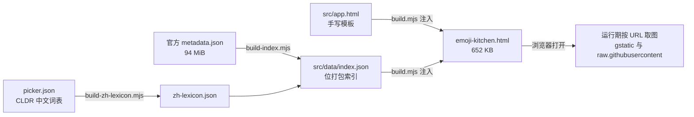

# 表情厨房单文件复刻（emoji-kitchen）

对 **<https://emojikitchen.dev/>** 的行为复刻，交付物是**一个可直接双击打开的 HTML 文件**：[emoji-kitchen.html](./emoji-kitchen.html)。
左栏挑一个表情，中间铺开它在 Google 表情厨房里所有的搭配图；右栏再指定一个，就只看那一张。

> **新人小结**：把 Google 的表情厨房想成一家只有一本菜单的餐厅。菜单（哪个表情和哪个表情能拼成一张新图）原本印在一本 94 MiB 的厚册子里，每次进店都要先搬一遍。这个项目做的事，是在后厨把那本册子**抄成一张扑克牌大小的便签**（619 个表情 × 每人 10 bit 的编号 + 6 bit 的批次号 + 1 bit 的左右顺序），塞进网页自己身上。于是便签随身带、秒开，而真正的菜（组合图）仍然按地址去 Google 的冰柜里取——我们只抄了地址，没有把菜端走。

---

## 1. 功能

| 功能 | 说明 | 与原站的关系 |
| --- | --- | --- |
| 双选择器 + 各自搜索框 | 左栏选主表情，右栏选搭配表情；右栏在未选主表情时禁用并压暗 | 一致 |
| 本地检索（中/拼音/英） | 输入 `咖啡`、`kafei`、`coffee` 都能命中 ☕；支持多词 AND、码点前缀（`1f3`） | **改进**：原站走 `backend.emojikitchen.dev`，该接口无 CORS 头，本地文件里必然请求失败，故改为内嵌词表本地检索 |
| 组合格子视图 | 选中主表情后，中间按 gBoard 顺序铺开其全部搭配（如 😀 有 619 组） | 一致 |
| 单图详情 | 等式 `🚀 ＋  ＝ 组合图`、别名、分类、上线批次 | 一致（信息更完整） |
| 同组多版本切换 | 同一对表情的历史批次可 ‹ › 轮播（实测最多 5 版） | **增强** |
| 下载 PNG | 拉取原图并存为 `英文名-英文名.png` | 一致 |
| 打包下载 ZIP | 把当前表情的全部搭配图打成一个 ZIP（自带 STORE 编码器，无第三方库） | 一致（原站亦有批量下载） |
| 复制图片到剪贴板 | `navigator.clipboard.write(ClipboardItem)` | **增强** |
| 深链 | `#1f600` 单选、`#1f600/2615` 定到单图；粘贴地址即可复现 | **增强**（原站无路由） |
| 深色 / 浅色 | 跟随系统首选项，手动切换后记忆 | **增强** |
| 键盘 | `Esc` 逐级退回，`/` 聚焦搜索 | **增强** |
| 窄屏 | <860px 改为纵向堆叠 | 自适应 |

## 2. 来源与出处

**本项目不是官方仓库的分支，也不包含上游源码。** 页面代码（HTML/CSS/JS）全部为本次新写；上游的贡献是**数据事实**与**交互范式**，逐条列明如下。

| 上游 | 出处 | 本项目如何使用 | 许可 |
| --- | --- | --- | --- |
| Emoji Kitchen 网站与数据集 | 原作者 **xsalazar**（个人主页 <https://xsalazar.com>），源码仓库 <https://github.com/xsalazar/emoji-kitchen>，线上站 <https://emojikitchen.dev/> | 读取其公开的 `https://emojikitchen.dev/metadata.json` 作为**构建期输入**，派生出本仓库的压缩索引；运行期不再访问该站 | 仓库**未标注 SPDX 许可**（GitHub API `license: null`，1664 stars）。使用前请自行核对上游条款 |
| Google 表情厨房组合图 | Google（Android 键盘）出品，由 `www.gstatic.com/android/keyboard/emojikitchen/...` 直接分发 | **仅按 URL 引用**，图片不下载、不转存、不入库；本项目仓库内没有任何组合图副本 | Google 素材，版权归 Google |
| 基表情图（选择器格子） | <https://github.com/googlefonts/noto-emoji> 的 `2D/svg/emoji_uXXXX.svg` | 仅按 URL 引用；取不到时回退到系统字体里的表情字符 | **OFL-1.1**（SIL Open Font License 1.1） |
| 中文 / 拼音检索词表 | Unicode **CLDR** 中文表情派生关键词（本机 `offline-emoji-picker` 预制资产 `picker.json`） | 构建期派生成工程内种子 [src/data/zh-lexicon.json](./src/data/zh-lexicon.json)，只保留本工程用得到的 619 项 | Unicode, Inc.《COPYRIGHT AND PERMISSION NOTICE》（© 2001–2026） |
| 概念科普链接 | <https://www.emojipedia.org/emoji-kitchen/> | 页面页脚"了解更多"指向此处 | — |

**页面内的署名位置**：页脚三个图标依次指向原作者主页、原项目源码、Emojipedia 说明页（与原站同源的三个链接）。

**关于中文名的取舍**（值得单列一条）：CLDR 的中文条目是**关键词列表**，首词并非名称——☕ 的首词是"茶"，而"脸"在 619 项里出现 110 次。因此本项目**不拿中文当显示名**，中文只用于检索与别名展示，表情身份仍用 Unicode 英文短名，避免把 ☕ 标成"茶"这类误导。

## 3. 工程结构

```
emoji-kitchen/
├── emoji-kitchen.html          ← 交付物（构建产物，勿手改）
├── src/
│   ├── app.html                ← 页面模板（唯一手写源文件，610 行）
│   └── data/
│       ├── index.json          ← 生成的压缩索引（620 KB）
│       └── zh-lexicon.json     ← 中文/拼音词表种子（96.7 KB）
└── tools/
    ├── build-zh-lexicon.mjs    ← picker.json → 词表种子（覆盖率不足即非零退出）
    ├── build-index.mjs         ← 官方 metadata.json → 压缩索引
    ├── build.mjs               ← 模板 + 索引 → 单 HTML
    └── verify-urls.mjs         ← 判据：URL 重建规则对全量记录必须零反例
```



数据流是**单向**的：`src/app.html` 与 `src/data/*` 是源，`emoji-kitchen.html` 永远是它们的函数。改页面请改模板再重跑 `build.mjs`，直接改产物会在下次构建被覆盖。

## 4. 索引格式（为什么能压到 620 KB）

官方 `metadata.json` 把每张组合图的完整 URL 逐条写死，共 330,640 条；而 URL 其实是**可推导的**：

```
https://www.gstatic.com/android/keyboard/emojikitchen/{date}/{L}/{L}_{R}.png
```

其中 `{L}`/`{R}` 是码点串，**每一段各自加一个 `u` 前缀**：`263a-fe0f` → `u263a-ufe0f`（不是整段一个 `u`，也不做补零）。这条规则经 `tools/verify-urls.mjs` 对全量 330,640 条比对，**0 条不一致**。

于是每条配对只需存三样东西：

| 字段 | 位宽 | 取值域 | 依据 |
| --- | --- | --- | --- |
| 伙伴表情序号 | 10 bit | 0–618（619 项） | ⌈log₂619⌉ = 10 |
| 批次日期序号 | 6 bit | 0–44（45 个批次） | ⌈log₂45⌉ = 6 |
| 左右顺序 | 1 bit | 0 = 主表情在左，1 = 伙伴在左 | 由 `leftEmojiCodepoint` 判定 |
| 合计 | **17 bit / 条** | 165,621 条 → 351,945 字节 | 实测 base64 后 458.3 KB |

> **新人小结**：这就像把"几栋楼几层几号"写成一句话。原站是把整条地址抄 33 万遍；我们只记"门牌号"，因为街道名是固定的、可以现推。17 bit 是量出来的：要区分 619 个表情就得 10 bit（2¹⁰ = 1024 才装得下 619），日期 45 种要 6 bit（2⁶ = 64），左右谁在前再要 1 bit——加起来 17，一条不差。

另一个关键设计：**配对只存一份**。实测组合关系严格对称（A 与 B 的组合图和 B 与 A 的是同一张 URL，293,585 条有序比对里 0 条反例），所以只在序号较小的一方挂记录，运行期再反向补出邻接表。这直接把记录数从 330,640 砍到 165,621。

## 5. 关键数字

| 指标 | 数值 | 出处 |
| --- | --- | --- |
| 基表情数 | 619 | `build-index.mjs` 输出 |
| 唯一无序配对 | 147,000 | `build-index.mjs` 实跑去重（293,586 条有序记录折半所得；其中 413 项是与自身配对，另有 1 对只在单侧出现，故 2×147,000 − 413 = 293,587 比实测多 1） |
| 含历史版本的记录 | 165,621 | 同上 |
| 上线批次（date）数 | 45 | 同上 |
| 单对表情的版本数 | 最多 5；分布 1 版 260,016 / 2 版 30,326 / 3 版 3,012 / 4 版 224 / 5 版 8 | Node 遍历官方 `metadata.json` 实数 |
| URL 重建规则反例 | 0 / 330,640 | `verify-urls.mjs` 实跑 |
| 中文词表覆盖率 | 619 / 619 | `build-zh-lexicon.mjs` 实跑 |
| 官方 metadata.json | 98,873,872 字节 | `curl -I` 的 `Content-Length` |
| 交付 HTML | 652.0 KB（数据 602.9 + 代码 30.6） | `build.mjs` 输出 |
| 组合图原始尺寸 | 534 × 534 | 浏览器 `naturalWidth/Height` 实测 |

## 6. 重建

需要 **Node 20.11+**（三个构建脚本用了 `import.meta.dirname`；本机实测 v24.21）。浏览器侧需要支持 `ClipboardItem`、`scrollIntoView({block})` 与 `loading="lazy"` 的现代内核。

```bash
node tools/build-zh-lexicon.mjs   # 词表种子（需 picker.json，路径见脚本内三级回退）
node tools/build-index.mjs        # 需官方 metadata.json（默认读 %TEMP%/ek_meta.json）
node tools/verify-urls.mjs        # 判据，非 0 即规则被改坏
node tools/build.mjs              # 产出 emoji-kitchen.html
```

顺序不能反：`build-index.mjs` 会读词表种子，缺失即报错退出；`build.mjs` 会读索引。
想刷新数据：重新下载 <https://emojikitchen.dev/metadata.json> 再跑前三个脚本，索引会随上游增长自动重排位宽（超过 1024 个表情时脚本会主动拒绝，而不是静默截断）。

## 7. 验证台账

**已核（附方法）**

| 事项 | 方法 | 结果 |
| --- | --- | --- |
| URL 重建规则 | 对全量 330,640 条 `gStaticUrl` 逐条比对 | 0 不一致 |
| 组合图可取 | 浏览器内跨全量分布抽样 8 条 `fetch` | 全 200 |
| 索引解码正确 | 😀 的伙伴数与官方数据核对 | 619 = 619 |
| 中文检索 | Node 独立算期望值，浏览器逐条对 | 8/8 词计数相等 |
| 点击不跳位 | 点**当时可见**的格子，比对 `scrollTop` 与节点身份 | 左 600→600、右 900→900，`listRebuilt:false` |
| 远处选中会揭示 | 从中间格子选一个不可见伙伴 | 右栏滚至 6400，格子进入视口 |
| ZIP 合法性 | 产物内 `makeZip` 拿到 Node 跑，再用系统 `tar.exe` 列出并解出 | 条目可读、PNG 字节与原图一致 |
| 批量下载整链路 | 页面点"⬇ 打包下载"（273 张） | 2.6 秒完成，提示"已打包 273 张" |
| 深链 | 设 `#1f600/2615`、`#1f375`、清空 | 单图 / 317 组 / 复位，均正确 |
| 控制台 | 全流程后读 console | 零消息 |

**未验证（附原因）**

| 事项 | 原因 |
| --- | --- |
| 真实指针下的"复制图片" | 自动化环境 `clipboard.write` 被浏览器权限拒绝；代码如实弹失败提示，但成功腿未跑通 |
| 窄屏 <860px 堆叠布局 | 只写了 CSS 与媒体查询，未做小屏截图核对 |
| 单图"下载 PNG"的落盘文件名 | 走了 `fetch`→`Blob`→`<a download>` 通路且未抛错，但保存对话框/落地文件未逐一核对 |
| 上游数据漂移后的表现 | 索引是 2026-10-16 的快照；上游若新增表情超过 1024 项，`build-index.mjs` 会拒绝构建而非静默出错 |

## 8. FAQ

**Q：为什么不直接引用原站的 94 MiB `metadata.json`？**
A：那样首屏要等几十秒且吃内存。它确实带 `Access-Control-Allow-Origin: *`，所以想改回"永远最新"也能做到——把 `src/app.html` 的启动流程换成先 `fetch` 再解码即可，代价是首屏。

**Q：断网能打开吗？**
A：能打开、能搜索、能出全部地址，但**图会空**——组合图和基表情图都是按 URL 现取的（这是刻意的：不转存 Google 素材）。要完全离线得把图也拉下来，那就不再是"一个 HTML"了。

**Q：为什么搜索结果和原站不一样？**
A：原站的搜索是它后端算的（要求输入 ≥3 字符）。本项目在本地按"每个词都要命中"匹配英文名/关键词/中文/拼音/码点，所以 `热饮` 能命中 ☕ 和 🍵，而原站那条接口在本地根本请求不通。

**Q：能改配色或加分类筛选吗？**
A：改 [src/app.html](./src/app.html)（唯一手写源），然后 `node tools/build.mjs`。索引里已经存了每个表情的 `category`，加一栏分类筛选不需要重跑数据脚本。
